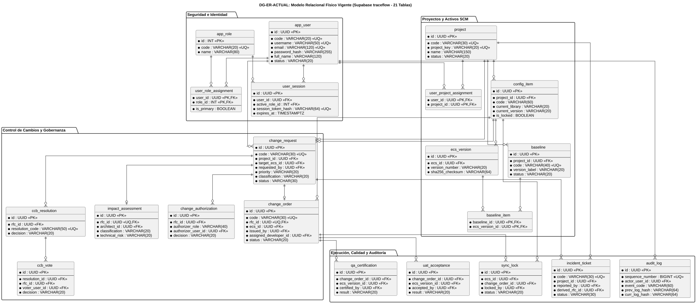
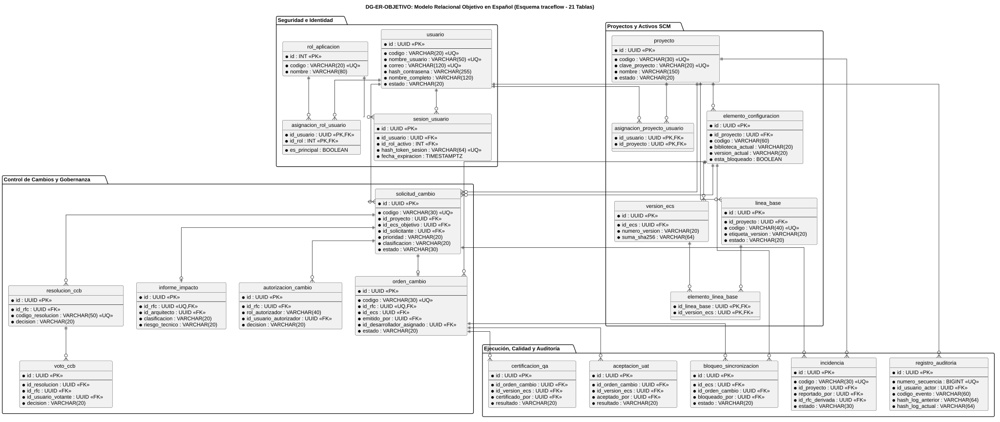

# Diccionario de Datos — Modelo Físico Vigente y Modelo Objetivo en Español (TraceFlow SCM)

> **Proyecto:** TraceFlow SCM — Sistema de Gestión de Configuración de Software y Control de Cambios
> **Organización Cliente:** ÉXODO S.A.C. | **Equipo:** C-SharkTeam
> **Instancia Supabase:** `TraceFlow-UPT` (`xmyfqxlvveiawnxgydtz`, AWS `us-west-2`)
> **Motor Verificado:** `PostgreSQL 17.12` (introspección de solo lectura vía `traceflow_app` sobre `information_schema` y `pg_catalog`)
> **Rama:** `docs/alineacion-srs-sad-2026-11-12` (Commit base `84c832f`)
> **Estado:** Candidato a Aprobación (DOC-02.2 / Revisado en DOC-03) — *El esquema físico en Supabase NO ha sido renombrado*
> **Fecha:** 25 de noviembre de 2026

> [!IMPORTANT]
> **Cobertura de verificación y límites de privilegio (`traceflow_app`):**
> - **Verificado directamente en PostgreSQL 17.12 (`pg_catalog` + `information_schema`):** 21 tablas, 198 columnas, 21 PKs, 51 FKs, 22 UNIQUE, 26 CHECK explícitos (120 restricciones totales), 55 índices, 2 secuencias, 11 funciones `SECURITY DEFINER`, 10 triggers normativos (`pg_trigger`), 46 privilegios de `traceflow_app` y estado RLS (`false` en las 21 tablas).
> - **`[PENDIENTE DE VERIFICACIÓN VÍA MCP]`:** Historial aplicado en `supabase_migrations.schema_migrations` (`permission denied` para `traceflow_app`), roles administrativos externos de Supabase (`postgres`, `anon`, `authenticated`, `service_role`), exposición PostgREST y configuración externa de plataforma.

---

## 1. Introducción y Propósito
Este documento formaliza el modelo de datos de **TraceFlow SCM**, cubriendo las **21 tablas** y **198 columnas** actualmente desplegadas en `traceflow`, junto con su equivalente objetivo en español para la futura etapa `REF-01.5`.

## 2. Alcance del Modelo de Datos
- **Esquema cubierto:** `traceflow` (21 tablas relacionales, 2 secuencias, 11 funciones PL/pgSQL, 10 triggers normativos, 55 índices, 120 restricciones declaradas en `pg_constraint`).
- **Fuera de alcance de renombrado:** Esquemas gestionados por Supabase (`public`, `auth`, `storage`, `supabase_migrations`) y extensiones nativas.

## 3. Convenciones de Nomenclatura
- **Idioma objetivo:** Español sin tildes ni caracteres especiales en `snake_case` singular para tablas (`usuario`, `solicitud_cambio`, `orden_cambio`).
- **Siglas normativas preservadas:** `ecs`, `rfc`, `ccb`, `qa`, `uat`, `sod`, `sha256`.
- **Prefijos de restricciones e índices:** `pk_*`, `fk_*`, `uq_*`, `chk_*`, `idx_*`, `trg_*`.

## 4. Esquema Físico Actual y Conciliación con Inventarios Históricos
- **Esquemas visibles para `traceflow_app`:** `public`, `traceflow`.
- **Migraciones versionadas en repositorio (`supabase/migrations/`):**
  1. `202611250001_initial_traceflow.sql` — 21 tablas, 2 secuencias, FKs, CHECKs e índices iniciales.
  2. `202611250002_structural_seeds.sql` — Catálogo inicial de los 7 roles `PU-01`..`PU-07`.
  3. `202611250003_secure_app_role_least_privilege.sql` — 10 triggers de inmutabilidad/SoD y privilegios mínimos para `traceflow_app`.
- **Conciliación frente a documentos históricos:**
  - `ADR-007` y `FD05` mencionaban conceptualmente `scm_locks` y `DG-D03` omitía `app_user.code`, `change_authorization` y `uat_acceptance`; el esquema físico real consolidado utiliza `sync_lock` e incluye las 21 tablas descritas aquí.
  - El informe histórico `IMPLEMENTACION_BD_SUPABASE.md` (consolidado en `ESTADO_DEL_PROYECTO.md`) citaba 5 tablas de borrador (`implementation_task`, `qa_test_run`, `defect_report`, `uat_session`, `rollback_event`) y "11 secuencias"; la inspección real certifica exactamente **21 tablas** y **2 secuencias**.
  - En `information_schema.table_constraints`, `traceflow_app` solo visualizaba 15 PKs porque posee únicamente `SELECT` en 6 tablas (`app_role`, `project`, `user_role_assignment`, `user_project_assignment`, `baseline`, `baseline_item`); consultando `pg_catalog.pg_constraint` se verifican íntegramente las **21 PKs** y **120 restricciones**.
  - **Estado aplicado en `supabase_migrations.schema_migrations`:** `[PENDIENTE DE VERIFICACIÓN VÍA MCP]`.

## 5. Modelo Relacional Objetivo en Español
Propone la traducción uniforme de las 21 tablas, 198 columnas, 11 funciones, 10 triggers y restricciones propias hacia `snake_case` singular en español, ejecutable mediante migraciones incrementales `ALTER TABLE ... RENAME TO` y `RENAME COLUMN` en `REF-01.5` sin `DROP/CREATE` destructivo ni pérdida de historial.

## 6. Diagramas Entidad–Relación
### 6.1 Modelo Físico Vigente (`DG-ER-ACTUAL`)
Fuente: [`DG-ER-ACTUAL.puml`](assets/diagramas/plantuml/diseno/DG-ER-ACTUAL.puml) | [PNG](assets/diagramas/render/diseno/DG-ER-ACTUAL.png)

### 6.2 Modelo Objetivo en Español (`DG-ER-OBJETIVO`)
Fuente: [`DG-ER-OBJETIVO.puml`](assets/diagramas/plantuml/diseno/DG-ER-OBJETIVO.puml) | [PNG](assets/diagramas/render/diseno/DG-ER-OBJETIVO.png)

### 6.3 Diagrama Lógico de Diseño Preexistente (`DG-D03`)
Complementariamente, el repositorio conserva el modelo lógico conceptual [`DG-D03.puml`](assets/diagramas/plantuml/diseno/DG-D03.puml) ([SVG](assets/diagramas/render/diseno/DG-D03.svg)), cuyas diferencias frente al modelo físico real quedan conciliadas en la Sección 4.

## 7. Catálogo de Tablas (21 Tablas)

| # | Tabla física actual | Tabla objetivo (español) | Columnas | Módulo responsable | Casos de uso | Privilegios `traceflow_app` |
|---:|---|---|---:|---|---|---|
| 01 | `app_role` | `rol_aplicacion` | 4 | MOD-01 Autenticación y RBAC | CU-01 | `SELECT` |
| 02 | `app_user` | `usuario` | 11 | MOD-01 Autenticación y RBAC | CU-01, CU-27 | `INSERT, SELECT, UPDATE` |
| 03 | `audit_log` | `registro_auditoria` | 17 | MOD-07 Auditoría e Integridad | CU-27, ADR-008 | `INSERT, SELECT` |
| 04 | `baseline` | `linea_base` | 8 | MOD-05 Administración SCM | CU-20, RN-02 | `SELECT` |
| 05 | `baseline_item` | `elemento_linea_base` | 3 | MOD-05 Administración SCM | CU-20 | `SELECT` |
| 06 | `ccb_resolution` | `resolucion_ccb` | 10 | MOD-04 Control de Cambios | CU-07 | `INSERT, SELECT` |
| 07 | `ccb_vote` | `voto_ccb` | 7 | MOD-04 Control de Cambios | CU-07, SoD-05 | `INSERT, SELECT` |
| 08 | `change_authorization` | `autorizacion_cambio` | 8 | MOD-04 Control de Cambios | CU-30 | `INSERT, SELECT` |
| 09 | `change_order` | `orden_cambio` | 9 | MOD-04 Control de Cambios | CU-08, CU-10, CU-22 | `INSERT, SELECT, UPDATE` |
| 10 | `change_request` | `solicitud_cambio` | 16 | MOD-04 Control de Cambios | CU-04, CU-04.1, CU-05..CU-08 | `INSERT, SELECT, UPDATE` |
| 11 | `config_item` | `elemento_configuracion` | 14 | MOD-05 Administración SCM | CU-09..CU-14, CU-20, CU-26 | `INSERT, SELECT, UPDATE` |
| 12 | `ecs_version` | `version_ecs` | 11 | MOD-05 Administración SCM | CU-12, CU-13, CU-20, CU-26 | `INSERT, SELECT` |
| 13 | `impact_assessment` | `informe_impacto` | 15 | MOD-04 Control de Cambios | CU-06, RN-05 | `INSERT, SELECT, UPDATE` |
| 14 | `incident_ticket` | `incidencia` | 9 | MOD-08 Incidencias | CU-23, CU-24, CU-25 | `INSERT, SELECT, UPDATE` |
| 15 | `project` | `proyecto` | 14 | MOD-02 Gestión de Proyectos | CU-02, CU-03 | `SELECT` |
| 16 | `qa_certification` | `certificacion_qa` | 7 | MOD-06 Calidad y Pruebas | CU-16..CU-19 | `INSERT, SELECT, UPDATE` |
| 17 | `sync_lock` | `bloqueo_sincronizacion` | 9 | MOD-05 Administración SCM | CU-10, CU-11, CU-12, CU-21, CU-22 | `INSERT, SELECT, UPDATE` |
| 18 | `uat_acceptance` | `aceptacion_uat` | 7 | MOD-06 Calidad y Pruebas | CU-29, RN-09 | `INSERT, SELECT, UPDATE` |
| 19 | `user_project_assignment` | `asignacion_proyecto_usuario` | 4 | MOD-02 Gestión de Proyectos | CU-01, CU-02, CU-03 | `SELECT, INSERT, UPDATE` (H02-R01) |
| 20 | `user_role_assignment` | `asignacion_rol_usuario` | 5 | MOD-01 Autenticación y RBAC | CU-01 | `SELECT` |
| 21 | `user_session` | `sesion_usuario` | 10 | MOD-01 Autenticación y RBAC | CU-01, RNF-01 | `INSERT, SELECT, UPDATE` |

## 8. Diccionario Detallado de Columnas por Tabla (21 Tablas / 198 Columnas)

### 8.1 `app_role` → `rol_aplicacion`
- **Descripción funcional:** Catálogo inmutable de los 7 perfiles funcionales canónicos (PU-01 a PU-07).
- **Módulo responsable:** MOD-01 Autenticación y RBAC | **Casos de uso:** CU-01
- **Clave primaria:** `(id)`
- **Relaciones salientes (FK):** Ninguna (tabla raíz/catálogo)
- **Restricciones relevantes:** PK/FK/UNIQUE estándar

| Campo actual | Campo objetivo | Tipo PostgreSQL | Nulo | PK/FK | Predeterminado | Restricción | Descripción |
|---|---|---|:---:|:---:|---|---|---|
| `id` | `id` | `INTEGER` | NO | PK | `nextval('traceflow.app_role_id_seq'::regclass)` | NOT NULL | Columna de `rol_aplicacion` (`id`) |
| `code` | `codigo` | `VARCHAR(30)` | NO | — | — | UNIQUE | Columna de `rol_aplicacion` (`code`) |
| `name` | `nombre` | `VARCHAR(80)` | NO | — | — | NOT NULL | Columna de `rol_aplicacion` (`name`) |
| `description` | `descripcion` | `TEXT` | NO | — | — | NOT NULL | Columna de `rol_aplicacion` (`description`) |

### 8.2 `app_user` → `usuario`
- **Descripción funcional:** Cuentas institucionales de operadores con credenciales Argon2id.
- **Módulo responsable:** MOD-01 Autenticación y RBAC | **Casos de uso:** CU-01, CU-27
- **Clave primaria:** `(id)`
- **Relaciones salientes (FK):** Ninguna (tabla raíz/catálogo)
- **Restricciones relevantes:** `app_user_status_check`: `CHECK (((status)::text = ANY ((ARRAY['ACTIVE'::character varying, 'INACTIVE'::character varying, 'SUSPENDED'::character varying])::text[])))`

| Campo actual | Campo objetivo | Tipo PostgreSQL | Nulo | PK/FK | Predeterminado | Restricción | Descripción |
|---|---|---|:---:|:---:|---|---|---|
| `id` | `id` | `UUID` | NO | PK | `gen_random_uuid()` | NOT NULL | Columna de `usuario` (`id`) |
| `code` | `codigo` | `VARCHAR(30)` | NO | — | — | UNIQUE | Columna de `usuario` (`code`) |
| `username` | `nombre_usuario` | `VARCHAR(50)` | NO | — | — | UNIQUE | Columna de `usuario` (`username`) |
| `email` | `correo` | `VARCHAR(100)` | NO | — | — | UNIQUE | Columna de `usuario` (`email`) |
| `password_hash` | `hash_contrasena` | `VARCHAR(255)` | NO | — | — | NOT NULL | Columna de `usuario` (`password_hash`) |
| `full_name` | `nombre_completo` | `VARCHAR(120)` | NO | — | — | NOT NULL | Columna de `usuario` (`full_name`) |
| `organization` | `organizacion` | `VARCHAR(120)` | NO | — | `'ÉXODO S.A.C.'::character varying` | NOT NULL | Columna de `usuario` (`organization`) |
| `position` | `cargo` | `VARCHAR(120)` | SÍ | — | — | — | Columna de `usuario` (`position`) |
| `status` | `estado` | `VARCHAR(20)` | NO | — | `'ACTIVE'::character varying` | `CHECK (((status)::text = ANY ((ARRAY['ACTIVE'::character varying, 'INACTIVE'::character varying, 'SUSPENDED'::character varying])::text[])))` | Columna de `usuario` (`status`) |
| `created_at` | `fecha_creacion` | `TIMESTAMPTZ` | NO | — | `now()` | NOT NULL | Columna de `usuario` (`created_at`) |
| `updated_at` | `fecha_actualizacion` | `TIMESTAMPTZ` | NO | — | `now()` | NOT NULL | Columna de `usuario` (`updated_at`) |

### 8.3 `audit_log` → `registro_auditoria`
- **Descripción funcional:** Bitácora append-only encadenada criptográficamente con SHA-256.
- **Módulo responsable:** MOD-07 Auditoría e Integridad | **Casos de uso:** CU-27, ADR-008
- **Clave primaria:** `(id)`
- **Relaciones salientes (FK):** `actor_user_id` → `traceflow.app_user(id) ON DELETE SET NULL`, `project_id` → `traceflow.project(id) ON DELETE SET NULL`, `related_ecn_id` → `traceflow.change_order(id) ON DELETE SET NULL`
- **Restricciones relevantes:** `audit_log_result_status_check`: `CHECK (((result_status)::text = ANY ((ARRAY['SUCCESS'::character varying, 'FAILURE'::character varying, 'REJECTED'::character varying])::text[])))`

| Campo actual | Campo objetivo | Tipo PostgreSQL | Nulo | PK/FK | Predeterminado | Restricción | Descripción |
|---|---|---|:---:|:---:|---|---|---|
| `id` | `id` | `UUID` | NO | PK | `gen_random_uuid()` | NOT NULL | Columna de `registro_auditoria` (`id`) |
| `sequence_number` | `numero_secuencia` | `BIGINT` | NO | — | `nextval('traceflow.audit_log_sequence_number_seq'::regclass)` | UNIQUE | Columna de `registro_auditoria` (`sequence_number`) |
| `event_code` | `codigo_evento` | `VARCHAR(30)` | SÍ | — | — | — | Columna de `registro_auditoria` (`event_code`) |
| `timestamp` | `timestamp` | `TIMESTAMPTZ` | NO | — | `now()` | NOT NULL | Columna de `registro_auditoria` (`timestamp`) |
| `actor_user_id` | `id_usuario_actor` | `UUID` | SÍ | FK | — | FK traceflow.app_user(id) ON DELETE SET NULL | Columna de `registro_auditoria` (`actor_user_id`) |
| `actor_role` | `rol_actor` | `VARCHAR(50)` | NO | — | — | NOT NULL | Columna de `registro_auditoria` (`actor_role`) |
| `operation` | `operacion` | `VARCHAR(60)` | NO | — | — | NOT NULL | Columna de `registro_auditoria` (`operation`) |
| `entity_name` | `nombre_entidad` | `VARCHAR(50)` | NO | — | — | NOT NULL | Columna de `registro_auditoria` (`entity_name`) |
| `entity_id` | `id_entidad` | `VARCHAR(50)` | NO | — | — | NOT NULL | Columna de `registro_auditoria` (`entity_id`) |
| `project_id` | `id_proyecto` | `UUID` | SÍ | FK | — | FK traceflow.project(id) ON DELETE SET NULL | Columna de `registro_auditoria` (`project_id`) |
| `related_ecn_id` | `related_ecn_id` | `UUID` | SÍ | FK | — | FK traceflow.change_order(id) ON DELETE SET NULL | Columna de `registro_auditoria` (`related_ecn_id`) |
| `result_status` | `estado_resultado` | `VARCHAR(20)` | NO | — | — | `CHECK (((result_status)::text = ANY ((ARRAY['SUCCESS'::character varying, 'FAILURE'::character varying, 'REJECTED'::character varying])::text[])))` | Columna de `registro_auditoria` (`result_status`) |
| `payload_diff` | `diferencia_carga` | `JSONB` | NO | — | `'{}'::jsonb` | NOT NULL | Columna de `registro_auditoria` (`payload_diff`) |
| `ip_address` | `direccion_ip` | `VARCHAR(45)` | SÍ | — | — | — | Columna de `registro_auditoria` (`ip_address`) |
| `user_agent` | `agente_usuario` | `TEXT` | SÍ | — | — | — | Columna de `registro_auditoria` (`user_agent`) |
| `prev_log_hash` | `hash_log_anterior` | `VARCHAR(64)` | NO | — | — | NOT NULL | Columna de `registro_auditoria` (`prev_log_hash`) |
| `curr_log_hash` | `hash_log_actual` | `VARCHAR(64)` | NO | — | — | NOT NULL | Columna de `registro_auditoria` (`curr_log_hash`) |

### 8.4 `baseline` → `linea_base`
- **Descripción funcional:** Instantánea congelada en Biblioteca Maestra identificada por versión semántica.
- **Módulo responsable:** MOD-05 Administración SCM | **Casos de uso:** CU-20, RN-02
- **Clave primaria:** `(id)`
- **Relaciones salientes (FK):** `frozen_by` → `traceflow.app_user(id) ON DELETE RESTRICT`, `project_id` → `traceflow.project(id) ON DELETE RESTRICT`
- **Restricciones relevantes:** `baseline_status_check`: `CHECK (((status)::text = ANY ((ARRAY['CONGELADA'::character varying, 'OBSOLETA'::character varying])::text[])))`

| Campo actual | Campo objetivo | Tipo PostgreSQL | Nulo | PK/FK | Predeterminado | Restricción | Descripción |
|---|---|---|:---:|:---:|---|---|---|
| `id` | `id` | `UUID` | NO | PK | `gen_random_uuid()` | NOT NULL | Columna de `linea_base` (`id`) |
| `project_id` | `id_proyecto` | `UUID` | NO | FK | — | FK traceflow.project(id) ON DELETE RESTRICT | Columna de `linea_base` (`project_id`) |
| `code` | `codigo` | `VARCHAR(30)` | NO | — | — | UNIQUE | Columna de `linea_base` (`code`) |
| `name` | `nombre` | `VARCHAR(120)` | NO | — | — | NOT NULL | Columna de `linea_base` (`name`) |
| `version_label` | `etiqueta_version` | `VARCHAR(30)` | NO | — | — | NOT NULL | Columna de `linea_base` (`version_label`) |
| `status` | `estado` | `VARCHAR(20)` | NO | — | `'CONGELADA'::character varying` | `CHECK (((status)::text = ANY ((ARRAY['CONGELADA'::character varying, 'OBSOLETA'::character varying])::text[])))` | Columna de `linea_base` (`status`) |
| `frozen_by` | `congelado_por` | `UUID` | NO | FK | — | FK traceflow.app_user(id) ON DELETE RESTRICT | Columna de `linea_base` (`frozen_by`) |
| `frozen_at` | `fecha_congelamiento` | `TIMESTAMPTZ` | NO | — | `now()` | NOT NULL | Columna de `linea_base` (`frozen_at`) |

### 8.5 `baseline_item` → `elemento_linea_base`
- **Descripción funcional:** Detalle inmutable de las versiones exactas de ECS incluidas en una línea base.
- **Módulo responsable:** MOD-05 Administración SCM | **Casos de uso:** CU-20
- **Clave primaria:** `(baseline_id, ecs_version_id)`
- **Relaciones salientes (FK):** `baseline_id` → `traceflow.baseline(id) ON DELETE CASCADE`, `ecs_version_id` → `traceflow.ecs_version(id) ON DELETE RESTRICT`
- **Restricciones relevantes:** PK/FK/UNIQUE estándar

| Campo actual | Campo objetivo | Tipo PostgreSQL | Nulo | PK/FK | Predeterminado | Restricción | Descripción |
|---|---|---|:---:|:---:|---|---|---|
| `baseline_id` | `id_linea_base` | `UUID` | NO | PK, FK | — | FK traceflow.baseline(id) ON DELETE CASCADE | Columna de `elemento_linea_base` (`baseline_id`) |
| `ecs_version_id` | `id_version_ecs` | `UUID` | NO | PK, FK | — | FK traceflow.ecs_version(id) ON DELETE RESTRICT | Columna de `elemento_linea_base` (`ecs_version_id`) |
| `added_at` | `added_at` | `TIMESTAMPTZ` | NO | — | `now()` | NOT NULL | Columna de `elemento_linea_base` (`added_at`) |

### 8.6 `ccb_resolution` → `resolucion_ccb`
- **Descripción funcional:** Acta y escrutinio colegiado de deliberación del Comité de Control de Cambios (CCB).
- **Módulo responsable:** MOD-04 Control de Cambios | **Casos de uso:** CU-07
- **Clave primaria:** `(id)`
- **Relaciones salientes (FK):** `resolved_by` → `traceflow.app_user(id) ON DELETE SET NULL`, `rfc_id` → `traceflow.change_request(id) ON DELETE RESTRICT`
- **Restricciones relevantes:** `ccb_resolution_decision_check`: `CHECK (((decision)::text = ANY ((ARRAY['AUTORIZADA'::character varying, 'RECHAZADA'::character varying, 'EN_DELIBERACION'::character varying])::text[])))`

| Campo actual | Campo objetivo | Tipo PostgreSQL | Nulo | PK/FK | Predeterminado | Restricción | Descripción |
|---|---|---|:---:|:---:|---|---|---|
| `id` | `id` | `UUID` | NO | PK | `gen_random_uuid()` | NOT NULL | Columna de `resolucion_ccb` (`id`) |
| `rfc_id` | `id_rfc` | `UUID` | NO | FK | — | FK traceflow.change_request(id) ON DELETE RESTRICT | Columna de `resolucion_ccb` (`rfc_id`) |
| `resolution_code` | `codigo_resolucion` | `VARCHAR(50)` | NO | — | — | UNIQUE | Columna de `resolucion_ccb` (`resolution_code`) |
| `decision` | `decision` | `VARCHAR(20)` | NO | — | — | `CHECK (((decision)::text = ANY ((ARRAY['AUTORIZADA'::character varying, 'RECHAZADA'::character varying, 'EN_DELIBERACION'::character varying])::text[])))` | Columna de `resolucion_ccb` (`decision`) |
| `votes_in_favor` | `votos_a_favor` | `INTEGER` | NO | — | `0` | NOT NULL | Columna de `resolucion_ccb` (`votes_in_favor`) |
| `votes_against` | `votos_en_contra` | `INTEGER` | NO | — | `0` | NOT NULL | Columna de `resolucion_ccb` (`votes_against`) |
| `votes_abstention` | `votos_abstencion` | `INTEGER` | NO | — | `0` | NOT NULL | Columna de `resolucion_ccb` (`votes_abstention`) |
| `observations` | `observaciones` | `TEXT` | SÍ | — | — | — | Columna de `resolucion_ccb` (`observations`) |
| `resolved_by` | `resuelto_por` | `UUID` | SÍ | FK | — | FK traceflow.app_user(id) ON DELETE SET NULL | Columna de `resolucion_ccb` (`resolved_by`) |
| `resolved_at` | `fecha_resolucion` | `TIMESTAMPTZ` | SÍ | — | — | — | Columna de `resolucion_ccb` (`resolved_at`) |

### 8.7 `ccb_vote` → `voto_ccb`
- **Descripción funcional:** Voto individual, único e irrevocable de cada miembro del CCB por solicitud.
- **Módulo responsable:** MOD-04 Control de Cambios | **Casos de uso:** CU-07, SoD-05
- **Clave primaria:** `(id)`
- **Relaciones salientes (FK):** `resolution_id` → `traceflow.ccb_resolution(id) ON DELETE CASCADE`, `rfc_id` → `traceflow.change_request(id) ON DELETE CASCADE`, `voter_user_id` → `traceflow.app_user(id) ON DELETE RESTRICT`
- **Restricciones relevantes:** `ccb_vote_decision_check`: `CHECK (((decision)::text = ANY ((ARRAY['APROBAR'::character varying, 'RECHAZAR'::character varying, 'ABSTENERSE'::character varying])::text[])))`; `uq_ccb_vote_per_member`: `UNIQUE (rfc_id, voter_user_id)`

| Campo actual | Campo objetivo | Tipo PostgreSQL | Nulo | PK/FK | Predeterminado | Restricción | Descripción |
|---|---|---|:---:|:---:|---|---|---|
| `id` | `id` | `UUID` | NO | PK | `gen_random_uuid()` | NOT NULL | Columna de `voto_ccb` (`id`) |
| `resolution_id` | `id_resolucion` | `UUID` | NO | FK | — | FK traceflow.ccb_resolution(id) ON DELETE CASCADE | Columna de `voto_ccb` (`resolution_id`) |
| `rfc_id` | `id_rfc` | `UUID` | NO | FK | — | FK traceflow.change_request(id) ON DELETE CASCADE | Columna de `voto_ccb` (`rfc_id`) |
| `voter_user_id` | `id_usuario_votante` | `UUID` | NO | FK | — | FK traceflow.app_user(id) ON DELETE RESTRICT | Columna de `voto_ccb` (`voter_user_id`) |
| `decision` | `decision` | `VARCHAR(20)` | NO | — | — | `CHECK (((decision)::text = ANY ((ARRAY['APROBAR'::character varying, 'RECHAZAR'::character varying, 'ABSTENERSE'::character varying])::text[])))` | Columna de `voto_ccb` (`decision`) |
| `justification` | `justificacion` | `TEXT` | NO | — | — | NOT NULL | Columna de `voto_ccb` (`justification`) |
| `voted_at` | `fecha_votacion` | `TIMESTAMPTZ` | NO | — | `now()` | NOT NULL | Columna de `voto_ccb` (`voted_at`) |

### 8.8 `change_authorization` → `autorizacion_cambio`
- **Descripción funcional:** Registro de autorizaciones de cambio (actualmente Doble Llave Operativa PU-02 + PU-03 para Cambios Menores).
- **Módulo responsable:** MOD-04 Control de Cambios | **Casos de uso:** CU-30
- **Clave primaria:** `(id)`
- **Relaciones salientes (FK):** `authorizer_user_id` → `traceflow.app_user(id) ON DELETE RESTRICT`, `rfc_id` → `traceflow.change_request(id) ON DELETE CASCADE`
- **Restricciones relevantes:** `change_authorization_authorizer_role_check`: `CHECK (((authorizer_role)::text = ANY ((ARRAY['GESTOR'::character varying, 'ARQUITECTO'::character varying])::text[])))`; `change_authorization_authorizer_role_id_check`: `CHECK (((authorizer_role_id)::text = ANY ((ARRAY['PU-02'::character varying, 'PU-03'::character varying])::text[])))`; `change_authorization_decision_check`: `CHECK (((decision)::text = ANY ((ARRAY['APROBADO'::character varying, 'RECHAZADO'::character varying, 'REESCALADO_CCB'::character varying])::text[])))`; `uq_rfc_authorizer_role`: `UNIQUE (rfc_id, authorizer_role)`

| Campo actual | Campo objetivo | Tipo PostgreSQL | Nulo | PK/FK | Predeterminado | Restricción | Descripción |
|---|---|---|:---:|:---:|---|---|---|
| `id` | `id` | `UUID` | NO | PK | `gen_random_uuid()` | NOT NULL | Columna de `autorizacion_cambio` (`id`) |
| `rfc_id` | `id_rfc` | `UUID` | NO | FK | — | FK traceflow.change_request(id) ON DELETE CASCADE | Columna de `autorizacion_cambio` (`rfc_id`) |
| `authorizer_role` | `rol_autorizador` | `VARCHAR(40)` | NO | — | — | `CHECK (((authorizer_role)::text = ANY ((ARRAY['GESTOR'::character varying, 'ARQUITECTO'::character varying])::text[])))` | Columna de `autorizacion_cambio` (`authorizer_role`) |
| `authorizer_role_id` | `id_rol_autorizador` | `VARCHAR(10)` | NO | — | — | `CHECK (((authorizer_role_id)::text = ANY ((ARRAY['PU-02'::character varying, 'PU-03'::character varying])::text[])))` | Columna de `autorizacion_cambio` (`authorizer_role_id`) |
| `authorizer_user_id` | `id_usuario_autorizador` | `UUID` | NO | FK | — | FK traceflow.app_user(id) ON DELETE RESTRICT | Columna de `autorizacion_cambio` (`authorizer_user_id`) |
| `decision` | `decision` | `VARCHAR(20)` | NO | — | — | `CHECK (((decision)::text = ANY ((ARRAY['APROBADO'::character varying, 'RECHAZADO'::character varying, 'REESCALADO_CCB'::character varying])::text[])))` | Columna de `autorizacion_cambio` (`decision`) |
| `justification` | `justificacion` | `TEXT` | NO | — | — | NOT NULL | Columna de `autorizacion_cambio` (`justification`) |
| `authorized_at` | `fecha_autorizacion` | `TIMESTAMPTZ` | NO | — | `now()` | NOT NULL | Columna de `autorizacion_cambio` (`authorized_at`) |

### 8.9 `change_order` → `orden_cambio`
- **Descripción funcional:** Orden de Cambio formal (ECN/ECO) que asigna implementación al Desarrollador (PU-06).
- **Módulo responsable:** MOD-04 Control de Cambios | **Casos de uso:** CU-08, CU-10, CU-22
- **Clave primaria:** `(id)`
- **Relaciones salientes (FK):** `assigned_developer_id` → `traceflow.app_user(id) ON DELETE RESTRICT`, `ecs_id` → `traceflow.config_item(id) ON DELETE RESTRICT`, `issued_by` → `traceflow.app_user(id) ON DELETE RESTRICT`, `rfc_id` → `traceflow.change_request(id) ON DELETE RESTRICT`
- **Restricciones relevantes:** `change_order_status_check`: `CHECK (((status)::text = ANY ((ARRAY['EMITIDA'::character varying, 'EN_EJECUCION'::character varying, 'CERRADA'::character varying, 'CANCELADA'::character varying])::text[])))`

| Campo actual | Campo objetivo | Tipo PostgreSQL | Nulo | PK/FK | Predeterminado | Restricción | Descripción |
|---|---|---|:---:|:---:|---|---|---|
| `id` | `id` | `UUID` | NO | PK | `gen_random_uuid()` | NOT NULL | Columna de `orden_cambio` (`id`) |
| `code` | `codigo` | `VARCHAR(30)` | NO | — | — | UNIQUE | Columna de `orden_cambio` (`code`) |
| `rfc_id` | `id_rfc` | `UUID` | NO | FK | — | UNIQUE; FK traceflow.change_request(id) ON DELETE RESTRICT | Columna de `orden_cambio` (`rfc_id`) |
| `ecs_id` | `id_ecs` | `UUID` | NO | FK | — | FK traceflow.config_item(id) ON DELETE RESTRICT | Columna de `orden_cambio` (`ecs_id`) |
| `status` | `estado` | `VARCHAR(20)` | NO | — | `'EMITIDA'::character varying` | `CHECK (((status)::text = ANY ((ARRAY['EMITIDA'::character varying, 'EN_EJECUCION'::character varying, 'CERRADA'::character varying, 'CANCELADA'::character varying])::text[])))` | Columna de `orden_cambio` (`status`) |
| `issued_by` | `emitido_por` | `UUID` | NO | FK | — | FK traceflow.app_user(id) ON DELETE RESTRICT | Columna de `orden_cambio` (`issued_by`) |
| `assigned_developer_id` | `id_desarrollador_asignado` | `UUID` | NO | FK | — | FK traceflow.app_user(id) ON DELETE RESTRICT | Columna de `orden_cambio` (`assigned_developer_id`) |
| `issued_at` | `fecha_emision` | `TIMESTAMPTZ` | NO | — | `now()` | NOT NULL | Columna de `orden_cambio` (`issued_at`) |
| `closed_at` | `fecha_cierre` | `TIMESTAMPTZ` | SÍ | — | — | — | Columna de `orden_cambio` (`closed_at`) |

### 8.10 `change_request` → `solicitud_cambio`
- **Descripción funcional:** Expediente central de Solicitud de Cambio (RFC) en 14 estados oficiales TB-07.
- **Módulo responsable:** MOD-04 Control de Cambios | **Casos de uso:** CU-04, CU-04.1, CU-05..CU-08
- **Clave primaria:** `(id)`
- **Relaciones salientes (FK):** `project_id` → `traceflow.config_item(id, project_id) ON DELETE RESTRICT`, `project_id` → `traceflow.project(id) ON DELETE RESTRICT`, `requested_by` → `traceflow.app_user(id) ON DELETE RESTRICT`, `target_ecs_id` → `traceflow.config_item(id, project_id) ON DELETE RESTRICT`
- **Restricciones relevantes:** `change_request_classification_check`: `CHECK (((classification)::text = ANY ((ARRAY['CAMBIO_MENOR'::character varying, 'CAMBIO_MAYOR'::character varying, 'PENDIENTE'::character varying])::text[])))`; `change_request_priority_check`: `CHECK (((priority)::text = ANY ((ARRAY['BAJA'::character varying, 'MEDIA'::character varying, 'ALTA'::character varying, 'CRITICA'::character varying])::text[])))`; `change_request_status_check`: `CHECK (((status)::text = ANY ((ARRAY['REGISTRADA'::character varying, 'EN_SUBSANACION'::character varying, 'CLASIFICADA'::character varying, 'EN_ANALISIS_TECNICO'::character varying, 'EN_EVALUACION'::character varying, 'AUTORIZADA'::character varying, 'ORDEN_EMITIDA'::character varying, 'EN_IMPLEMENTACION'::character varying, 'EN_PRUEBAS'::character varying, 'EN_ACEPTACION'::character varying, 'DESESTIMADA'::character varying, 'RECHAZADA'::character varying, 'CANCELADA'::character varying, 'IMPLEMENTADA'::character varying])::text[])))`; `uq_rfc_id_project`: `UNIQUE (id, project_id)`

| Campo actual | Campo objetivo | Tipo PostgreSQL | Nulo | PK/FK | Predeterminado | Restricción | Descripción |
|---|---|---|:---:|:---:|---|---|---|
| `id` | `id` | `UUID` | NO | PK | `gen_random_uuid()` | NOT NULL | Columna de `solicitud_cambio` (`id`) |
| `code` | `codigo` | `VARCHAR(30)` | NO | — | — | UNIQUE | Columna de `solicitud_cambio` (`code`) |
| `project_id` | `id_proyecto` | `UUID` | NO | FK | — | FK traceflow.project(id) ON DELETE RESTRICT; traceflow.config_item(id, project_id) ON DELETE RESTRICT | Columna de `solicitud_cambio` (`project_id`) |
| `target_ecs_id` | `id_ecs_objetivo` | `UUID` | NO | FK | — | FK traceflow.config_item(id, project_id) ON DELETE RESTRICT | Columna de `solicitud_cambio` (`target_ecs_id`) |
| `title` | `titulo` | `VARCHAR(200)` | NO | — | — | NOT NULL | Columna de `solicitud_cambio` (`title`) |
| `description` | `descripcion` | `TEXT` | NO | — | — | NOT NULL | Columna de `solicitud_cambio` (`description`) |
| `justification` | `justificacion` | `TEXT` | NO | — | — | NOT NULL | Columna de `solicitud_cambio` (`justification`) |
| `priority` | `prioridad` | `VARCHAR(20)` | NO | — | — | `CHECK (((priority)::text = ANY ((ARRAY['BAJA'::character varying, 'MEDIA'::character varying, 'ALTA'::character varying, 'CRITICA'::character varying])::text[])))` | Columna de `solicitud_cambio` (`priority`) |
| `classification` | `clasificacion` | `VARCHAR(20)` | SÍ | — | `'PENDIENTE'::character varying` | `CHECK (((classification)::text = ANY ((ARRAY['CAMBIO_MENOR'::character varying, 'CAMBIO_MAYOR'::character varying, 'PENDIENTE'::character varying])::text[])))` | Columna de `solicitud_cambio` (`classification`) |
| `status` | `estado` | `VARCHAR(30)` | NO | — | `'REGISTRADA'::character varying` | `CHECK (((status)::text = ANY ((ARRAY['REGISTRADA'::character varying, 'EN_SUBSANACION'::character varying, 'CLASIFICADA'::character varying, 'EN_ANALISIS_TECNICO'::character varying, 'EN_EVALUACION'::character varying, 'AUTORIZADA'::character varying, 'ORDEN_EMITIDA'::character varying, 'EN_IMPLEMENTACION'::character varying, 'EN_PRUEBAS'::character varying, 'EN_ACEPTACION'::character varying, 'DESESTIMADA'::character varying, 'RECHAZADA'::character varying, 'CANCELADA'::character varying, 'IMPLEMENTADA'::character varying])::text[])))` | Columna de `solicitud_cambio` (`status`) |
| `requested_by` | `id_solicitante` | `UUID` | NO | FK | — | FK traceflow.app_user(id) ON DELETE RESTRICT | Columna de `solicitud_cambio` (`requested_by`) |
| `observations` | `observaciones` | `TEXT` | SÍ | — | — | — | Columna de `solicitud_cambio` (`observations`) |
| `rejection_reason` | `motivo_rechazo` | `TEXT` | SÍ | — | — | — | Columna de `solicitud_cambio` (`rejection_reason`) |
| `created_at` | `fecha_creacion` | `TIMESTAMPTZ` | NO | — | `now()` | NOT NULL | Columna de `solicitud_cambio` (`created_at`) |
| `updated_at` | `fecha_actualizacion` | `TIMESTAMPTZ` | NO | — | `now()` | NOT NULL | Columna de `solicitud_cambio` (`updated_at`) |
| `closed_at` | `fecha_cierre` | `TIMESTAMPTZ` | SÍ | — | — | — | Columna de `solicitud_cambio` (`closed_at`) |

### 8.11 `config_item` → `elemento_configuracion`
- **Descripción funcional:** Inventario de Elementos de Configuración de Software (ECS) y su biblioteca actual.
- **Módulo responsable:** MOD-05 Administración SCM | **Casos de uso:** CU-09..CU-14, CU-20, CU-26
- **Clave primaria:** `(id)`
- **Relaciones salientes (FK):** `author_id` → `traceflow.app_user(id) ON DELETE SET NULL`, `project_id` → `traceflow.project(id) ON DELETE RESTRICT`
- **Restricciones relevantes:** `config_item_current_library_check`: `CHECK (((current_library)::text = ANY ((ARRAY['TRABAJO'::character varying, 'SOPORTE'::character varying, 'MAESTRA'::character varying])::text[])))`; `config_item_item_type_check`: `CHECK (((item_type)::text = ANY ((ARRAY['CODIGO_FUENTE'::character varying, 'DOCUMENTO_TECNICO'::character varying, 'ESQUEMA_BD'::character varying, 'SCRIPT_DESPLIEGUE'::character varying, 'SOURCE_CODE'::character varying, 'DOCUMENT'::character varying, 'DB_SCHEMA'::character varying, 'BUILD_SCRIPT'::character varying])::text[])))`; `uq_ecs_id_project`: `UNIQUE (id, project_id)`; `uq_project_ecs_code`: `UNIQUE (project_id, code)`

| Campo actual | Campo objetivo | Tipo PostgreSQL | Nulo | PK/FK | Predeterminado | Restricción | Descripción |
|---|---|---|:---:|:---:|---|---|---|
| `id` | `id` | `UUID` | NO | PK | `gen_random_uuid()` | NOT NULL | Columna de `elemento_configuracion` (`id`) |
| `project_id` | `id_proyecto` | `UUID` | NO | FK | — | FK traceflow.project(id) ON DELETE RESTRICT | Columna de `elemento_configuracion` (`project_id`) |
| `code` | `codigo` | `VARCHAR(50)` | NO | — | — | NOT NULL | Columna de `elemento_configuracion` (`code`) |
| `name` | `nombre` | `VARCHAR(120)` | NO | — | — | NOT NULL | Columna de `elemento_configuracion` (`name`) |
| `description` | `descripcion` | `TEXT` | SÍ | — | — | — | Columna de `elemento_configuracion` (`description`) |
| `item_type` | `tipo_elemento` | `VARCHAR(30)` | NO | — | — | `CHECK (((item_type)::text = ANY ((ARRAY['CODIGO_FUENTE'::character varying, 'DOCUMENTO_TECNICO'::character varying, 'ESQUEMA_BD'::character varying, 'SCRIPT_DESPLIEGUE'::character varying, 'SOURCE_CODE'::character varying, 'DOCUMENT'::character varying, 'DB_SCHEMA'::character varying, 'BUILD_SCRIPT'::character varying])::text[])))` | Columna de `elemento_configuracion` (`item_type`) |
| `current_library` | `biblioteca_actual` | `VARCHAR(20)` | NO | — | `'TRABAJO'::character varying` | `CHECK (((current_library)::text = ANY ((ARRAY['TRABAJO'::character varying, 'SOPORTE'::character varying, 'MAESTRA'::character varying])::text[])))` | Columna de `elemento_configuracion` (`current_library`) |
| `current_version` | `version_actual` | `VARCHAR(20)` | NO | — | `'1.0.0'::character varying` | NOT NULL | Columna de `elemento_configuracion` (`current_version`) |
| `file_path` | `ruta_archivo` | `VARCHAR(255)` | NO | — | — | NOT NULL | Columna de `elemento_configuracion` (`file_path`) |
| `sha256_checksum` | `suma_sha256` | `VARCHAR(64)` | NO | — | — | NOT NULL | Columna de `elemento_configuracion` (`sha256_checksum`) |
| `is_locked` | `esta_bloqueado` | `BOOLEAN` | NO | — | `false` | NOT NULL | Columna de `elemento_configuracion` (`is_locked`) |
| `author_id` | `author_id` | `UUID` | SÍ | FK | — | FK traceflow.app_user(id) ON DELETE SET NULL | Columna de `elemento_configuracion` (`author_id`) |
| `created_at` | `fecha_creacion` | `TIMESTAMPTZ` | NO | — | `now()` | NOT NULL | Columna de `elemento_configuracion` (`created_at`) |
| `updated_at` | `fecha_actualizacion` | `TIMESTAMPTZ` | NO | — | `now()` | NOT NULL | Columna de `elemento_configuracion` (`updated_at`) |

### 8.12 `ecs_version` → `version_ecs`
- **Descripción funcional:** Historial inmutable de versiones de cada ECS con suma SHA-256 (RNF-03, RN-02).
- **Módulo responsable:** MOD-05 Administración SCM | **Casos de uso:** CU-12, CU-13, CU-20, CU-26
- **Clave primaria:** `(id)`
- **Relaciones salientes (FK):** `check_in_by` → `traceflow.app_user(id) ON DELETE RESTRICT`, `ecs_id` → `traceflow.config_item(id) ON DELETE RESTRICT`
- **Restricciones relevantes:** `ecs_version_storage_status_check`: `CHECK (((storage_status)::text = ANY ((ARRAY['PENDING_STORAGE'::character varying, 'COMMITTED'::character varying, 'STORAGE_FAILED'::character varying])::text[])))`; `uq_ecs_version`: `UNIQUE (ecs_id, version_number)`

| Campo actual | Campo objetivo | Tipo PostgreSQL | Nulo | PK/FK | Predeterminado | Restricción | Descripción |
|---|---|---|:---:|:---:|---|---|---|
| `id` | `id` | `UUID` | NO | PK | `gen_random_uuid()` | NOT NULL | Columna de `version_ecs` (`id`) |
| `ecs_id` | `id_ecs` | `UUID` | NO | FK | — | FK traceflow.config_item(id) ON DELETE RESTRICT | Columna de `version_ecs` (`ecs_id`) |
| `version_number` | `numero_version` | `VARCHAR(20)` | NO | — | — | NOT NULL | Columna de `version_ecs` (`version_number`) |
| `sha256_checksum` | `suma_sha256` | `VARCHAR(64)` | NO | — | — | NOT NULL | Columna de `version_ecs` (`sha256_checksum`) |
| `storage_path` | `storage_path` | `VARCHAR(255)` | NO | — | — | NOT NULL | Columna de `version_ecs` (`storage_path`) |
| `storage_status` | `storage_status` | `VARCHAR(20)` | NO | — | `'COMMITTED'::character varying` | `CHECK (((storage_status)::text = ANY ((ARRAY['PENDING_STORAGE'::character varying, 'COMMITTED'::character varying, 'STORAGE_FAILED'::character varying])::text[])))` | Columna de `version_ecs` (`storage_status`) |
| `file_size_bytes` | `tamano_bytes` | `BIGINT` | NO | — | `0` | NOT NULL | Columna de `version_ecs` (`file_size_bytes`) |
| `check_in_by` | `check_in_by` | `UUID` | NO | FK | — | FK traceflow.app_user(id) ON DELETE RESTRICT | Columna de `version_ecs` (`check_in_by`) |
| `change_order_id` | `id_orden_cambio` | `UUID` | SÍ | — | — | — | Columna de `version_ecs` (`change_order_id`) |
| `commit_message` | `commit_message` | `TEXT` | NO | — | — | NOT NULL | Columna de `version_ecs` (`commit_message`) |
| `created_at` | `fecha_creacion` | `TIMESTAMPTZ` | NO | — | `now()` | NOT NULL | Columna de `version_ecs` (`created_at`) |

### 8.13 `impact_assessment` → `informe_impacto`
- **Descripción funcional:** Dictamen técnico de impacto sobre la Triple Restricción elaborado por el Arquitecto (PU-03).
- **Módulo responsable:** MOD-04 Control de Cambios | **Casos de uso:** CU-06, RN-05
- **Clave primaria:** `(id)`
- **Relaciones salientes (FK):** `architect_id` → `traceflow.app_user(id) ON DELETE RESTRICT`, `rfc_id` → `traceflow.change_request(id) ON DELETE CASCADE`
- **Restricciones relevantes:** `impact_assessment_classification_check`: `CHECK (((classification)::text = ANY ((ARRAY['CAMBIO_MENOR'::character varying, 'CAMBIO_MAYOR'::character varying])::text[])))`; `impact_assessment_effort_hours_check`: `CHECK ((effort_hours >= 0))`; `impact_assessment_estimated_cost_check`: `CHECK ((estimated_cost >= (0)::numeric))`; `impact_assessment_estimated_days_check`: `CHECK ((estimated_days >= 0))`; `impact_assessment_technical_risk_check`: `CHECK (((technical_risk)::text = ANY ((ARRAY['BAJO'::character varying, 'MEDIO'::character varying, 'ALTO'::character varying])::text[])))`

| Campo actual | Campo objetivo | Tipo PostgreSQL | Nulo | PK/FK | Predeterminado | Restricción | Descripción |
|---|---|---|:---:|:---:|---|---|---|
| `id` | `id` | `UUID` | NO | PK | `gen_random_uuid()` | NOT NULL | Columna de `informe_impacto` (`id`) |
| `rfc_id` | `id_rfc` | `UUID` | NO | FK | — | UNIQUE; FK traceflow.change_request(id) ON DELETE CASCADE | Columna de `informe_impacto` (`rfc_id`) |
| `architect_id` | `id_arquitecto` | `UUID` | NO | FK | — | FK traceflow.app_user(id) ON DELETE RESTRICT | Columna de `informe_impacto` (`architect_id`) |
| `classification` | `clasificacion` | `VARCHAR(20)` | NO | — | — | `CHECK (((classification)::text = ANY ((ARRAY['CAMBIO_MENOR'::character varying, 'CAMBIO_MAYOR'::character varying])::text[])))` | Columna de `informe_impacto` (`classification`) |
| `architecture_impact` | `impacto_arquitectura` | `TEXT` | NO | — | — | NOT NULL | Columna de `informe_impacto` (`architecture_impact`) |
| `dependencies_impact` | `impacto_dependencias` | `TEXT` | SÍ | — | — | — | Columna de `informe_impacto` (`dependencies_impact`) |
| `affected_ecs_ids` | `ids_ecs_afectados` | `JSONB` | NO | — | `'[]'::jsonb` | NOT NULL | Columna de `informe_impacto` (`affected_ecs_ids`) |
| `effort_hours` | `horas_esfuerzo` | `INTEGER` | NO | — | — | `CHECK ((effort_hours >= 0))` | Columna de `informe_impacto` (`effort_hours`) |
| `estimated_cost` | `costo_estimado` | `NUMERIC(10,2)` | NO | — | — | `CHECK ((estimated_cost >= (0)::numeric))` | Columna de `informe_impacto` (`estimated_cost`) |
| `estimated_days` | `dias_estimados` | `INTEGER` | NO | — | — | `CHECK ((estimated_days >= 0))` | Columna de `informe_impacto` (`estimated_days`) |
| `technical_risk` | `riesgo_tecnico` | `VARCHAR(20)` | NO | — | — | `CHECK (((technical_risk)::text = ANY ((ARRAY['BAJO'::character varying, 'MEDIO'::character varying, 'ALTO'::character varying])::text[])))` | Columna de `informe_impacto` (`technical_risk`) |
| `scope_affected` | `alcance_afectado` | `BOOLEAN` | NO | — | `false` | NOT NULL | Columna de `informe_impacto` (`scope_affected`) |
| `schedule_affected` | `cronograma_afectado` | `BOOLEAN` | NO | — | `false` | NOT NULL | Columna de `informe_impacto` (`schedule_affected`) |
| `cost_affected` | `costo_afectado` | `BOOLEAN` | NO | — | `false` | NOT NULL | Columna de `informe_impacto` (`cost_affected`) |
| `assessed_at` | `fecha_evaluacion` | `TIMESTAMPTZ` | NO | — | `now()` | NOT NULL | Columna de `informe_impacto` (`assessed_at`) |

### 8.14 `incident_ticket` → `incidencia`
- **Descripción funcional:** Tickets operativos de incidencias derivables a Solicitudes de Cambio (RFC).
- **Módulo responsable:** MOD-08 Incidencias | **Casos de uso:** CU-23, CU-24, CU-25
- **Clave primaria:** `(id)`
- **Relaciones salientes (FK):** `derived_rfc_id` → `traceflow.change_request(id) ON DELETE SET NULL`, `project_id` → `traceflow.project(id) ON DELETE RESTRICT`, `reported_by` → `traceflow.app_user(id) ON DELETE RESTRICT`
- **Restricciones relevantes:** `incident_ticket_status_check`: `CHECK (((status)::text = ANY ((ARRAY['REGISTRADO'::character varying, 'DERIVADO'::character varying, 'ATENDIDO'::character varying, 'CERRADO'::character varying])::text[])))`

| Campo actual | Campo objetivo | Tipo PostgreSQL | Nulo | PK/FK | Predeterminado | Restricción | Descripción |
|---|---|---|:---:|:---:|---|---|---|
| `id` | `id` | `UUID` | NO | PK | `gen_random_uuid()` | NOT NULL | Columna de `incidencia` (`id`) |
| `project_id` | `id_proyecto` | `UUID` | NO | FK | — | FK traceflow.project(id) ON DELETE RESTRICT | Columna de `incidencia` (`project_id`) |
| `code` | `codigo` | `VARCHAR(30)` | NO | — | — | UNIQUE | Columna de `incidencia` (`code`) |
| `title` | `titulo` | `VARCHAR(150)` | NO | — | — | NOT NULL | Columna de `incidencia` (`title`) |
| `description` | `descripcion` | `TEXT` | NO | — | — | NOT NULL | Columna de `incidencia` (`description`) |
| `reported_by` | `reportado_por` | `UUID` | NO | FK | — | FK traceflow.app_user(id) ON DELETE RESTRICT | Columna de `incidencia` (`reported_by`) |
| `status` | `estado` | `VARCHAR(20)` | NO | — | `'REGISTRADO'::character varying` | `CHECK (((status)::text = ANY ((ARRAY['REGISTRADO'::character varying, 'DERIVADO'::character varying, 'ATENDIDO'::character varying, 'CERRADO'::character varying])::text[])))` | Columna de `incidencia` (`status`) |
| `derived_rfc_id` | `id_rfc_derivada` | `UUID` | SÍ | FK | — | FK traceflow.change_request(id) ON DELETE SET NULL | Columna de `incidencia` (`derived_rfc_id`) |
| `created_at` | `fecha_creacion` | `TIMESTAMPTZ` | NO | — | `now()` | NOT NULL | Columna de `incidencia` (`created_at`) |

### 8.15 `project` → `proyecto`
- **Descripción funcional:** Catálogo de proyectos clientes con clave de proyecto, estado y versión de línea base activa.
- **Módulo responsable:** MOD-02 Gestión de Proyectos | **Casos de uso:** CU-02, CU-03
- **Clave primaria:** `(id)`
- **Relaciones salientes (FK):** `architect_id` → `traceflow.app_user(id) ON DELETE RESTRICT`, `created_by` → `traceflow.app_user(id) ON DELETE RESTRICT`, `librarian_id` → `traceflow.app_user(id) ON DELETE RESTRICT`, `manager_id` → `traceflow.app_user(id) ON DELETE RESTRICT`
- **Restricciones relevantes:** `project_status_check`: `CHECK (((status)::text = ANY ((ARRAY['ACTIVE'::character varying, 'CLOSED'::character varying, 'ARCHIVED'::character varying])::text[])))`; `uq_project_id_code`: `UNIQUE (id, code)`

| Campo actual | Campo objetivo | Tipo PostgreSQL | Nulo | PK/FK | Predeterminado | Restricción | Descripción |
|---|---|---|:---:|:---:|---|---|---|
| `id` | `id` | `UUID` | NO | PK | `gen_random_uuid()` | NOT NULL | Columna de `proyecto` (`id`) |
| `code` | `codigo` | `VARCHAR(30)` | NO | — | — | UNIQUE | Columna de `proyecto` (`code`) |
| `project_key` | `clave_proyecto` | `VARCHAR(30)` | NO | — | — | UNIQUE | Columna de `proyecto` (`project_key`) |
| `name` | `nombre` | `VARCHAR(120)` | NO | — | — | NOT NULL | Columna de `proyecto` (`name`) |
| `description` | `descripcion` | `TEXT` | SÍ | — | — | — | Columna de `proyecto` (`description`) |
| `client_name` | `nombre_cliente` | `VARCHAR(120)` | NO | — | — | NOT NULL | Columna de `proyecto` (`client_name`) |
| `status` | `estado` | `VARCHAR(20)` | NO | — | `'ACTIVE'::character varying` | `CHECK (((status)::text = ANY ((ARRAY['ACTIVE'::character varying, 'CLOSED'::character varying, 'ARCHIVED'::character varying])::text[])))` | Columna de `proyecto` (`status`) |
| `active_baseline_version` | `version_linea_base_activa` | `VARCHAR(30)` | SÍ | — | — | — | Columna de `proyecto` (`active_baseline_version`) |
| `manager_id` | `id_gestor` | `UUID` | SÍ | FK | — | FK traceflow.app_user(id) ON DELETE RESTRICT | Columna de `proyecto` (`manager_id`) |
| `architect_id` | `id_arquitecto` | `UUID` | SÍ | FK | — | FK traceflow.app_user(id) ON DELETE RESTRICT | Columna de `proyecto` (`architect_id`) |
| `librarian_id` | `id_bibliotecario` | `UUID` | SÍ | FK | — | FK traceflow.app_user(id) ON DELETE RESTRICT | Columna de `proyecto` (`librarian_id`) |
| `created_by` | `creado_por` | `UUID` | SÍ | FK | — | FK traceflow.app_user(id) ON DELETE RESTRICT | Columna de `proyecto` (`created_by`) |
| `created_at` | `fecha_creacion` | `TIMESTAMPTZ` | NO | — | `now()` | NOT NULL | Columna de `proyecto` (`created_at`) |
| `updated_at` | `fecha_actualizacion` | `TIMESTAMPTZ` | NO | — | `now()` | NOT NULL | Columna de `proyecto` (`updated_at`) |

### 8.16 `qa_certification` → `certificacion_qa`
- **Descripción funcional:** Certificación técnica de calidad emitida por PU-07 (segregada de PU-06).
- **Módulo responsable:** MOD-06 Calidad y Pruebas | **Casos de uso:** CU-16..CU-19
- **Clave primaria:** `(id)`
- **Relaciones salientes (FK):** `certified_by` → `traceflow.app_user(id) ON DELETE RESTRICT`, `change_order_id` → `traceflow.change_order(id) ON DELETE RESTRICT`, `ecs_version_id` → `traceflow.ecs_version(id) ON DELETE RESTRICT`
- **Restricciones relevantes:** `qa_certification_result_check`: `CHECK (((result)::text = ANY ((ARRAY['CONFORME'::character varying, 'NO_CONFORME'::character varying])::text[])))`

| Campo actual | Campo objetivo | Tipo PostgreSQL | Nulo | PK/FK | Predeterminado | Restricción | Descripción |
|---|---|---|:---:|:---:|---|---|---|
| `id` | `id` | `UUID` | NO | PK | `gen_random_uuid()` | NOT NULL | Columna de `certificacion_qa` (`id`) |
| `change_order_id` | `id_orden_cambio` | `UUID` | NO | FK | — | FK traceflow.change_order(id) ON DELETE RESTRICT | Columna de `certificacion_qa` (`change_order_id`) |
| `ecs_version_id` | `id_version_ecs` | `UUID` | SÍ | FK | — | FK traceflow.ecs_version(id) ON DELETE RESTRICT | Columna de `certificacion_qa` (`ecs_version_id`) |
| `result` | `resultado` | `VARCHAR(20)` | NO | — | — | `CHECK (((result)::text = ANY ((ARRAY['CONFORME'::character varying, 'NO_CONFORME'::character varying])::text[])))` | Columna de `certificacion_qa` (`result`) |
| `test_suite_summary` | `test_suite_summary` | `TEXT` | NO | — | — | NOT NULL | Columna de `certificacion_qa` (`test_suite_summary`) |
| `certified_by` | `certificado_por` | `UUID` | NO | FK | — | FK traceflow.app_user(id) ON DELETE RESTRICT | Columna de `certificacion_qa` (`certified_by`) |
| `certified_at` | `fecha_certificacion` | `TIMESTAMPTZ` | NO | — | `now()` | NOT NULL | Columna de `certificacion_qa` (`certified_at`) |

### 8.17 `sync_lock` → `bloqueo_sincronizacion`
- **Descripción funcional:** Bloqueo exclusivo de Check-Out por ECS protegido por índice único condicional (RN-06).
- **Módulo responsable:** MOD-05 Administración SCM | **Casos de uso:** CU-10, CU-11, CU-12, CU-21, CU-22
- **Clave primaria:** `(id)`
- **Relaciones salientes (FK):** `change_order_id` → `traceflow.change_order(id) ON DELETE RESTRICT`, `ecs_id` → `traceflow.config_item(id) ON DELETE RESTRICT`, `locked_by` → `traceflow.app_user(id) ON DELETE RESTRICT`
- **Restricciones relevantes:** `sync_lock_release_reason_check`: `CHECK (((release_reason)::text = ANY ((ARRAY['CHECK_IN'::character varying, 'ROLLBACK'::character varying, 'CANCELED'::character varying])::text[])))`; `sync_lock_status_check`: `CHECK (((status)::text = ANY ((ARRAY['ACTIVE'::character varying, 'RELEASED'::character varying])::text[])))`

| Campo actual | Campo objetivo | Tipo PostgreSQL | Nulo | PK/FK | Predeterminado | Restricción | Descripción |
|---|---|---|:---:|:---:|---|---|---|
| `id` | `id` | `UUID` | NO | PK | `gen_random_uuid()` | NOT NULL | Columna de `bloqueo_sincronizacion` (`id`) |
| `ecs_id` | `id_ecs` | `UUID` | NO | FK | — | FK traceflow.config_item(id) ON DELETE RESTRICT | Columna de `bloqueo_sincronizacion` (`ecs_id`) |
| `change_order_id` | `id_orden_cambio` | `UUID` | NO | FK | — | FK traceflow.change_order(id) ON DELETE RESTRICT | Columna de `bloqueo_sincronizacion` (`change_order_id`) |
| `locked_by` | `bloqueado_por` | `UUID` | NO | FK | — | FK traceflow.app_user(id) ON DELETE RESTRICT | Columna de `bloqueo_sincronizacion` (`locked_by`) |
| `status` | `estado` | `VARCHAR(20)` | NO | — | `'ACTIVE'::character varying` | `CHECK (((status)::text = ANY ((ARRAY['ACTIVE'::character varying, 'RELEASED'::character varying])::text[])))` | Columna de `bloqueo_sincronizacion` (`status`) |
| `work_library_path` | `ruta_biblioteca_trabajo` | `VARCHAR(255)` | NO | — | — | NOT NULL | Columna de `bloqueo_sincronizacion` (`work_library_path`) |
| `locked_at` | `fecha_bloqueo` | `TIMESTAMPTZ` | NO | — | `now()` | NOT NULL | Columna de `bloqueo_sincronizacion` (`locked_at`) |
| `released_at` | `fecha_liberacion` | `TIMESTAMPTZ` | SÍ | — | — | — | Columna de `bloqueo_sincronizacion` (`released_at`) |
| `release_reason` | `motivo_liberacion` | `VARCHAR(30)` | SÍ | — | — | `CHECK (((release_reason)::text = ANY ((ARRAY['CHECK_IN'::character varying, 'ROLLBACK'::character varying, 'CANCELED'::character varying])::text[])))` | Columna de `bloqueo_sincronizacion` (`release_reason`) |

### 8.18 `uat_acceptance` → `aceptacion_uat`
- **Descripción funcional:** Conformidad de Aceptación de Usuario emitida por el Solicitante previa al Check-In a Maestra.
- **Módulo responsable:** MOD-06 Calidad y Pruebas | **Casos de uso:** CU-29, RN-09
- **Clave primaria:** `(id)`
- **Relaciones salientes (FK):** `accepted_by` → `traceflow.app_user(id) ON DELETE RESTRICT`, `change_order_id` → `traceflow.change_order(id) ON DELETE RESTRICT`, `ecs_version_id` → `traceflow.ecs_version(id) ON DELETE RESTRICT`
- **Restricciones relevantes:** `uat_acceptance_result_check`: `CHECK (((result)::text = ANY ((ARRAY['ACEPTADO'::character varying, 'RECHAZADO'::character varying])::text[])))`

| Campo actual | Campo objetivo | Tipo PostgreSQL | Nulo | PK/FK | Predeterminado | Restricción | Descripción |
|---|---|---|:---:|:---:|---|---|---|
| `id` | `id` | `UUID` | NO | PK | `gen_random_uuid()` | NOT NULL | Columna de `aceptacion_uat` (`id`) |
| `change_order_id` | `id_orden_cambio` | `UUID` | NO | FK | — | FK traceflow.change_order(id) ON DELETE RESTRICT | Columna de `aceptacion_uat` (`change_order_id`) |
| `ecs_version_id` | `id_version_ecs` | `UUID` | SÍ | FK | — | FK traceflow.ecs_version(id) ON DELETE RESTRICT | Columna de `aceptacion_uat` (`ecs_version_id`) |
| `result` | `resultado` | `VARCHAR(20)` | NO | — | — | `CHECK (((result)::text = ANY ((ARRAY['ACEPTADO'::character varying, 'RECHAZADO'::character varying])::text[])))` | Columna de `aceptacion_uat` (`result`) |
| `observations` | `observaciones` | `TEXT` | NO | — | — | NOT NULL | Columna de `aceptacion_uat` (`observations`) |
| `accepted_by` | `aceptado_por` | `UUID` | NO | FK | — | FK traceflow.app_user(id) ON DELETE RESTRICT | Columna de `aceptacion_uat` (`accepted_by`) |
| `accepted_at` | `fecha_aceptacion` | `TIMESTAMPTZ` | NO | — | `now()` | NOT NULL | Columna de `aceptacion_uat` (`accepted_at`) |

### 8.19 `user_project_assignment` → `asignacion_proyecto_usuario`
- **Descripción funcional:** Matriz N:M de aislamiento multitenant que restringe el acceso por proyecto.
- **Módulo responsable:** MOD-02 Gestión de Proyectos | **Casos de uso:** CU-01, CU-02, CU-03
- **Clave primaria:** `(user_id, project_id)`
- **Relaciones salientes (FK):** `assigned_by` → `traceflow.app_user(id) ON DELETE SET NULL`, `project_id` → `traceflow.project(id) ON DELETE RESTRICT`, `user_id` → `traceflow.app_user(id) ON DELETE RESTRICT`
- **Restricciones relevantes:** PK/FK/UNIQUE estándar

| Campo actual | Campo objetivo | Tipo PostgreSQL | Nulo | PK/FK | Predeterminado | Restricción | Descripción |
|---|---|---|:---:|:---:|---|---|---|
| `user_id` | `id_usuario` | `UUID` | NO | PK, FK | — | FK traceflow.app_user(id) ON DELETE RESTRICT | Columna de `asignacion_proyecto_usuario` (`user_id`) |
| `project_id` | `id_proyecto` | `UUID` | NO | PK, FK | — | FK traceflow.project(id) ON DELETE RESTRICT | Columna de `asignacion_proyecto_usuario` (`project_id`) |
| `assigned_at` | `fecha_asignacion` | `TIMESTAMPTZ` | NO | — | `now()` | NOT NULL | Columna de `asignacion_proyecto_usuario` (`assigned_at`) |
| `assigned_by` | `asignado_por` | `UUID` | SÍ | FK | — | FK traceflow.app_user(id) ON DELETE SET NULL | Columna de `asignacion_proyecto_usuario` (`assigned_by`) |

### 8.20 `user_role_assignment` → `asignacion_rol_usuario`
- **Descripción funcional:** Relación N:M entre usuarios y roles autorizados con indicador de rol principal.
- **Módulo responsable:** MOD-01 Autenticación y RBAC | **Casos de uso:** CU-01
- **Clave primaria:** `(user_id, role_id)`
- **Relaciones salientes (FK):** `assigned_by` → `traceflow.app_user(id) ON DELETE SET NULL`, `role_id` → `traceflow.app_role(id) ON DELETE RESTRICT`, `user_id` → `traceflow.app_user(id) ON DELETE RESTRICT`
- **Restricciones relevantes:** PK/FK/UNIQUE estándar

| Campo actual | Campo objetivo | Tipo PostgreSQL | Nulo | PK/FK | Predeterminado | Restricción | Descripción |
|---|---|---|:---:|:---:|---|---|---|
| `user_id` | `id_usuario` | `UUID` | NO | PK, FK | — | FK traceflow.app_user(id) ON DELETE RESTRICT | Columna de `asignacion_rol_usuario` (`user_id`) |
| `role_id` | `id_rol` | `INTEGER` | NO | PK, FK | — | FK traceflow.app_role(id) ON DELETE RESTRICT | Columna de `asignacion_rol_usuario` (`role_id`) |
| `is_primary` | `es_principal` | `BOOLEAN` | NO | — | `false` | NOT NULL | Columna de `asignacion_rol_usuario` (`is_primary`) |
| `assigned_at` | `fecha_asignacion` | `TIMESTAMPTZ` | NO | — | `now()` | NOT NULL | Columna de `asignacion_rol_usuario` (`assigned_at`) |
| `assigned_by` | `asignado_por` | `UUID` | SÍ | FK | — | FK traceflow.app_user(id) ON DELETE SET NULL | Columna de `asignacion_rol_usuario` (`assigned_by`) |

### 8.21 `user_session` → `sesion_usuario`
- **Descripción funcional:** Sesiones opacas en servidor asociadas a token SHA-256 y rol efectivo único (ADR-006).
- **Módulo responsable:** MOD-01 Autenticación y RBAC | **Casos de uso:** CU-01, RNF-01
- **Clave primaria:** `(id)`
- **Relaciones salientes (FK):** `active_role_id` → `traceflow.app_role(id) ON DELETE RESTRICT`, `user_id` → `traceflow.app_user(id) ON DELETE CASCADE`
- **Restricciones relevantes:** PK/FK/UNIQUE estándar

| Campo actual | Campo objetivo | Tipo PostgreSQL | Nulo | PK/FK | Predeterminado | Restricción | Descripción |
|---|---|---|:---:|:---:|---|---|---|
| `id` | `id` | `UUID` | NO | PK | `gen_random_uuid()` | NOT NULL | Columna de `sesion_usuario` (`id`) |
| `user_id` | `id_usuario` | `UUID` | NO | FK | — | FK traceflow.app_user(id) ON DELETE CASCADE | Columna de `sesion_usuario` (`user_id`) |
| `active_role_id` | `id_rol_activo` | `INTEGER` | NO | FK | — | FK traceflow.app_role(id) ON DELETE RESTRICT | Columna de `sesion_usuario` (`active_role_id`) |
| `session_token_hash` | `hash_token_sesion` | `VARCHAR(64)` | NO | — | — | UNIQUE | Columna de `sesion_usuario` (`session_token_hash`) |
| `ip_address` | `direccion_ip` | `VARCHAR(45)` | SÍ | — | — | — | Columna de `sesion_usuario` (`ip_address`) |
| `user_agent` | `agente_usuario` | `TEXT` | SÍ | — | — | — | Columna de `sesion_usuario` (`user_agent`) |
| `is_revoked` | `esta_revocado` | `BOOLEAN` | NO | — | `false` | NOT NULL | Columna de `sesion_usuario` (`is_revoked`) |
| `created_at` | `fecha_creacion` | `TIMESTAMPTZ` | NO | — | `now()` | NOT NULL | Columna de `sesion_usuario` (`created_at`) |
| `last_activity_at` | `fecha_ultima_actividad` | `TIMESTAMPTZ` | NO | — | `now()` | NOT NULL | Columna de `sesion_usuario` (`last_activity_at`) |
| `expires_at` | `fecha_expiracion` | `TIMESTAMPTZ` | NO | — | — | NOT NULL | Columna de `sesion_usuario` (`expires_at`) |

## 9. Relaciones y Cardinalidades Principales
- `app_user` (1) ──< (N) `user_role_assignment` (N) >── (1) `app_role`
- `app_user` (1) ──< (N) `user_project_assignment` (N) >── (1) `project`
- `app_user` (1) ──< (N) `user_session` (N) >── (1) `app_role` (`active_role_id`)
- `project` (1) ──< (N) `config_item` (1) ──< (N) `ecs_version`
- `project` (1) ──< (N) `baseline` (1) ──< (N) `baseline_item` (N) >── (1) `ecs_version`
- `project` (1) ──< (N) `change_request` (N) >── (1) `config_item` (FK compuesta `(target_ecs_id, project_id)` garantizando aislamiento multitenant)
- `change_request` (1) ── (0..1) `impact_assessment` (`rfc_id UNIQUE`)
- `change_request` (1) ──< (0..2) `change_authorization` (`UNIQUE (rfc_id, authorizer_role)` para Doble Llave)
- `change_request` (1) ──< (N) `ccb_resolution` (1) ──< (N) `ccb_vote` (`UNIQUE (rfc_id, voter_user_id)`)
- `change_request` (1) ── (0..1) `change_order` (`rfc_id UNIQUE`) ──< (N) `sync_lock` / `qa_certification` / `uat_acceptance`
- `project` (1) ──< (N) `incident_ticket` (N) >── (0..1) `change_request` (`derived_rfc_id`)
- `app_user` (1) ──< (N) `audit_log` (`SET NULL` en tabla append-only)

## 10. Catálogos y Enumeraciones Oficiales
- **Roles (`app_role`):** `PU-01` a `PU-07` (7 registros activos).
- **Estados de RFC (`TB-07`):** `REGISTRADA`, `EN_SUBSANACION`, `CLASIFICADA`, `EN_ANALISIS_TECNICO`, `EN_EVALUACION`, `AUTORIZADA`, `ORDEN_EMITIDA`, `EN_IMPLEMENTACION`, `EN_PRUEBAS`, `EN_ACEPTACION`, `DESESTIMADA`, `RECHAZADA`, `CANCELADA`, `IMPLEMENTADA`.
- **Prioridades RFC:** `BAJA`, `MEDIA`, `ALTA`, `CRITICA`.
- **Clasificaciones RFC:** `PENDIENTE` (solo `change_request`), `CAMBIO_MENOR`, `CAMBIO_MAYOR`.
- **Bibliotecas SCM:** `TRABAJO`, `SOPORTE`, `MAESTRA`.
- **Tipos ECS:** `CODIGO_FUENTE`, `ESQUEMA_BD`, `DOCUMENTO_TECNICO`, `SCRIPT_DESPLIEGUE`, `CONFIGURACION`.
- **Causas de liberación de bloqueo (`sync_lock.release_reason`):** `CHECK_IN`, `ROLLBACK`, `CANCELED`.

## 11. Restricciones de Integridad Verificadas (`pg_catalog.pg_constraint`)
Conteo físico exacto de las **120 restricciones** en el esquema `traceflow`:
- **PRIMARY KEY (`p`):** `21` (1 por cada tabla, incluyendo PKs compuestas en `user_role_assignment`, `user_project_assignment` y `baseline_item`).
- **FOREIGN KEY (`f`):** `51` (incluyendo FK compuesta `fk_rfc_target_ecs_same_project`).
- **UNIQUE (`u`):** `22` (incluyendo restricciones compuestas `uq_project_id_code`, `uq_rfc_id_project`, `uq_rfc_authorizer_role`, `uq_ccb_vote_per_member`).
- **CHECK (`c`):** `26` restricciones explícitas de dominio y estados.

## 12. Índices y Secuencias (55 Índices / 2 Secuencias)
### 12.1 Secuencias
- `app_role_id_seq` (`integer`, inicio=1, incremento=1)
- `audit_log_sequence_number_seq` (`bigint`, inicio=1, incremento=1)

### 12.2 Índices Relevantes y Parciales
| Tabla | Índice | Definición |
|---|---|---|
| `app_role` | `app_role_code_key` | `CREATE UNIQUE INDEX app_role_code_key ON traceflow.app_role USING btree (code)` |
| `app_role` | `app_role_pkey` | `CREATE UNIQUE INDEX app_role_pkey ON traceflow.app_role USING btree (id)` |
| `app_user` | `app_user_code_key` | `CREATE UNIQUE INDEX app_user_code_key ON traceflow.app_user USING btree (code)` |
| `app_user` | `app_user_email_key` | `CREATE UNIQUE INDEX app_user_email_key ON traceflow.app_user USING btree (email)` |
| `app_user` | `app_user_pkey` | `CREATE UNIQUE INDEX app_user_pkey ON traceflow.app_user USING btree (id)` |
| `app_user` | `app_user_username_key` | `CREATE UNIQUE INDEX app_user_username_key ON traceflow.app_user USING btree (username)` |
| `audit_log` | `audit_log_pkey` | `CREATE UNIQUE INDEX audit_log_pkey ON traceflow.audit_log USING btree (id)` |
| `audit_log` | `audit_log_sequence_number_key` | `CREATE UNIQUE INDEX audit_log_sequence_number_key ON traceflow.audit_log USING btree (sequence_number)` |
| `audit_log` | `idx_audit_log_actor` | `CREATE INDEX idx_audit_log_actor ON traceflow.audit_log USING btree (actor_user_id)` |
| `audit_log` | `idx_audit_log_operation` | `CREATE INDEX idx_audit_log_operation ON traceflow.audit_log USING btree (operation)` |
| `audit_log` | `idx_audit_log_project` | `CREATE INDEX idx_audit_log_project ON traceflow.audit_log USING btree (project_id)` |
| `audit_log` | `idx_audit_log_seq` | `CREATE INDEX idx_audit_log_seq ON traceflow.audit_log USING btree (sequence_number)` |
| `audit_log` | `idx_audit_log_timestamp` | `CREATE INDEX idx_audit_log_timestamp ON traceflow.audit_log USING btree ("timestamp" DESC)` |
| `baseline` | `baseline_code_key` | `CREATE UNIQUE INDEX baseline_code_key ON traceflow.baseline USING btree (code)` |
| `baseline` | `baseline_pkey` | `CREATE UNIQUE INDEX baseline_pkey ON traceflow.baseline USING btree (id)` |
| `baseline_item` | `baseline_item_pkey` | `CREATE UNIQUE INDEX baseline_item_pkey ON traceflow.baseline_item USING btree (baseline_id, ecs_version_id)` |
| `ccb_resolution` | `ccb_resolution_pkey` | `CREATE UNIQUE INDEX ccb_resolution_pkey ON traceflow.ccb_resolution USING btree (id)` |
| `ccb_resolution` | `ccb_resolution_resolution_code_key` | `CREATE UNIQUE INDEX ccb_resolution_resolution_code_key ON traceflow.ccb_resolution USING btree (resolution_code)` |
| `ccb_vote` | `ccb_vote_pkey` | `CREATE UNIQUE INDEX ccb_vote_pkey ON traceflow.ccb_vote USING btree (id)` |
| `ccb_vote` | `uq_ccb_vote_per_member` | `CREATE UNIQUE INDEX uq_ccb_vote_per_member ON traceflow.ccb_vote USING btree (rfc_id, voter_user_id)` |
| `change_authorization` | `change_authorization_pkey` | `CREATE UNIQUE INDEX change_authorization_pkey ON traceflow.change_authorization USING btree (id)` |
| `change_authorization` | `uq_rfc_authorizer_role` | `CREATE UNIQUE INDEX uq_rfc_authorizer_role ON traceflow.change_authorization USING btree (rfc_id, authorizer_role)` |
| `change_order` | `change_order_code_key` | `CREATE UNIQUE INDEX change_order_code_key ON traceflow.change_order USING btree (code)` |
| `change_order` | `change_order_pkey` | `CREATE UNIQUE INDEX change_order_pkey ON traceflow.change_order USING btree (id)` |
| `change_order` | `change_order_rfc_id_key` | `CREATE UNIQUE INDEX change_order_rfc_id_key ON traceflow.change_order USING btree (rfc_id)` |
| `change_request` | `change_request_code_key` | `CREATE UNIQUE INDEX change_request_code_key ON traceflow.change_request USING btree (code)` |
| `change_request` | `change_request_pkey` | `CREATE UNIQUE INDEX change_request_pkey ON traceflow.change_request USING btree (id)` |
| `change_request` | `idx_rfc_project_status` | `CREATE INDEX idx_rfc_project_status ON traceflow.change_request USING btree (project_id, status)` |
| `change_request` | `idx_rfc_requester` | `CREATE INDEX idx_rfc_requester ON traceflow.change_request USING btree (requested_by)` |
| `change_request` | `uq_rfc_id_project` | `CREATE UNIQUE INDEX uq_rfc_id_project ON traceflow.change_request USING btree (id, project_id)` |
| `config_item` | `config_item_pkey` | `CREATE UNIQUE INDEX config_item_pkey ON traceflow.config_item USING btree (id)` |
| `config_item` | `idx_config_item_project` | `CREATE INDEX idx_config_item_project ON traceflow.config_item USING btree (project_id)` |
| `config_item` | `uq_ecs_id_project` | `CREATE UNIQUE INDEX uq_ecs_id_project ON traceflow.config_item USING btree (id, project_id)` |
| `config_item` | `uq_project_ecs_code` | `CREATE UNIQUE INDEX uq_project_ecs_code ON traceflow.config_item USING btree (project_id, code)` |
| `ecs_version` | `ecs_version_pkey` | `CREATE UNIQUE INDEX ecs_version_pkey ON traceflow.ecs_version USING btree (id)` |
| `ecs_version` | `idx_ecs_version_ecs` | `CREATE INDEX idx_ecs_version_ecs ON traceflow.ecs_version USING btree (ecs_id)` |
| `ecs_version` | `uq_ecs_version` | `CREATE UNIQUE INDEX uq_ecs_version ON traceflow.ecs_version USING btree (ecs_id, version_number)` |
| `impact_assessment` | `impact_assessment_pkey` | `CREATE UNIQUE INDEX impact_assessment_pkey ON traceflow.impact_assessment USING btree (id)` |
| `impact_assessment` | `impact_assessment_rfc_id_key` | `CREATE UNIQUE INDEX impact_assessment_rfc_id_key ON traceflow.impact_assessment USING btree (rfc_id)` |
| `incident_ticket` | `incident_ticket_code_key` | `CREATE UNIQUE INDEX incident_ticket_code_key ON traceflow.incident_ticket USING btree (code)` |
| `incident_ticket` | `incident_ticket_pkey` | `CREATE UNIQUE INDEX incident_ticket_pkey ON traceflow.incident_ticket USING btree (id)` |
| `project` | `project_code_key` | `CREATE UNIQUE INDEX project_code_key ON traceflow.project USING btree (code)` |
| `project` | `project_pkey` | `CREATE UNIQUE INDEX project_pkey ON traceflow.project USING btree (id)` |
| `project` | `project_project_key_key` | `CREATE UNIQUE INDEX project_project_key_key ON traceflow.project USING btree (project_key)` |
| `project` | `uq_project_id_code` | `CREATE UNIQUE INDEX uq_project_id_code ON traceflow.project USING btree (id, code)` |
| `qa_certification` | `qa_certification_pkey` | `CREATE UNIQUE INDEX qa_certification_pkey ON traceflow.qa_certification USING btree (id)` |
| `sync_lock` | `sync_lock_pkey` | `CREATE UNIQUE INDEX sync_lock_pkey ON traceflow.sync_lock USING btree (id)` |
| `sync_lock` | `uq_active_sync_lock_per_ecs` | `CREATE UNIQUE INDEX uq_active_sync_lock_per_ecs ON traceflow.sync_lock USING btree (ecs_id) WHERE ((status)::text = 'ACTIVE'::text)` |
| `uat_acceptance` | `uat_acceptance_pkey` | `CREATE UNIQUE INDEX uat_acceptance_pkey ON traceflow.uat_acceptance USING btree (id)` |
| `user_project_assignment` | `user_project_assignment_pkey` | `CREATE UNIQUE INDEX user_project_assignment_pkey ON traceflow.user_project_assignment USING btree (user_id, project_id)` |
| `user_role_assignment` | `user_role_assignment_pkey` | `CREATE UNIQUE INDEX user_role_assignment_pkey ON traceflow.user_role_assignment USING btree (user_id, role_id)` |
| `user_session` | `idx_user_session_token_hash` | `CREATE INDEX idx_user_session_token_hash ON traceflow.user_session USING btree (session_token_hash)` |
| `user_session` | `idx_user_session_user_activity` | `CREATE INDEX idx_user_session_user_activity ON traceflow.user_session USING btree (user_id, is_revoked, expires_at)` |
| `user_session` | `user_session_pkey` | `CREATE UNIQUE INDEX user_session_pkey ON traceflow.user_session USING btree (id)` |
| `user_session` | `user_session_session_token_hash_key` | `CREATE UNIQUE INDEX user_session_session_token_hash_key ON traceflow.user_session USING btree (session_token_hash)` |

## 13. Funciones y Triggers en `traceflow` (11 Funciones / 10 Triggers)
### 13.1 Funciones PL/pgSQL
- `append_audit_log(p_event_code character varying, p_actor_user_id uuid, p_actor_role character varying, p_operation character varying, p_entity_name character varying, p_entity_id character varying, p_project_id uuid, p_related_ecn_id uuid, p_result_status character varying, p_payload_diff jsonb, p_ip_address character varying, p_user_agent text)` → `uuid` | `SECURITY DEFINER`: `True`
- `enforce_ccb_vote_sod()` → `trigger` | `SECURITY DEFINER`: `True`
- `enforce_double_key_segregation()` → `trigger` | `SECURITY DEFINER`: `True`
- `enforce_impact_assessment_sod()` → `trigger` | `SECURITY DEFINER`: `True`
- `prevent_audit_log_tampering()` → `trigger` | `SECURITY DEFINER`: `True`
- `prevent_ccb_vote_tampering()` → `trigger` | `SECURITY DEFINER`: `True`
- `prevent_change_authorization_tampering()` → `trigger` | `SECURITY DEFINER`: `True`
- `prevent_ecs_version_tampering()` → `trigger` | `SECURITY DEFINER`: `True`
- `prevent_frozen_baseline_item_tampering()` → `trigger` | `SECURITY DEFINER`: `True`
- `prevent_frozen_baseline_tampering()` → `trigger` | `SECURITY DEFINER`: `True`
- `prevent_sync_lock_delete()` → `trigger` | `SECURITY DEFINER`: `True`

### 13.2 Triggers Activos (`pg_catalog.pg_trigger`)
| Tabla | Trigger | Definición |
|---|---|---|
| `audit_log` | `trg_audit_log_immutable` | `CREATE TRIGGER trg_audit_log_immutable BEFORE DELETE OR UPDATE ON traceflow.audit_log FOR EACH ROW EXECUTE FUNCTION traceflow.prevent_audit_log_tampering()` |
| `baseline` | `trg_baseline_frozen_guard` | `CREATE TRIGGER trg_baseline_frozen_guard BEFORE DELETE OR UPDATE ON traceflow.baseline FOR EACH ROW EXECUTE FUNCTION traceflow.prevent_frozen_baseline_tampering()` |
| `baseline_item` | `trg_baseline_item_frozen_guard` | `CREATE TRIGGER trg_baseline_item_frozen_guard BEFORE DELETE OR UPDATE ON traceflow.baseline_item FOR EACH ROW EXECUTE FUNCTION traceflow.prevent_frozen_baseline_item_tampering()` |
| `ccb_vote` | `trg_ccb_vote_immutable` | `CREATE TRIGGER trg_ccb_vote_immutable BEFORE DELETE OR UPDATE ON traceflow.ccb_vote FOR EACH ROW EXECUTE FUNCTION traceflow.prevent_ccb_vote_tampering()` |
| `ccb_vote` | `trg_enforce_ccb_vote_sod` | `CREATE TRIGGER trg_enforce_ccb_vote_sod BEFORE INSERT ON traceflow.ccb_vote FOR EACH ROW EXECUTE FUNCTION traceflow.enforce_ccb_vote_sod()` |
| `change_authorization` | `trg_change_authorization_immutable` | `CREATE TRIGGER trg_change_authorization_immutable BEFORE DELETE OR UPDATE ON traceflow.change_authorization FOR EACH ROW EXECUTE FUNCTION traceflow.prevent_change_authorization_tampering()` |
| `change_authorization` | `trg_enforce_double_key_segregation` | `CREATE TRIGGER trg_enforce_double_key_segregation BEFORE INSERT ON traceflow.change_authorization FOR EACH ROW EXECUTE FUNCTION traceflow.enforce_double_key_segregation()` |
| `ecs_version` | `trg_ecs_version_immutable` | `CREATE TRIGGER trg_ecs_version_immutable BEFORE DELETE OR UPDATE ON traceflow.ecs_version FOR EACH ROW EXECUTE FUNCTION traceflow.prevent_ecs_version_tampering()` |
| `impact_assessment` | `trg_enforce_impact_assessment_sod` | `CREATE TRIGGER trg_enforce_impact_assessment_sod BEFORE INSERT ON traceflow.impact_assessment FOR EACH ROW EXECUTE FUNCTION traceflow.enforce_impact_assessment_sod()` |
| `sync_lock` | `trg_sync_lock_no_delete` | `CREATE TRIGGER trg_sync_lock_no_delete BEFORE DELETE ON traceflow.sync_lock FOR EACH ROW EXECUTE FUNCTION traceflow.prevent_sync_lock_delete()` |

### 13.3 Auditoría de Seguridad sobre Funciones `SECURITY DEFINER` (`pg_proc`)
La inspección directa sobre `pg_catalog.pg_proc` (`traceflow_app` en modo lectura) verificó para las **11 funciones**:
- **Propietario (`proowner`):** `postgres` en todas las funciones.
- **`search_path` (`proconfig`):** Fijado explícitamente en todas ellas (`traceflow, extensions, pg_catalog, pg_temp` en `append_audit_log`; `traceflow, pg_catalog, pg_temp` en las 10 funciones de trigger), mitigando *search_path hijacking*.
- **Permisos `EXECUTE` (`proacl`):** Actualmente presentan concesión heredada `=X/postgres` (`has_function_privilege('public', oid, 'EXECUTE') = true`) además de `traceflow_app=X/postgres`.
- **Recomendación de endurecimiento (sin mutación aplicada todavía):** Aunque las funciones trigger no son invocables directamente fuera de triggers, `append_audit_log` es una función `SECURITY DEFINER` invocable; en `REF-01.5` o migración de seguridad futura se deberá ejecutar `REVOKE EXECUTE ON ALL FUNCTIONS IN SCHEMA traceflow FROM PUBLIC;` y conceder `EXECUTE` exclusivamente a `traceflow_app`.

## 14. Roles y Privilegios
- **Rol operativo de aplicación:** `traceflow_app` (mínimo privilegio por tabla, sin `DELETE` en ninguna tabla, sin `UPDATE` en tablas append-only `audit_log`, `ecs_version`, `ccb_vote`, `ccb_resolution`, `change_authorization`).
- **RLS (`relrowsecurity`):** `false` en las 21 tablas; la seguridad de acceso opera mediante rol `traceflow_app` sin exposición PostgREST y aislamiento multitenant en NestJS.
- **Roles administrativos de Supabase y configuración externa (`postgres`, `anon`, `authenticated`, `service_role`, Exposure PostgREST):** `[PENDIENTE DE VERIFICACIÓN VÍA MCP]`.

## 15. Reglas de Negocio Implementadas en PostgreSQL
| Regla | Mecanismo físico en PostgreSQL | Objeto(s) |
|---|---|---|
| **RN-02 / RNF-03** | Inmutabilidad de versiones ECS y líneas base congeladas | `trg_ecs_version_immutable`, `trg_baseline_frozen_guard`, `trg_baseline_item_frozen_guard` |
| **RN-06** | Exclusividad absoluta de Check-Out + prohibición de `DELETE` en bloqueos | Índice parcial `uq_active_sync_lock_per_ecs`, `trg_sync_lock_no_delete`, `CHECK release_reason` |
| **CU-30 / ADR-005** | Doble Llave física segregada e inmutable | `UNIQUE (rfc_id, authorizer_role)`, `trg_enforce_double_key_segregation`, `trg_change_authorization_immutable` |
| **SoD-01 / SoD-05** | Anti-autoevaluación en impacto técnico y votos CCB irrevocables | `trg_enforce_impact_assessment_sod`, `trg_enforce_ccb_vote_sod`, `trg_ccb_vote_immutable`, `UNIQUE (rfc_id, voter_user_id)` |
| **ADR-008** | Bitácora append-only serializada con cadena SHA-256 | `append_audit_log()` (`pg_advisory_xact_lock(74291)`), `trg_audit_log_immutable` |
| **Multitenancy** | Imposibilidad física de asociar un ECS de otro proyecto a una RFC | FK compuesta `fk_rfc_target_ecs_same_project (target_ecs_id, project_id)` |

## 16. Clasificación de Datos Sensibles
| Categoría | Columnas afectadas | Nivel | Controles |
|---|---|---|---|
| **Credenciales** | `app_user.password_hash` | Crítico | Hash Argon2id (`@node-rs/argon2`), nunca expuesto en DTOs/logs. |
| **Tokens de sesión** | `user_session.session_token_hash` | Crítico | Token opaco 256 bits en cookie `HttpOnly`; solo hash SHA-256 en BD. |
| **Identidad / Contacto** | `app_user.email`, `full_name`, `user_session.ip_address`, `user_agent` | Confidencial | Acceso autenticado y TLS 1.3 obligatorio en tránsito. |
| **Evidencia de auditoría** | `audit_log.*`, `curr_log_hash`, `prev_log_hash` | Integridad crítica | Append-only inmutable; prohibido modificar retroactivamente. |

## 17. Matriz de Equivalencias Actual–Objetivo (Tablas)
Consultar detalle completo por tabla en Sección 7 y por identificador en [`docs/MATRIZ_NOMENCLATURA.md`](MATRIZ_NOMENCLATURA.md).

## 18. Dependencias, Riesgos de Migración (`REF-01.5`) y Diseño Propuesto de Subsanación (`AMB-04`)
1. **Triggers y funciones `SECURITY DEFINER`:** Al renombrar tablas y columnas (`ALTER TABLE ... RENAME`), las funciones PL/pgSQL (`append_audit_log`, `enforce_*`, `prevent_*`) deben actualizarse dentro de la **misma transacción migratoria** porque referencian nombres de tablas/columnas como texto compilado en tiempo de ejecución.
2. **Cadena criptográfica histórica (`audit_log`):** No reescribir ni re-hashear `entity_name`, `operation` o `payload_diff` de registros existentes, para no invalidar `curr_log_hash`.
3. **Repositorios NestJS y pruebas `DB-T01`..`DB-T14`:** Deben desplegarse coordinadamente con la migración SQL conforme a [`PLAN_REFACTORIZACION.md`](PLAN_REFACTORIZACION.md).
4. **Propuesta documental para `AMB-04` (múltiples ciclos de subsanación — sin implementar todavía):** Para preservar el historial completo cuando una RFC retorna repetidamente entre `CU-05` (`EN_SUBSANACION`) y `CU-04.1` (`REGISTRADA`), se propone en `SCM-01` / `REF-01.5` diferenciar en `solicitud_cambio` los atributos del estado vigente (`notas_admision`, `observaciones_subsanacion`, `respuesta_subsanacion`, `motivo_desestimacion`) y respaldar cada iteración histórica mediante una tabla dedicada **`historial_subsanacion_rfc`** (`id UUID PK`, `id_rfc UUID FK`, `numero_ciclo INT`, `observado_por UUID FK`, `fecha_observacion TIMESTAMPTZ`, `observaciones TEXT`, `subsanado_por UUID FK`, `fecha_subsanacion TIMESTAMPTZ`, `respuesta TEXT`, `estado_ciclo VARCHAR(20)`), evitando sobrescribir observaciones previas.

## 19. Trazabilidad con SRS y SAD
- **SRS (`FD03`):** Cubre `RF-01`..`RF-18`, `RNF-01`..`RNF-09`, `RN-01`..`RN-09` y `CU-01`..`CU-30` + `CU-04.1`.
- **SAD (`SAD_FINAL.md` / `FD04` / `FD05`):** Alinea el modelo de datos físico actual con el modelo objetivo en español y las decisiones `ADR-004`, `ADR-006`, `ADR-007` y `ADR-008`.
- **Verificación pendiente vía MCP (`xmyfqxlvveiawnxgydtz`):** historial `supabase_migrations.schema_migrations`, roles externos y configuración PostgREST/Storage de Supabase.

---
*Diccionario de Datos de TraceFlow SCM — Etapa DOC-02.2 / Auditado DOC-03 — C-SharkTeam / ÉXODO S.A.C.*

---

## 20. Entidades Candidatas para la Etapa de Inicialización y Gobierno GitHub (INIT-H01-R / INIT-H02..05)

*(Diseño propuesto en `PLAN_INICIALIZACION_PROYECTOS.md` y `ADR-011`; certificado físicamente en PostgreSQL 16.14 aislado durante `INIT-H02-V` para las tablas 22 y 23. Despliegue productivo en Supabase en pausa bajo Governance Gate. Privilegios auditados bajo mínimo privilegio sin `DELETE` para preservar inmutabilidad probatoria. Columna `traceflow.project.status` expandida a `VARCHAR(40)` para compatibilidad canónica).*

| ID | Tabla Actual Propuesta | Equivalente Objetivo Español | Propósito y Cardinalidad | Claves y Restricciones | Privilegios `traceflow_app` |
|---|---|---|---|---|---|
| **22** | `organization` | `organizacion` | Tenant raíz institucional (DA-02). 1:N con `project` y `organization_member`. | PK `id UUID`, UQ `code`, UQ `slug`, CHECK `status IN ('ACTIVE','SUSPENDED','ARCHIVED')`. | `SELECT, INSERT, UPDATE` |
| **23** | `organization_member` | `miembro_organizacion` | Membresía previa obligatoria para asignación (DA-06). N:M entre `organization` y `app_user`. | PK `id UUID`, FK `organization_id`, FK `user_id`, UQ `(organization_id, user_id)`, CHECK `status IN ('ACTIVE','SUSPENDED')`. | `SELECT, INSERT, UPDATE` |
| **24** | `project_setup` | `configuracion_asistente` | Estado y autosave del Asistente de 5 pasos (DA-05). 1:1 con `project`. | PK `id UUID`, UQ `project_id`, `draft_payload JSONB`, CHECK `wizard_step BETWEEN 1 AND 5`. | `SELECT, INSERT, UPDATE` |
| **25** | `project_team_role` | `rol_equipo_proyecto` | Especialidades y roles funcionales del equipo en el proyecto. N:M con rol canónico. | PK `id UUID`, FK `project_id [RESTRICT]`, FK `user_id`, FK `role_id`, UQ `(project_id, user_id, role_id)`. | `SELECT, INSERT, UPDATE` |
| **26** | `project_methodology` | `metodologia_proyecto` | Adopción metodológica (Scrum, Cascada, Híbrida). 1:1 con `project`. | PK `id UUID`, UQ `project_id [RESTRICT]`, CHECK `methodology_type`. | `SELECT, INSERT, UPDATE` |
| **27** | `project_phase` | `fase_proyecto` | Fases cronológicas planificadas. 1:N con `project`. | PK `id UUID`, FK `project_id [RESTRICT]`, UQ `(project_id, sequence_order)`, CHECK `end_date >= start_date`. | `SELECT, INSERT, UPDATE` |
| **28** | `project_milestone` | `hito_proyecto` | Hitos clave de control temporal. 1:N con `project`. | PK `id UUID`, FK `project_id [RESTRICT]`, FK `phase_id [RESTRICT]`, UQ `(project_id, code)`. | `SELECT, INSERT, UPDATE` |
| **29** | `project_deliverable` | `entregable_proyecto` | Entregables técnicos asociados a ECS. 1:N con `project`. | PK `id UUID`, FK `project_id [RESTRICT]`, FK `milestone_id [RESTRICT]`, FK `associated_ecs_id [RESTRICT]`. | `SELECT, INSERT, UPDATE` |
| **30** | `github_integration` | `integracion_github` | Integración GitHub obligatoria (DA-03, DA-04). 1:1 con `project`. | PK `id UUID`, UQ `project_id [RESTRICT]`, UQ `(repo_owner, repo_name)`, UQ `github_repo_id` (activos), tokens efímeros bajo demanda en memoria. | `SELECT, INSERT, UPDATE` |
| **31** | `organization_github_installation` | `instalacion_github_organizacion` | Asociación institucional de instalaciones GitHub App autorizadas por organización (H04A-R / H04B-C). 1:N con `organization`. | PK `id UUID`, FK `organization_id [RESTRICT]`, UQ `(organization_id, installation_id)`, `account_login`, `target_id BIGINT`, `installed_by UUID`, CHECK `status IN ('ACTIVE', 'SUSPENDED', 'REVOKED', 'DELETED')`. | `SELECT, INSERT, UPDATE` |
| **32** | `github_event` | `evento_github` | Buffer idempotente para recepción y procesamiento asíncrono con trabajador recuperable, lease atómico (`claim_token`) y ciclo periódico continuo de eventos webhook (H04B / H04B-R / H04B-C). 1:N con `project`. | PK `id UUID`, UQ `delivery_id`, `event_type`, `action`, `installation_id BIGINT`, `github_repo_id BIGINT`, FK `project_id [SET NULL]`, `payload JSONB`, CHECK `processing_status IN ('PENDING', 'PROCESSING', 'PROCESSED', 'FAILED')`, `locked_by VARCHAR(100)`, `claim_token UUID`, `locked_at TIMESTAMPTZ`, `lease_expires_at TIMESTAMPTZ`, CHECK `correlation_status IN ('NONE', 'AUTORIZADO', 'PENDIENTE_DE_CORRELACION', 'OUT_OF_BAND', 'RECHAZADO')`, IDX `idx_github_event_claimable`. | `SELECT, INSERT, UPDATE` (REVOKE DELETE) |
| **33** | `config_item_path_history` | `historial_ruta_ecs` | Historial inmutable de renombres (`git mv`), movimientos y bajas (`git rm`) de ECS con evidencia segregada e idempotencia compuesta (H04B / H04B-R). 1:N con `config_item`. | PK `id UUID`, FK `config_item_id [RESTRICT]`, FK `project_id [RESTRICT]`, `old_path VARCHAR(500)`, `new_path VARCHAR(500)`, CHECK `change_type IN ('RENAME', 'MOVE', 'DELETE')`, `git_commit_sha VARCHAR(64)`, `applied_to_ecs BOOLEAN DEFAULT FALSE`, `applied_at TIMESTAMPTZ`, CHECK `status IN ('PENDING', 'APPLIED', 'REJECTED')`, UQ `uq_cip_history_commit_ecs_change (config_item_id, git_commit_sha, change_type)`. | `SELECT, INSERT, UPDATE` (REVOKE DELETE) |
