# Sistema de Gestión de Configuración de Software — TraceFlow SCM

> **Documento de Especificación de Requerimientos de Software (SRS)** — Revisión Funcional v2.0 (Consolidación SRS-02, Bloques 01 y 02 — Pendiente de Aprobación CCB)

**Institución:** Universidad Privada de Tacna — Facultad de Ingeniería — Escuela Profesional de Ingeniería de Sistemas (EPIS)  
**Curso:** Gestión de la Configuración de Software  
**Docente:** Dr. Ricardo Eduardo Valcarcel Alvarado  
**Organización Cliente:** ÉXODO S.A.C.  
**Equipo de Desarrollo:** C-SharkTeam — Antayhua Mamani, Renzo Antonio (2022073504); Medina Quispe, Joan Cristian (2022074255); Loyola Vilca Choque, Renzo Fernando (2021072615); Rivera Muñoz, Augusto Joaquin (2022073505)  
**Ubicación y Año:** Tacna – Perú, 2026

---

## Control de Versiones

| Versión | Elaborado por | Revisado por | Aprobado por | Fecha | Motivo |
| :---: | :--- | :--- | :--- | :---: | :--- |
| **1.0** | JCM / RAA / RFL / AJR | RVA | RVA | 16/09/2026 | Versión 1.0 inicial de especificación académica EPIS-UPT. |
| **1.1** | Equipo de Requisitos y GCSW | En revisión técnica | Pendiente CCB | 12/11/2026 | Conciliación integral de 31 casos de uso (`CU-04.1`, `CU-29`, `CU-30`), delimitación funcional y tratamiento normativo de diagramas y viabilidad. |
| **1.2** | Equipo Arquitectura y GCSW | En revisión técnica | Pendiente CCB | 25/11/2026 | Alineación documental inicial (`DOC-02`), delimitación de capacidades implementadas y trazabilidad integral. |
| **2.0** | Agente 01 (Documentación y Requisitos) | Pendiente CCB | Pendiente CCB | 25/11/2026 | Reestructuración funcional orientada al cliente (**SRS-02**): nuevo índice funcional, traslado del modelado técnico al SAD, integración del glosario del dominio, corrección piloto de `CU-04` y desarrollo completo de Bloques 01 (`CU-01`..`CU-03`) y 02 (`CU-04`..`CU-06`) con diagramas `DG-ACT-01`..`DG-ACT-06`. |

---

## Índice General

- [1. Introducción](#1-introducción)
  - [1.1. Propósito del documento](#11-propósito-del-documento)
  - [1.2. Problema que resuelve el sistema y beneficios esperados](#12-problema-que-resuelve-el-sistema-y-beneficios-esperados)
  - [1.3. Alcance funcional del sistema](#13-alcance-funcional-del-sistema)
  - [1.4. Terminología y glosario del dominio](#14-terminología-y-glosario-del-dominio)
- [2. Contexto Organizacional y Problemática (ÉXODO S.A.C.)](#2-contexto-organizacional-y-problemática-éxodo-sac)
  - [2.1. Identidad organizacional y estructura de participantes](#21-identidad-organizacional-y-estructura-de-participantes)
  - [2.2. Diagnóstico de la situación actual (AS-IS)](#22-diagnóstico-de-la-situación-actual-as-is)
  - [2.3. Necesidades identificadas, objetivos y viabilidad](#23-necesidades-identificadas-objetivos-y-viabilidad)
- [3. Descripción General del Sistema y Usuarios Participantes](#3-descripción-general-del-sistema-y-usuarios-participantes)
  - [3.1. Qué ofrece TraceFlow SCM: capacidades por área funcional](#31-qué-ofrece-traceflow-scm-capacidades-por-área-funcional)
  - [3.2. Flujo integral del ciclo de vida del cambio (TO-BE v2)](#32-flujo-integral-del-ciclo-de-vida-del-cambio-to-be-v2)
  - [3.3. Usuarios participantes y opciones por perfil (PU-01 a PU-07)](#33-usuarios-participantes-y-opciones-por-perfil-pu-01-a-pu-07)
  - [3.4. Políticas transversales y Segregación de Funciones (SoD)](#34-políticas-transversales-y-segregación-de-funciones-sod)
- [4. Especificación de Requisitos](#4-especificación-de-requisitos)
  - [4.1. Requisitos Funcionales (RF-01 a RF-18)](#41-requisitos-funcionales-rf-01-a-rf-18)
  - [4.2. Requisitos No Funcionales (RNF-01 a RNF-09)](#42-requisitos-no-funcionales-rnf-01-a-rnf-09)
  - [4.3. Reglas de Negocio (RN-01 a RN-09)](#43-reglas-de-negocio-rn-01-a-rn-09)
- [5. Catálogo y Narrativas Funcionales de Casos de Uso](#5-catálogo-y-narrativas-funcionales-de-casos-de-uso)
  - [5.1. Diagramas de Casos de Uso (DG-05 a DG-10)](#51-diagramas-de-casos-de-uso-dg-05-a-dg-10)
  - [5.2. Matriz Resumen del Catálogo de Casos de Uso (TB-10)](#52-matriz-resumen-del-catálogo-de-casos-de-uso-tb-10)
  - [5.3. Narrativas Funcionales Reestructuradas — Bloques 01 y 02](#53-narrativas-funcionales-reestructuradas--bloques-01-y-02)
  - [5.4. Casos de Uso Pendientes de Reestructuración (CU-07 a CU-30)](#54-casos-de-uso-pendientes-de-reestructuración-cu-07-a-cu-30)
- [6. Trazabilidad Funcional y Estado de Capacidades](#6-trazabilidad-funcional-y-estado-de-capacidades)
  - [6.1. Matrices de Trazabilidad Funcional (TB-12, TB-13 y TB-14)](#61-matrices-de-trazabilidad-funcional-tb-12-tb-13-y-tb-14)
  - [6.2. Estado funcional de capacidades entregadas frente al alcance aprobado](#62-estado-funcional-de-capacidades-entregadas-frente-al-alcance-aprobado)
  - [6.3. Remisión del modelado técnico al SAD](#63-remisión-del-modelado-técnico-al-sad)
- [7. Conclusiones y Referencias Normativas](#7-conclusiones-y-referencias-normativas)

---

# 1. Introducción

## 1.1. Propósito del documento

El presente documento contiene la **Especificación de Requisitos de Software (SRS)** del **Sistema de Gestión de Configuración de Software — TraceFlow SCM**, elaborado para **ÉXODO S.A.C.** en el marco del curso Gestión de la Configuración de Software de la EPIS-UPT (semestre académico 2026-II).

Su finalidad es definir con claridad, desde la perspectiva funcional del cliente y de los usuarios finales, qué problema resuelve el sistema, qué capacidades ofrece, quiénes participan en cada etapa del flujo de cambios, qué reglas obligatorias gobiernan su operación y cuáles son los criterios de aceptación verificables para cada funcionalidad. Los aspectos técnicos de arquitectura interna, diseño de datos y contratos de programación residen en el Documento de Arquitectura de Software ([`SAD_FINAL.md`](SAD_FINAL.md)).

## 1.2. Problema que resuelve el sistema y beneficios esperados

En la operación cotidiana de **ÉXODO S.A.C.**, el desarrollo y mantenimiento de software a medida para distintos clientes se venía realizando sin un sistema centralizado de Gestión de la Configuración del Software (`SCM`). El código fuente, los esquemas de datos y la documentación técnica se distribuían en equipos personales y cuentas individuales, coordinando modificaciones mediante acuerdos verbales o mensajería instantánea sin aprobaciones ni trazabilidad formal.

Esta forma de trabajo generaba copias divergentes, pérdida de avances por sobreescritura cuando varios consultores intervenían un mismo componente, entregas sin verificación independiente de calidad e imposibilidad de retornar con seguridad a una versión estable ante fallos en producción.

**TraceFlow SCM** resuelve esta problemática proporcionando una plataforma web institucional centralizada que:
- Ordena y documenta cada solicitud de modificación (`RFC`) desde su registro hasta su cierre formal.
- Garantiza que todo cambio sea evaluado técnicamente y autorizado por la instancia correspondiente antes de modificar artefactos estables.
- Separa los entornos de **Trabajo**, **Soporte** y **Maestra**, evitando modificaciones concurrentes destructivas mediante bloqueos exclusivos de sincronización.
- Asegura la doble validación previa a la entrega definitiva (conformidad técnica de Calidad `QA` y aceptación del Usuario `UAT`), conservando trazabilidad e integridad verificable de cada versión liberada.

## 1.3. Alcance funcional del sistema

TraceFlow SCM gobierna el ciclo completo de Gestión de la Configuración de Software y Control de Cambios para múltiples proyectos de clientes de **ÉXODO S.A.C.** operando de forma aislada entre sí:

- **Qué hace el sistema:** administración de usuarios y perfiles funcionales (`RF-01`); gestión y consulta aislada de proyectos (`RF-02`); registro y clasificación de Elementos de Configuración de Software (`RF-03`); registro, subsanación y validación inicial de Solicitudes de Cambio (`RF-04`); evaluación técnica de impacto y clasificación Menor/Mayor (`RF-05`); deliberación colegiada del Comité de Control de Cambios (`RF-06`) y autorización delegada para cambios menores; emisión formal de Órdenes de Cambio (`RF-07`); gestión de las tres bibliotecas mediante operaciones controladas de extracción y reintegración (`RF-08`, `RF-09`); pruebas unitarias, certificación de calidad, re-testeo y aceptación de usuario (`RF-10`, `RF-11`); reversión controlada y cancelación de órdenes (`RF-12`); congelamiento de líneas base (`RF-13`); cierre formal diferenciado y notificaciones (`RF-14`); gestión de incidencias y derivación a solicitudes de cambio (`RF-15`); trazabilidad histórica, auditoría e integridad (`RF-16`, `RF-17`) y emisión de reportes (`RF-18`).
- **Qué excluye el alcance:** soporte físico de hardware, administración de redes externas y procesos comerciales, contables o de facturación de ÉXODO S.A.C.
- **Delimitación entre alcance aprobado y estado de construcción:** todos los requisitos funcionales (`RF-01` a `RF-18`), reglas de negocio (`RN-01` a `RN-09`) y casos de uso (`CU-01` a `CU-30` y `CU-04.1`) permanecen aprobados y vigentes como alcance completo del sistema. Las diferencias entre lo ya operativo y lo planificado para siguientes hitos de desarrollo se registran en la Sección 6.2 sin recortar los requisitos aprobados.

## 1.4. Terminología y glosario del dominio

Con el fin de garantizar una lectura uniforme por parte del cliente y de todos los participantes del proyecto, a continuación se consolidan los términos funcionales oficiales de **TraceFlow SCM**:

| Término oficial | Sigla | Significado funcional dentro de TraceFlow SCM |
|---|---:|---|
| **Solicitud de Cambio** | `RFC` | Expediente formal mediante el cual el Solicitante registra una necesidad de cambio correctivo, adaptativo o perfectivo sobre un componente del proyecto, incluyendo justificación, prioridad y seguimiento por estados oficiales. |
| **Elemento de Configuración de Software** | `ECS` | Artefacto de software o documento técnico controlado formalmente por el sistema (código fuente, manual, especificación o esquema de datos) sujeto a versionamiento, custodia en bibliotecas y trazabilidad. |
| **Orden de Cambio** | `ECN/ECO` | Autorización ejecutiva formal emitida tras aprobarse una RFC, que habilita e instruye la ejecución controlada de la modificación sobre el ECS asignado. |
| **Comité de Control de Cambios** | `CCB` | Órgano colegiado encargado de deliberar, votar de forma individual e irrevocable y emitir resoluciones formales sobre cambios clasificados como Mayores. |
| **Informe Técnico de Impacto** | `TIA` | Evaluación elaborada por el Arquitecto / Especialista Técnico que analiza dependencias, riesgos, plan de reversión y afectación a la Triple Restricción (alcance, tiempo y costo), dictaminando si un cambio es Menor o Mayor. |
| **Autorización Delegada (Doble Llave)** | — | Mecanismo ágil de decisión para cambios clasificados como Menores que exige la autorización concurrente de dos responsables distintos: Gestor (`PU-02`) y Arquitecto (`PU-03`). |
| **Biblioteca de Trabajo** | — | Espacio controlado y temporal donde el Desarrollador implementa modificaciones autorizadas sobre copias extraídas bajo bloqueo exclusivo. |
| **Biblioteca de Soporte** | — | Entorno intermedio de integración y verificación donde se ejecutan pruebas de integración, certificación de Calidad (`QA`) y validación de usuario (`UAT`). |
| **Biblioteca Maestra** | — | Repositorio definitivo y protegido que resguarda únicamente versiones aprobadas, certificadas, aceptadas por el usuario y congeladas en Línea Base. |
| **Línea Base** | `LB` | Conjunto congelado e inmutable de versiones aprobadas de ECS en un hito del proyecto, identificado mediante numeración `mayor.menor.parche` como referencia segura de entrega o retorno. |
| **Check-Out / Extracción** | — | Operación controlada mediante la cual el Administrador SCM extrae un ECS autorizado hacia la Biblioteca de Trabajo activando un bloqueo exclusivo mientras dura la modificación. |
| **Check-In / Reintegración** | — | Operación controlada que reintegra un ECS verificado hacia la Biblioteca Maestra o de Soporte una vez cumplidas las validaciones exigidas, liberando el bloqueo de sincronización. |
| **Bloqueo de Sincronización** | — | Mecanismo exclusivo que impide que dos personas modifiquen simultáneamente un mismo ECS mientras exista una orden de cambio en ejecución. |
| **Certificación de Conformidad** | `QA` | Dictamen técnico emitido por el Equipo de Calidad tras superar satisfactoriamente las pruebas de integración y verificación funcional de un cambio. |
| **Aceptación del Usuario** | `UAT` | Validación y conformidad final suscrita por el Solicitante / Usuario Final en entorno controlado como requisito previo al pase definitivo a Biblioteca Maestra. |
| **Subsanación** | — | Etapa correctiva mediante la cual el Solicitante aclara o completa una RFC observada por el Gestor durante la revisión inicial (`CU-04.1`), pudiendo también desistir voluntariamente. |
| **Desestimación** | — | Cierre formal anticipado de una solicitud que resulta improcedente, duplicada, fuera de alcance o que no es subsanada dentro del plazo establecido. |
| **Reversión** | `Rollback` | Procedimiento ejecutado en la Biblioteca de Trabajo para restituir un ECS a su última versión estable ante fallos no subsanados en pruebas o rechazo en aceptación de usuario. |
| **Incidencia** | `INC` | Reporte operativo de falla o anomalía atendido en mesa de soporte que puede ser resuelto o derivado formalmente a una nueva Solicitud de Cambio (`RFC`). |
| **Registro de Auditoría** | `EVT` | Bitácora histórica inalterable de operaciones críticas realizadas por los usuarios, con identificación del responsable, perfil, fecha y verificación de integridad. |
| **Control de Acceso Basado en Roles** | `RBAC` | Política de seguridad que restringe cada pantalla y operación exclusivamente a los perfiles funcionales habilitados para ello. |
| **Segregación de Funciones** | `SoD` | Principio de control interno que impide que una misma persona concentre facultades incompatibles en un mismo trámite (por ejemplo: evaluar o aprobar su propia solicitud, o certificar en calidad el código que implementó). |

*(Las equivalencias técnicas entre este glosario y los nombres de tablas o componentes de programación se documentan en [`GLOSARIO.md`](GLOSARIO.md) y [`MATRIZ_NOMENCLATURA.md`](MATRIZ_NOMENCLATURA.md)).*

---

# 2. Contexto Organizacional y Problemática (ÉXODO S.A.C.)

## 2.1. Identidad organizacional y estructura de participantes

- **Nombre de la Empresa:** **ÉXODO S.A.C.**, consultora peruana dedicada al desarrollo de software a medida, mantenimiento de sistemas y prestación de servicios de tecnologías de la información para clientes de diversos sectores productivos.
- **Visión:** Consolidarse como una empresa referente en desarrollo de software en la región sur del Perú, reconocida por la calidad, la trazabilidad y la confiabilidad de las soluciones tecnológicas que entrega a sus clientes.
- **Misión:** Brindar soluciones de software a medida que resuelvan problemas reales de negocio, aplicando buenas prácticas de ingeniería de software, control de calidad y gestión de configuración, garantizando la satisfacción y confianza de los clientes.
- **Estructura de trabajo y participantes:** La organización vincula sus niveles estratégico (Gerencia de Proyectos), táctico (Jefaturas de Proyecto) y operativo (desarrollo, calidad y soporte) con el equipo responsable de análisis, arquitectura, construcción y aseguramiento de calidad (**C-SharkTeam**).

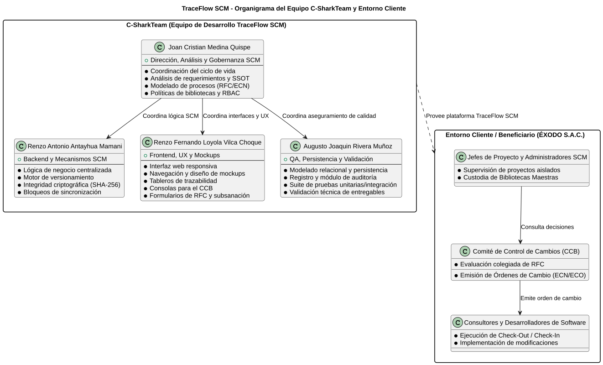

*Fuente: Elaboración propia (`DG-01`, compendio [`DIAGRAMS.md`](DIAGRAMS.md)).*

## 2.2. Diagnóstico de la situación actual (AS-IS)

El levantamiento de información en **ÉXODO S.A.C.** evidenció las siguientes deficiencias operativas en el proceso actual sin herramientas formales de control de configuración:

1. **Almacenamiento disperso:** El código fuente y la documentación residen en equipos personales y cuentas individuales sin repositorio institucional centralizado.
2. **Control de versiones empírico:** Se emplean nombres manuales de carpetas o archivos comprimidos (por ejemplo, `"Proyecto_Cliente_Final_v2"`) sin estándares de versionamiento ni líneas base definidas.
3. **Flujo de cambios informal:** Los ajustes se solicitan y coordinan de forma verbal o por mensajería instantánea sin registrar quién autorizó el cambio, qué impacto tiene o por qué se modificó un componente.
4. **Sobreescritura por falta de sincronización:** La ausencia de bloqueos exclusivos provoca pérdida de avances cuando varios consultores trabajan simultáneamente sobre los mismos componentes.
5. **Entregas sin validación ni retorno seguro:** Los cambios llegan a entornos de cliente sin certificación previa de calidad ni puntos estables para revertir defectos críticos.

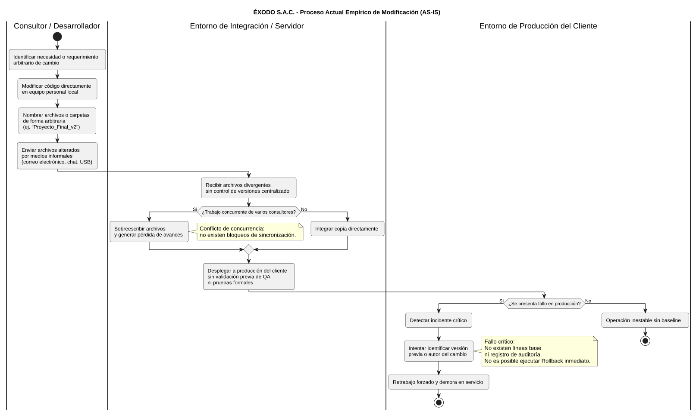

*Fuente: Elaboración propia (`DG-02`, compendio [`DIAGRAMS.md`](DIAGRAMS.md)).*

## 2.3. Necesidades identificadas, objetivos y viabilidad

### Necesidades detectadas

**Tabla TB-03: Cuadro de Necesidades Identificadas**

| Área | Problema Detectado | Requerimiento del Sistema |
| :--- | :--- | :--- |
| Código | Pérdida de fuentes | Repositorio centralizado y seguro. |
| Cambios | Modificaciones arbitrarias | Flujo de aprobación (Solicitudes de Cambio). |
| Versiones | Confusión sobre la versión vigente | Etiquetado de Líneas Base (Baselines). |
| Auditoría | No se identifica al responsable de una falla | Registro de auditoría y trazabilidad total. |
| Entregas | Entregas al cliente sin validación previa | Aprobación formal antes de la liberación. |
Nota: Elaboración Propia

### Objetivos de negocio y diseño funcional

- **Objetivo general de negocio:** Optimizar la calidad y continuidad de los servicios de software que ÉXODO S.A.C. entrega a sus clientes, eliminando pérdidas de información y sobrecostos por versiones conflictivas.
- **Objetivos específicos cuantificables:**
  1. **Reducción de retrabajo:** Disminuir en un **25%** el tiempo invertido por los equipos técnicos en resolver conflictos y recuperar archivos perdidos.
  2. **Garantía de integridad:** Asegurar que el **100%** de las versiones entregadas a clientes correspondan a versiones validadas y aprobadas por el flujo formal de cambios.
  3. **Trazabilidad oportuna:** Identificar el origen, responsable y justificación de cualquier cambio realizado en un proyecto en **menos de 24 horas**.
  4. **Estandarización operativa:** Unificar la gestión de cambios de todos los equipos bajo una misma política institucional.
  5. **Satisfacción del cliente:** Reducir en un **30%** las incidencias derivadas de entregas no autorizadas o versiones incorrectas.

### Delimitación y viabilidad resumida

- **Delimitación organizacional y temporal:** Orientado a las áreas de proyectos, desarrollo, calidad y soporte de **ÉXODO S.A.C.**, formulado en el semestre académico **2026-II** y evaluado financieramente a un horizonte de 5 años (2026–2030).
- **Viabilidad técnica, operativa y legal:** Factible sobre infraestructura institucional/nube compatible con herramientas estándar de desarrollo; alineada al **Decreto Legislativo N.° 822** (protección de propiedad intelectual) y a la **Ley N.° 29733** (protección de datos personales y acceso restringido por rol), además de promover una operación digital libre de papel.
- **Viabilidad económica:**

**Tabla TB-02: Indicadores Financieros de Viabilidad Económica**

| Indicador Financiero | Valor Proyectado | Interpretación Técnica / Financiera |
| :--- | :--- | :--- |
| Inversión Inicial (CAPEX) | S/. 5,475.00 | Cubre 500 horas de desarrollo agregadas para el equipo C-SharkTeam (Joan Medina, Renzo Antayhua, Renzo Loyola y Augusto Rivera a razón referencial de S/. 9.00/hr; **PENDIENTE DE VALIDACIÓN DE ESFUERZO** individual), depreciación de equipos (3.5 meses), conectividad, dominio web e imprevistos. |
| Costo Operativo Anual (OPEX) | S/. 1,140.00 | Mantenimiento de infraestructura PaaS (Render/Supabase), renovación de dominio, soporte preventivo y materiales de difusión. |
| Valor Actual Neto (VAN) | +S/. 10,801.64 | Estrictamente positivo (VAN > 0), ratificando que el proyecto generará valor económico y retención institucional por encima de la tasa exigida (COK 12.00%). |
| Tasa Interna de Retorno (TIR) | 68.20% | Supera ampliamente el COK referencial (12.00%), otorgando un margen de seguridad amplio frente a variaciones de costos. |
| Relación Beneficio / Costo (B/C) | 1.97 | Por cada sol invertido en el ciclo del proyecto, se generarán S/. 1.97 en beneficios y ahorros valorizados para la empresa consultora ÉXODO S.A.C. y sus clientes. |
| Periodo de Recuperación (Payback) | 1 año y 9.7 meses | La inversión inicial se recuperará plenamente durante el transcurso del segundo año de operación. |

---

# 3. Descripción General del Sistema y Usuarios Participantes

## 3.1. Qué ofrece TraceFlow SCM: capacidades por área funcional

TraceFlow SCM organiza sus funcionalidades en ocho áreas de negocio integradas que cubren desde la gestión de identidades hasta la auditoría de entregas:

1. **Gobernanza y Seguridad:** Control de acceso por perfiles funcionales, inicio de sesión con selección de perfil activo y segregación de funciones.
2. **Gestión de Proyectos:** Administración de la cartera de proyectos de clientes con aislamiento estricto entre ellos.
3. **Gestión de Configuración (`ECS`):** Catalogación e identificación tipificada de todos los artefactos bajo control.
4. **Gestión de Bibliotecas:** Segregación operativa entre **Biblioteca de Trabajo**, **Biblioteca de Soporte** y **Biblioteca Maestra**, gobernada por bloqueos exclusivos de sincronización.
5. **Control de Cambios:** Tramitación integral de `RFC`, subsanación, evaluación de impacto, decisión colegiada (`CCB`) o delegada (*Doble Llave*), emisión de `ECN/ECO`, validación `QA`/`UAT`, líneas base y reversión.
6. **Soporte e Incidencias:** Atención de tickets reportados y derivación formal a solicitudes de cambio.
7. **Trazabilidad y Auditoría:** Registro histórico inalterable de decisiones y verificación de integridad.
8. **Reportes:** Emisión de informes de estado de solicitudes, inventario de configuración y actas formales.

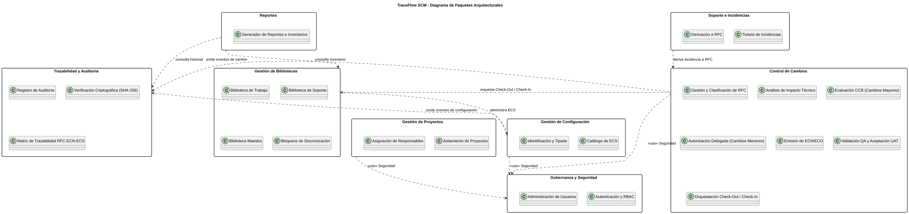

*Fuente: Elaboración propia (`DG-04`, compendio [`DIAGRAMS.md`](DIAGRAMS.md)).*

## 3.2. Flujo integral del ciclo de vida del cambio (TO-BE v2)

El proceso propuesto (**TO-BE v2**) articula diez etapas secuenciales y controladas que garantizan trazabilidad desde la detección de la necesidad hasta el congelamiento de la nueva Línea Base:

1. El **Solicitante** registra la `RFC` asociando un proyecto y un `ECS` (`CU-04`).
2. El **Analista de Requerimientos / Gestor** verifica completitud y coherencia (`CU-05`): puede admitir (`CLASIFICADA`), devolver con observaciones para corrección (`EN_SUBSANACION`, atendida en `CU-04.1`) o cerrar anticipadamente por improcedencia/duplicidad (`DESESTIMADA`).
3. El **Arquitecto / Especialista Técnico** elabora el Informe Técnico de Impacto (`CU-06`), evaluando afectación a la Triple Restricción y clasificando el trámite en **Cambio Menor** o **Cambio Mayor**.
4. **Decisión según clasificación:** los Cambios Menores pasan a autorización conjunta **Doble Llave** entre Gestor y Arquitecto (`CU-30`); los Cambios Mayores pasan a deliberación colegiada del **CCB** (`CU-07`). Un dictamen negativo cierra la solicitud como `RECHAZADA`.
5. Con dictamen aprobatorio (`AUTORIZADA`), se emite formalmente la Orden de Cambio `ECN/ECO` (`CU-08`, estado `ORDEN_EMITIDA`).
6. El **Administrador de Configuración / Bibliotecario** ejecuta el `Check-Out` hacia la Biblioteca de Trabajo (`CU-10`) e impone el bloqueo exclusivo de sincronización (`CU-11`, estado `EN_IMPLEMENTACION`).
7. El **Desarrollador** implementa los cambios (`CU-14`) y ejecuta pruebas unitarias locales (`CU-15`).
8. El **Equipo de Calidad / Testing** ejecuta pruebas de integración en Biblioteca de Soporte (`CU-16`, estado `EN_PRUEBAS`). Ante hallazgos abre ciclos de no conformidad y re-testeo (`CU-18`, `CU-19`); si persiste un fallo insubsanable, el Administrador SCM realiza `Rollback` (`CU-21`) y cancela la orden (`CU-22`, estado `CANCELADA`). Al resultar conforme, QA emite su Certificación (`CU-17`).
9. El **Solicitante** ejecuta las pruebas de aceptación en entorno controlado (`CU-29`, estado `EN_ACEPTACION`).
10. Con la doble conformidad concurrente (**QA + UAT**), el Administrador SCM ejecuta el `Check-In` a Biblioteca Maestra (`CU-12`), congela la nueva Línea Base (`CU-20`) y libera el bloqueo, consolidando el cierre formal exitoso (`IMPLEMENTADA`).

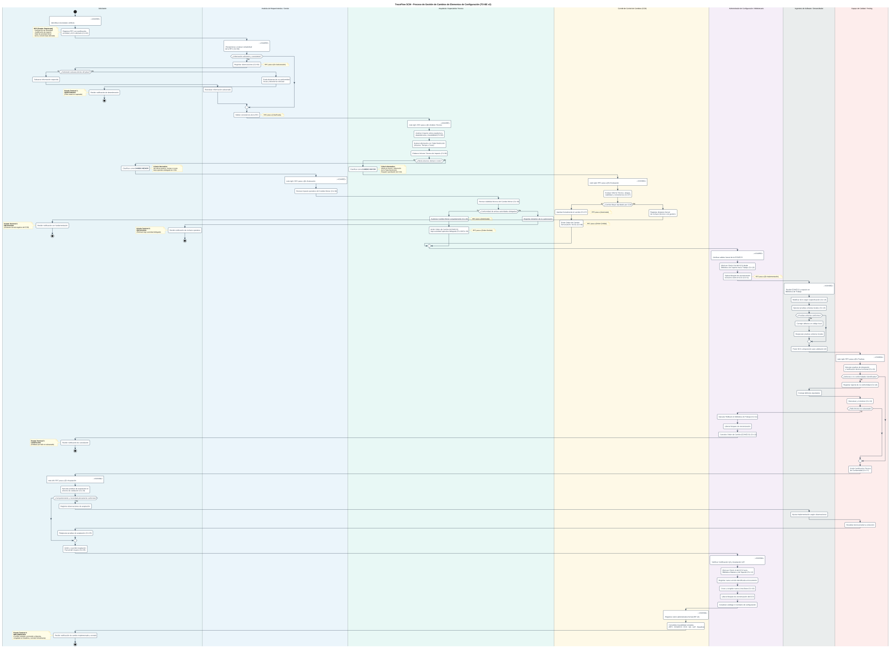

### Estados oficiales del ciclo de vida de una Solicitud de Cambio (`TB-07`)

**Tabla TB-07: Estados Oficiales del Ciclo de Vida de una RFC**

| N.º | Nombre del Estado | Actor / Responsable Principal | Tipo de Estado | Descripción y Criterio de Transición |
| :---: | :--- | :--- | :--- | :--- |
| 1 | **Registrada** | Solicitante | Inicial | La Solicitud de Cambio (RFC) ha sido creada y registrada en el sistema mediante CU-04, quedando pendiente de revisión inicial de completitud. |
| 2 | **En Subsanación** | Solicitante | Intermedio (Bucle) | El Analista de Requerimientos identificó datos incompletos o inconsistentes (CU-05); el Solicitante dispone de un plazo reglamentario para subsanar observaciones. |
| 3 | **Clasificada** | Analista de Requerimientos / Gestor | Intermedio | La solicitud superó el filtro inicial de completitud (CU-05), se categorizó preliminarmente y queda formalmente admitida para análisis técnico de impacto. |
| 4 | **En Análisis Técnico** | Arquitecto / Especialista Técnico | Intermedio | El Arquitecto elabora el Informe Técnico de Impacto (CU-06), evaluando arquitectura, dependencias y la afectación a la Triple Restricción (Alcance, Tiempo, Costo) para determinar si es Cambio Menor o Mayor. |
| 5 | **En Evaluación** | CCB / Autoridad Operativa Delegada | Intermedio | La solicitud y su informe de impacto son deliberados colegiadamente por el CCB (Cambio Mayor, CU-07) o evaluados conjuntamente por la Autoridad Delegada (Cambio Menor, CU-30). |
| 6 | **Autorizada** | CCB / Autoridad Operativa Delegada | Intermedio | El cambio recibió dictamen aprobatorio formal (CU-07 o CU-30), habilitando la emisión de la orden de cambio y la asignación de recursos. |
| 7 | **Orden Emitida** | CCB / Autoridad Operativa Delegada | Intermedio | Se emitió y formalizó la Orden de Cambio (ECN/ECO) mediante CU-08, autorizando el Check-Out del ECS y el inicio de los trabajos en la Biblioteca de Trabajo. |
| 8 | **En Implementación** | Ingeniero de Software / Desarrollador | Intermedio | El Administrador ejecutó el Check-Out (CU-10) con bloqueo de sincronización (CU-11) y el Desarrollador efectúa las modificaciones y pruebas unitarias locales (CU-14, CU-15). |
| 9 | **En Pruebas** | Equipo de Calidad / Testing | Intermedio | El ECS modificado fue entregado a QA para ejecución de pruebas de integración y funcionales (CU-16), incluyendo posibles ciclos de corrección y re-testeo (CU-18, CU-19). |
| 10 | **En Aceptación** | Solicitante / Usuario Final | Intermedio | Habiéndose emitido la Certificación Técnica de Conformidad por QA (CU-17), el Solicitante evalúa el comportamiento del cambio en entorno de validación (CU-29, UAT). |
| 11 | **Desestimada** | Analista de Requerimientos / Gestor | Terminal | Cierre formal anticipado debido a que la solicitud fue declarada inviable/improcedente en revisión inicial o no se subsanaron las observaciones requeridas en el plazo establecido (CU-05). |
| 12 | **Rechazada** | CCB / Autoridad Operativa Delegada | Terminal | Cierre formal por dictamen colegiado negativo del CCB (por inviabilidad técnica o motivos de gestión/alcance, CU-07) o rechazo de la Autoridad Delegada (CU-30). Se notifica al Solicitante con fundamentación. |
| 13 | **Cancelada** | Administrador de Configuración / Bibliotecario | Terminal | Cierre formal por fallo técnico no subsanado tras re-testeo en QA o desistimiento justificado; el Administrador ejecuta rollback del ECS en la Biblioteca de Trabajo (CU-21) y cancela la ECN/ECO (CU-22). |
| 14 | **Implementada** | Administrador de Configuración / CCB | Terminal | Cierre formal exitoso: con la doble conformidad (QA + UAT), el Administrador ejecutó Check-In a Biblioteca Maestra (CU-12), congeló la nueva Línea Base (CU-20), liberó el bloqueo y el CCB formalizó el cierre (RF-14). |

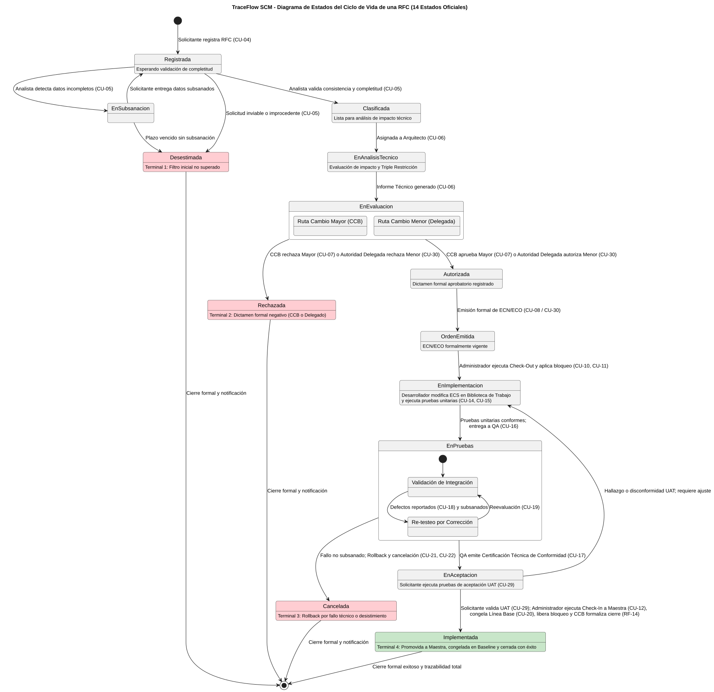

## 3.3. Usuarios participantes y opciones por perfil (`PU-01` a `PU-07`)

Cada participante opera en TraceFlow SCM con un **perfil efectivo único por sesión**, accediendo únicamente a las opciones habilitadas para su rol dentro de los proyectos asignados:

**Tabla TB-09: Matriz de Perfiles y Roles de Usuario del Sistema (PU-01 a PU-07)**

| ID | Tipo de Usuario / Actor | Descripción | Nivel Técnico | Funciones en el Sistema TraceFlow SCM |
| :--- | :--- | :--- | :--- | :--- |
| PU-01 | Solicitante | Persona (interna o del cliente) que identifica una necesidad de cambio y origina el trámite mediante un RFC. | Básico | Registrar Solicitudes de Cambio (RFC), subsanar información observada, consultar el estado de tickets/solicitudes y recibir notificaciones de cierre o rechazo. |
| PU-02 | Analista de Requerimientos / Gestor | Responsable de la recepción, validación formal y clasificación inicial de las solicitudes de cambio. | Avanzado | Registrar y validar RFC, solicitar subsanación de datos, clasificar tipo y criticidad, registrar causales de no aprobación, actualizar el plan de gestión del proyecto y derivar incidencias a RFC. |
| PU-03 | Arquitecto / Especialista Técnico | Responsable del análisis de impacto técnico de los cambios propuestos. | Experto | Realizar análisis de impacto en arquitectura y dependencias, estimar esfuerzo/costo/tiempo, generar el Informe Técnico de Impacto y registrar/clasificar nuevos ECS. |
| PU-04 | Comité de Control de Cambios (CCB) | Grupo colegiado de decisión que evalúa la viabilidad técnica y aprueba o rechaza formalmente los cambios. | Avanzado | Evaluar el informe técnico y solicitudes, aprobar o rechazar RFC, emitir Órdenes de Cambio (ECN/ECO), auditar acciones del sistema y formalizar cierres. |
| PU-05 | Administrador de Configuración / Bibliotecario | Responsable de administrar las bibliotecas (Trabajo, Soporte, Maestra), los bloqueos y las líneas base. | Experto | Ejecutar Check-Out/Check-In entre bibliotecas, aplicar y liberar bloqueos de sincronización, ejecutar rollback, establecer y congelar líneas base, validar integridad (SHA-256) y generar reportes. |
| PU-06 | Ingeniero de Software / Desarrollador | Consultor técnico que implementa el cambio aprobado sobre el ECS en la Biblioteca de Trabajo. | Medio | Recibir Orden de Cambio y ECS autorizado, implementar modificaciones, ejecutar pruebas unitarias locales y corregir defectos reportados por QA. |
| PU-07 | Equipo de Calidad / Testing | Responsable de validar funcional y técnicamente el cambio antes de su integración a la Biblioteca Maestra. | Medio | Ejecutar pruebas de integración y validación funcional, emitir Certificación de Conformidad, reportar no conformidades y hallazgos, y re-testear correcciones. |
Nota: Elaboración Propia

## 3.4. Políticas transversales y Segregación de Funciones (`SoD`)

1. **Aislamiento por proyecto:** Ningún usuario puede visualizar o operar sobre solicitudes o elementos de proyectos que no tenga expresamente asignados.
2. **Propiedad de trámites del Solicitante (`PU-01`):** El Solicitante únicamente visualiza, subsana o acepta en UAT las solicitudes de su propia autoría.
3. **Prohibición de autoevaluación y autoaprobación:** Quien registra una RFC tiene prohibido admitirla como Gestor, dictaminar su impacto técnico como Arquitecto o votar su aprobación en el CCB.
4. **Doble Llave obligatoria en Cambios Menores:** La autorización delegada exige dos firmas de personas físicas distintas (Gestor y Arquitecto).
5. **Separación entre desarrollo y aseguramiento de calidad:** Quien implementa un cambio no puede certificarlo en QA.

---

# 4. Especificación de Requisitos

## 4.1. Requisitos Funcionales (`RF-01` a `RF-18`)

**Tabla TB-04: Cuadro de Requerimientos Funcionales (RF-01 a RF-18)**

| ID | Requerimiento Funcional | Descripción | Prioridad |
| :--- | :--- | :--- | :--- |
| RF-01 | Gestión de Usuarios y Roles | El sistema debe permitir registrar usuarios y asignar los roles del flujo de cambios (Solicitante, Analista de Requerimientos/Gestor, Arquitecto/Especialista Técnico, CCB, Administrador de Configuración/Bibliotecario, Ingeniero de Software/Desarrollador, Equipo de Calidad/Testing), restringiendo las acciones disponibles según el rol. | Alta |
| RF-02 | Gestión de Proyectos | El sistema debe permitir crear y administrar múltiples proyectos de clientes de ÉXODO S.A.C. de forma aislada entre sí. | Alta |
| RF-03 | Identificación de ECS | El sistema debe permitir registrar y clasificar los Elementos de Configuración (código, documentos, esquemas de BD) de cada proyecto. | Alta |
| RF-04 | Registro de Solicitudes de Cambio (RFC) | El sistema debe permitir al Solicitante registrar una Solicitud de Cambio indicando descripción, justificación, prioridad, ECS afectado y fecha, y permitir su subsanación cuando la información esté incompleta. | Alta |
| RF-05 | Clasificación y Análisis de Impacto | El sistema debe permitir al Arquitecto/Especialista Técnico registrar el análisis de impacto técnico (arquitectura, dependencias, riesgos, esfuerzo, tiempo y costo), evaluando la afectación de la Triple Restricción para emitir el dictamen formal de clasificación en Cambio Menor o Cambio Mayor. | Alta |
| RF-06 | Evaluación y Aprobación de Cambios Mayores por el CCB | El sistema debe permitir al Comité de Control de Cambios (CCB) evaluar colegiadamente las solicitudes clasificadas como Cambios Mayores, deliberar sobre su viabilidad técnica y de gestión, registrar la votación y aprobarlas o rechazarlas fundamentando las causales en acta formal. | Alta |
| RF-07 | Gestión y Emisión de Órdenes de Cambio (ECN/ECO) | El sistema debe permitir generar y formalizar la Orden de Cambio (ECN/ECO) una vez autorizada la solicitud, sea mediante resolución colegiada del CCB para Cambios Mayores o mediante autoridad operativa delegada compartida (Analista de Requerimientos/Gestor y Arquitecto/Especialista Técnico) para Cambios Menores, actualizando el plan del proyecto asociado. | Media |
| RF-08 | Gestión de Bibliotecas de Software | El sistema debe administrar al menos tres bibliotecas por proyecto (Biblioteca de Trabajo, Biblioteca de Soporte y Biblioteca Maestra), permitiendo mover un ECS entre ellas mediante operaciones de Check-Out y Check-In. | Alta |
| RF-09 | Control de Versiones y Bloqueos de Sincronización | El sistema debe registrar cada Check-in/Check-out de un ECS con autor, fecha y descripción del cambio, y aplicar/liberar bloqueos de sincronización que impidan la edición concurrente del mismo ECS en la Biblioteca de Trabajo. | Alta |
| RF-10 | Gestión de Pruebas, Certificación QA y Aceptación del Usuario | El sistema debe permitir al Equipo de Calidad registrar los resultados de pruebas de integración y validación funcional emitiendo la Certificación de Conformidad técnica, y permitir al Solicitante/Usuario Final registrar las pruebas de aceptación y suscribir el Acta de Aceptación formal en el entorno controlado de validación previo a la liberación. | Alta |
| RF-11 | Reevaluación y Re-testeo | El sistema debe permitir registrar ciclos de corrección de defectos y re-testeo sobre un cambio no conforme, hasta su certificación o hasta agotar los reintentos permitidos. | Media |
| RF-12 | Rollback y Cancelación de Órdenes de Cambio | El sistema debe permitir al Administrador de Configuración ejecutar un rollback del ECS en la Biblioteca de Trabajo y cancelar la Orden de Cambio cuando el re-test no sea superado exitosamente o ante rechazo formal insubsanable en la aceptación del usuario. | Alta |
| RF-13 | Gestión de Líneas Base | El sistema debe permitir crear y congelar líneas base a partir de un ECS verificado al momento del Check-In a la Biblioteca Maestra/Soporte, registrando la versión resultante tras contar con la certificación de QA y la aceptación del usuario. | Alta |
| RF-14 | Cierre Formal del Cambio y Notificaciones | El sistema debe registrar el cierre formal de una Solicitud de Cambio bajo uno de cuatro estados terminales mutuamente excluyentes (Cerrado – Implementado, Rechazado Técnico, Rechazado Administrativo o Cancelado – Fallo No Subsanado), consolidar la trazabilidad completa del expediente y notificar formalmente al Solicitante y a las partes interesadas. | Alta |
| RF-15 | Gestión de Incidencias y Soporte | El sistema debe permitir registrar, dar seguimiento y derivar incidencias reportadas por consultores o clientes hacia una nueva Solicitud de Cambio. | Media |
| RF-16 | Trazabilidad de Configuración | El sistema debe permitir visualizar las relaciones entre los ECS, las Solicitudes de Cambio, las Órdenes de Cambio y las líneas base a lo largo del tiempo. | Alta |
| RF-17 | Auditoría e Integridad | El sistema debe registrar las acciones críticas de los usuarios en cada etapa del flujo y validar la integridad de los artefactos mediante checksums (SHA-256). | Alta |
| RF-18 | Generación de Reportes | El sistema debe permitir generar reportes de estado del flujo de cambios, inventario de ECS y actas de cambios, con posibilidad de exportación. | Media |
| RF-19 | Gestión de Organizaciones y Membresías (INIT-H01) | El sistema debe permitir administrar organizaciones cliente (DA-02) y delimitar membresías institucionales previas como requisito para asignación a proyectos (DA-06). | Alta |
| RF-20 | Asistente Híbrido de Inicialización de Proyectos (INIT-H01) | El sistema debe guiar la inicialización de proyectos en 5 pasos secuenciales con guardado borrador autosave (DA-01, DA-05). | Alta |
| RF-21 | Integración y Vinculación de Repositorios GitHub (INIT-H01) | El sistema debe permitir vincular repositorios remotos existentes o crear nuevos repositorios en GitHub mediante GitHub App y webhooks seguros (DA-03). | Alta |
| RF-22 | Planificación de Metodologías, Fases y Entregables (INIT-H01) | El sistema debe permitir definir la metodología (Scrum, Cascada, Híbrida), cronograma de fases, hitos de control y entregables asociados a ECS. | Media |
| RF-23 | Salvaguardas de Ciclo de Vida y Activación SCM (INIT-H01) | El sistema debe exigir la validación de la integración GitHub para activar el proyecto (DA-04) y bloquear operaciones SCM en proyectos inactivos. | Crítica |

## 4.2. Requisitos No Funcionales (`RNF-01` a `RNF-09`)

**Tabla TB-05: Cuadro de Requerimientos No Funcionales (RNF-01 a RNF-09)**

| ID | Atributo de Calidad | Descripción | Prioridad |
| :--- | :--- | :--- | :--- |
| RNF-01 | Seguridad | El sistema debe utilizar protocolos de transferencia segura (HTTPS/SSH) y control de acceso basado en roles (RBAC). | Alta |
| RNF-02 | Disponibilidad | El sistema debe garantizar un tiempo de actividad (uptime) del 99.9% durante los periodos críticos de proyecto. | Alta |
| RNF-03 | Integridad | El sistema debe verificar la integridad de los artefactos almacenados mediante checksums (SHA-256). | Alta |
| RNF-04 | Usabilidad | La interfaz debe permitir que un nuevo consultor se familiarice con el flujo de trabajo en menos de 3 horas. | Media |
| RNF-05 | Escalabilidad | El sistema debe soportar más de 50 proyectos simultáneos sin degradar el rendimiento de las operaciones. | Media |
| RNF-06 | Rendimiento | Las operaciones de consulta de historial o comparación de versiones no deben exceder los 3 segundos de respuesta. | Baja |
| RNF-07 | Compatibilidad | El sistema debe ser compatible con entornos de desarrollo de uso común (Visual Studio Code, IntelliJ IDEA, Android Studio). | Alta |
| RNF-08 | Mantenibilidad | La arquitectura debe permitir actualizaciones y parches sin requerir la detención total del servicio. | Media |
| RNF-09 | Respaldo | El sistema debe programar copias de seguridad automáticas diarias del repositorio central. | Alta |
Nota: Elaboración Propia

### Criterios medibles de verificación y operabilidad orientados al servicio

- **RNF-01 (Seguridad):** Todo acceso exige autenticación previa, comunicaciones cifradas en tránsito y restricción efectiva de menús y acciones según el perfil asignado (`PU-01`..`PU-07`) y el proyecto del usuario.
- **RNF-02 (Disponibilidad):** Meta de disponibilidad operativa del **99.9%** en periodos críticos de entrega, respaldada por procedimientos de continuidad y recuperación definidos en la arquitectura.
- **RNF-03 (Integridad):** Toda operación crítica y artefacto versionado genera constancia verificable que permite detectar alteraciones no autorizadas.
- **RNF-04 (Usabilidad):** Los flujos principales (como registro de RFC, revisión inicial y evaluación) se organizan en pantallas guiadas con validaciones explícitas para que un nuevo consultor los adopte en **menos de 3 horas**.
- **RNF-05 (Escalabilidad):** Capacidad planificada para administrar más de **50 proyectos simultáneos** sin pérdida de aislamiento ni degradación en las consultas.
- **RNF-06 (Rendimiento):** Las consultas de expedientes, historiales y comparaciones de versiones deben responder en un tiempo objetivo **inferior a 3 segundos**.
- **RNF-07 (Compatibilidad):** Accesible mediante navegadores web modernos desde los equipos habituales de consultores que utilizan entornos como Visual Studio Code, IntelliJ IDEA o Android Studio.
- **RNF-08 (Mantenibilidad):** Organización funcional modular que facilita actualizaciones evolutivas sin detener el negocio de forma prolongada.
- **RNF-09 (Respaldo):** Programación automatizada de copias de seguridad diarias del repositorio central y registros institucionales (sujeta a homologación formal de metas de recuperación ante desastres por el CCB).

## 4.3. Reglas de Negocio (`RN-01` a `RN-09`)

**Tabla TB-06: Cuadro de Reglas de Negocio (RN-01 a RN-09)**

| ID | Nombre de la Regla | Descripción | Autoridad | Situación Actual (Problemática) |
| :--- | :--- | :--- | :--- | :--- |
| RN-01 | Aprobación Obligatoria Previa a Modificación e Integración | Ningún ECS puede ser modificado ni transferido a la Biblioteca de Trabajo sin una Orden de Cambio (ECN/ECO) emitida formalmente por el CCB (para Cambios Mayores) o bajo autoridad operativa delegada compartida entre el Analista de Requerimientos/Gestor y el Arquitecto/Especialista Técnico (para Cambios Menores). Asimismo, la integración definitiva a la Biblioteca Maestra exige las debidas certificaciones de calidad y aceptación del usuario. | Comité de Control de Cambios (CCB) / Autoridad Operativa Delegada | Se modificaban e integraban cambios directamente sin autorización formal. |
| RN-02 | Identificación Unívoca de Versiones | Toda línea base establecida tras un Check-In a la Biblioteca Maestra debe estar identificada con un estándar de versionamiento (mayor.menor.parche). | Administrador de Configuración / Bibliotecario | Se usaban nombres de carpetas y archivos comprimidos con nombres arbitrarios. |
| RN-03 | Trazabilidad de Cambios | Todo Check-in registrado debe incluir un mensaje descriptivo y estar asociado a una Orden de Cambio (ECN/ECO) previamente emitida. | Administrador de Configuración / Bibliotecario y Analista de Requerimientos / Gestor | No existía registro de quién ni por qué se modificaba el código. |
| RN-04 | Restricción de Bibliotecas Congeladas | Un ECS almacenado en la Biblioteca Maestra no puede modificarse directamente; cualquier corrección exige un nuevo ciclo completo de RFC, Check-Out y Check-In. | Administrador de Configuración / Bibliotecario | Los consultores editaban directamente los archivos entregados al cliente. |
| RN-05 | Evaluación Técnica y Clasificación Obligatoria | Ninguna Solicitud de Cambio puede ser autorizada (por vía delegada o por el CCB) sin contar previamente con un Informe Técnico de Impacto elaborado por el Arquitecto/Especialista Técnico que evalúe arquitectura, dependencias, riesgos y el impacto sobre la Triple Restricción (alcance, tiempo y costo), dictaminando si clasifica como Cambio Menor o Mayor. | Arquitecto / Especialista Técnico | Los cambios se aprobaban sin análisis técnico documentado ni evaluación de impacto en la triple restricción. |
| RN-06 | Bloqueo de Sincronización Obligatorio | Todo ECS que ingresa a la Biblioteca de Trabajo mediante Check-Out debe quedar bloqueado para otros usuarios hasta su Check-In o rollback. | Administrador de Configuración / Bibliotecario | Varios consultores editaban el mismo archivo de forma simultánea, generando sobreescrituras. |
| RN-07 | Diferenciación de Resultados Formales de Cierre | Toda Solicitud de Cambio debe cerrarse formalmente bajo uno de cuatro resultados terminales y mutuamente excluyentes: Cerrado – Implementado (Check-In y Línea Base conformes tras QA y UAT), Rechazado Técnico (inviabilidad dictaminada por el CCB), Rechazado Administrativo (decisión del CCB o de la autoridad delegada por alcance/costo/prioridad) o Cancelado por Fallo No Subsanado (fallo en re-test de QA o rechazo insubsanable en UAT con rollback ejecutado). | Comité de Control de Cambios (CCB) / Autoridad Operativa Delegada / Administrador de Configuración | No existía distinción formal entre los motivos de cierre ni cobertura para el cierre exitoso. |
| RN-08 | Reversión Obligatoria ante Fallo No Subsanado | Si el re-test posterior a una corrección no es superado exitosamente, o si se formula rechazo insubsanable en la aceptación del usuario, el Administrador de Configuración debe ejecutar un rollback del ECS en la Biblioteca de Trabajo antes de cancelar la Orden de Cambio. | Administrador de Configuración / Bibliotecario | El código con errores permanecía en el entorno de trabajo sin reversión formal. |
| RN-09 | Doble Validación Previa al Check-In a Biblioteca Maestra | Ningún ECS modificado puede ser transferido a la Biblioteca Maestra ni congelado en una nueva Línea Base sin contar concurrentemente con la Certificación de Conformidad técnica emitida por el Equipo de Calidad/Testing y el Acta de Aceptación formal suscrita por el Solicitante/Usuario Final en el entorno controlado de validación previo a la liberación. | Equipo de Calidad / Testing y Solicitante / Usuario Final | El código se integraba y entregaba al cliente sin pruebas formales ni aceptación documentada. |
| RN-10 | Pertenencia Obligatoria a Organización (DA-02) | Todo proyecto debe pertenecer a una organización registrada en el sistema; no se admiten proyectos globales o huérfanos. | Administrador de Organización / Gestor (`PU-02`) | No existía el concepto de organización como tenant raíz. |
| RN-11 | Incorporación Exclusiva de Usuarios Registrados (DA-06) | Solo los usuarios con cuenta activa y membresía en la organización pueden ser asignados al equipo de un proyecto. | Administrador de Organización / Gestor (`PU-02`) | Se asignaban colaboradores sin validación de pertenencia institucional. |
| RN-12 | Integración GitHub Obligatoria para Activación (DA-04) | Ningún proyecto puede activarse operacionalmente si no cuenta con un repositorio GitHub vinculado, con permisos verificados y webhook validado. | Gestor (`PU-02`) / Arquitecto (`PU-03`) | Los proyectos operaban sin respaldo físico en Git. |
| RN-13 | Bloqueo Estricto de Operaciones SCM en Proyectos Inactivos | Se prohíbe registrar RFCs, emitir órdenes o modificar bibliotecas en proyectos en estado `BORRADOR`, `EN_CONFIGURACION`, `SUSPENDIDO` o `ARCHIVADO`. | Guardián del Sistema (`ProjectActiveGuard`) | Se admitían RFCs sobre proyectos incompletos o cerrados. |
| RN-14 | Persistencia Parcial de Estado Borrador (DA-05) | El progreso del asistente de inicialización se almacena de forma incremental en borrador (`JSONB`) sin forzar restricciones relacionales duras. | Sistema TraceFlow | La creación requería un solo envío síncrono sin posibilidad de pausa. |
| RN-15 | Inmutabilidad de Transición de Estados de Proyecto | Toda activación, suspensión o archivado de proyecto debe registrarse en la bitácora inmutable de auditoría con firma SHA-256. | Sistema TraceFlow / Módulo de Auditoría | Los cambios de estado no contaban con encadenamiento criptográfico. |

Nota: Elaboración Propia

---

# 5. Catálogo y Narrativas Funcionales de Casos de Uso

## 5.1. Diagramas de Casos de Uso (`DG-05` a `DG-10`)

- **Vista General del Sistema (`DG-05`):**
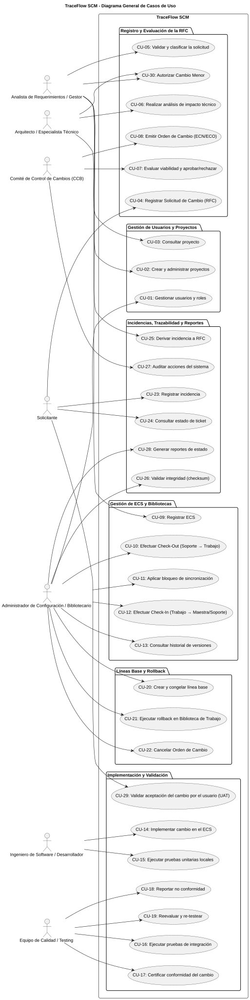

- **Administración de Usuarios y Proyectos (`DG-06`):**
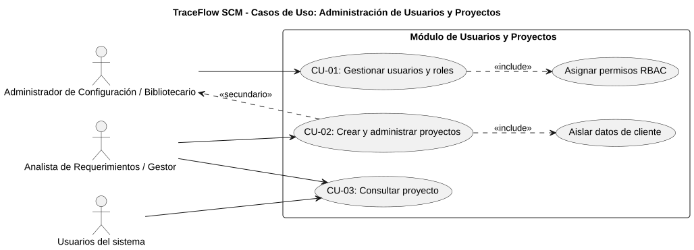

- **Registro y Evaluación de RFC e Incidencias (`DG-07`):**
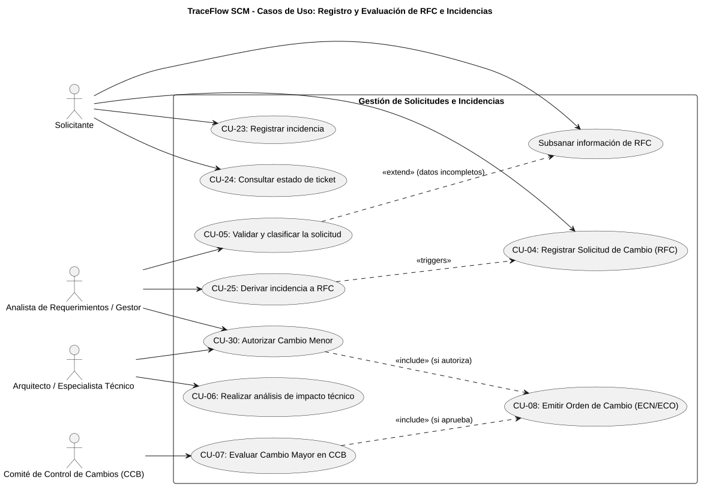

- **SCM Core — ECS, Bibliotecas y Líneas Base (`DG-08`):**
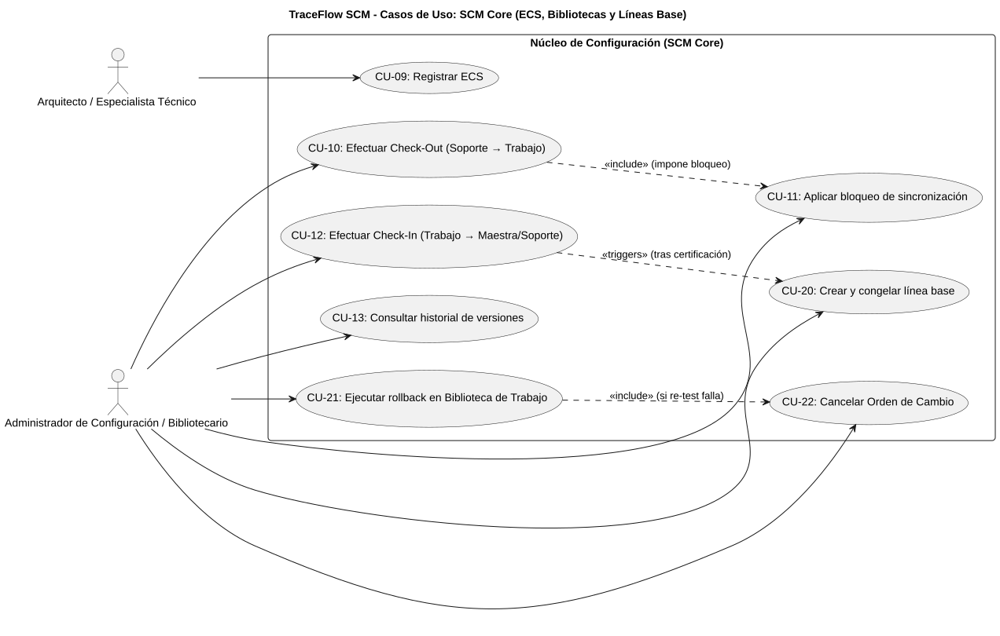

- **Implementación y Validación de Calidad (`DG-09`):**
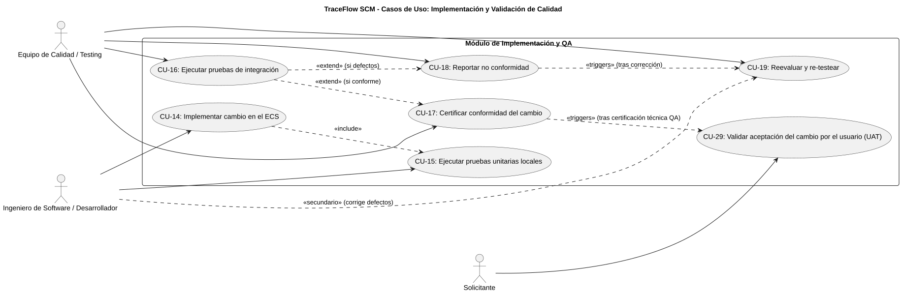

- **Trazabilidad, Auditoría e Integridad (`DG-10`):**
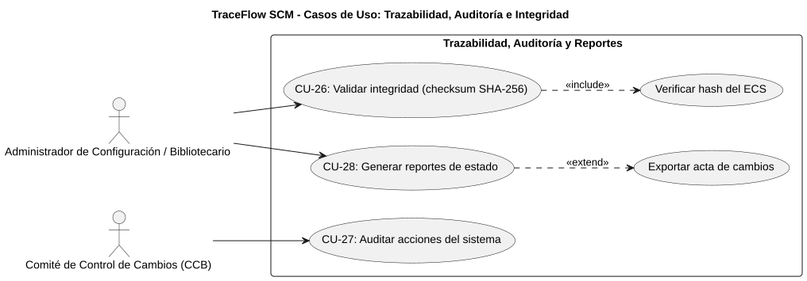

## 5.2. Matriz Resumen del Catálogo de Casos de Uso (`TB-10`)

**Tabla TB-10: Catálogo General de Casos de Uso del Sistema TraceFlow SCM**

| Cód. Orig. | ID Estándar | Nombre del Caso de Uso | Tipo | Actor Principal | Actores Secundarios | Módulo Relacionado | Requerimiento Asociado Explícito |
| :--- | :--- | :--- | :--- | :--- | :--- | :--- | :--- |
| CUS01 | CU-01 | Gestionar usuarios y roles | Secundario, administrativo | Administrador de Configuración / Bibliotecario | Usuarios del sistema | Gestión de Usuarios y Proyectos | RF-01 – Gestión de Usuarios y Roles |
| CUS02 | CU-02 | Crear y administrar proyectos | Primario, administrativo | Analista de Requerimientos / Gestor | Administrador de Configuración / Bibliotecario | Gestión de Usuarios y Proyectos | RF-02 – Gestión de Proyectos |
| CUS03 | CU-03 | Consultar proyecto | Secundario, de consulta | Analista de Requerimientos / Gestor | Usuarios autorizados | Gestión de Usuarios y Proyectos | RF-02 – Gestión de Proyectos |
| CUS04 | CU-04 | Registrar Solicitud de Cambio (RFC) | Primario, operativo | Solicitante | Analista de Requerimientos / Gestor | Registro y Evaluación de la RFC | RF-04 – Registro de Solicitudes de Cambio (RFC) |
| — | CU-04.1 | Subsanar Solicitud de Cambio (RFC) | Secundario, correctivo (Extensión <<extend>> de CU-04) | Solicitante | Analista de Requerimientos / Gestor | Registro y Evaluación de la RFC | RF-04 – Registro de Solicitudes de Cambio (RFC) |
| CUS05 | CU-05 | Validar y clasificar la solicitud | Primario, operativo | Analista de Requerimientos / Gestor | Solicitante | Registro y Evaluación de la RFC | RF-04, RF-05 – Registro, Clasificación y Análisis de Impacto |
| CUS06 | CU-06 | Realizar análisis de impacto técnico | Primario, analítico | Arquitecto / Especialista Técnico | Analista de Requerimientos / Gestor | Registro y Evaluación de la RFC | RF-05 – Clasificación y Análisis de Impacto |
| CUS07 | CU-07 | Evaluar viabilidad y aprobar/rechazar | Primario, decisional | Comité de Control de Cambios (CCB) | Solicitante, Analista de Requerimientos | Registro y Evaluación de la RFC | RF-06 – Evaluación y Aprobación de Cambios Mayores por el CCB |
| CUS08 | CU-08 | Emitir Orden de Cambio (ECN/ECO) | Primario, formalización | Comité de Control de Cambios (CCB) / Analista de Requerimientos / Gestor | Administrador de Configuración / Bibliotecario | Registro y Evaluación de la RFC | RF-07 – Gestión y Emisión de Órdenes de Cambio (ECN/ECO) |
| CUS09 | CU-09 | Registrar ECS | Primario, configuración | Arquitecto / Especialista Técnico | Administrador de Configuración / Bibliotecario | Gestión de ECS y Bibliotecas | RF-03 – Identificación de ECS |
| CUS10 | CU-10 | Efectuar Check-Out (Soporte → Trabajo) | Primario, operación SCM | Administrador de Configuración / Bibliotecario | Ingeniero de Software / Desarrollador | Gestión de ECS y Bibliotecas | RF-08, RF-09 – Gestión de Bibliotecas y Control de Versiones |
| CUS11 | CU-11 | Aplicar bloqueo de sincronización | Secundario, soporte SCM | Administrador de Configuración / Bibliotecario | Ingeniero de Software / Desarrollador | Gestión de ECS y Bibliotecas | RF-09 – Control de Versiones y Bloqueos de Sincronización |
| CUS12 | CU-12 | Efectuar Check-In (Trabajo → Maestra/Soporte) | Primario, operación SCM | Administrador de Configuración / Bibliotecario | Equipo de Calidad / Testing, Solicitante | Gestión de ECS y Bibliotecas | RF-08, RF-09, RF-10 – Gestión de Bibliotecas, Control de Versiones y Aceptación |
| CUS13 | CU-13 | Consultar historial de versiones | Secundario, auditoría | Administrador de Configuración / Bibliotecario | Usuarios autorizados | Gestión de ECS y Bibliotecas | RF-09, RF-16 – Control de Versiones y Trazabilidad |
| CUS14 | CU-14 | Implementar cambio en el ECS | Primario, desarrollo | Ingeniero de Software / Desarrollador | Administrador de Configuración / Bibliotecario | Implementación y Validación | RF-07, RF-09 – Orden de Cambio y Control de Versiones |
| CUS15 | CU-15 | Ejecutar pruebas unitarias locales | Secundario, verificación | Ingeniero de Software / Desarrollador | Ninguno (Autocontenido) | Implementación y Validación | RF-10 – Gestión de Pruebas y Certificación de Conformidad |
| CUS16 | CU-16 | Ejecutar pruebas de integración | Primario, validación QA | Equipo de Calidad / Testing | Ingeniero de Software / Desarrollador | Implementación y Validación | RF-10 – Gestión de Pruebas y Certificación de Conformidad |
| CUS17 | CU-17 | Certificar conformidad del cambio | Primario, certificación | Equipo de Calidad / Testing | Administrador de Configuración / Bibliotecario | Implementación y Validación | RF-10 – Gestión de Pruebas y Certificación de Conformidad |
| CUS18 | CU-18 | Reportar no conformidad | Alternativo, QA | Equipo de Calidad / Testing | Ingeniero de Software / Desarrollador | Implementación y Validación | RF-10 – Gestión de Pruebas y Certificación de Conformidad |
| CUS19 | CU-19 | Reevaluar y re-testear | Alternativo, esencial | Equipo de Calidad / Testing | Ingeniero de Software / Desarrollador | Implementación y Validación | RF-11 – Reevaluación y Re-testeo |
| CUS20 | CU-20 | Crear y congelar línea base | Primario, esencial | Administrador de Configuración / Bibliotecario | Equipo de Calidad / Testing, Solicitante | Líneas Base y Rollback | RF-13 – Gestión de Líneas Base |
| CUS21 | CU-21 | Ejecutar rollback en Biblioteca de Trabajo | Alternativo, correctivo | Administrador de Configuración / Bibliotecario | Ingeniero de Software / Desarrollador | Líneas Base y Rollback | RF-12 – Rollback y Cancelación de Órdenes de Cambio |
| CUS22 | CU-22 | Cancelar Orden de Cambio | Alternativo, cierre fallido | Administrador de Configuración / Bibliotecario | Solicitante, CCB | Líneas Base y Rollback | RF-12, RF-14 – Rollback, Cancelación y Cierre Formal |
| CUS23 | CU-23 | Registrar incidencia | Primario, soporte | Solicitante | Analista de Requerimientos / Gestor | Incidencias y Soporte | RF-15 – Gestión de Incidencias y Soporte |
| CUS24 | CU-24 | Consultar estado de ticket | Secundario, consulta | Solicitante | Analista de Requerimientos / Gestor | Incidencias y Soporte | RF-15 – Gestión de Incidencias y Soporte |
| CUS25 | CU-25 | Derivar incidencia a RFC | Primario, transición | Analista de Requerimientos / Gestor | Solicitante | Incidencias y Soporte | RF-15 – Gestión de Incidencias y Soporte |
| CUS26 | CU-26 | Validar integridad (checksum) | Secundario, seguridad | Administrador de Configuración / Bibliotecario | Ninguno (Autocontenido) | Trazabilidad, Auditoría y Reportes | RF-17, RNF-03 – Auditoría e Integridad |
| CUS27 | CU-27 | Auditar acciones del sistema | Secundario, control | Comité de Control de Cambios (CCB) | Administrador de Configuración / Bibliotecario | Trazabilidad, Auditoría y Reportes | RF-16, RF-17 – Trazabilidad de Configuración y Auditoría |
| CUS28 | CU-28 | Generar reportes de estado | Secundario, reporte | Administrador de Configuración / Bibliotecario | Gestores y Dirección de Proyecto | Trazabilidad, Auditoría y Reportes | RF-18 – Generación de Reportes |
| CUS29 | CU-29 | Validar aceptación del cambio por el usuario (UAT) | Primario, validación usuario | Solicitante | Administrador de Configuración / Bibliotecario | Implementación y Validación | RF-10 – Gestión de Pruebas, Certificación QA y Aceptación del Usuario |
| CUS30 | CU-30 | Autorizar Cambio Menor | Primario, decisional | Analista de Requerimientos / Gestor, Arquitecto / Especialista Técnico | Solicitante, Ingeniero de Software / Desarrollador | Registro y Evaluación de la RFC | RF-05, RF-07 – Clasificación, Análisis de Impacto y Gestión de Órdenes de Cambio |
| — | CU-31 | Administrar Organizaciones y Membresías (INIT-H01) | Primario, administrativo | Administrador de Organización (`PU-02`) | Usuarios del sistema | Gestión de Organizaciones y Proyectos | RF-19 – Gestión de Organizaciones y Membresías (DA-02, DA-06) |
| — | CU-32 | Inicializar Proyecto mediante Asistente Híbrido (INIT-H01) | Primario, configuración | Analista de Requerimientos / Gestor (`PU-02`), Arquitecto (`PU-03`) | Equipo del proyecto | Gestión de Organizaciones y Proyectos | RF-20 – Asistente Híbrido de Inicialización (DA-01, DA-05) |
| — | CU-33 | Integrar y Validar Repositorio GitHub (INIT-H01) | Primario, integración | Arquitecto / Especialista Técnico (`PU-03`), Gestor (`PU-02`) | Administrador de Configuración | Integración de Repositorios | RF-21 – Integración GitHub (DA-03, DA-04) |
| — | CU-34 | Configurar Metodología, Fases y Entregables (INIT-H01) | Secundario, planificación | Analista de Requerimientos / Gestor (`PU-02`), Arquitecto (`PU-03`) | Equipo del proyecto | Planificación y Metodología | RF-22 – Metodologías, Fases y Entregables |
| — | CU-35 | Activar, Suspender y Archivar Proyecto (INIT-H01) | Primario, control | Analista de Requerimientos / Gestor (`PU-02`), Comité CCB (`PU-04`) | Todos los roles asignados | Gestión de Organizaciones y Proyectos | RF-23 – Ciclo de Vida y Salvaguarda SCM (DA-04) |

## 5.3. Narrativas Funcionales Reestructuradas — Bloques 01 y 02

*(Las narrativas de los Bloques 01 y 02 siguen el estándar funcional aprobado en `SRS-01`: ficha descriptiva, flujo normal por fases en tabla `Acción del Actor | Respuesta del Sistema`, flujos alternativos, excepciones, reglas de negocio, estados afectados, criterios de aceptación y diagramas de actividades y de casos de uso. Se diferencia de forma transparente el requisito aprobado respecto del estado de implementación actual sin reducir el alcance aprobado.)*

---

### Bloque 01 — Usuarios y proyectos

#### CU-01 — Gestionar usuarios y roles

##### 1.1. Ficha descriptiva

| Atributo | Detalle |
| :--- | :--- |
| **Id Caso de Uso** | `CU-01` (Código histórico: `CUS01`) |
| **Nombre** | Gestionar usuarios y roles |
| **Tipo** | Primario de gobernanza / administrativo |
| **Requisito ID** | `RF-01` — Gestión de Usuarios y Roles `RN-01` — Aprobación Obligatoria Previa a Modificación e Integración *(marco de facultades acreditadas)* |
| **Versión** | 2.0 (Consolidación SRS-02) |
| **Autor** | C-SharkTeam — Agente 01 (Documentación y Requisitos) |
| **Actores** | **Principal:** Administrador de Configuración / Bibliotecario (`PU-05`) **Secundarios:** Usuarios del sistema (`PU-01` a `PU-07`) |
| **Interacción** | Consola web de Administración de Usuarios y Roles |
| **Descripción** | Permite administrar el directorio institucional de usuarios autorizados, registrando cuentas nuevas, asignando uno o más de los siete roles oficiales (`PU-01`..`PU-07`) y proyectos de ÉXODO S.A.C., actualizando asignaciones o desactivando lógicamente cuentas cuando corresponda, preservando íntegramente el historial de auditoría. |
| **Referencias** | `RF-01`, `RN-01`, `TB-09`, `DG-06`, `DG-ACT-01` |
| **Precondiciones** | 1. El operador ha iniciado sesión en TraceFlow SCM. 2. El rol activo de la sesión corresponde a **Administrador de Configuración / Bibliotecario (`PU-05`)**. |
| **Postcondiciones** | **Éxito:** La cuenta queda creada, actualizada o desactivada en el directorio corporativo con sus roles oficiales y proyectos asociados, y se registra el evento en auditoría. **Error o cancelación:** No se crean ni modifican cuentas en el directorio del sistema. |

##### 1.2. Flujo normal de eventos

| **Acción del Actor** | **Respuesta del Sistema** |
| :--- | :--- |
| **Fase 1: Acceso al directorio de usuarios y validación de perfil** | |
| **1.** El Administrador de Configuración / Bibliotecario selecciona la opción **"Usuarios y Roles"** en el menú de administración. | **2.** El sistema verifica que el rol activo en sesión corresponda a **Administrador de Configuración / Bibliotecario (`PU-05`)** (`E001`) y presenta el directorio de cuentas registradas junto con el catálogo de los siete perfiles oficiales (`PU-01` a `PU-07`) y los proyectos activos. |
| **Fase 2: Captura de datos de identidad y asignación de roles/proyectos** | |
| **3.** El Administrador selecciona **"Registrar Usuario"** (`A001` para modificar existente, `A002` para desactivar/reactivar) e ingresa código de colaborador, nombre completo, correo corporativo, credencial inicial de acceso, perfil(es) asignado(s) y proyectos autorizados. Luego pulsa **"Guardar Usuario"**. | **4.** El sistema valida que los campos obligatorios estén completos, que el formato de correo sea válido, que no exista otro usuario con el mismo correo o código (`E002`) y que todos los perfiles seleccionados pertenezcan al catálogo oficial de los siete roles (`E003`). |
| **Fase 3: Activación, registro de auditoría y notificación** | |
| **5.** El Administrador confirma el alta en pantalla. | **6.** El sistema registra la nueva cuenta en estado **Activo** con sus permisos de acceso basados en roles (`RBAC`) y proyectos asignados, deja constancia en la bitácora de auditoría, muestra el mensaje de confirmación en pantalla y envía al colaborador la notificación con sus instrucciones de acceso inicial. |

##### 1.3. Flujos alternativos

###### A001: Modificar roles o proyectos de un usuario registrado
* **Paso origen:** Paso 3.
* **Condición de activación:** Un colaborador cambia de funciones o se incorpora/retira de un proyecto de ÉXODO S.A.C.

| **Acción del Actor** | **Respuesta del Sistema** |
| :--- | :--- |
| **A001-1.** El Administrador busca y selecciona la cuenta existente, modifica los perfiles asignados (`PU-01`..`PU-07`) o los proyectos autorizados y confirma la actualización. | **A001-2.** El sistema valida que al menos permanezca un rol oficial válido (`E003`), actualiza las autorizaciones vigentes para futuras sesiones y conserva intacto el historial de decisiones y auditoría ejecutadas previamente por el usuario. |

###### A002: Desactivar o reactivar lógicamente una cuenta de usuario
* **Paso origen:** Paso 3.
* **Condición de activación:** Desvinculación temporal/definitiva de un colaborador o reincorporación operativa.

| **Acción del Actor** | **Respuesta del Sistema** |
| :--- | :--- |
| **A002-1.** El Administrador selecciona la cuenta, elige **"Desactivar Cuenta"** (o **"Reactivar Cuenta"**) y confirma la acción. | **A002-2.** El sistema cambia el estado de la cuenta a **Desactivado** (bloqueando el inicio de sesión y cerrando sesiones vigentes sin borrar registros históricos ni firmas previas) o a **Activo**, registrando el cambio en auditoría. |

##### 1.4. Flujos de excepción

###### E001: Operador sin perfil de Administrador de Configuración
* **Paso origen:** Paso 2.
* **Condición de activación:** El usuario autenticado no posee el rol activo `PU-05`.

| **Acción del Actor** | **Respuesta del Sistema** |
| :--- | :--- |
| **E001-1.** Un usuario con otro rol intenta acceder a la gestión de usuarios y roles. | **E001-2.** El sistema deniega el acceso mostrando el aviso de restricción por control de acceso (`RBAC`) y no permite altas, modificaciones ni bajas. Fin del caso de uso. |

###### E002: Datos incompletos, correo corporativo o código duplicado
* **Paso origen:** Paso 4.
* **Condición de activación:** Falta un dato obligatorio o el correo/código ya pertenece a una cuenta registrada.

| **Acción del Actor** | **Respuesta del Sistema** |
| :--- | :--- |
| **E002-1.** El Administrador intenta guardar la ficha con omisiones o identificadores duplicados. | **E002-2.** El sistema resalta los campos observados, informa si el correo o código ya existe y solicita su corrección sin crear registros parciales. Retorna al paso 3. |

###### E003: Intento de asignar un rol fuera del catálogo oficial
* **Paso origen:** Paso 4 y `A001`.
* **Condición de activación:** Se intenta asignar un perfil distinto a `PU-01`..`PU-07` o dejar al usuario sin rol.

| **Acción del Actor** | **Respuesta del Sistema** |
| :--- | :--- |
| **E003-1.** El sistema detecta un perfil no reconocido o ausencia de rol oficial. | **E003-2.** El sistema rechaza la operación e indica que solo se admiten los siete perfiles oficiales del flujo SCM. Retorna al paso 3. |

##### 1.5. Reglas de negocio aplicables
* **`RN-01`:** Respalda que las facultades de decisión, evaluación y aprobación recaigan únicamente sobre cuentas formalmente acreditadas con los perfiles correspondientes.

##### 1.6. Estados afectados
* **Ciclo de vida RFC:** No aplica directamente (administración transversal de identidades).
* **Estado de cuenta de usuario:** `Inexistente` → `Activo` / `Desactivado`.

##### 1.7. Criterios de aceptación funcionales
1. Solo el perfil `Administrador de Configuración / Bibliotecario (PU-05)` puede acceder a crear, modificar o desactivar cuentas.
2. No se permiten cuentas con correo o código duplicado ni roles ajenos a los siete perfiles canónicos (`PU-01`..`PU-07`).
3. La desactivación de un usuario bloquea su acceso futuro sin eliminar sus trámites, dictámenes ni registros históricos de auditoría.
4. *Estado respecto al alcance aprobado:* el inicio de sesión seguro, la selección de perfil único por sesión y el control de acceso por rol están operativos; la interfaz web completa y operaciones interactivas de alta, edición y desactivación administrativa forman parte del requisito aprobado y permanecen pendientes de construcción (actualmente representadas en vista informativa).

##### 1.8. Diagramas correspondientes
* **Diagrama de actividades (`DG-ACT-01`):**
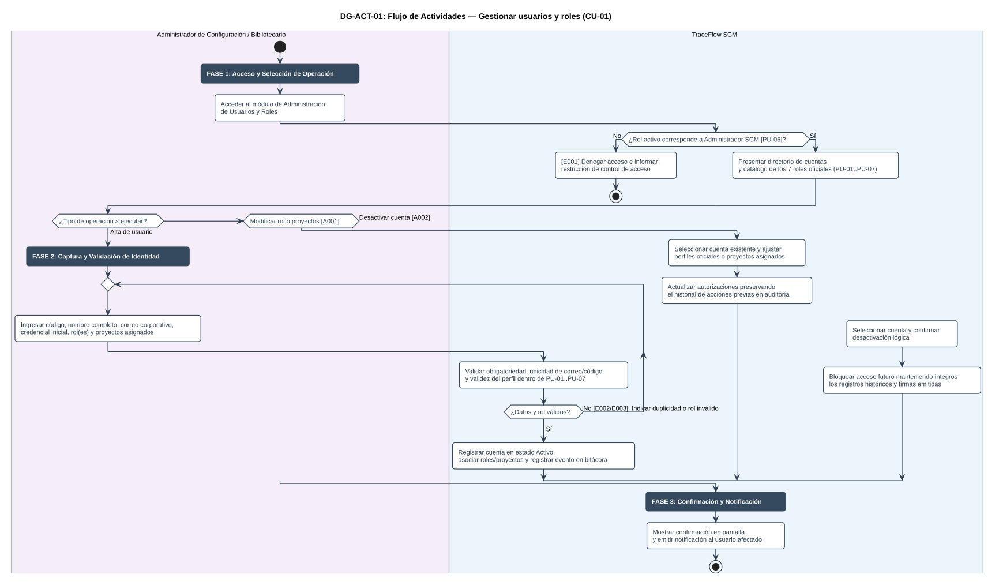
* **Diagrama de caso de uso (`DG-06`):** [`DG-06: Administración de Usuarios y Proyectos`](assets/diagramas/render/generales/DG-06.svg).

---

#### CU-02 — Crear y administrar proyectos

##### 2.1. Ficha descriptiva

| Atributo | Detalle |
| :--- | :--- |
| **Id Caso de Uso** | `CU-02` (Código histórico: `CUS02`) |
| **Nombre** | Crear y administrar proyectos |
| **Tipo** | Primario, administrativo |
| **Requisito ID** | `RF-02` — Gestión de Proyectos `RN-01`, `RN-04` *(marco de aislamiento de bibliotecas por proyecto)* |
| **Versión** | 2.0 (Consolidación SRS-02) |
| **Autor** | C-SharkTeam — Agente 01 (Documentación y Requisitos) |
| **Actores** | **Principal:** Analista de Requerimientos / Gestor (`PU-02`) **Secundario:** Administrador de Configuración / Bibliotecario (`PU-05`) |
| **Interacción** | Consola web de Directorio y Administración de Proyectos |
| **Descripción** | Permite registrar nuevos proyectos de clientes de ÉXODO S.A.C., delimitar sus datos contractuales, asignar los participantes autorizados y habilitar su espacio lógico aislado junto con las tres bibliotecas de configuración, así como actualizar parámetros o cerrar/archivar proyectos culminados. |
| **Referencias** | `RF-02`, `RN-01`, `RN-04`, `CU-03`, `CU-09`, `DG-06`, `DG-ACT-02` |
| **Precondiciones** | 1. El usuario ha iniciado sesión con el rol activo **Analista de Requerimientos / Gestor (`PU-02`)**. 2. Los colaboradores que se asignarán al proyecto existen previamente en el directorio institucional (`CU-01`). |
| **Postcondiciones** | **Éxito:** El proyecto queda registrado o actualizado con aislamiento estricto de sus datos frente a otros clientes, equipo asignado y bibliotecas inicializadas (o en estado `Archivado` de solo lectura si se cierra). **Error:** No se crea ni modifica el proyecto. |

##### 2.2. Flujo normal de eventos

| **Acción del Actor** | **Respuesta del Sistema** |
| :--- | :--- |
| **Fase 1: Apertura del módulo de proyectos** | |
| **1.** El Analista de Requerimientos / Gestor selecciona **"Proyectos"** en el menú lateral y pulsa **"Nuevo Proyecto"** (`A001` editar existente, `A002` archivar culminado). | **2.** El sistema valida los permisos del rol activo **Gestor (`PU-02`)** (`E001`) y presenta el formulario de registro junto con la lista de usuarios activos disponibles para asignación. |
| **Fase 2: Registro, validación de unicidad y configuración de aislamiento** | |
| **3.** El Gestor ingresa el código del proyecto, nombre formal, cliente de ÉXODO S.A.C., descripción de objetivos, fecha de inicio, plazo contractual y usuarios asignados al equipo del proyecto. Luego pulsa **"Guardar Proyecto"**. | **4.** El sistema verifica que los campos mandatorios estén completos, que ni el código ni la denominación existan ya en el catálogo (`E002`) y que las fechas contractuales sean coherentes entre sí (`E003`). |
| **Fase 3: Inicialización de espacio lógico y notificación** | |
| **5.** El Gestor confirma la creación. | **6.** El sistema registra el proyecto en estado **Activo** estableciendo un espacio lógico independiente aislado de los demás clientes, habilita sus tres bibliotecas de configuración (**Trabajo**, **Soporte** y **Maestra**), registra la acción en auditoría, confirma en pantalla y notifica al **Administrador de Configuración / Bibliotecario (`PU-05`)** para iniciar el catálogo de ECS (`CU-09`). |

##### 2.3. Flujos alternativos

###### A001: Actualizar parámetros o equipo de un proyecto activo
* **Paso origen:** Paso 1.
* **Condición de activación:** Ampliación de plazos, ajuste de descripción o incorporación/retiro de miembros del equipo.

| **Acción del Actor** | **Respuesta del Sistema** |
| :--- | :--- |
| **A001-1.** El Gestor selecciona un proyecto existente en el directorio, edita los campos autorizados o el equipo asignado y pulsa **"Actualizar Proyecto"**. | **A001-2.** El sistema valida coherencia de fechas (`E003`) y no duplicidad (`E002`), actualiza la configuración preservando el historial de auditoría y confirma los cambios en pantalla. |

###### A002: Archivar o cerrar formalmente un proyecto culminado
* **Paso origen:** Paso 1.
* **Condición de activación:** Finalización contractual y aceptación definitiva del proyecto por el cliente.

| **Acción del Actor** | **Respuesta del Sistema** |
| :--- | :--- |
| **A002-1.** El Gestor selecciona **"Archivar Proyecto"** sobre un proyecto finalizado y confirma el cierre. | **A002-2.** El sistema cambia el estado del proyecto a **Archivado**, congela nuevas solicitudes o modificaciones de ECS y conserva todas las líneas base y expedientes históricos en modo consulta. |

##### 2.4. Flujos de excepción

###### E001: Usuario sin privilegios de administración de proyectos
* **Paso origen:** Paso 2.
* **Condición de activación:** Un usuario con perfil distinto a `PU-02` intenta crear, editar o archivar un proyecto.

| **Acción del Actor** | **Respuesta del Sistema** |
| :--- | :--- |
| **E001-1.** El actor intenta ejecutar una acción administrativa de proyecto sin autorización. | **E001-2.** El sistema restringe la acción informando que la creación y administración de proyectos corresponde al Gestor autorizado. Fin del caso de uso. |

###### E002: Código o nombre de proyecto duplicado
* **Paso origen:** Paso 4.
* **Condición de activación:** El código o denominación ingresada coincide con otro proyecto ya registrado.

| **Acción del Actor** | **Respuesta del Sistema** |
| :--- | :--- |
| **E002-1.** El sistema detecta duplicidad de código o nombre. | **E002-2.** Rechaza la operación solicitando ingresar un identificador y nombre únicos. Retorna al paso 3. |

###### E003: Incoherencia de fechas o campos obligatorios faltantes
* **Paso origen:** Paso 4.
* **Condición de activación:** Fecha de cierre anterior a fecha de inicio o campos obligatorios vacíos.

| **Acción del Actor** | **Respuesta del Sistema** |
| :--- | :--- |
| **E003-1.** El sistema detecta fechas invertidas o datos faltantes. | **E003-2.** Señala los campos con error indicando la corrección necesaria sin guardar cambios. Retorna al paso 3. |

##### 2.5. Reglas de negocio aplicables
* **`RN-01`:** Todo proceso de cambios opera exclusivamente dentro del marco de un proyecto formalmente registrado.
* **`RN-04`:** Cada proyecto delimita sus propias bibliotecas segregadas (**Trabajo**, **Soporte** y **Maestra**).

##### 2.6. Estados afectados
* **Ciclo de vida RFC:** No aplica directamente.
* **Estado del proyecto:** `Inexistente` → `Activo` / `Archivado`.

##### 2.7. Criterios de aceptación funcionales
1. Cada proyecto creado cuenta con identificador y denominación únicos, cliente asociado, equipo asignado y aislamiento estricto frente a otros proyectos.
2. Ningún usuario fuera del equipo asignado a un proyecto puede visualizar sus datos ni tramitar cambios en él.
3. Al archivarse un proyecto se impiden nuevas alteraciones conservando las líneas base e historial íntegro.
4. *Estado respecto al alcance aprobado:* el catálogo corporativo de proyectos y las reglas de aislamiento por usuario ya están activos; las pantallas interactivas de alta, edición y archivado permanecen pendientes de construcción (actualmente en vista informativa).

##### 2.8. Diagramas correspondientes
* **Diagrama de actividades (`DG-ACT-02`):**
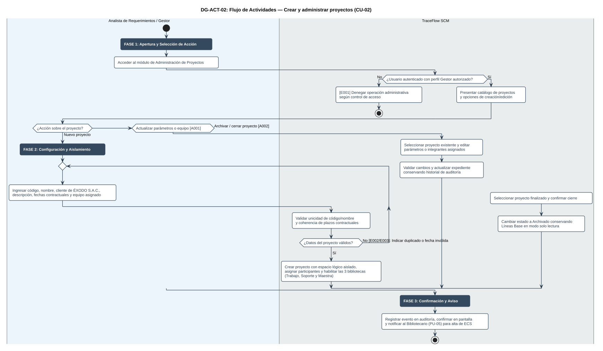
* **Diagrama de caso de uso (`DG-06`):** [`DG-06: Administración de Usuarios y Proyectos`](assets/diagramas/render/generales/DG-06.svg).

---

#### CU-03 — Consultar proyecto

##### 3.1. Ficha descriptiva

| Atributo | Detalle |
| :--- | :--- |
| **Id Caso de Uso** | `CU-03` (Código histórico: `CUS03`) |
| **Nombre** | Consultar proyecto |
| **Tipo** | Secundario, de consulta (solo lectura) |
| **Requisito ID** | `RF-02` — Gestión de Proyectos `RN-04` — Restricción de Bibliotecas Congeladas |
| **Versión** | 2.0 (Consolidación SRS-02) |
| **Autor** | C-SharkTeam — Agente 01 (Documentación y Requisitos) |
| **Actores** | **Principal:** Analista de Requerimientos / Gestor (`PU-02`) **Secundarios:** Usuarios autorizados de los perfiles `PU-01` a `PU-07` asignados al proyecto |
| **Interacción** | Directorio General de Proyectos y Ficha Integral de Proyecto |
| **Descripción** | Permite a los usuarios autorizados consultar la ficha consolidada de un proyecto asignado, visualizando sus datos generales, cliente, equipo participante, catálogo de Elementos de Configuración (`ECS`) y resumen de solicitudes de cambio activas, sin alterar la configuración ni permitir acceso a proyectos de otros clientes no asignados. |
| **Referencias** | `RF-02`, `RN-04`, `CU-02`, `DG-06`, `DG-ACT-03` |
| **Precondiciones** | 1. El usuario ha iniciado sesión en TraceFlow SCM. 2. El usuario tiene asignado al menos un proyecto dentro de su cuenta. |
| **Postcondiciones** | **Éxito:** Se muestra en pantalla la ficha integral consolidada del proyecto en modo solo lectura. **Error:** Se bloquea la consulta informando restricción de acceso o inexistencia. |

##### 3.2. Flujo normal de eventos

| **Acción del Actor** | **Respuesta del Sistema** |
| :--- | :--- |
| **Fase 1: Acceso al directorio filtrado** | |
| **1.** El usuario selecciona **"Proyectos"** en el menú de navegación. | **2.** El sistema identifica la sesión activa y presenta exclusivamente el listado de proyectos asignados al usuario (`A001` búsqueda/filtrado), aislando cualquier proyecto externo no autorizado. |
| **Fase 2: Validación y visualización de ficha integral** | |
| **3.** El usuario selecciona el proyecto que desea inspeccionar. | **4.** El sistema verifica que el proyecto exista (`E002`) y que el usuario posea asignación vigente sobre él (`E001`). |
| | **5.** El sistema consolida y muestra la **Ficha Integral de Proyecto** con: datos generales y cliente, estado (`Activo` o `Archivado`), equipo responsable, catálogo de `ECS` del proyecto y resumen cuantitativo de `RFC` activas, habilitando accesos de navegación autorizados según el rol en sesión. |

##### 3.3. Flujos alternativos

###### A001: Búsqueda y filtrado del directorio de proyectos
* **Paso origen:** Paso 2.
* **Condición de activación:** El usuario participa en varios proyectos y requiere ubicar uno específico.

| **Acción del Actor** | **Respuesta del Sistema** |
| :--- | :--- |
| **A001-1.** El usuario ingresa criterios de búsqueda (nombre, código o cliente) o filtra por estado del proyecto. | **A001-2.** El sistema actualiza dinámicamente la lista mostrando únicamente los proyectos coincidentes dentro de su cartera asignada. Retorna al paso 3. |

##### 3.4. Flujos de excepción

###### E001: Intento de acceso a proyecto no asignado
* **Paso origen:** Paso 4.
* **Condición de activación:** El usuario intenta consultar directamente un proyecto sobre el cual carece de asignación.

| **Acción del Actor** | **Respuesta del Sistema** |
| :--- | :--- |
| **E001-1.** El usuario accede al identificador de un proyecto externo a sus asignaciones. | **E001-2.** El sistema bloquea la visualización, muestra el mensaje de acceso denegado por aislamiento entre proyectos y ofrece retornar al directorio permitido. Fin del caso de uso. |

###### E002: Proyecto inexistente
* **Paso origen:** Paso 4.
* **Condición de activación:** El código o identificador consultado no existe en el sistema.

| **Acción del Actor** | **Respuesta del Sistema** |
| :--- | :--- |
| **E002-1.** El sistema no localiza el proyecto solicitado. | **E002-2.** Muestra el aviso de proyecto no encontrado e invita a volver al directorio de proyectos. Fin del caso de uso. |

##### 3.5. Reglas de negocio aplicables
* **`RN-04`:** Garantiza consulta controlada de los artefactos y bibliotecas sin habilitar edición directa fuera del flujo formal de cambios.

##### 3.6. Estados afectados
* **Estado inicial / final:** No aplica (operación de consulta de solo lectura).

##### 3.7. Criterios de aceptación funcionales
1. El directorio muestra únicamente los proyectos a los que pertenece el usuario autenticado.
2. La consulta directa de un proyecto no asignado es rechazada explícitamente sin filtrar datos de clientes terceros.
3. La ficha consolidada presenta información general, catálogo de ECS vinculados y acceso contextual conforme al perfil activo.
4. *Estado respecto al alcance aprobado:* la consulta y validación de aislamiento por proyecto operan en el servicio del sistema y en el selector global de proyecto; la pantalla visual completa del Directorio y Ficha de Proyecto se encuentra actualmente en vista informativa en espera de su interfaz definitiva.

##### 3.8. Diagramas correspondientes
* **Diagrama de actividades (`DG-ACT-03`):**
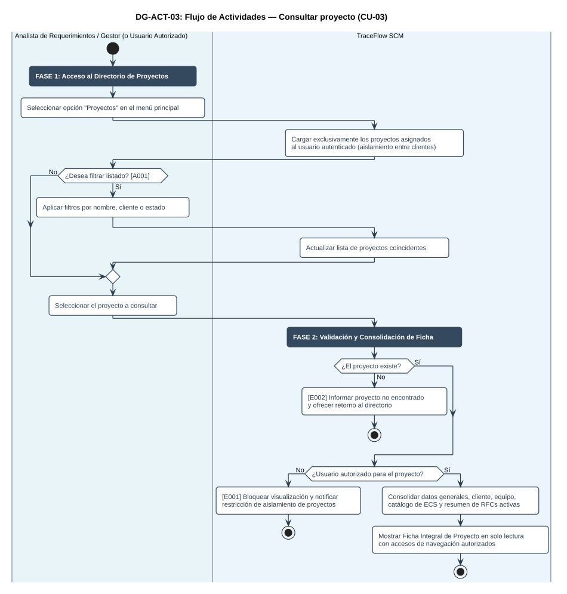
* **Diagrama de caso de uso (`DG-06`):** [`DG-06: Administración de Usuarios y Proyectos`](assets/diagramas/render/generales/DG-06.svg).

---

### Bloque 02 — Registro y evaluación de solicitudes

#### CU-04 — Registrar Solicitud de Cambio (RFC)

##### 4.1. Ficha descriptiva

| Atributo | Detalle |
| :--- | :--- |
| **Id Caso de Uso** | `CU-04` (Código histórico: `CUS04`) |
| **Nombre** | Registrar Solicitud de Cambio (RFC) |
| **Tipo** | Primario, operativo (Esencial) |
| **Requisito ID** | `RF-04` — Registro de Solicitudes de Cambio (RFC) `RN-04` — Restricción de Bibliotecas Congeladas `RN-01` — Aprobación Obligatoria Previa a Modificación e Integración *(marco habilitante del flujo)* |
| **Versión** | 2.1 (Corrección SRS-02) |
| **Autor** | C-SharkTeam — Agente 01 (Documentación y Requisitos) |
| **Actores** | **Principal:** Solicitante (`PU-01`) **Secundario (Receptor de notificación):** Analista de Requerimientos / Gestor (`PU-02`) |
| **Interacción** | Asistente web guiado de 4 pasos (*Nueva Solicitud RFC*) |
| **Descripción** | Permite al Solicitante formalizar en TraceFlow SCM una nueva Solicitud de Cambio (`RFC`) asociada a un proyecto asignado y a un Elemento de Configuración (`ECS`) de dicho proyecto, registrando su necesidad, justificación, prioridad y categoría para que quede radicada en estado inicial `REGISTRADA` e ingrese a revisión formal. |
| **Referencias** | `RF-04`, `RN-04`, `RN-01`, `TB-07` (Estado 1 `Registrada`), `CU-04.1`, `CU-05`, `CU-25`, `DG-07`, `DG-ACT-04` |
| **Precondiciones** | 1. El usuario ha iniciado sesión en TraceFlow SCM. 2. El rol activo en la sesión es **Solicitante (`PU-01`)** (ver `E001`). 3. El usuario tiene asignado al menos un proyecto activo con al menos un `ECS` catalogado (ver `E003`). |
| **Postcondiciones** | **Éxito:** 1. Se registra la RFC con código correlativo único (`RFC-AAAA-NNNN`), estado oficial **`REGISTRADA`** y clasificación técnica preliminar **`PENDIENTE`**. 2. Queda vinculada al proyecto, al solicitante y al `ECS` afectado, con constancia en la bitácora inmutable de auditoría. 3. *(Requisito aprobado pendiente de despacho automático)* Se notifica al Analista de Requerimientos / Gestor (`PU-02`) para su revisión inicial (`CU-05`). 4. Se limpia el borrador temporal de la sesión si existía. **Cancelación o fallo (`A003`, `E001..E005`):** No se radica ninguna solicitud ni se altera el catálogo de ECS. |

##### 4.2. Flujo normal de eventos

| **Acción del Actor** | **Respuesta del Sistema** |
| :--- | :--- |
| **Fase 1: Acceso al asistente e Información General** | |
| **1.** El Solicitante accede a **"Nueva Solicitud RFC"** desde el menú principal o desde la bandeja de solicitudes. | **2.** El sistema verifica que el rol activo en sesión corresponda a **Solicitante (`PU-01`)** (`E001`), carga los proyectos asignados al usuario, previsualiza el código correlativo estimado y presenta el **Paso 1: Información General de la Solicitud** (*Paso 1/4*). Si existe un borrador temporal guardado previamente para el proyecto activo, restaura los datos capturados en pantalla. |
| **3.** El Solicitante elige el **Proyecto de Software Asignado**, escribe el **Título de la Solicitud de Cambio** (máximo 120 caracteres), selecciona la **Prioridad Propuesta** (*Baja*, *Media*, *Alta* o *Crítica / Urgente*) y la **Categoría de Cambio** (*Correctivo*, *Adaptativo* o *Perfectivo*). Luego pulsa **"Siguiente Paso"** (`A001`, `A003`). | **4.** El sistema valida que exista un proyecto seleccionado y que el título cumpla las reglas de obligatoriedad y longitud mínima (`E002`). Al superar la validación, habilita el **Paso 2: Justificación y Descripción Detallada** (*Paso 2/4*). |
| **Fase 2: Justificación de negocio y selección del ECS** | |
| **5.** El Solicitante ingresa la **Descripción Detallada del Requerimiento o Falla**, la **Justificación de Negocio / Valor Agregado** y, de forma opcional, una **Propuesta Técnica Sugerida**. Luego pulsa **"Siguiente Paso"** (`A001`, `A003`). | **6.** El sistema valida la obligatoriedad y longitud mínima de descripción y justificación (`E002`), consulta el catálogo de `ECS` del proyecto seleccionado (`E003`) y muestra el **Paso 3: Elemento de Configuración (ECS) y Evidencias** (*Paso 3/4*), indicando para cada ECS código, nombre, versión vigente, tipo, biblioteca actual y eventual indicador de bloqueo activo. |
| **7.** El Solicitante selecciona el **ECS Afectado** (`A002` si adjunta documentación técnica o probatoria) y pulsa **"Siguiente Paso"** (`A001`, `A003`). | **8.** El sistema verifica que exista un ECS seleccionado (`E002`) y despliega el **Paso 4: Confirmación y Envío Formal de la Solicitud** (*Paso 4/4*), presentando la ficha resumen consolidada con todos los datos ingresados y el control de confirmación de envío. |
| **Fase 3: Confirmación, validación integral y radicación formal** | |
| **9.** El Solicitante verifica el resumen técnico, marca el control de confirmación *(actualmente presentado como Declaración de Veracidad Institucional; ver decisión pendiente en §6.2)* y pulsa **"Enviar Solicitud de Cambio"** (`A001`, `A003`). | **10.** El sistema ejecuta la validación integral en servidor sobre longitudes, proyecto asignado (`E002`), pertenencia y disponibilidad del ECS dentro del mismo proyecto (`E004`) y registra formalmente la solicitud (`E005` ante indisponibilidad de conexión), asignando código correlativo único (`RFC-AAAA-NNNN`), estado inicial **`REGISTRADA`** y clasificación **`PENDIENTE`**. |
| | **11.** El sistema registra el evento en la bitácora inmutable de auditoría, deriva la notificación al **Analista de Requerimientos / Gestor (`PU-02`)** *(requisito pendiente de automatización en envío)*, elimina el borrador temporal del proyecto y muestra el comprobante **"¡Solicitud de Cambio Registrada Exitosamente!"** con accesos a **Ver Expediente 360°**, **Ir a la Bandeja RFC**, **Registrar Otra** e **Ir al Dashboard**. |

> [!IMPORTANT]
> **Discrepancia detectada (`DEV-01` / SRS-02) y regla uniforme propuesta para aprobación:**  
> 1. *Longitudes mínimas:* la interfaz de captura valida actualmente **5** caracteres en título y **15** en descripción y justificación, mientras que el servidor exige **10** caracteres en título y **20** en descripción y justificación (rechazando el envío final si el usuario digitó textos entre esos rangos). **Regla uniforme propuesta:** estandarizar **mínimo 10 y máximo 120 caracteres en título**, y **mínimo 20 caracteres en descripción y justificación** tanto en pantalla como en servidor.  
> 2. *Campos adicionales y adjuntos:* la captura de **Categoría**, **Propuesta Técnica Sugerida** y **Archivos adjuntos** se ofrece en la interfaz; actualmente el servidor registra los campos principales y los anexos reales en almacenamiento centralizado permanecen pendientes de implementación física.  
> 3. *Declaración de veracidad:* el formulario exige marcar una casilla de declaración de veracidad antes de enviar; dicha condición **no consta en `RF-04` ni en la narrativa original aprobada**, por lo que queda sometida a ratificación o simplificación del CCB.

##### 4.3. Flujos alternativos

###### A001: Guardar borrador temporal
* **Paso origen:** Pasos 3, 5, 7 o 9.
* **Condición de activación:** El Solicitante necesita pausar la captura antes de enviar la solicitud y pulsa **"Guardar Borrador"**.

| **Acción del Actor** | **Respuesta del Sistema** |
| :--- | :--- |
| **A001-1.** El Solicitante pulsa **"Guardar Borrador"** en la cabecera del asistente. | **A001-2.** El sistema conserva temporalmente los datos digitados asociados al proyecto actual dentro de la sesión del navegador y muestra el aviso **"Borrador guardado"**, sin radicar aún la RFC en el servidor. |

###### A002: Adjuntar documentación técnica o probatoria de respaldo
* **Paso origen:** Paso 7 (Paso 3 del asistente).
* **Condición de activación:** El Solicitante dispone de actas, capturas, bitácoras de error o informes técnicos de respaldo (capacidad contemplada en el requisito aprobado `RF-04`).

| **Acción del Actor** | **Respuesta del Sistema** |
| :--- | :--- |
| **A002-1.** El Solicitante selecciona o ingresa los archivos de sustento técnico y pulsa **"Adjuntar"**. | **A002-2.** El sistema valida los formatos/tamaños permitidos y los vincula al expediente para su visualización en el resumen del Paso 4 y posterior evaluación en `CU-05`. *(Nota de estado vigente: actualmente en pantalla solo se asocian nombres nominales de referencia; el almacenamiento físico real de archivos forma parte del alcance aprobado pendiente de habilitación).* Retorna al paso 7. |

###### A003: Cancelar registro y descartar cambios
* **Paso origen:** Pasos 3, 5, 7 o 9.
* **Condición de activación:** El Solicitante decide cancelar la captura pulsando **"Cancelar"**.

| **Acción del Actor** | **Respuesta del Sistema** |
| :--- | :--- |
| **A003-1.** El Solicitante pulsa **"Cancelar"**. | **A003-2.** El sistema muestra el cuadro **"¿Descartar registro de solicitud?"** indicando que los datos ingresados no se registrarán, con los botones **"Continuar editando"** y **"Sí, descartar y salir"**. |
| **A003-3.** Confirma **"Sí, descartar y salir"** (o **"Continuar editando"**). | **A003-4.** Si confirma el descarte, sale del asistente sin crear ninguna RFC; en caso contrario, cierra el aviso y mantiene los datos en edición. |

##### 4.4. Flujos de excepción

###### E001: Rol activo no autorizado (Segregación de Funciones)
* **Paso origen:** Paso 2.
* **Condición de activación:** La sesión actual no tiene activo el perfil **Solicitante (`PU-01`)**.

| **Acción del Actor** | **Respuesta del Sistema** |
| :--- | :--- |
| **E001-1.** El usuario intenta registrar o remitir una RFC con otro perfil activo. | **E001-2.** El sistema despliega la advertencia **"Restricción de Segregación de Funciones (SoD)"** informando que el registro corresponde exclusivamente al Solicitante (`PU-01`) y mantiene inhabilitado el botón **"Enviar Solicitud de Cambio"** (además de rechazar la petición en el servidor). Fin del caso de uso. |

###### E002: Campos obligatorios incompletos o longitud mínima insuficiente
* **Paso origen:** Pasos 4, 6, 8 o 10.
* **Condición de activación:** Faltan campos mandatorios, el título excede 120 caracteres, no se cumple la longitud mínima en pantalla o en servidor, no se seleccionó un ECS o falta la confirmación previa al envío.

| **Acción del Actor** | **Respuesta del Sistema** |
| :--- | :--- |
| **E002-1.** El Solicitante intenta avanzar o enviar datos que incumplen las reglas de validación. | **E002-2.** El sistema bloquea el avance o radicación, señala el campo observado y muestra un mensaje comprensible con el requisito mínimo incumplido, conservando el resto de la información digitada para corrección. Retorna al paso donde ocurrió la validación. |

###### E003: Proyecto sin Elementos de Configuración (ECS) disponibles
* **Paso origen:** Paso 6.
* **Condición de activación:** El proyecto elegido no tiene ningún ECS catalogado.

| **Acción del Actor** | **Respuesta del Sistema** |
| :--- | :--- |
| **E003-1.** El Solicitante avanza al Paso 3 tras elegir un proyecto sin ECS activos. | **E003-2.** El sistema informa **"No se encontraron elementos de configuración registrados para este proyecto. Contacte al Administrador SCM."** e impide avanzar al Paso 4 al no poder vincular un ECS afectado. Fin del flujo o regreso al Paso 1 para elegir otro proyecto. |

###### E004: Inconsistencia de integridad entre proyecto y ECS o ECS inactivo
* **Paso origen:** Paso 10.
* **Condición de activación:** El ECS indicado no pertenece al proyecto seleccionado, no existe o fue dado de baja/archivado antes de confirmar la radicación.

| **Acción del Actor** | **Respuesta del Sistema** |
| :--- | :--- |
| **E004-1.** El servidor detecta discordancia entre el proyecto asignado y el ECS afectado (o indisponibilidad del elemento). | **E004-2.** El sistema rechaza el registro explicando claramente la incompatibilidad proyecto–ECS detectada, sin generar expedientes parciales ni alterar el inventario. El usuario puede regresar al Paso 3 para corregir la selección. |

###### E005: Falla de conectividad o indisponibilidad temporal al enviar
* **Paso origen:** Paso 10.
* **Condición de activación:** Interrupción temporal de red o indisponibilidad del servidor al confirmar la radicación.

| **Acción del Actor** | **Respuesta del Sistema** |
| :--- | :--- |
| **E005-1.** No se recibe confirmación del servidor tras pulsar **"Enviar Solicitud de Cambio"**. | **E005-2.** El sistema presenta la alerta **"No se pudo procesar la Solicitud de Cambio"** explicando que ocurrió un error de comunicación, conserva íntegramente los datos capturados en pantalla y habilita reintentar el envío o guardar borrador sin duplicar expedientes. |

##### 4.5. Reglas de negocio aplicables
* **`RN-04` (Restricción de Bibliotecas Congeladas):** Toda modificación sobre un ECS en Biblioteca Maestra exige iniciar un nuevo ciclo formal comenzando por el registro de la RFC.
* **`RN-01` (Aprobación Obligatoria Previa a Modificación e Integración):** Establece el marco rector que impide alterar el software sin completar las fases posteriores de validación, análisis y orden de cambio originadas desde la RFC.

##### 4.6. Estados afectados
* **Estado inicial:** Ninguno (alta de expediente nuevo).
* **Estado resultante:** **`REGISTRADA`** (Estado 1 de `TB-07`), con clasificación técnica **`PENDIENTE`**.

##### 4.7. Criterios de aceptación funcionales
1. El asistente guía al Solicitante en 4 pasos progresivos, conserva información al retroceder y permite guardar y recuperar borrador temporal por proyecto.
2. El sistema impide radicar solicitudes a perfiles distintos de `Solicitante (PU-01)` y bloquea asociar un ECS que no pertenezca al mismo proyecto asignado.
3. Al confirmarse el envío válido, se asigna código correlativo único (`RFC-AAAA-NNNN`), se registra el estado inicial `REGISTRADA`, se emite el registro de auditoría y se presenta el comprobante con accesos al expediente y a la bandeja.
4. Ante fallos de validación (`E002`, `E004`) o conectividad (`E005`), no se pierde la información digitada ni se crean registros parciales.
5. **Prevención de solicitudes duplicadas *(Criterio de aceptación pendiente de validación)*:** El sistema deberá alertar o prevenir el registro duplicado de una RFC abierta con el mismo alcance sobre el mismo proyecto y ECS antes de radicarla; criterio pendiente de validación e implementación formal por el equipo y el CCB.
6. *Brechas registradas respecto al alcance aprobado:* despacho automático de notificación al Gestor (`PU-02`), almacenamiento físico de archivos adjuntos, unificación de longitudes mínimas (10/20) entre interfaz y servidor, y ratificación de la declaración de veracidad.

##### 4.8. Diagramas correspondientes
* **Diagrama de actividades (`DG-ACT-04`):**
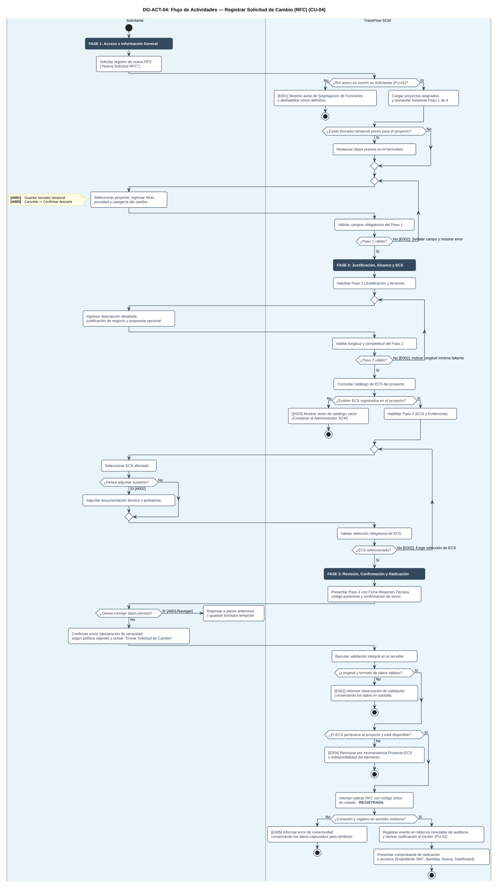
* **Diagrama de caso de uso (`DG-07`):** [`DG-07: Registro y Evaluación de RFC e Incidencias`](assets/diagramas/render/generales/DG-07.svg).

---

#### CU-04.1 — Subsanar Solicitud de Cambio (RFC)

##### 4.1.1. Ficha descriptiva

| Atributo | Detalle |
| :--- | :--- |
| **Id Caso de Uso** | `CU-04.1` (Extensión `<<extend>>` de `CU-04`) |
| **Nombre** | Subsanar Solicitud de Cambio (RFC) |
| **Tipo** | Secundario, correctivo |
| **Requisito ID** | `RF-04` — Registro de Solicitudes de Cambio (RFC) `RN-04`, `RN-07` *(desistimiento voluntario / cierre por vencimiento)* |
| **Versión** | 2.0 (Consolidación SRS-02) |
| **Autor** | C-SharkTeam — Agente 01 (Documentación y Requisitos) |
| **Actores** | **Principal:** Solicitante (`PU-01`, autor original del expediente) **Secundario:** Analista de Requerimientos / Gestor (`PU-02`) |
| **Interacción** | Formulario web de Subsanación de RFC accesado desde el Expediente 360° |
| **Descripción** | Permite al Solicitante original corregir, ampliar o aclarar la información y evidencias de una solicitud observada por el Gestor en revisión inicial (`EN_SUBSANACION`), reingresándola a estado `REGISTRADA` con notas de descargo, o bien formalizar su desistimiento voluntario (`DESESTIMADA`). |
| **Referencias** | `RF-04`, `RN-04`, `RN-07`, `TB-07` (Estados `En Subsanación`, `Registrada`, `Desestimada`), `CU-04`, `CU-05`, `DG-07`, `DG-ACT-04.1` |
| **Precondiciones** | 1. La solicitud existe y pertenece al proyecto activo seleccionado. 2. Su estado oficial es **`EN_SUBSANACION`** (`E002`). 3. El usuario tiene sesión con perfil activo **`Solicitante (PU-01)`** y es el **solicitante original** de esa RFC (`E001`). 4. La subsanación se realiza dentro del plazo reglamentario vigente (`E004`). |
| **Postcondiciones** | **Éxito:** El expediente queda actualizado con los datos corregidos y notas de descargo, retorna al estado **`REGISTRADA`**, se registra auditoría y se notifica al Gestor (`PU-02`) para nueva revisión (`CU-05`). **Desistimiento (`A001`) o plazo vencido (`E004`):** La solicitud pasa al estado terminal **`DESESTIMADA`**. |

##### 4.1.2. Flujo normal de eventos

| **Acción del Actor** | **Respuesta del Sistema** |
| :--- | :--- |
| **Fase 1: Acceso contextual y presentación de observaciones** | |
| **1.** El Solicitante abre una solicitud en estado `EN_SUBSANACION` desde su bandeja y pulsa el botón **"Subsanar Solicitud"** en el expediente. | **2.** El sistema valida que el expediente pertenezca al proyecto activo, que su estado sea **`EN_SUBSANACION`** (`E002`), que el operador sea **`Solicitante (PU-01)`** y titular original del trámite (`E001`), y que no haya expirado el plazo reglamentario (`E004`). Luego presenta destacado el panel **"Observaciones formuladas por el Gestor"** (texto de observaciones, revisor y fecha) y el formulario precargado en cuatro bloques. |
| **Fase 2: Corrección de datos, evidencias y notas de descargo** | |
| **3.** El Solicitante ajusta título, prioridad solicitada o categoría (`A001` si decide desistir), amplía la **Descripción Detallada**, la **Justificación Operativa** y opcionalmente la **Propuesta Técnica Sugerida**; rectifica el **ECS Afectado** si corresponde (`A002` para gestionar archivos adjuntos); e ingresa un resumen aclaratorio en **"Notas de Descargo Formal y Explicación de Cambios"**. Luego pulsa **"Reingresar Solicitud Subsanada"**. | **4.** El sistema verifica que título, descripción, justificación y ECS seleccionado cumplan los criterios obligatorios y pertenezcan al proyecto del trámite (`E003`). |
| **Fase 3: Reingreso formal y notificación** | |
| **5.** El sistema procesa el reingreso confirmado. | **6.** El sistema actualiza la solicitud y transiciona su estado oficial de **`EN_SUBSANACION`** a **`REGISTRADA`**, registra la acción en auditoría, remite notificación al **Analista de Requerimientos / Gestor (`PU-02`)** y muestra el diálogo **"Solicitud Reingresada Satisfactoriamente"** con el botón **"Ir al Expediente 360°"**. |

##### 4.1.3. Flujos alternativos

###### A001: Desistimiento voluntario de la solicitud observada
* **Paso origen:** Paso 3.
* **Condición de activación:** El Solicitante decide retirar definitivamente la iniciativa y pulsa **"Desistir de la Solicitud (Cierre Voluntario)"**.

| **Acción del Actor** | **Respuesta del Sistema** |
| :--- | :--- |
| **A001-1.** El Solicitante pulsa **"Desistir de la Solicitud (Cierre Voluntario)"**. | **A001-2.** El sistema abre el diálogo **"Confirmar Desistimiento de la Solicitud"** advirtiendo que el cierre como **`DESESTIMADA`** es irrevocable, solicitando la fundamentación obligatoria y una casilla de confirmación. |
| **A001-3.** El Solicitante ingresa el motivo de desistimiento, marca la casilla de confirmación y pulsa **"Confirmar Desistimiento Definitivo"** (o **"Volver al Formulario"** para continuar editando). | **A001-4.** El sistema valida que el motivo tenga detalle suficiente (mínimo 10 caracteres) y la casilla marcada (`E003`); registra el cierre formal en estado terminal **`DESESTIMADA`**, graba auditoría y redirige al Expediente 360°. |

###### A002: Incorporar o retirar documentación probatoria de subsanación
* **Paso origen:** Paso 3.
* **Condición de activación:** El Solicitante agrega evidencias aclaratorias solicitadas en el pliego de observaciones o retira adjuntos previos.

| **Acción del Actor** | **Respuesta del Sistema** |
| :--- | :--- |
| **A002-1.** El Solicitante agrega archivos mediante sugerencias o entrada manual (**"Agregar"**) o elimina alguno existente. | **A002-2.** El sistema actualiza la lista visible de documentos vinculados al expediente subsanado. *(Al igual que en `CU-04`, el almacenamiento físico en repositorio centralizado forma parte del requisito aprobado pendiente de implementación real).* Retorna al paso 3. |

##### 4.1.4. Flujos de excepción

###### E001: Proyecto distinto, rol no autorizado o usuario distinto al solicitante original
* **Paso origen:** Paso 2.
* **Condición de activación:** La RFC pertenece a otro proyecto no activo en sesión, el rol activo no es `PU-01` o el usuario conectado no es el autor original del expediente.

| **Acción del Actor** | **Respuesta del Sistema** |
| :--- | :--- |
| **E001-1.** El usuario intenta abrir el formulario de subsanación incumpliendo proyecto, rol o titularidad. | **E001-2.** El sistema bloquea la edición explicando la causa (aislamiento de proyecto con opción de conmutar si tiene permiso, acceso reservado al rol Solicitante, o subsanación restringida al solicitante original) y ofrece volver al expediente en solo lectura. Fin del caso de uso. |

###### E002: Estado incompatible o expediente inexistente
* **Paso origen:** Paso 2.
* **Condición de activación:** La solicitud no existe o su estado actual es distinto a `EN_SUBSANACION`.

| **Acción del Actor** | **Respuesta del Sistema** |
| :--- | :--- |
| **E002-1.** Se intenta acceder a subsanación sobre un expediente inexistente o en otro estado. | **E002-2.** El sistema informa que el expediente no existe o que únicamente las solicitudes en **`EN_SUBSANACION`** admiten corrección formal, ofreciendo volver a la bandeja o al expediente. Fin del caso de uso. |

###### E003: Validación incompleta de campos subsanados o de motivo de desistimiento
* **Paso origen:** Paso 4 y `A001-4`.
* **Condición de activación:** Campos mandatorios vacíos, longitudes insuficientes o falta de motivo/confirmación al desistir.

| **Acción del Actor** | **Respuesta del Sistema** |
| :--- | :--- |
| **E003-1.** El sistema detecta campos faltantes o longitudes por debajo del mínimo requerido. | **E003-2.** Impide el reingreso o cierre, señala los campos observados y solicita completarlos sin perder lo editado. Retorna al paso 3 o al modal `A001`. |

###### E004: Vencimiento del plazo reglamentario de subsanación
* **Paso origen:** Paso 2 *(Requisito normativo aprobado pendiente de automatización temporal)*.
* **Condición de activación:** El Solicitante accede una vez vencido el plazo reglamentario fijado tras la emisión de observaciones.

| **Acción del Actor** | **Respuesta del Sistema** |
| :--- | :--- |
| **E004-1.** Se intenta subsanar fuera del plazo reglamentario establecido para el proyecto. | **E004-2.** El sistema bloquea la edición, informa el vencimiento del plazo y declara el cierre formal del expediente en estado terminal **`DESESTIMADA`**. Fin del caso de uso. |

##### 4.1.5. Reglas de negocio aplicables
* **`RN-04`:** Mantiene la canalización obligatoria por expediente RFC antes de cualquier modificación técnica.
* **`RN-07`:** Regula el cierre formal anticipado como `DESESTIMADA` ante desistimiento o falta de subsanación.

##### 4.1.6. Estados afectados
* **Estado inicial:** **`EN_SUBSANACION`** (Estado 2 de `TB-07`).
* **Estados resultantes:** **`REGISTRADA`** (reingreso normal) o **`DESESTIMADA`** (desistimiento voluntario o vencimiento de plazo).

##### 4.1.7. Criterios de aceptación funcionales
1. Solo el solicitante original autenticado como `PU-01` dentro del proyecto correspondiente puede editar una RFC en `EN_SUBSANACION`.
2. El formulario muestra de forma visible el pliego de observaciones del Gestor junto a la información editable y un campo de notas de descargo.
3. El reingreso exitoso retorna la RFC a `REGISTRADA` y el desistimiento confirmado exige motivo y transiciona de forma irreversible a `DESESTIMADA`.
4. *Brechas registradas respecto al alcance aprobado:* el flujo completo opera actualmente de forma simulada en la interfaz del prototipo, quedando pendiente su integración definitiva con el servidor, el control automático de caducidad de plazo (`E004`), la homologación de categorías con `CU-04` *(la vista de subsanación lista `EVOLUTIVO` además de `CORRECTIVO`/`ADAPTATIVO`/`PERFECTIVO`)* y la conservación histórica de múltiples ciclos de subsanación.

##### 4.1.8. Diagramas correspondientes
* **Diagrama de actividades (`DG-ACT-04.1`):**
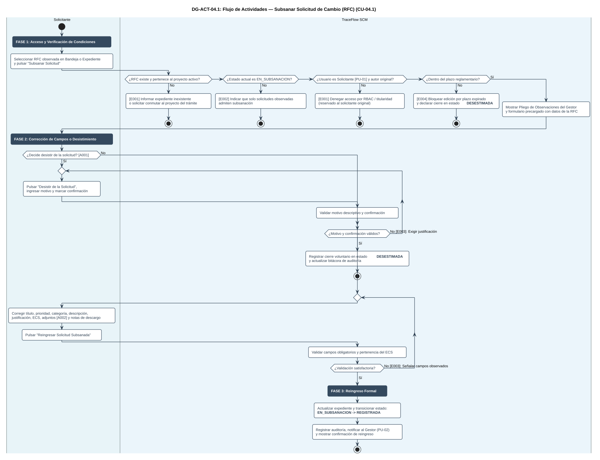
* **Diagrama de caso de uso (`DG-07`):** [`DG-07: Registro y Evaluación de RFC e Incidencias`](assets/diagramas/render/generales/DG-07.svg).

---

#### CU-05 — Validar y clasificar la solicitud

##### 5.1. Ficha descriptiva

| Atributo | Detalle |
| :--- | :--- |
| **Id Caso de Uso** | `CU-05` (Código histórico: `CUS05`) |
| **Nombre** | Validar y clasificar la solicitud |
| **Tipo** | Primario, operativo (Esencial) |
| **Requisito ID** | `RF-04` — Registro de Solicitudes de Cambio (RFC) `RF-05` — Clasificación y Análisis de Impacto *(filtro formal de admisión y triaje)* `RF-14` — Trazabilidad Integral y Registro Inmutable de Auditoría `RN-01` — Aprobación Obligatoria Previa a Modificación e Integración `RN-07` — Desestimación Formal y Cierre Anticipado de Solicitudes |
| **Versión** | 2.1 (Alineación con prototipo y arquitectura SRS-03R) |
| **Autor** | C-SharkTeam — Agente 01 (Documentación y Requisitos) |
| **Actores** | **Principal:** Analista de Requerimientos / Gestor (`PU-02`) **Secundarios:** Solicitante (`PU-01`), Arquitecto / Especialista Técnico (`PU-03`) |
| **Interacción** | Consola web interactiva de **Revisión Inicial y Dictamen de Admisión** dentro del **Expediente 360°** (`/rfcs/:id`), originada desde la **Bandeja General de Solicitudes (RFC)** (`/rfcs`) |
| **Descripción** | Permite al Analista de Requerimientos / Gestor (`PU-02`) ejecutar el triaje administrativo y filtro formal de completitud, coherencia técnica preliminar, legibilidad de evidencias probatorias y pertinencia sobre una Solicitud de Cambio (`RFC`) radicada en estado **`REGISTRADA`**. El Gestor examina la información multidimensional del Expediente 360° y formaliza su decisión institucional a través de tres rutas resolutivas excluyentes: **admitir** la iniciativa hacia la fase de análisis de impacto (`CLASIFICADA`, habilitando el `CU-06`), **observar** la solicitud requiriendo aclaraciones o evidencias adicionales mediante pliego formal (`EN_SUBSANACION`, derivando al `CU-04.1`), o **desestimar** definitivamente el expediente por inviabilidad técnica, fuera de alcance contractual o duplicidad (`DESESTIMADA`, formalizando su archivo irreversible conforme a `RN-07`). |
| **Referencias** | `RF-04`, `RF-05`, `RF-14`, `RN-01`, `RN-05`, `RN-07`, `TB-07` (Estados 1 `Registrada`, 2 `En Subsanación`, 3 `Clasificada`, 11 `Desestimada`), `TB-09` (SoD), `CU-04`, `CU-04.1`, `CU-06`, `DG-07`, `DG-11`, `DG-ACT-05`, `SCREEN-05`, `SCREEN-06`, `WF-06A`, `NAV-05`, `NAV-06`, `PRES-03`, `PRES-04` |
| **Precondiciones** | 1. El usuario cuenta con sesión activa institucional en TraceFlow SCM. 2. El perfil activo en la sesión corresponde a **Analista de Requerimientos / Gestor (`PU-02`)** (ver `E001`). 3. El Gestor tiene asignado el proyecto de software propietario del expediente dentro del marco de aislamiento multitenant (ver `E001`). 4. La Solicitud de Cambio existe y se encuentra en estado oficial **`REGISTRADA`** (ver `E002`). |
| **Postcondiciones** | **Éxito — Ruta de Admisión (Flujo Normal):** 1. La solicitud transiciona a estado oficial **`CLASIFICADA`** (Estado 3 de `TB-07`), manteniendo clasificación técnica preliminar como `PENDIENTE` sujeta a la cuantificación en `CU-06`. 2. Se registran en el expediente el revisor responsable (`admittedBy`), fecha-hora ISO (`admittedAt`) y las observaciones de admisión (`admissionNotes`). 3. Se estampa el evento inmutable en la bitácora de auditoría con firma criptográfica SHA-256 (`RFC_ADMITIDA`). 4. El sistema presenta el aviso de éxito en pantalla, actualiza el banner contextual del expediente y habilita al Arquitecto / Especialista Técnico (`PU-03`) el botón **"Realizar Análisis de Impacto Técnico"** (`CU-06`). *(Nota de notificación: el aviso se despliega de forma síncrona en la interfaz; el despacho de notificaciones asíncronas vía SMTP/WebSockets permanece pendiente de integración física en backend).* **Éxito — Ruta de Observación (`A001`):** 1. La solicitud transiciona a estado oficial **`EN_SUBSANACION`** (Estado 2 de `TB-07`). 2. Se persisten el pliego formal de observaciones (`subsanacionNotes`), el revisor (`observedBy`) y fecha-hora (`observedAt`). 3. Se registra el evento de auditoría `RFC_OBSERVADA`. 4. Se despliega la alerta de confirmación en pantalla y el Expediente 360° muestra el banner de observaciones pendientes, habilitando el botón **"Subsanar Solicitud"** exclusivamente al Solicitante original autor de la RFC (`PU-01`) para ejecutar el **`CU-04.1`**. **Éxito — Ruta de Desestimación (`A002`):** 1. La solicitud pasa a estado terminal **`DESESTIMADA`** (Estado 11 de `TB-07`), formalizando su cierre anticipado irreversible bajo `RN-07`. 2. Se registra la fundamentación obligatoria (`dismissalReason`), responsable del archivo (`dismissedBy`), fecha de cierre (`dismissedAt`, `closedAt`). 3. Se genera el evento de auditoría inmutable `RFC_DESESTIMADA`. 4. El expediente queda bloqueado de forma permanente contra cualquier modificación futura; el Solicitante puede consultar la resolución en modo solo lectura. **Restricción o cancelación (`E001`..`E004`):** No se altera el estado oficial del expediente, no se generan registros resolutivos de auditoría y se preserva el trámite en su estado previo. |

##### 5.2. Flujo normal de eventos

| **Acción del Actor** | **Respuesta del Sistema** |
| :--- | :--- |
| **Fase 1: Identificación y recepción en Bandeja General de Solicitudes** | |
| **1.** El Analista de Requerimientos / Gestor accede al menú principal de navegación lateral y pulsa **"Bandeja de Solicitudes"** (o navega a la ruta `/rfcs`). | **2.** El sistema verifica que la sesión esté autenticada, recupera las RFCs correspondientes al proyecto de software activo en la sesión (respetando el aislamiento multitenant) y despliega la pantalla **Bandeja General de Solicitudes (RFC)** (`SCREEN-05` / `PRES-03`), mostrando contadores de registros, la barra de búsqueda y filtros (**Buscar por código, título o solicitante...**, desplegable de **Estado** con las opciones normativas de `TB-07` y desplegable de **Clasificación**) junto a la tabla de alta densidad con columnas: **Código RFC**, **Título y Justificación Resumida**, **Prioridad**, **Clasificación**, **Estado**, **Solicitante**, **Fecha** y **Acción**. El botón **"+ Nueva Solicitud RFC"** se mantiene visible pero inhabilitado con tooltip de advertencia SoD (acción exclusiva de Solicitante `PU-01`). |
| **3.** El Gestor identifica las solicitudes pendientes de triaje seleccionando la opción **"REGISTRADA"** en el filtro de **Estado** (o ingresando el código correlativo en la barra de búsqueda) y pulsa el botón **"Ver"** (o hace clic sobre el código o título formal) del registro deseado. | **4.** El sistema valida que el expediente pertenezca al proyecto activo (`E001`) y que el rol activo en sesión sea **Analista de Requerimientos / Gestor (`PU-02`)** (`E001`). Luego verifica que la solicitud se encuentre en estado oficial **`REGISTRADA`** (`E002`), recupera los datos íntegros del trámite y despliega la pantalla del **Expediente 360°** (`SCREEN-06` / `PRES-04`) en su variante contextual **`WF-06A`** (**Admisión y Filtro de Completitud**). En la cabecera, presenta el código único (`RFC-AAAA-NNNN`), badge de estado oficial **`Registrada`**, categoría, título formal, fecha-hora de radicación y la cuadrícula de metadatos clave: **Proyecto de Software**, **Solicitante**, **Prioridad Solicitada** y **Clasificación** (indicando inicialmente *"Pendiente de Clasificación"*). En el bloque superior de decisiones, despliega destacada la consola **"Revisión Inicial y Dictamen de Admisión"** con el badge institucional **"Rol Activo: Gestor"** y las tres alternativas de resolución: **"Opción A: Admitir RFC"**, **"Opción B: Observar RFC"** y **"Opción C: Desestimar RFC"**. |
| **Fase 2: Inspección integral del Expediente 360° y evidencias** | |
| **5.** El Gestor efectúa la inspección integral del trámite recorriendo las pestañas estructuradas del expediente: a) En la pestaña **"Resumen y justificación"**: revisa el **Título Formal de la Solicitud**, la **Descripción Detallada del Requerimiento o Falla**, la **Justificación de Negocio / Valor Agregado**, la **Propuesta Técnica Sugerida por el Solicitante** (si fue registrada), antecedentes de subsanaciones anteriores si la solicitud reingresó de un ciclo previo, y la sección de **Documentación Técnica y Evidencias Adjuntas** (`E004` si detecta evidencias ilegibles, dañadas o insuficientes). b) En la pestaña **"Elementos afectados (ECS)"**: verifica el artefacto primario vinculado, constatando código (`ECS-NNN`), nombre, tipo, versión vigente en línea base (`vX.Y`), proyecto propietario, **Biblioteca actual** (`MAESTRA`, `SOPORTE`, `DESARROLLO`) y estado de bloqueo concurrente bajo regla `RN-06`. c) Contrasta los antecedentes con el inventario de solicitudes del proyecto para descartar duplicidades de alcance. | **6.** El sistema mantiene accesibles las pestañas consultadas, preserva la información en modo lectura estructurada y conserva activa la consola de resolución en la cabecera de trabajo para que el Gestor emita su dictamen administrativo. |
| **Fase 3: Emisión del dictamen formal de admisión (Flujo Normal)** | |
| **7.** El Gestor selecciona la tarjeta interactiva **"Opción A: Admitir RFC"** (`A001` si decide observar, `A002` si decide desestimar). El sistema despliega el formulario de admisión con el campo **"Dictamen Preliminar / Observaciones de Admisión:"** precargado con el texto sugerido *"Solicitud admitida formalmente tras verificación de completitud y pertinencia."* y la nota regulatoria *"La clasificación técnica definitiva será determinada tras el informe de impacto."*. El Gestor revisa o complementa la nota y pulsa el botón **"Admitir Solicitud (REGISTRADA → CLASIFICADA)"**. | **8.** El sistema valida que la transición normativa esté permitida según la máquina de estados `DG-11` (`E002`), actualiza el estado de la entidad a **`CLASIFICADA`**, registra en el expediente el nombre del revisor (`admittedBy`), fecha-hora ISO (`admittedAt`) y las notas de admisión (`admissionNotes`), y persiste los cambios de forma atómica en el almacén de datos. |
| | **9.** El sistema genera e inserta un evento inmutable en la bitácora de auditoría (`RFC_ADMITIDA` con firma SHA-256 e IP de origen), muestra en pantalla la alerta verde de confirmación: **"La solicitud [código] fue admitida formalmente (REGISTRADA -> CLASIFICADA)."**, actualiza el banner contextual del Expediente 360° al estado verde **"Solicitud Admitida Formalmente — Pendiente de Dictamen de Arquitectura"** y habilita el botón contextual **"Realizar Análisis de Impacto Técnico"** para el rol de Arquitecto / Especialista Técnico (`PU-03`) conforme al **`CU-06`**. *(Fin del flujo normal).* |

> [!IMPORTANT]
> **Discrepancias detectadas (`DEV-02` / SRS-03R) y criterios técnicos de delimitación:** 
> 1. *Triaje de admisión vs. Clasificación dimensional técnica:* Aunque la denominación histórica del caso es "Validar y clasificar la solicitud", la arquitectura aprobada en SAD y el prototipo funcional delimitan que la clasificación técnica dimensional formal (determinar si es **Cambio Menor** o **Cambio Mayor** sobre esfuerzo, costo y cronograma) es competencia exclusiva del **Arquitecto / Especialista Técnico (`PU-03`)** mediante el Informe Técnico de Impacto TIA (`CU-06`, `RN-05`). En `CU-05`, el Gestor realiza la **admisión formal administrativa** hacia el estado `CLASIFICADA` (Estado 3 de `TB-07`), permaneciendo la clasificación dimensional en estado "Pendiente" hasta la emisión del TIA. 
> 2. *Desacople de endpoint backend:* El SAD especifica el endpoint `PATCH /api/v1/rfcs/{id}/classify` para persistir la decisión de triaje. En el backend NestJS actual (`backend/src/modules/rfcs/rfcs.controller.ts`), dicho endpoint no está expuesto aún (solo operan `GET /rfcs`, `GET /rfcs/:id` y `POST /rfcs`), por lo que la transición opera actualmente a través del adaptador y almacén local de estados (`useRfcStore`). 
> 3. *Notificaciones en pantalla vs. despacho automático:* La confirmación de las decisiones de admisión, observación y desestimación se despliega de forma síncrona mediante avisos visuales (banners y alertas) en el navegador del operador. El envío automatizado de notificaciones asíncronas vía correo electrónico institucional o WebSockets al Solicitante (`PU-01`) o Arquitecto (`PU-03`) forma parte del alcance aprobado pendiente de habilitación en servidor. 
> 4. *Historial de ciclos de observación:* El prototipo actual almacena las observaciones del último ciclo en el atributo `subsanacionNotes`. La conservación histórica estructurada de múltiples iteraciones sucesivas de observación/subsanación queda registrada a través de la bitácora de auditoría, postergando la creación de una entidad relacional dedicada a fases posteriores.

##### 5.3. Flujos alternativos

###### A001: Observar la solicitud por información incompleta o insuficiente (`Opción B`)
* **Paso origen:** Paso 7 del flujo normal.
* **Condición de activación:** La RFC presenta vacíos en la justificación operativa, alcance ambiguo, falta de sustento técnico en el ECS seleccionado o evidencias adjuntas insuficientes/inconsistentes (`E004`).

| **Acción del Actor** | **Respuesta del Sistema** |
| :--- | :--- |
| **A001-1.** El Gestor pulsa la tarjeta interactiva **"Opción B: Observar RFC"** en la consola de revisión inicial. | **A001-2.** El sistema activa el panel de formulación de observaciones, presentando el campo de captura **"Pliego Formal de Observaciones para Subsanación *"** con el indicador de obligatoriedad y longitud *"Mínimo 10 caracteres"*, el texto guía (*placeholder*) *"Indique detalladamente al solicitante qué campos corregir (justificación, alcance, evidencias probatorias)..."*, la advertencia regulatoria *"La solicitud pasará a estado de subsanación para que el solicitante formule sus descargos."* y el botón **"Emitir Pliego de Observaciones (REGISTRADA → EN_SUBSANACION)"**. |
| **A001-3.** El Gestor redacta con precisión las deficiencias identificadas, los antecedentes requeridos y las instrucciones de subsanación técnica, y pulsa **"Emitir Pliego de Observaciones (REGISTRADA → EN_SUBSANACION)"**. | **A001-4.** El sistema valida que el pliego no esté vacío y contenga al menos 10 caracteres descriptivos (`E003`). Al superar la validación, transiciona el estado oficial de la solicitud de **`REGISTRADA`** a **`EN_SUBSANACION`** (Estado 2 de `TB-07`), persiste el texto en `subsanacionNotes`, guarda el nombre del revisor en `observedBy` y la marca temporal ISO en `observedAt`. |
| | **A001-5.** El sistema registra el evento `RFC_OBSERVADA` en la bitácora inmutable de auditoría (SHA-256), presenta en pantalla la alerta verde: **"Se emitió el pliego de observaciones para [código] (REGISTRADA -> EN_SUBSANACION)."** y actualiza el banner del Expediente 360° al estado ámbar **"Pliego de Observaciones Pendiente de Subsanación"** (con badge **"Acción del Solicitante"**), publicando el pliego para consulta del expediente. **Continuación para el Solicitante (`CU-04.1`):** Cuando el Solicitante original autor del trámite (`PU-01`) accede a la solicitud desde su bandeja, el sistema le muestra el pliego formal emitido y le habilita el botón **"Subsanar Solicitud"** (`/rfcs/:id/edit`), iniciando formalmente el flujo de subsanación correctiva reglamentado en el **`CU-04.1`**. *(Fin del caso de uso).* |

###### A002: Desestimar la solicitud por improcedencia, duplicidad o fuera de alcance (`Opción C`)
* **Paso origen:** Paso 7 del flujo normal.
* **Condición de activación:** La solicitud resulta manifiestamente inviable técnica u operativamente, duplica un requerimiento ya atendido o en curso, o contraviene el alcance contractual y la línea base del proyecto.

| **Acción del Actor** | **Respuesta del Sistema** |
| :--- | :--- |
| **A002-1.** El Gestor pulsa la tarjeta interactiva **"Opción C: Desestimar RFC"** en la consola de revisión inicial. | **A002-2.** El sistema activa el panel de desestimación formal, mostrando el campo de captura **"Fundamentación Mandatoria de Desestimación *"** con el indicador *"Mínimo 10 caracteres"*, el texto guía *"Explique las razones de improcedencia, falta de justificación o inviabilidad del cambio..."*, la casilla obligatoria de confirmación: **"Confirmo la desestimación definitiva de este expediente y su archivo en estado DESESTIMADA."**, el aviso de irrevocabilidad *"Esta acción es irreversible e inhabilita ulteriores modificaciones."* y el botón **"Desestimar Definitivamente (REGISTRADA → DESESTIMADA)"**. |
| **A002-3.** El Gestor redacta la fundamentación mandatoria del rechazo preliminar, marca la casilla de confirmación y pulsa **"Desestimar Definitivamente (REGISTRADA → DESESTIMADA)"**. | **A002-4.** El sistema valida que la fundamentación contenga al menos 10 caracteres y que la casilla de confirmación se encuentre expresamente marcada (`E003`). Al superar la validación, transiciona el estado oficial de la solicitud a **`DESESTIMADA`** (Estado 11 terminal de `TB-07`) conforme a la regla `RN-07`, almacena el motivo en `dismissalReason`, el responsable en `dismissedBy` y la fecha-hora en `dismissedAt` y `closedAt`. |
| | **A002-5.** El sistema registra el evento `RFC_DESESTIMADA` en la bitácora inmutable de auditoría (SHA-256), bloquea de forma permanente cualquier acción de edición o reapertura sobre el expediente, despliega la alerta: **"La solicitud [código] fue desestimada y archivada definitivamente (REGISTRADA -> DESESTIMADA)."** y actualiza el banner del expediente al estado gris **"Solicitud Desestimada"**. El Solicitante puede visualizar el expediente cerrado y la justificación formal en modo solo lectura desde su bandeja. *(Fin del caso de uso).* |

##### 5.4. Flujos de excepción

###### E001: Perfil activo no autorizado o proyecto no asignado (Segregación de Funciones y Aislamiento Multitenant)
* **Paso origen:** Pasos 2 y 4 del flujo normal.
* **Condición de activación:** La sesión activa no corresponde al perfil **Analista de Requerimientos / Gestor (`PU-02`)** o el expediente pertenece a un proyecto de software diferente al actualmente activo en la sesión.

| **Acción del Actor** | **Respuesta del Sistema** |
| :--- | :--- |
| **E001-1.** Un usuario intenta acceder a la revisión inicial de una RFC de otro proyecto o contando con un perfil distinto a `PU-02`. | **E001-2.** El sistema evalúa la infracción de acceso: a) *Aislamiento multitenant:* Si la RFC pertenece a otro proyecto, intercepta el acceso y presenta la vista de advertencia institucional **"Aislamiento de Proyecto • Restricción Multitenant"** (**"Acceso Bloqueado: Expediente de Proyecto Externo"**), mostrando la comparativa de IDs de proyecto. Si el usuario tiene asignado dicho proyecto en su cuenta, ofrece el botón **"Conmutar al proyecto [Nombre] y abrir expediente"**; en caso contrario, muestra denegación de acceso y el botón **"Regresar a la Bandeja de mi Proyecto"**. b) *Segregación de Funciones (SoD):* Si el proyecto es correcto pero el rol activo no es `PU-02`, el sistema presenta el Expediente 360° en solo lectura y reemplaza la consola de dictamen por el aviso informativo: **"Revisión Inicial Reservada al Gestor"** (con icono de candado), señalando el rol activo actual del usuario y recordando que la revisión formal corresponde con exclusividad al Gestor (`PU-02`). Fin del caso de uso. |

###### E002: Estado oficial incompatible para triaje inicial
* **Paso origen:** Pasos 4 y 8 del flujo normal.
* **Condición de activación:** La solicitud seleccionada no se encuentra en estado oficial **`REGISTRADA`** al momento de abrir el expediente o al enviar la orden de transición.

| **Acción del Actor** | **Respuesta del Sistema** |
| :--- | :--- |
| **E002-1.** El operador intenta dictaminar una RFC que ya fue admitida (`CLASIFICADA`), observada (`EN_SUBSANACION`) o cerrada previamente. | **E002-2.** El sistema rechaza la transición invocando las reglas de la máquina de estados `DG-11`, bloquea la ejecución de las acciones resolutivas y presenta un aviso indicando que el expediente se encuentra en estado `[Estado Actual]` y no admite revisión inicial de admisión. Fin del caso de uso. |

###### E003: Observaciones, fundamentación o confirmación insuficientes
* **Paso origen:** Pasos `A001-4` y `A002-4`.
* **Condición de activación:** El pliego de observaciones formulado en `A001` o la fundamentación de desestimación en `A002` tienen una extensión inferior a 10 caracteres, o bien no se marcó la casilla obligatoria de confirmación de desestimación definitiva.

| **Acción del Actor** | **Respuesta del Sistema** |
| :--- | :--- |
| **E003-1.** El Gestor pulsa emitir observaciones o desestimar sin cumplir con las validaciones obligatorias de formulario. | **E003-2.** El sistema detiene el procesamiento en cliente/servidor, cancela la transición de estado, conserva íntegramente los textos digitados en pantalla y despliega el mensaje de error específico en el panel de acción: - Si el pliego tiene menos de 10 caracteres: **"El pliego de observaciones debe contener al menos 10 caracteres descriptivos."** - Si la fundamentación de desestimación tiene menos de 10 caracteres: **"La justificación de desestimación es obligatoria y debe contener al menos 10 caracteres."** - Si no se marcó la casilla de desestimación: **"Debe marcar la casilla de confirmación para desestimar definitivamente el expediente."** El Gestor corrige la omisión y reintenta el envío. |

###### E004: Evidencias probatorias o anexos técnicos ilegibles o inconsistentes
* **Paso origen:** Paso 5 del flujo normal.
* **Condición de activación:** Los documentos técnicos, diagramas o actas adjuntas presentan formatos corruptos, resolución ilegible o falta de correspondencia con el problema reportado.

| **Acción del Actor** | **Respuesta del Sistema** |
| :--- | :--- |
| **E004-1.** El Gestor constata en la pestaña **"Resumen y justificación"** que los anexos no respaldan fehacientemente la solicitud. | **E004-2.** El Gestor no aprueba la admisión directa y canaliza el expediente hacia la **Opción B (`A001`)**, emitiendo un pliego de observaciones donde instruye al Solicitante adjuntar evidencias legibles o informes técnicos complementarios a través de la consola de subsanación de **`CU-04.1`**. |

##### 5.5. Reglas de negocio aplicables
* **`RN-01` (Aprobación Obligatoria Previa a Modificación e Integración):** Constituye el principio rector de configuración; ninguna solicitud puede avanzar a análisis de impacto técnico ni a implementación operativa sin haber superado el filtro formal de admisión administrativa.
* **`RN-07` (Desestimación Formal y Cierre Anticipado de Solicitudes):** Garantiza que todo descarte de una iniciativa en triaje inicial deba fundamentarse formalmente con expresión de causa técnica u operativa y archivarse en el estado terminal irreversible `DESESTIMADA`.
* **`RN-05` (Evaluación Técnica y Clasificación Obligatoria — Delimitación de Roles):** Establece que la cuantificación dimensional sobre la Triple Restricción (Alcance, Tiempo, Costo) y la determinación final entre Cambio Menor o Cambio Mayor corresponden al Arquitecto (`PU-03`) mediante el Informe Técnico de Impacto TIA (`CU-06`), delimitando que `CU-05` cumple una función de triaje y admisión preliminar.
* **Matriz de Segregación de Funciones (`TB-09` / SoD):** Reserva de forma estricta y excluyente al rol **Analista de Requerimientos / Gestor (`PU-02`)** la potestad de admitir, observar o desestimar solicitudes en estado `REGISTRADA`.

##### 5.6. Estados afectados
* **Estado inicial:** **`REGISTRADA`** (Estado 1 de `TB-07`).
* **Estados resultantes:**
  * **`CLASIFICADA`** (Estado 3 de `TB-07`): ante dictamen favorable de admisión formal (`Flujo Normal`).
  * **`EN_SUBSANACION`** (Estado 2 de `TB-07`): ante emisión formal de pliego de observaciones (`A001`).
  * **`DESESTIMADA`** (Estado 11 terminal de `TB-07`): ante desestimación justificada por inviabilidad, duplicidad o fuera de alcance (`A002`).

##### 5.7. Criterios de aceptación funcionales y observables
1. **Segregación de Funciones estricta:** Exclusivamente el usuario autenticado con el perfil activo **Analista de Requerimientos / Gestor (`PU-02`)** y con asignación al proyecto de software puede visualizar habilitada y ejecutar la consola interactiva **"Revisión Inicial y Dictamen de Admisión"** sobre una RFC en estado `REGISTRADA`.
2. **Triaje por Bandeja General:** La bandeja de solicitudes permite al Gestor filtrar de manera unívoca los expedientes en estado `REGISTRADA` y acceder directamente a su Expediente 360° mediante el botón **"Ver"** o el enlace del código correlativo.
3. **Consola interactiva de tres vías:** En el Expediente 360° de una RFC `REGISTRADA`, el sistema ofrece visualmente tres opciones diferenciadas por colorimetría institucional: **"Opción A: Admitir RFC"** (verde esmeralda), **"Opción B: Observar RFC"** (ámbar) y **"Opción C: Desestimar RFC"** (rojo carmesí).
4. **Validación de campos obligatorios y extensiones mínimas:**
   * La emisión de observaciones (`Opción B`) exige obligatoriamente un pliego con extensión mínima de **10 caracteres**; de lo contrario, se bloquea la transición y se despliega el mensaje de error: *"El pliego de observaciones debe contener al menos 10 caracteres descriptivos."*.
   * La desestimación definitiva (`Opción C`) exige obligatoriamente una justificación de al menos **10 caracteres** y el marcado afirmativo de la casilla de confirmación de irreversibilidad; ante omisión, se despliega el mensaje de error correspondiente y se cancela la transición.
5. **Transiciones atómicas y trazabilidad inmutable:** Cada una de las tres decisiones actualiza de forma inmediata y excluyente el estado oficial en el almacén de datos (`CLASIFICADA`, `EN_SUBSANACION` o `DESESTIMADA`), persiste revisor y fecha-hora ISO, y concatena un evento en la bitácora de auditoría con firma SHA-256 (`RFC_ADMITIDA`, `RFC_OBSERVADA`, `RFC_DESESTIMADA`).
6. **Despliegue contextual y habilitación de etapas posteriores:**
   * Al admitir la RFC, el Expediente 360° actualiza el banner al estado verde de admisión y habilita para el Arquitecto (`PU-03`) el botón **"Realizar Análisis de Impacto Técnico"** (`CU-06`).
   * Al observar la RFC, el expediente actualiza el banner al estado ámbar, hace visible el pliego y habilita para el Solicitante original autor del trámite (`PU-01`) el botón **"Subsanar Solicitud"** (`CU-04.1`).
   * Al desestimar la RFC, el expediente pasa a solo lectura permanente, advirtiendo su archivo definitivo bajo `RN-07`.
7. **Delimitación de capacidades simuladas en prototipo:** Las decisiones de triaje actualizan reactivamente el estado en cliente y la persistencia local (`useRfcStore` / `localStorage`). Los avisos de confirmación se presentan de forma síncrona en la interfaz; la emisión de notificaciones asíncronas vía SMTP/WebSockets hacia el Solicitante o Arquitecto, la persistencia en base de datos mediante el endpoint `PATCH /api/v1/rfcs/{id}/classify` y el almacenamiento físico de adjuntos permanecen formalmente identificados como componentes pendientes de integración backend.

##### 5.8. Diagramas correspondientes
* **Diagrama de actividades (`DG-ACT-05`):**
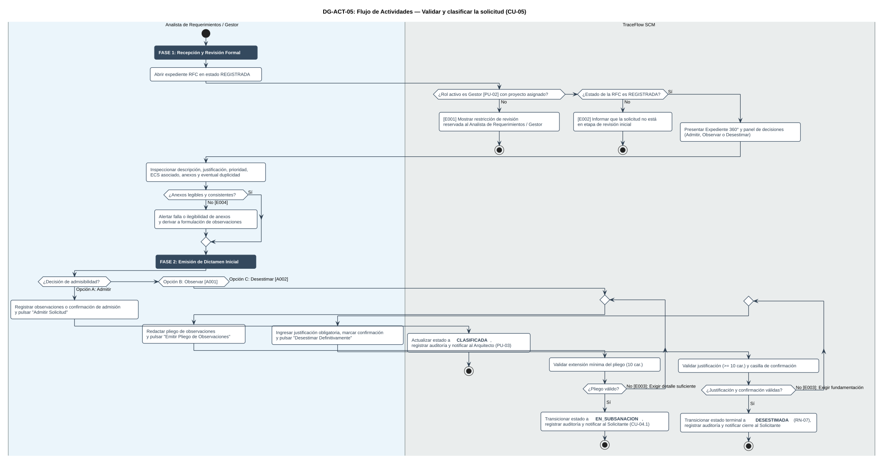
* **Diagrama de caso de uso (`DG-07`):** [`DG-07: Registro y Evaluación de RFC e Incidencias`](assets/diagramas/render/generales/DG-07.svg).

---

#### CU-06 — Realizar análisis de impacto técnico

##### 6.1. Ficha descriptiva

| Atributo | Detalle |
| :--- | :--- |
| **Id Caso de Uso** | `CU-06` (Código histórico: `CUS06`) |
| **Nombre** | Realizar análisis de impacto técnico |
| **Tipo** | Primario, analítico (Esencial) |
| **Requisito ID** | `RF-05` — Clasificación y Análisis de Impacto `RN-01`, `RN-05` — Evaluación Técnica y Clasificación Obligatoria |
| **Versión** | 2.0 (Consolidación SRS-02) |
| **Autor** | C-SharkTeam — Agente 01 (Documentación y Requisitos) |
| **Actores** | **Principal:** Arquitecto / Especialista Técnico (`PU-03`) **Secundarios:** Analista de Requerimientos / Gestor (`PU-02`), Comité de Control de Cambios (`PU-04`) |
| **Interacción** | Consola web de Evaluación de Impacto Técnico |
| **Descripción** | Permite al Arquitecto / Especialista Técnico analizar la viabilidad e implicancias técnicas de una RFC admitida (`CLASIFICADA` / `EN_ANALISIS_TECNICO`), cuantificando la afectación a la Triple Restricción (esfuerzo, costo y cronograma), identificando ECS afectados y dependientes, evaluando riesgos técnicos y plan preliminar de rollback, y emitiendo el **Informe Técnico de Impacto (`TIA`)** que clasifica formalmente el cambio como **Cambio Menor** (`CU-30`) o **Cambio Mayor** (`CU-07`). |
| **Referencias** | `RF-05`, `RN-01`, `RN-05`, `TB-07` (Estados 3, 4 y 5), `CU-05`, `CU-07`, `CU-30`, `DG-07`, `DG-ACT-06` |
| **Precondiciones** | 1. El operador posee sesión activa con perfil **`Arquitecto / Especialista Técnico (PU-03)`** y asignación al proyecto de la RFC (`E001`). 2. Por Segregación de Funciones, el Arquitecto **no es el solicitante original** de la RFC evaluada (`E001`). 3. La RFC se encuentra en estado **`CLASIFICADA`** o **`EN_ANALISIS_TECNICO`** y no cuenta con un Informe Técnico de Impacto previo congelado (`E002`). |
| **Postcondiciones** | **Éxito:** Se emite de forma inmutable el Informe Técnico de Impacto (`TIA-AAAA-NNNN`) vinculado al expediente, la RFC pasa a estado **`EN_EVALUACION`** con clasificación oficial `CAMBIO_MENOR` o `CAMBIO_MAYOR`, se registra auditoría y se enruta a **Doble Llave (`CU-30`)** o **CCB (`CU-07`)**. |

##### 6.2. Flujo normal de eventos

| **Acción del Actor** | **Respuesta del Sistema** |
| :--- | :--- |
| **Fase 1: Acceso contextual y validaciones de segregación** | |
| **1.** El Arquitecto / Especialista Técnico selecciona **"Análisis de Impacto Técnico"** sobre una RFC admitida en estado `CLASIFICADA` o `EN_ANALISIS_TECNICO`. | **2.** El sistema verifica perfil activo **`PU-03`**, pertenencia del proyecto, prohibición de autoevaluación frente al solicitante original (`E001`), estado válido y ausencia de informe previo congelado (`E002`). Luego sitúa el contexto en análisis técnico y presenta los datos de la RFC, las notas de admisión del Gestor y el catálogo completo de `ECS` del proyecto. |
| **Fase 2: Cuantificación de Triple Restricción, alcance y riesgos** | |
| **3.** El Arquitecto estima el **Esfuerzo Técnico (Horas-Hombre)**, **Presupuesto Estimado (S/.)** e **Impacto en Cronograma (Días Útiles)** (`A001` si requiere aclaración de alcance previa); selecciona uno o más **ECS afectados y dependientes** del proyecto, redacta el **Resumen y Fundamentación Técnica**, define el **Nivel de Riesgo Global** (*Bajo*, *Medio*, *Alto*), marca o añade los **Riesgos Técnicos Específicos**, y describe el **Plan Preliminar de Rollback / Contingencia**. | **4.** El sistema muestra en pantalla los contadores y preselección del ECS primario de la RFC, manteniendo la coherencia con el catálogo del proyecto. |
| **Fase 3: Dictamen técnico, congelamiento y enrutamiento** | |
| **5.** El Arquitecto selecciona la clasificación (**Cambio Menor** o **Cambio Mayor**) y el **Dictamen Técnico Final** (`PROCEDE_MENOR`, `PROCEDE_MAYOR` o `RECHAZO_TECNICO`, ver `E004`), y pulsa **"Firmar y Emitir Informe Técnico (CU-06)"**. | **6.** El sistema valida que el esfuerzo sea mayor a `0`, el costo y días no sean negativos, la fundamentación técnica tenga al menos **15 caracteres** y exista al menos un `ECS` válido del proyecto (`E003`). |
| | **7.** El sistema genera y congela el **Informe Técnico de Impacto (`TIA-AAAA-NNNN`)**, transiciona la RFC al estado oficial **`EN_EVALUACION`** con la clasificación asignada, registra la acción en auditoría, deriva el expediente hacia **Doble Llave (`CU-30`)** o **CCB (`CU-07`)** y presenta la confirmación **"¡Informe Técnico de Impacto Emitido con Éxito!"**. |

##### 6.3. Flujos alternativos

###### A001: Solicitud de aclaración técnica antes de dictaminar
* **Paso origen:** Paso 3.
* **Condición de activación:** El Arquitecto detecta ambigüedad técnica puntual sobre requisitos funcionales o alcance de integración que no impide haber admitido la solicitud.

| **Acción del Actor** | **Respuesta del Sistema** |
| :--- | :--- |
| **A001-1.** El Arquitecto formula una consulta técnica al Gestor / Solicitante para precisar alcance o restricciones operativas. | **A001-2.** El sistema registra la consulta y notifica al Gestor para consignar la aclaración correspondiente *(mecanismo de mensajería interna pendiente de implementación automatizada)*. Una vez precisada, retorna al paso 3. |

##### 6.4. Flujos de excepción

###### E001: Violación de Segregación de Funciones o falta de acceso al proyecto
* **Paso origen:** Paso 2.
* **Condición de activación:** El usuario no actúa como `PU-03`, no tiene el proyecto asignado o figura como el solicitante original de la RFC.

| **Acción del Actor** | **Respuesta del Sistema** |
| :--- | :--- |
| **E001-1.** El usuario intenta evaluar una solicitud fuera de sus proyectos, sin rol `PU-03` o registrada por él mismo. | **E001-2.** El sistema bloquea el formulario mostrando el aviso normativo correspondiente (**Aislamiento de Proyecto** o **Incompatibilidad Normativa por Segregación de Funciones — RN-05**) e inhabilita el botón de firma. Fin del caso de uso. |

###### E002: Estado incompatible o Informe Técnico ya congelado
* **Paso origen:** Paso 2.
* **Condición de activación:** La RFC está en un estado distinto a `CLASIFICADA` / `EN_ANALISIS_TECNICO` o ya posee un informe emitido previamente.

| **Acción del Actor** | **Respuesta del Sistema** |
| :--- | :--- |
| **E002-1.** El Arquitecto accede a evaluar una solicitud no admitida o ya dictaminada. | **E002-2.** El sistema informa que el expediente no está disponible para evaluación o que su informe técnico ya fue congelado de manera inmutable, permitiendo consultar el expediente existente. Fin del caso de uso. |

###### E003: Parámetros inválidos o fundamentación técnica incompleta
* **Paso origen:** Paso 6.
* **Condición de activación:** Esfuerzo `<= 0`, costo o días negativos, fundamentación menor a 15 caracteres o falta de selección de ECS válido del proyecto.

| **Acción del Actor** | **Respuesta del Sistema** |
| :--- | :--- |
| **E003-1.** El Arquitecto intenta firmar el informe con estimaciones inválidas o sustento insuficiente. | **E003-2.** El sistema rechaza el registro, muestra el error específico en pantalla y mantiene los datos capturados para su corrección. Retorna al paso 3. |

###### E004: Dictamen de inviabilidad técnica absoluta (`RECHAZO_TECNICO`)
* **Paso origen:** Paso 5 y Paso 7.
* **Condición de activación:** El Arquitecto concluye que la modificación compromete la estabilidad, seguridad o restricciones arquitectónicas del sistema de forma inaceptable.

| **Acción del Actor** | **Respuesta del Sistema** |
| :--- | :--- |
| **E004-1.** El Arquitecto emite el dictamen **`INVIABLE TÉCNICAMENTE (RECHAZO_TECNICO)`** manteniendo el análisis de riesgos que lo sustenta. | **E004-2.** El sistema congela el Informe Técnico de Impacto con dicha recomendación y transiciona la RFC a **`EN_EVALUACION`** enrutándola hacia el **Comité de Control de Cambios (`CU-07`)** para formalizar su rechazo colegiado conforme a `RN-07`. |

##### 6.5. Reglas de negocio aplicables
* **`RN-05` (Evaluación Técnica y Clasificación Obligatoria):** Prohíbe autorizar cualquier RFC sin Informe Técnico de Impacto previo sobre arquitectura, dependencias, riesgos y Triple Restricción, exigiendo segregación frente al solicitante.
* **`RN-01`:** Supedita la emisión de órdenes y cambios al dictamen clasificatorio resultante.

##### 6.6. Estados afectados
* **Estado inicial:** **`CLASIFICADA`** (Estado 3) / **`EN_ANALISIS_TECNICO`** (Estado 4 intermedio de `TB-07`).
* **Estado resultante:** **`EN_EVALUACION`** (Estado 5 de `TB-07`), habilitando `CU-30` (Cambio Menor) o `CU-07` (Cambio Mayor).

##### 6.7. Criterios de aceptación funcionales
1. Ningún usuario que haya registrado una RFC puede evaluar su propio impacto técnico (`SoD` anti-autoevaluación), ni tampoco un usuario ajeno al proyecto o sin perfil `PU-03`.
2. Todo informe emitido registra cuantitativamente esfuerzo (`> 0`), costo (`>= 0`), impacto en días (`>= 0`), al menos un ECS afectado, fundamentación técnica (`>= 15` caracteres), riesgos, plan de rollback y clasificación (`Cambio Menor` o `Cambio Mayor`).
3. Una vez firmado, el Informe Técnico de Impacto queda inmutable y no permite emitir un segundo informe sobre la misma RFC.
4. La emisión transiciona la RFC a `EN_EVALUACION` sin aprobarla automáticamente ni emitir orden de cambio todavía.
5. *Brechas registradas respecto al alcance aprobado:* el módulo opera actualmente de forma simulada en la interfaz del prototipo, quedando pendiente su persistencia e imposición de reglas en el servidor, la mensajería de aclaraciones (`A001`) y las notificaciones automáticas hacia CCB/Autoridad Delegada.

##### 6.8. Diagramas correspondientes
* **Diagrama de actividades (`DG-ACT-06`):**
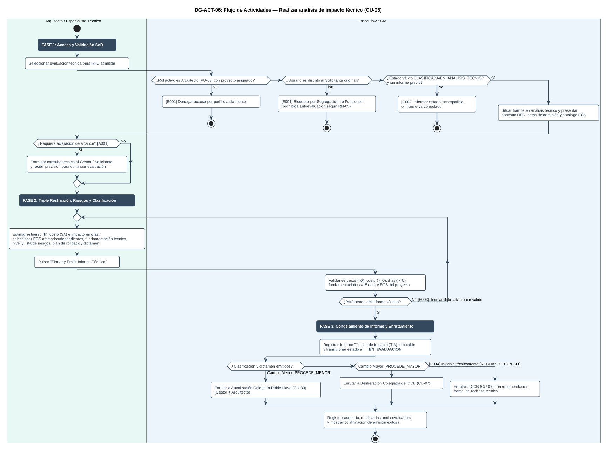
* **Diagrama de caso de uso (`DG-07`):** [`DG-07: Registro y Evaluación de RFC e Incidencias`](assets/diagramas/render/generales/DG-07.svg).

---

## 5.4. Casos de Uso Pendientes de Reestructuración (`CU-07` a `CU-30`)

> [!NOTE]
> **Alcance de la entrega SRS-02:** Conforme al plan incremental aprobado, las siguientes **24 narrativas (`CU-07` a `CU-30`)** conservan íntegramente su especificación vigente de línea base y serán normalizadas al nuevo formato de 10 apartados y diagramas `DG-ACT-*` en las siguientes iteraciones tras la revisión de los Bloques 01 y 02.

### CU-07 — Evaluar Cambio Mayor en CCB

| Campo | Descripción |
| :--- | :--- |
| **Código** | CU-07 |
| **Nombre** | Evaluar Cambio Mayor en CCB |
| **Tipo** | Primario, decisional |
| **Actor principal** | Comité de Control de Cambios (CCB) |
| **Actores secundarios** | Solicitante, Analista de Requerimientos / Gestor, Arquitecto / Especialista Técnico |
| **Paquete / Módulo** | Evaluación y Aprobación de Cambios |
| **RF asociados** | RF-06 — Evaluación y Aprobación de Cambios Mayores por el CCB |
| **RN asociadas** | RN-01 — Aprobación Obligatoria Previa a Modificación e Integración RN-05 — Evaluación Técnica y Clasificación Obligatoria RN-07 — Diferenciación de Resultados Formales de Cierre |
| **Objetivo** | Deliberar colegiadamente en el seno del CCB sobre la procedencia estratégica, técnica, presupuestal y contractual de una RFC clasificada como Cambio Mayor, dictaminando formalmente su aprobación o rechazo en acta resolutiva. |
| **Disparador** | Convocatoria a sesión de CCB ante la presencia de una o más RFC en estado `En Evaluación` con clasificación de Cambio Mayor. |
| **Precondiciones** | 1. La RFC se encuentra en estado oficial **`En Evaluación`**. 2. Cuenta con Informe Técnico de Impacto formalmente emitido que dictamina clasificación como **Cambio Mayor** (RN-05). |
| **Postcondiciones** | La RFC transiciona a estado oficial **`Autorizada`** (si se aprueba) o a **`Rechazada`** (estado terminal, si no se aprueba). |
| **Entradas** | Expediente de la RFC, Informe Técnico de Impacto, análisis de la Triple Restricción, cuórum de miembros del CCB y votos registrados. |
| **Salidas / Entregables** | Acta Resolutiva de Sesión del CCB formalizada con registro de votos y dictamen colegiado vinculante. |

#### Flujo Principal

1. El Comité de Control de Cambios (CCB) accede al expediente de la RFC clasificada como Cambio Mayor en estado "En Evaluación".
2. TraceFlow SCM presenta el expediente integral, el Informe Técnico de Impacto, la evaluación de la Triple Restricción y la estimación de riesgos.
3. El Comité de Control de Cambios (CCB) delibera colegiadamente sobre la viabilidad técnica, el impacto contractual, presupuestal y estratégico del cambio.
4. El Comité de Control de Cambios (CCB) formula la votación formal de los miembros y emite el acta resolutiva con dictamen aprobatorio.
5. TraceFlow SCM valida el cuórum legal, registra el acta formal de deliberación y actualiza el estado oficial de la RFC a **`Autorizada`**.
6. TraceFlow SCM notifica formalmente la resolución aprobatoria al Solicitante, al Analista de Requerimientos / Gestor y al Administrador de Configuración / Bibliotecario para la emisión de la orden de cambio.

#### Flujos Alternativos

- **A1 — Dictamen de rechazo colegiado del Cambio Mayor**  
  - **Origen:** Paso 4 del Flujo Principal.  
  - **Condición de activación:** El CCB determina que el cambio es inviable por costos, plazos contractuales, riesgos excesivos o desalineación con el cliente.  
  - **Secuencia:**  
    1. El Comité de Control de Cambios (CCB) registra la votación denegatoria y fundamenta formalmente las causales de rechazo en el acta.  
    2. TraceFlow SCM registra el acta resolutiva y transiciona el estado oficial de la RFC a `Rechazada` (estado terminal).  
    3. TraceFlow SCM notifica el rechazo fundamentado al Solicitante y a las partes interesadas según RN-07.  
  - **Convergencia:** Concluye el ciclo de vida de la RFC como expediente archivado.

- **A2 — Solicitud de ampliación de información técnica por el CCB**  
  - **Origen:** Paso 3 del Flujo Principal.  
  - **Condición de activación:** El CCB considera insuficiente la evaluación de impacto para tomar una decisión informada.  
  - **Secuencia:**  
    1. El CCB solicita una reevaluación o ampliación del análisis técnico al Arquitecto.  
    2. TraceFlow SCM mantiene el estado `En Evaluación` y notifica al Arquitecto los puntos a profundizar.  
  - **Convergencia:** El expediente queda a la espera de la actualización del Informe de Impacto.

#### Excepciones

- **E1 — Falta de cuórum reglamentario en la votación del CCB**  
  - **Origen:** Paso 5 del Flujo Principal.  
  - **Condición de fallo:** No se cuenta con el número mínimo de integrantes autorizados para emitir resolución válida.  
  - **Respuesta del sistema:** TraceFlow SCM bloquea la formalización de la votación e indica la falta de cuórum.  
  - **Resultado:** La solicitud permanece en estado `En Evaluación` hasta convocar una nueva sesión válida.

#### Reglas aplicadas

- **RN-01 (Aprobación Obligatoria Previa a Modificación e Integración):** Restringe toda afectación de software sin la debida resolución previa del CCB para Cambios Mayores.
- **RN-05 (Evaluación Técnica y Clasificación Obligatoria):** Asegura que el CCB fundamente su decisión en el Informe Técnico de Impacto previo.
- **RN-07 (Diferenciación de Resultados Formales de Cierre):** Garantiza que ante un dictamen desfavorable la RFC transicione formalmente a `Rechazada`.

#### Estados afectados

- **Estado inicial:** **`En Evaluación`** (Estado 5 de TB-07)
- **Transición:** Deliberación y resolución colegiada del CCB
- **Estado final:** **`Autorizada`** (Estado 6 de TB-07) o **`Rechazada`** (Estado 12 de TB-07)

#### Entregables

- Acta Resolutiva de Sesión del CCB formalizada con registro de votos y dictamen vinculante en estado `Autorizada` o `Rechazada`.

#### Trazabilidad
- **RF:** RF-06
- **RN:** RN-01, RN-05, RN-07
- **Estado(s):** En Evaluación $
ightarrow$ Autorizada (o Rechazada)
- **DG relacionado:** DG-03, DG-04, DG-07, DG-11

---

### CU-08 — Emitir Orden de Cambio (ECN/ECO)

| Campo | Descripción |
| :--- | :--- |
| **Código** | CU-08 |
| **Nombre** | Emitir Orden de Cambio (ECN/ECO) |
| **Tipo** | Primario, formalización |
| **Actor principal** | Comité de Control de Cambios (CCB) / Analista de Requerimientos / Gestor (según tipo de cambio) |
| **Actores secundarios** | Administrador de Configuración / Bibliotecario, Ingeniero de Software / Desarrollador |
| **Paquete / Módulo** | Control de Cambios y Órdenes |
| **RF asociados** | RF-07 — Gestión y Emisión de Órdenes de Cambio (ECN/ECO) |
| **RN asociadas** | RN-01 — Aprobación Obligatoria Previa a Modificación e Integración |
| **Objetivo** | Formalizar, numerar y expedir la Orden formal de Cambio (ECN/ECO) sobre una RFC previamente autorizada, asignando responsables y plazos técnicos para habilitar el Check-Out del ECS. |
| **Disparador** | Registro de dictamen favorable que posiciona la RFC en estado oficial `Autorizada`. |
| **Precondiciones** | La RFC se encuentra en estado oficial **`Autorizada`** (mediante CU-07 o CU-30). El caso de uso NO aprueba el cambio, únicamente formaliza su orden de ejecución. |
| **Postcondiciones** | 1. La ECN/ECO queda formalmente expedida con código correlativo único (ECN-YYYY-NNNN). 2. La RFC transiciona a estado oficial **`Orden Emitida`**. 3. Se habilita al Administrador de Configuración para ejecutar el Check-Out (CU-10). |
| **Entradas** | Expediente de la RFC autorizada, desarrollador asignado, cronograma de desarrollo y alcance técnico a intervenir. |
| **Salidas / Entregables** | Documento formal de Orden de Cambio (ECN/ECO) registrado en el sistema. |

#### Flujo Principal

1. La autoridad competente (CCB para Cambio Mayor o Autoridad Delegada para Cambio Menor) selecciona una RFC en estado "Autorizada".
2. TraceFlow SCM presenta el formulario de formalización de Orden de Cambio precargando los antecedentes técnicos y la resolución aprobatoria.
3. El emisor ingresa la asignación del Ingeniero de Software / Desarrollador responsable, los plazos máximos de ejecución y el alcance específico de modificación sobre el ECS.
4. TraceFlow SCM valida que la RFC cuente con autorización formal vigente y que el desarrollador asignado posea rol activo en el proyecto según RN-01.
5. TraceFlow SCM expide formalmente la Orden de Cambio (ECN/ECO) con numeración unívoca correlativa y actualiza el estado oficial de la RFC a **`Orden Emitida`**.
6. TraceFlow SCM notifica formalmente la emisión de la orden al Administrador de Configuración / Bibliotecario y al Ingeniero de Software / Desarrollador para proceder con el Check-Out.

#### Flujos Alternativos

- **A1 — Corrección de datos de asignación de la orden antes de expedir**  
  - **Origen:** Paso 3 del Flujo Principal.  
  - **Condición de activación:** Se identifica indisponibilidad del desarrollador seleccionado antes de la emisión final.  
  - **Secuencia:**  
    1. El emisor reasigna la orden a un desarrollador alternativo calificado.  
    2. TraceFlow SCM actualiza la asignación técnica en el borrador de la orden.  
  - **Convergencia:** Retorna al Paso 4 del Flujo Principal.

#### Excepciones

- **E1 — Intento de emisión sobre RFC no autorizada**  
  - **Origen:** Paso 4 del Flujo Principal.  
  - **Condición de fallo:** La solicitud no cuenta con estado oficial Autorizada o el dictamen previo fue revocado.  
  - **Respuesta del sistema:** TraceFlow SCM bloquea la generación de la orden e informa la inconsistencia de estado según RN-01.  
  - **Resultado:** No se emite la orden; el flujo se cancela de forma inmediata.

#### Reglas aplicadas

- **RN-01 (Aprobación Obligatoria Previa a Modificación e Integración):** Dispone que ningún ECS puede ser extraído ni modificado sin contar con una ECN/ECO debidamente emitida tras la autorización formal del cambio.

#### Estados afectados

- **Estado inicial:** **`Autorizada`** (Estado 6 de TB-07)
- **Transición:** Expedición y formalización de la ECN/ECO
- **Estado final:** **`Orden Emitida`** (Estado 7 de TB-07)

#### Entregables

- Orden formal de Cambio (ECN/ECO) expedida con código correlativo en estado `Orden Emitida`.

#### Trazabilidad
- **RF:** RF-07
- **RN:** RN-01
- **Estado(s):** Autorizada $
ightarrow$ Orden Emitida
- **DG relacionado:** DG-03, DG-04, DG-07, DG-11

---

### CU-09 — Registrar ECS

| Campo | Descripción |
| :--- | :--- |
| **Código** | CU-09 |
| **Nombre** | Registrar ECS |
| **Tipo** | Primario, configuración |
| **Actor principal** | Arquitecto / Especialista Técnico |
| **Actores secundarios** | Administrador de Configuración / Bibliotecario |
| **Paquete / Módulo** | Gestión de ECS y Bibliotecas |
| **RF asociados** | RF-03 — Identificación de ECS |
| **RN asociadas** | RN-01 — Aprobación Obligatoria Previa a Modificación e Integración RN-02 — Identificación Unívoca de Versiones RN-04 — Restricción de Bibliotecas Congeladas |
| **Objetivo** | Identificar, clasificar e incorporar formalmente un nuevo Elemento de Configuración de Software (código fuente, esquema de base de datos o especificación técnica) en el inventario del proyecto, asignándole identificador unívoco y depositándolo en la biblioteca correspondiente. |
| **Disparador** | Creación de nuevos módulos de código, especificaciones de diseño, esquemas o librerías que deben quedar bajo control formal de versiones. |
| **Precondiciones** | 1. El proyecto se encuentra en estado activo. 2. El actor cuenta con rol de Arquitecto o Administrador de Configuración con permisos de catalogación. |
| **Postcondiciones** | El ECS queda registrado en el inventario oficial del proyecto con código unívoco, versión inicial (1.0.0) y firma de integridad depositado en la biblioteca designada. |
| **Entradas** | Denominación del ECS, clasificación del artefacto (código, documento, esquema BD), descripción funcional, versión inicial, dependencias técnicas y archivo base. |
| **Salidas / Entregables** | Ficha técnica de ECS registrada en el catálogo con código unívoco y registro de integridad inicial. |

#### Flujo Principal

1. El Arquitecto / Especialista Técnico selecciona la opción de registrar un nuevo Elemento de Configuración de Software (ECS) en el proyecto activo.
2. TraceFlow SCM presenta el formulario de catalogación de ECS y la estructura jerárquica de componentes del sistema.
3. El Arquitecto / Especialista Técnico ingresa el nombre del artefacto, selecciona su tipología, define la versión inicial, especifica las dependencias con otros componentes y adjunta el archivo base.
4. TraceFlow SCM valida que la denominación sea unívoca en el proyecto, que la versión cumpla el estándar mayor.menor.parche (RN-02) y verifica la integridad del archivo mediante comprobación de suma (checksum).
5. TraceFlow SCM registra formalmente el ECS en el catálogo, genera su código correlativo unívoco y lo deposita en la biblioteca designada bajo control de versiones.
6. TraceFlow SCM emite confirmación de catalogación y notifica al Administrador de Configuración / Bibliotecario la disponibilidad del nuevo ECS para el flujo de cambios.

#### Flujos Alternativos

- **A1 — Registro de ECS de especificación documental o manual de usuario**  
  - **Origen:** Paso 3 del Flujo Principal.  
  - **Condición de activación:** El elemento a incorporar es un documento formal y no código ejecutable.  
  - **Secuencia:**  
    1. El Arquitecto selecciona la categoría documental y consigna los metadatos de formato y aprobación.  
  - **Convergencia:** Retorna al Paso 4 del Flujo Principal.

#### Excepciones

- **E1 — Denominación de ECS duplicada en el proyecto**  
  - **Origen:** Paso 4 del Flujo Principal.  
  - **Condición de fallo:** Ya existe un elemento registrado con idéntica denominación y ruta lógica en el proyecto.  
  - **Respuesta del sistema:** TraceFlow SCM rechaza el registro e instruye asignar un identificador unívoco según RN-02.  
  - **Resultado:** Retorna al Paso 3 del Flujo Principal; no se incorpora el elemento.

- **E2 — Estándar de versión inicial no conforme**  
  - **Origen:** Paso 4 del Flujo Principal.  
  - **Condición de fallo:** La versión ingresada no respeta la nomenclatura mayor.menor.parche.  
  - **Respuesta del sistema:** TraceFlow SCM exige corregir la versión según la regla oficial RN-02.  
  - **Resultado:** Retorna al Paso 3 del Flujo Principal para su subsanación.

#### Reglas aplicadas

- **RN-01 (Aprobación Obligatoria Previa a Modificación e Integración):** Dispone que todo artefacto sujeto a cambios deba estar formalmente catalogado como ECS.
- **RN-02 (Identificación Unívoca de Versiones):** Impone el estándar numérico mayor.menor.parche para el versionamiento del artefacto.
- **RN-04 (Restricción de Bibliotecas Congeladas):** Protege los ECS catalogados prohibiendo su edición directa fuera del flujo de control de cambios.

#### Estados afectados

- **Estado inicial:** N/A (Catalogación de inventario; no es un expediente de RFC).
- **Transición:** Incorporación formal de artefacto al repositorio de configuración.
- **Estado final:** N/A (ECS en estado `Vigente` en biblioteca).

#### Entregables

- Ficha técnica de ECS catalogada en el inventario del proyecto con identificador unívoco.

#### Trazabilidad
- **RF:** RF-03
- **RN:** RN-01, RN-02, RN-04
- **Estado(s):** N/A
- **DG relacionado:** DG-04, DG-07

---

### CU-10 — Efectuar Check-Out

| Campo | Descripción |
| :--- | :--- |
| **Código** | CU-10 |
| **Nombre** | Efectuar Check-Out |
| **Tipo** | Primario, operación SCM |
| **Actor principal** | Administrador de Configuración / Bibliotecario |
| **Actores secundarios** | Ingeniero de Software / Desarrollador |
| **Paquete / Módulo** | Gestión de ECS y Bibliotecas |
| **RF asociados** | RF-08 — Gestión de Bibliotecas de Software RF-09 — Control de Versiones y Bloqueos de Sincronización |
| **RN asociadas** | RN-01 — Aprobación Obligatoria Previa a Modificación e Integración RN-06 — Bloqueo de Sincronización Obligatorio |
| **Objetivo** | Transferir de forma controlada una copia del ECS desde la Biblioteca de Soporte hacia la Biblioteca de Trabajo asignada al Desarrollador, activando la protección de edición exclusiva. |
| **Disparador** | Recepción de la notificación de ECN/ECO en estado oficial `Orden Emitida`. |
| **Precondiciones** | 1. La RFC se encuentra en estado oficial **`Orden Emitida`** con ECN/ECO formalmente vigente (RN-01). 2. El ECS existe y se encuentra accesible en la Biblioteca de Soporte. 3. El ECS no cuenta con bloqueo de sincronización activo por otra orden (RN-06). |
| **Postcondiciones** | 1. La copia de trabajo del ECS queda disponible en la Biblioteca de Trabajo del Desarrollador asignado. 2. Se aplica el bloqueo de sincronización sobre el ECS (CU-11). 3. La RFC transiciona a estado oficial **`En Implementación`**. |
| **Entradas** | Identificador de ECN/ECO, identificador de ECS y credenciales del Desarrollador asignado. |
| **Salidas / Entregables** | Copia de trabajo del ECS transferida a la Biblioteca de Trabajo y constancia de Check-Out registrada en auditoría. |

#### Flujo Principal

1. El Administrador de Configuración / Bibliotecario selecciona la Orden de Cambio en estado "Orden Emitida" para transferir el artefacto.
2. TraceFlow SCM presenta los datos de la ECN/ECO, el ECS asociado en la Biblioteca de Soporte y el Desarrollador asignado.
3. El Administrador de Configuración / Bibliotecario confirma la operación de Check-Out hacia la Biblioteca de Trabajo.
4. TraceFlow SCM valida que el ECS no presente bloqueo de sincronización activo y verifica su integridad mediante comprobación de suma (checksum) según RN-06.
5. TraceFlow SCM transfiere la copia del ECS a la Biblioteca de Trabajo, aplica el bloqueo de sincronización exclusivo y actualiza el estado oficial de la RFC a **`En Implementación`**.
6. TraceFlow SCM genera el registro histórico de Check-Out en la bitácora y notifica al Ingeniero de Software / Desarrollador la disponibilidad del artefacto para inicio de actividades técnicas.

#### Flujos Alternativos

- **A1 — Verificación y reintento por retardo en la transferencia de repositorio**  
  - **Origen:** Paso 4 del Flujo Principal.  
  - **Condición de activación:** Se produce una inconsistencia temporal en la lectura de la Biblioteca de Soporte.  
  - **Secuencia:**  
    1. TraceFlow SCM reintenta la lectura de integridad del artefacto.  
    2. El sistema confirma la integridad del archivo de origen.  
  - **Convergencia:** Retorna al Paso 5 del Flujo Principal.

#### Excepciones

- **E1 — ECS bloqueado concurrentemente por otra orden de cambio**  
  - **Origen:** Paso 4 del Flujo Principal.  
  - **Condición de fallo:** El ECS se encuentra retenido bajo bloqueo de sincronización por otro desarrollo en curso según RN-06.  
  - **Respuesta del sistema:** TraceFlow SCM deniega el Check-Out, muestra los datos del usuario que mantiene el bloqueo y registra la colisión en auditoría.  
  - **Resultado:** La operación se detiene sin transferir archivos; la orden permanece en espera de liberación del bloqueo.

#### Reglas aplicadas

- **RN-01 (Aprobación Obligatoria Previa a Modificación e Integración):** Impide el Check-Out si la solicitud no cuenta con una ECN/ECO formalmente emitida.
- **RN-06 (Bloqueo de Sincronización Obligatorio):** Exige que el Check-Out active de inmediato el bloqueo exclusivo impidiendo colisiones de edición.

#### Estados afectados

- **Estado inicial:** **`Orden Emitida`** (Estado 7 de TB-07)
- **Transición:** Ejecución de Check-Out y asignación a Biblioteca de Trabajo
- **Estado final:** **`En Implementación`** (Estado 8 de TB-07)

#### Entregables

- Constancia de Check-Out registrada con copia de trabajo alojada en la Biblioteca de Trabajo.

#### Trazabilidad
- **RF:** RF-08, RF-09
- **RN:** RN-01, RN-06
- **Estado(s):** Orden Emitida $
ightarrow$ En Implementación
- **DG relacionado:** DG-03, DG-04, DG-07, DG-11

---

### CU-11 — Aplicar bloqueo de sincronización

| Campo | Descripción |
| :--- | :--- |
| **Código** | CU-11 |
| **Nombre** | Aplicar bloqueo de sincronización |
| **Tipo** | Secundario, soporte SCM |
| **Actor principal** | Administrador de Configuración / Bibliotecario |
| **Actores secundarios** | Ingeniero de Software / Desarrollador |
| **Paquete / Módulo** | Gestión de ECS y Bibliotecas |
| **RF asociados** | RF-09 — Control de Versiones y Bloqueos de Sincronización |
| **RN asociadas** | RN-06 — Bloqueo de Sincronización Obligatorio |
| **Objetivo** | Establecer una restricción de concurrencia a nivel de catálogo sobre un ECS en Check-Out, impidiendo su edición simultánea o extracción por otros usuarios hasta su Check-In o Rollback. |
| **Disparador** | Ejecución de la operación de Check-Out (CU-10) o solicitud administrativa de aseguramiento de concurrencia. |
| **Precondiciones** | El ECS se encuentra registrado en el proyecto y sin bloqueo activo previo a nombre de otra orden. |
| **Postcondiciones** | El ECS queda registrado en estado bloqueado ("Locked") vinculado unívocamente al Desarrollador asignado y a la ECN/ECO vigente. |
| **Entradas** | Identificador del ECS, identificador de la ECN/ECO y usuario beneficiario del bloqueo. |
| **Salidas / Entregables** | Registro de bloqueo activo en el catálogo de configuración y marca de exclusividad en el inventario de ECS. |

#### Flujo Principal

1. El Administrador de Configuración / Bibliotecario (o TraceFlow SCM durante el Check-Out) solicita la aplicación del bloqueo de sincronización sobre el ECS.
2. TraceFlow SCM consulta el estado actual de concurrencia del ECS en el catálogo del proyecto.
3. TraceFlow SCM valida que el ECS no cuente con un bloqueo activo preexistente según RN-06.
4. TraceFlow SCM registra el bloqueo exclusivo asociando el identificador del Desarrollador asignado, la ECN/ECO y la marca temporal de aplicación.
5. TraceFlow SCM actualiza el catálogo impidiendo nuevas operaciones de Check-Out o modificación sobre el ECS por terceros consultores.
6. TraceFlow SCM confirma la aplicación del bloqueo y asienta la transacción en la bitácora de control de concurrencia.

#### Flujos Alternativos

- **A1 — Consulta de estado de bloqueo previo**  
  - **Origen:** Paso 2 del Flujo Principal.  
  - **Condición de activación:** El Administrador verifica si un ECS ya posee bloqueo antes de planificar una asignación.  
  - **Secuencia:**  
    1. TraceFlow SCM presenta el detalle del bloqueo vigente (usuario, fecha y orden asociada).  
  - **Convergencia:** Concluye la consulta sin modificar el catálogo.

#### Excepciones

- **E1 — Conflicto de bloqueo por concurrencia simultánea**  
  - **Origen:** Paso 3 del Flujo Principal.  
  - **Condición de fallo:** Otra transacción estableció el bloqueo milisegundos antes sobre el mismo ECS.  
  - **Respuesta del sistema:** TraceFlow SCM rechaza la solicitud de bloqueo y notifica la colisión de concurrencia.  
  - **Resultado:** La operación se cancela salvaguardando la integridad del repositorio.

#### Reglas aplicadas

- **RN-06 (Bloqueo de Sincronización Obligatorio):** Establece como regla mandatoria que todo ECS transferido a la Biblioteca de Trabajo quede estrictamente bloqueado para evitar sobrescrituras de código o documentos.

#### Estados afectados

- **Estado inicial:** Mantiene el estado del flujo activo (típicamente durante **`Orden Emitida`** / **`En Implementación`**)
- **Transición:** Aseguramiento de concurrencia por Check-Out
- **Estado final:** Mantiene el estado activo (**`En Implementación`**)

#### Entregables

- Asiento de bloqueo de sincronización activo registrado en la bitácora de control de configuración.

#### Trazabilidad
- **RF:** RF-09
- **RN:** RN-06
- **Estado(s):** Mantiene En Implementación
- **DG relacionado:** DG-03, DG-07

---

### CU-12 — Efectuar Check-In

| Campo | Descripción |
| :--- | :--- |
| **Código** | CU-12 |
| **Nombre** | Efectuar Check-In |
| **Tipo** | Primario, operación SCM |
| **Actor principal** | Administrador de Configuración / Bibliotecario |
| **Actores secundarios** | Equipo de Calidad / Testing, Solicitante |
| **Paquete / Módulo** | Gestión de ECS y Bibliotecas |
| **RF asociados** | RF-08 — Gestión de Bibliotecas de Software RF-09 — Control de Versiones y Bloqueos de Sincronización RF-10 — Gestión de Pruebas, Certificación QA y Aceptación del Usuario |
| **RN asociadas** | RN-01 — Aprobación Obligatoria Previa a Modificación e Integración RN-02 — Identificación Unívoca de Versiones RN-04 — Restricción de Bibliotecas Congeladas RN-06 — Bloqueo de Sincronización Obligatorio RN-09 — Doble Validación Previa al Check-In a Biblioteca Maestra |
| **Objetivo** | Transferir e integrar formalmente el ECS verificado y aceptado desde la Biblioteca de Soporte hacia la Biblioteca Maestra, generando el nuevo número de versión y liberando el bloqueo de sincronización. |
| **Disparador** | Notificación de cumplimiento concurrente de la Certificación Técnica de QA y del Acta de Aceptación UAT del Solicitante. |
| **Precondiciones** | 1. Orden de Cambio formalmente emitida (ECN/ECO vigente). 2. Certificación Técnica de Conformidad emitida por QA (CU-17). 3. Acta de Aceptación UAT formalmente suscrita por el Solicitante (CU-29). 4. ECS válido con integridad comprobada mediante suma de verificación. 5. Bloqueo de sincronización vigente sobre el ECS a nombre de la orden. |
| **Postcondiciones** | 1. El ECS queda integrado de forma inmutable en la Biblioteca Maestra. 2. Se asigna la nueva versión oficial según estándar mayor.menor.parche (RN-02). 3. Se libera el bloqueo de sincronización del ECS (RN-06). 4. Se habilita la congelación de la nueva Línea Base (CU-20). |
| **Entradas** | Copia verificada del ECS, constancia de doble validación (QA + UAT) y metadatos de versión. |
| **Salidas / Entregables** | Registro formal de Check-In en la Biblioteca Maestra y constancia de liberación de bloqueo de sincronización. |

#### Flujo Principal

1. El Administrador de Configuración / Bibliotecario selecciona la RFC con doble validación aprobada para proceder al Check-In.
2. TraceFlow SCM presenta el expediente técnico consolidando la ECN/ECO, el Certificado Técnico de QA y el Acta de Aceptación UAT.
3. El Administrador de Configuración / Bibliotecario confirma la transferencia formal del ECS hacia la Biblioteca Maestra.
4. TraceFlow SCM valida la concurrencia de la Orden Emitida, la Certificación de QA, el Acta de Aceptación UAT, la integridad del archivo (checksum SHA-256) y la vigencia del bloqueo según RN-09.
5. TraceFlow SCM transfiere e integra el ECS en la Biblioteca Maestra, asigna la nueva versión según estándar oficial (RN-02) y libera el bloqueo de sincronización según RN-06.
6. TraceFlow SCM registra el asiento histórico de Check-In en la bitácora de auditoría y notifica la integración exitosa al CCB y a los interesados, habilitando la creación y congelamiento de la nueva Línea Base.

#### Flujos Alternativos

- **A1 — Check-In intermedio hacia Biblioteca de Soporte para pruebas**  
  - **Origen:** Paso 3 del Flujo Principal.  
  - **Condición de activación:** La transferencia corresponde al paso de desarrollo a pruebas en el ciclo de integración.  
  - **Secuencia:**  
    1. El Administrador transfiere el ECS a la Biblioteca de Soporte sin levantar el bloqueo exclusivo de desarrollo.  
  - **Convergencia:** Permite la ejecución de pruebas de integración en CU-16.

#### Excepciones

- **E1 — Incumplimiento de la regla de doble validación (Falta QA o UAT)**  
  - **Origen:** Paso 4 del Flujo Principal.  
  - **Condición de fallo:** Se intenta ejecutar el Check-In hacia la Biblioteca Maestra faltando la Certificación de QA o el Acta UAT.  
  - **Respuesta del sistema:** TraceFlow SCM bloquea categóricamente la operación e indica la ausencia de la doble validación según RN-09.  
  - **Resultado:** El ECS permanece en la biblioteca intermedia; no se realiza la integración a la Biblioteca Maestra.

- **E2 — Inconsistencia en la comprobación de integridad (Checksum alterado)**  
  - **Origen:** Paso 4 del Flujo Principal.  
  - **Condición de fallo:** La suma de verificación del archivo no coincide con el artefacto certificado.  
  - **Respuesta del sistema:** TraceFlow SCM alerta sobre alteración no autorizada de integridad y aborta la transferencia.  
  - **Resultado:** Se cancela la operación y se genera una alerta de seguridad en la bitácora de auditoría.

#### Reglas aplicadas

- **RN-09 (Doble Validación Previa al Check-In a Biblioteca Maestra):** Prohíbe de forma absoluta la integración a la Biblioteca Maestra sin contar concurrentemente con la certificación técnica de QA y el acta formal de UAT.
- **RN-04 (Restricción de Bibliotecas Congeladas):** Protege la Biblioteca Maestra asegurando que solo ingresen artefactos debidamente aprobados.
- **RN-06 (Bloqueo de Sincronización Obligatorio):** Dispone la liberación formal del bloqueo únicamente cuando el Check-In ha sido perfeccionado.

#### Estados afectados

- **Estado inicial:** **`En Aceptación`** (Estado 10 de TB-07)
- **Transición:** Check-In formal a la Biblioteca Maestra con doble conformidad
- **Estado final:** **`En Aceptación`** (Estado 10 de TB-07, fase final previa a congelación de Línea Base)

#### Entregables

- Asiento formal de Check-In a la Biblioteca Maestra y constancia de versión actualizada en el repositorio central.

#### Trazabilidad
- **RF:** RF-08, RF-09, RF-10
- **RN:** RN-01, RN-02, RN-04, RN-06, RN-09
- **Estado(s):** Mantiene En Aceptación (inmediato anterior a Implementada)
- **DG relacionado:** DG-03, DG-04, DG-07, DG-09, DG-11

---

### CU-13 — Consultar historial de versiones

| Campo | Descripción |
| :--- | :--- |
| **Código** | CU-13 |
| **Nombre** | Consultar historial de versiones |
| **Tipo** | Secundario, auditoría |
| **Actor principal** | Administrador de Configuración / Bibliotecario |
| **Actores secundarios** | Usuarios autorizados |
| **Paquete / Módulo** | Gestión de ECS y Bibliotecas |
| **RF asociados** | RF-09 — Control de Versiones y Bloqueos de Sincronización RF-16 — Trazabilidad de Configuración |
| **RN asociadas** | RN-02 — Identificación Unívoca de Versiones RN-03 — Trazabilidad de Cambios |
| **Objetivo** | Inspeccionar la línea temporal de versiones, operaciones de Check-In, Check-Out, autores, marcas de tiempo, memorias descriptivas y Órdenes de Cambio (ECN/ECO) asociadas a un ECS a lo largo de su ciclo de vida. |
| **Disparador** | Necesidad técnica o de auditoría de verificar la evolución histórica de un componente de software o comparar versiones. |
| **Precondiciones** | El ECS se encuentra formalmente registrado en el catálogo del proyecto; el usuario cuenta con credenciales de lectura. |
| **Postcondiciones** | TraceFlow SCM presenta la bitácora cronológica y árbol de versiones del ECS sin modificar su estado ni sus archivos. |
| **Entradas** | Identificador del ECS y criterios de filtrado temporal o de versión. |
| **Salidas / Entregables** | Reporte visual cronológico del historial de versiones y trazabilidad de operaciones Check-In/Check-Out. |

#### Flujo Principal

1. El Administrador de Configuración / Bibliotecario selecciona un ECS en el catálogo del proyecto y solicita consultar su historial.
2. TraceFlow SCM recupera el historial de versiones y la bitácora de transacciones del elemento desde el repositorio de configuración.
3. TraceFlow SCM presenta la lista cronológica de versiones registradas indicando código de versión, autor, fecha, ECN/ECO asociada y biblioteca de residencia.
4. El Administrador de Configuración / Bibliotecario selecciona una versión específica para inspeccionar sus detalles.
5. TraceFlow SCM presenta la memoria descriptiva de los cambios, las firmas de auditoría y la firma de integridad de la versión seleccionada según RN-03.
6. TraceFlow SCM habilita la comparación conceptual de diferencias respecto a la versión previa o respecto a la versión activa en la Biblioteca Maestra.

#### Flujos Alternativos

- **A1 — Comparación de diferencias entre dos versiones históricas del ECS**  
  - **Origen:** Paso 4 del Flujo Principal.  
  - **Condición de activación:** El actor requiere auditar qué modificaciones específicas se aplicaron entre dos versiones distintas.  
  - **Secuencia:**  
    1. El Administrador selecciona dos versiones del historial y solicita comparación.  
    2. TraceFlow SCM presenta la vista comparativa de diferencias conceptuales entre ambos estados del artefacto.  
  - **Convergencia:** Retorna al Paso 6 del Flujo Principal.

#### Excepciones

- **E1 — ECS sin historial de modificaciones (versión inicial sin cambios)**  
  - **Origen:** Paso 2 del Flujo Principal.  
  - **Condición de fallo:** El elemento únicamente cuenta con su versión de catalogación base sin operaciones de cambio posteriores.  
  - **Respuesta del sistema:** TraceFlow SCM informa que el ECS se encuentra en su versión inicial sin transacciones de Check-In adicionales.  
  - **Resultado:** Se muestra únicamente la ficha de creación base.

#### Reglas aplicadas

- **RN-02 (Identificación Unívoca de Versiones):** Garantiza que cada hito del historial exhiba una nomenclatura estandarizada.
- **RN-03 (Trazabilidad de Cambios):** Asegura que cada versión del historial se encuentre inexorablemente vinculada a una ECN/ECO y a un mensaje descriptivo.

#### Estados afectados

- **Estado inicial:** N/A (Operación de sólo lectura).
- **Transición:** N/A
- **Estado final:** N/A

#### Entregables

- Vista de historial cronológico y trazabilidad de versiones del ECS presentada en pantalla.

#### Trazabilidad
- **RF:** RF-09, RF-16
- **RN:** RN-02, RN-03
- **Estado(s):** N/A
- **DG relacionado:** DG-04, DG-07

---

### CU-14 — Implementar cambio en el ECS

| Campo | Descripción |
| :--- | :--- |
| **Código** | CU-14 |
| **Nombre** | Implementar cambio en el ECS |
| **Tipo** | Primario, desarrollo |
| **Actor principal** | Ingeniero de Software / Desarrollador |
| **Actores secundarios** | Administrador de Configuración / Bibliotecario |
| **Paquete / Módulo** | Implementación y Validación |
| **RF asociados** | RF-07 — Gestión y Emisión de Órdenes de Cambio (ECN/ECO) RF-09 — Control de Versiones y Bloqueos de Sincronización |
| **RN asociadas** | RN-01 — Aprobación Obligatoria Previa a Modificación e Integración RN-03 — Trazabilidad de Cambios |
| **Objetivo** | Efectuar las modificaciones técnicas y codificación sobre la copia de trabajo del ECS alojada en la Biblioteca de Trabajo, circunscribiéndose estrictamente al alcance de la ECN/ECO. |
| **Disparador** | Notificación de disponibilidad del ECS en la Biblioteca de Trabajo tras el Check-Out. |
| **Precondiciones** | 1. La RFC se encuentra en estado oficial **`En Implementación`**. 2. La copia de trabajo del ECS está alojada en la Biblioteca de Trabajo con bloqueo exclusivo a nombre del Desarrollador (RN-06). |
| **Postcondiciones** | Las modificaciones técnicas quedan consolidadas en el espacio de trabajo local preparadas para la verificación unitaria. |
| **Entradas** | Copia de trabajo del ECS, especificaciones técnicas de la ECN/ECO y pautas de diseño del proyecto. |
| **Salidas / Entregables** | Artefacto de software modificado en la Biblioteca de Trabajo con memoria técnica descriptiva del cambio. |

#### Flujo Principal

1. El Ingeniero de Software / Desarrollador accede a su espacio en la Biblioteca de Trabajo y visualiza la ECN/ECO asignada.
2. TraceFlow SCM presenta el alcance técnico de la orden, los criterios de aceptación y el ECS desbloqueado exclusivamente para su usuario.
3. El Ingeniero de Software / Desarrollador realiza las modificaciones, adaptaciones o correcciones sobre la copia de trabajo del ECS.
4. TraceFlow SCM registra el progreso de los cambios efectuados asociándolos inmutablemente al identificador de la ECN/ECO según RN-03.
5. El Ingeniero de Software / Desarrollador formula la memoria descriptiva de los cambios aplicados detallando los componentes modificados.
6. TraceFlow SCM consolida la versión de trabajo del ECS dejándola dispuesta para la ejecución de pruebas unitarias locales.

#### Flujos Alternativos

- **A1 — Solicitud de ajuste de alcance técnico durante la implementación**  
  - **Origen:** Paso 3 del Flujo Principal.  
  - **Condición de activación:** El Desarrollador identifica una dependencia imprevista que requiere alterar el alcance de la orden.  
  - **Secuencia:**  
    1. El Desarrollador registra una consulta de alcance formal dirigida al Arquitecto.  
    2. El Arquitecto evalúa si la consulta requiere una ampliación formal o se resuelve dentro de los parámetros de la ECN/ECO vigente.  
  - **Convergencia:** Retorna al Paso 3 con la instrucción técnica clarificada.

#### Excepciones

- **E1 — Pérdida de integridad de la copia de trabajo local**  
  - **Origen:** Paso 4 del Flujo Principal.  
  - **Condición de fallo:** Corrupción accidental del espacio de trabajo del desarrollador.  
  - **Respuesta del sistema:** TraceFlow SCM permite reestablecer una copia limpia desde la Biblioteca de Soporte respetando el bloqueo vigente.  
  - **Resultado:** Se reanuda la implementación en el Paso 3 sin vulnerar el repositorio central.

#### Reglas aplicadas

- **RN-01 (Aprobación Obligatoria Previa a Modificación e Integración):** Limita la modificación técnica únicamente a los ECS que cuenten con ECN/ECO formalmente emitida.
- **RN-03 (Trazabilidad de Cambios):** Exige que cada modificación realizada cuente con una descripción técnica asociada formalmente a la orden de cambio.

#### Estados afectados

- **Estado inicial:** **`En Implementación`** (Estado 8 de TB-07)
- **Transición:** Desarrollo y aplicación técnica del cambio
- **Estado final:** **`En Implementación`** (Estado 8 de TB-07)

#### Entregables

- Copia de trabajo del ECS modificada con memoria descriptiva en la Biblioteca de Trabajo.

#### Trazabilidad
- **RF:** RF-07, RF-09
- **RN:** RN-01, RN-03
- **Estado(s):** Mantiene En Implementación
- **DG relacionado:** DG-03, DG-07

---

### CU-15 — Ejecutar pruebas unitarias locales

| Campo | Descripción |
| :--- | :--- |
| **Código** | CU-15 |
| **Nombre** | Ejecutar pruebas unitarias locales |
| **Tipo** | Secundario, verificación |
| **Actor principal** | Ingeniero de Software / Desarrollador |
| **Actores secundarios** | Ninguno (Autocontenido en entorno local) |
| **Paquete / Módulo** | Implementación y Validación |
| **RF asociados** | RF-10 — Gestión de Pruebas, Certificación QA y Aceptación del Usuario |
| **RN asociadas** | RN-01 — Aprobación Obligatoria Previa a Modificación e Integración RN-03 — Trazabilidad de Cambios |
| **Objetivo** | Verificar de forma temprana y automatizada que los componentes modificados del ECS funcionen correctamente de forma aislada, previo a su entrega a control de calidad. |
| **Disparador** | Culminación de las tareas de codificación en la Biblioteca de Trabajo (CU-14). |
| **Precondiciones** | El ECS ha sido modificado y consolidado en la Biblioteca de Trabajo del Desarrollador. |
| **Postcondiciones** | Reporte de pruebas unitarias registrado con 100% de casos críticos superados, habilitando la solicitud de pruebas de integración. |
| **Entradas** | ECS modificado, suites de pruebas unitarias y datos de prueba locales. |
| **Salidas / Entregables** | Reporte formal de resultados de pruebas unitarias vinculado al expediente de la ECN/ECO. |

#### Flujo Principal

1. El Ingeniero de Software / Desarrollador solicita la ejecución del conjunto de pruebas unitarias sobre el ECS modificado.
2. TraceFlow SCM presenta el entorno de verificación unitaria cargando los casos de prueba asociados al componente intervenido.
3. El Ingeniero de Software / Desarrollador dispara la ejecución de la batería de pruebas en la Biblioteca de Trabajo.
4. TraceFlow SCM valida que la totalidad de los casos de prueba unitarios se ejecuten sin errores y satisfagan los criterios de cobertura.
5. TraceFlow SCM registra el reporte de resultados unitarios vinculándolo a la bitácora de la Orden de Cambio.
6. TraceFlow SCM confirma el éxito de la verificación y habilita la opción de promover el artefacto para pruebas de integración con QA.

#### Flujos Alternativos

- **A1 — Corrección inmediata de fallo unitario menor**  
  - **Origen:** Paso 4 del Flujo Principal.  
  - **Condición de activación:** Uno o más casos de prueba unitarios arrojan fallo en lógica local.  
  - **Secuencia:**  
    1. El Desarrollador ajusta la codificación local.  
    2. El Desarrollador reinicia la suite de pruebas unitarias.  
  - **Convergencia:** Retorna al Paso 4 del Flujo Principal.

#### Excepciones

- **E1 — Fallo persistente en casos de prueba unitarios**  
  - **Origen:** Paso 4 del Flujo Principal.  
  - **Condición de fallo:** La suite no logra aprobarse tras múltiples ejecuciones locales.  
  - **Respuesta del sistema:** TraceFlow SCM bloquea la promoción del ECS hacia pruebas de integración.  
  - **Resultado:** El Desarrollador debe continuar la labor de depuración en CU-14; no se permite el paso a QA.

#### Reglas aplicadas

- **RN-01 (Aprobación Obligatoria Previa a Modificación e Integración):** Asegura que no se promuevan cambios inestables hacia entornos compartidos de prueba.
- **RN-03 (Trazabilidad de Cambios):** Garantiza que los resultados de las pruebas queden asentados como evidencia técnica de la orden.

#### Estados afectados

- **Estado inicial:** **`En Implementación`** (Estado 8 de TB-07)
- **Transición:** Verificación unitaria local satisfactoria
- **Estado final:** **`En Implementación`** (Estado 8 de TB-07, habilitado para entrega a QA)

#### Entregables

- Reporte formal de pruebas unitarias con dictamen aprobatorio registrado en la ECN/ECO.

#### Trazabilidad
- **RF:** RF-10
- **RN:** RN-01, RN-03
- **Estado(s):** Mantiene En Implementación
- **DG relacionado:** DG-03, DG-07

---

### CU-16 — Ejecutar pruebas de integración

| Campo | Descripción |
| :--- | :--- |
| **Código** | CU-16 |
| **Nombre** | Ejecutar pruebas de integración |
| **Tipo** | Primario, validación QA |
| **Actor principal** | Equipo de Calidad / Testing |
| **Actores secundarios** | Ingeniero de Software / Desarrollador |
| **Paquete / Módulo** | Implementación y Validación |
| **RF asociados** | RF-10 — Gestión de Pruebas, Certificación QA y Aceptación del Usuario |
| **RN asociadas** | RN-01 — Aprobación Obligatoria Previa a Modificación e Integración RN-09 — Doble Validación Previa al Check-In a Biblioteca Maestra |
| **Objetivo** | Ejecutar el plan integral de pruebas funcionales, de regresión y de integración en la Biblioteca de Soporte, verificando que el cambio cumpla las especificaciones sin alterar otros módulos. |
| **Disparador** | Entrega del ECS a control de calidad y transición de la RFC a estado oficial `En Pruebas`. |
| **Precondiciones** | 1. La RFC se encuentra en estado oficial **`En Pruebas`**. 2. El ECS modificado ha sido desplegado en el entorno controlado de la Biblioteca de Soporte con pruebas unitarias aprobadas. |
| **Postcondiciones** | Resultados de pruebas de integración registrados con matrices de ejecución y evidencias adjuntas en el expediente. |
| **Entradas** | Plan de pruebas de integración, casos de prueba del proyecto, ECS desplegado en Biblioteca de Soporte y datos de prueba. |
| **Salidas / Entregables** | Matriz de ejecución de pruebas de integración con registro de conformidades o fallos identificados. |

#### Flujo Principal

1. El Equipo de Calidad / Testing selecciona la RFC en estado "En Pruebas" desde su panel de control de calidad.
2. TraceFlow SCM presenta el expediente de la solicitud, la ECN/ECO, el ECS en la Biblioteca de Soporte y el plan de pruebas de integración asignado.
3. El Equipo de Calidad / Testing ejecuta los casos de prueba funcionales, de integración entre módulos y de regresión en el entorno de soporte.
4. TraceFlow SCM registra los resultados de cada caso de prueba (aprobado o fallido) junto con las evidencias capturadas.
5. TraceFlow SCM consolida el informe de ejecución determinando si se alcanzaron los criterios de cobertura y calidad requeridos por el proyecto.
6. TraceFlow SCM confirma el cierre de la batería de pruebas y presenta el resumen consolidado para emitir la certificación técnica (CU-17) o reportar no conformidad (CU-18).

#### Flujos Alternativos

- **A1 — Detección de fallas durante la ejecución de integración**  
  - **Origen:** Paso 4 del Flujo Principal.  
  - **Condición de activación:** Uno o más casos de prueba críticos arrojan defectos o no conformidades.  
  - **Secuencia:**  
    1. El Equipo de Calidad suspende la ejecución regular de la suite.  
    2. TraceFlow SCM deriva el flujo hacia el caso de uso CU-18 (Reportar no conformidad).  
  - **Convergencia:** Concluye la ejecución con registro de defectos pendientes de corrección.

#### Excepciones

- **E1 — Inconsistencia en el entorno de despliegue de la Biblioteca de Soporte**  
  - **Origen:** Paso 3 del Flujo Principal.  
  - **Condición de fallo:** Falla en la disponibilidad del entorno de integración o datos de prueba desactualizados.  
  - **Respuesta del sistema:** TraceFlow SCM alerta sobre la anomalía del entorno y preserva el estado de la batería.  
  - **Resultado:** Se coordina el reajuste del ambiente de pruebas sin alterar la trazabilidad del cambio.

#### Reglas aplicadas

- **RN-01 (Aprobación Obligatoria Previa a Modificación e Integración):** Impide promover cambios sin verificación rigurosa en entorno intermedio controlado.
- **RN-09 (Doble Validación Previa al Check-In a Biblioteca Maestra):** Constituye el prerrequisito técnico mandatorio que debe completarse antes de cualquier consideración de entrega final.

#### Estados afectados

- **Estado inicial:** **`En Pruebas`** (Estado 9 de TB-07)
- **Transición:** Ejecución integral de la suite de pruebas de integración
- **Estado final:** **`En Pruebas`** (Estado 9 de TB-07)

#### Entregables

- Matriz de resultados de pruebas de integración debidamente suscrita con evidencias técnicas.

#### Trazabilidad
- **RF:** RF-10
- **RN:** RN-01, RN-09
- **Estado(s):** Mantiene En Pruebas
- **DG relacionado:** DG-03, DG-04, DG-09, DG-11

---

### CU-17 — Certificar conformidad del cambio

| Campo | Descripción |
| :--- | :--- |
| **Código** | CU-17 |
| **Nombre** | Certificar conformidad del cambio |
| **Tipo** | Primario, certificación |
| **Actor principal** | Equipo de Calidad / Testing |
| **Actores secundarios** | Administrador de Configuración / Bibliotecario, Solicitante |
| **Paquete / Módulo** | Implementación y Validación |
| **RF asociados** | RF-10 — Gestión de Pruebas, Certificación QA y Aceptación del Usuario |
| **RN asociadas** | RN-01 — Aprobación Obligatoria Previa a Modificación e Integración RN-09 — Doble Validación Previa al Check-In a Biblioteca Maestra |
| **Objetivo** | Expedir el dictamen formal de Certificación Técnica de Conformidad tras constatar la superación exitosa de las pruebas de integración en la Biblioteca de Soporte, habilitando de forma exclusiva la fase de validación y aceptación por el usuario (UAT). |
| **Disparador** | Ejecución conforme de la totalidad de las pruebas de integración requeridas (CU-16). |
| **Precondiciones** | 1. La RFC se encuentra en estado oficial **`En Pruebas`**. 2. Se cuenta con el informe de pruebas de integración con 100% de casos críticos aprobados y sin defectos abiertos de severidad alta o crítica. El CU solo emite certificación técnica de QA; no sustituye la aceptación del usuario (UAT). |
| **Postcondiciones** | 1. La Certificación Técnica de Conformidad queda suscrita y anexada al expediente. 2. La RFC transiciona a estado oficial **`En Aceptación`** para la validación por el Solicitante (CU-29). |
| **Entradas** | Matriz de pruebas de integración aprobada, métricas de cobertura y dictamen técnico de calidad. |
| **Salidas / Entregables** | Certificado Técnico de Conformidad de QA registrado formalmente en el sistema. |

#### Flujo Principal

1. El Equipo de Calidad / Testing selecciona la RFC con pruebas de integración conformes en estado "En Pruebas".
2. TraceFlow SCM presenta el consolidado de resultados, el informe de cobertura y la ausencia de defectos bloqueantes.
3. El Equipo de Calidad / Testing suscribe formalmente el dictamen técnico de Certificación de Conformidad.
4. TraceFlow SCM valida que se cumpla la totalidad de los criterios técnicos de aceptación y la ausencia de incidencias pendientes según RN-09.
5. TraceFlow SCM registra el Certificado Técnico de Conformidad y actualiza el estado oficial de la RFC a **`En Aceptación`**.
6. TraceFlow SCM notifica formalmente al Solicitante para que proceda con la validación de aceptación funcional (UAT) y al Administrador de Configuración.

#### Flujos Alternativos

- **A1 — Emisión de certificación técnica con observaciones menores no bloqueantes**  
  - **Origen:** Paso 3 del Flujo Principal.  
  - **Condición de activación:** Existen observaciones estéticas o de documentación que no afectan la funcionalidad ni la estabilidad.  
  - **Secuencia:**  
    1. El Equipo de Calidad asienta las observaciones como compromisos menores en el certificado.  
    2. TraceFlow SCM registra las notas de conformidad condicionada sin detener el flujo.  
  - **Convergencia:** Retorna al Paso 4 del Flujo Principal.

#### Excepciones

- **E1 — Detección tardía de incidencia crítica no resuelta**  
  - **Origen:** Paso 4 del Flujo Principal.  
  - **Condición de fallo:** El sistema identifica que un caso de prueba crítico fue marcado como fallido o quedó pendiente de ejecución.  
  - **Respuesta del sistema:** TraceFlow SCM bloquea la emisión del certificado e indica el defecto no cerrado según RN-09.  
  - **Resultado:** No se emite la certificación técnica; la solicitud permanece en estado `En Pruebas`.

#### Reglas aplicadas

- **RN-09 (Doble Validación Previa al Check-In a Biblioteca Maestra):** Exige como primer componente obligatorio de la doble validación la Certificación Técnica de Conformidad emitida formalmente por QA.
- **RN-01 (Aprobación Obligatoria Previa a Modificación e Integración):** Asegura que ningún cambio avance hacia la integración sin el respaldo explícito de calidad.

#### Estados afectados

- **Estado inicial:** **`En Pruebas`** (Estado 9 de TB-07)
- **Transición:** Expedición formal de la Certificación Técnica de Conformidad de QA
- **Estado final:** **`En Aceptación`** (Estado 10 de TB-07)

#### Entregables

- Certificado Técnico de Conformidad expedido por QA en estado oficial `En Aceptación`.

#### Trazabilidad
- **RF:** RF-10
- **RN:** RN-01, RN-09
- **Estado(s):** En Pruebas $
ightarrow$ En Aceptación
- **DG relacionado:** DG-03, DG-04, DG-09, DG-11

---

### CU-18 — Reportar no conformidad

| Campo | Descripción |
| :--- | :--- |
| **Código** | CU-18 |
| **Nombre** | Reportar no conformidad |
| **Tipo** | Alternativo, QA |
| **Actor principal** | Equipo de Calidad / Testing |
| **Actores secundarios** | Ingeniero de Software / Desarrollador |
| **Paquete / Módulo** | Implementación y Validación |
| **RF asociados** | RF-10 — Gestión de Pruebas, Certificación QA y Aceptación del Usuario RF-11 — Reevaluación y Re-testeo |
| **RN asociadas** | RN-08 — Reversión Obligatoria ante Fallo No Subsanado |
| **Objetivo** | Documentar, categorizar y notificar formalmente los defectos o discrepancias identificadas durante las pruebas de integración en la Biblioteca de Soporte, requiriendo su subsanación técnica. |
| **Disparador** | Detección de uno o más fallos funcionales o técnicos durante la ejecución de pruebas (CU-16). |
| **Precondiciones** | La RFC se encuentra en estado oficial **`En Pruebas`** con pruebas de integración fallidas. |
| **Postcondiciones** | Informe de No Conformidad registrado en el expediente, suspensión de la certificación y notificación al Desarrollador con incremento del contador de ciclos. |
| **Entradas** | Casos de prueba fallidos, evidencias de error, severidad del defecto y pasos para reproducirlo. |
| **Salidas / Entregables** | Informe formal de No Conformidad registrado con pliego de defectos asociados a la ECN/ECO. |

#### Flujo Principal

1. El Equipo de Calidad / Testing selecciona la opción de reportar no conformidad sobre la RFC en estado "En Pruebas".
2. TraceFlow SCM presenta el formulario de registro de defectos precargando los casos de prueba no conformes.
3. El Equipo de Calidad / Testing detalla la descripción del error, la severidad (Crítica, Mayor, Menor), los pasos de reproducción y adjunta evidencias.
4. TraceFlow SCM valida la consistencia del reporte, asienta el defecto en la bitácora técnica e incrementa el contador de ciclos de prueba según RN-08.
5. TraceFlow SCM registra el Informe de No Conformidad en el expediente de la orden y suspende cualquier trámite de certificación.
6. TraceFlow SCM notifica formalmente al Ingeniero de Software / Desarrollador asignado para que efectúe las correcciones requeridas en la Biblioteca de Trabajo.

#### Flujos Alternativos

- **A1 — Clasificación del defecto como observación subsanable en línea**  
  - **Origen:** Paso 3 del Flujo Principal.  
  - **Condición de activación:** El defecto se debe únicamente a un parámetro de configuración corregible de forma inmediata.  
  - **Secuencia:**  
    1. El Equipo de Calidad coordina la corrección del parámetro.  
    2. Se asienta la incidencia sin requerir nuevo empaquetado de software.  
  - **Convergencia:** Retorna a ejecución de pruebas en CU-16.

#### Excepciones

- **E1 — Agotamiento de ciclos máximos de corrección permitidos**  
  - **Origen:** Paso 4 del Flujo Principal.  
  - **Condición de fallo:** El contador de ciclos de prueba acumulados excede el límite contractual o reglamentario del proyecto.  
  - **Respuesta del sistema:** TraceFlow SCM declara la no conformidad como fallo técnico insubsanable y bloquea nuevos ciclos de desarrollo según RN-08.  
  - **Resultado:** Se cancela la vía de re-testeo y se activa de forma obligatoria el flujo de Rollback (CU-21) y Cancelación (CU-22).

#### Reglas aplicadas

- **RN-08 (Reversión Obligatoria ante Fallo No Subsanado):** Gobierna el control de los ciclos de corrección e impone el límite a partir del cual el fallo se considera definitivo requiriendo rollback.

#### Estados afectados

- **Estado inicial:** **`En Pruebas`** (Estado 9 de TB-07)
- **Transición:** Registro de no conformidad técnica y notificación de re-trabajo
- **Estado final:** **`En Pruebas`** (Estado 9 de TB-07, con retorno a labores de corrección)

#### Entregables

- Informe de No Conformidad registrado formalmente con pliego de defectos técnicos.

#### Trazabilidad
- **RF:** RF-10, RF-11
- **RN:** RN-08
- **Estado(s):** Mantiene En Pruebas
- **DG relacionado:** DG-03, DG-04, DG-09

---

### CU-19 — Reevaluar y re-testear

| Campo | Descripción |
| :--- | :--- |
| **Código** | CU-19 |
| **Nombre** | Reevaluar y re-testear |
| **Tipo** | Alternativo, esencial |
| **Actor principal** | Equipo de Calidad / Testing |
| **Actores secundarios** | Ingeniero de Software / Desarrollador |
| **Paquete / Módulo** | Implementación y Validación |
| **RF asociados** | RF-11 — Reevaluación y Re-testeo |
| **RN asociadas** | RN-08 — Reversión Obligatoria ante Fallo No Subsanado |
| **Objetivo** | Ejecutar una nueva verificación técnica focalizada en los defectos reportados y una prueba de regresión sobre el ECS corregido por el Desarrollador, resolviendo si se alcanza la conformidad o si se procede a la reversión definitiva. |
| **Disparador** | Notificación de entrega de correcciones por parte del Desarrollador tras un reporte de no conformidad previo. |
| **Precondiciones** | 1. Existencia de un Informe de No Conformidad registrado (CU-18). 2. El Desarrollador entregó la versión corregida del ECS en la Biblioteca de Soporte. 3. No haberse superado el límite de ciclos de corrección del proyecto (RN-08). |
| **Postcondiciones** | Se dictamina formalmente la superación del re-testeo (habilitando CU-17) o se ratifica el fallo insubsanable (desencadenando CU-21 y CU-22). |
| **Entradas** | Versión corregida del ECS, pliego de defectos previos, casos de prueba focalizados y suite de regresión. |
| **Salidas / Entregables** | Dictamen de re-testeo registrado en la bitácora de aseguramiento de calidad. |

#### Flujo Principal

1. El Equipo de Calidad / Testing selecciona la RFC con correcciones aplicadas en estado "En Pruebas".
2. TraceFlow SCM presenta el pliego de defectos previos y las memorias técnicas de corrección registradas por el Desarrollador.
3. El Equipo de Calidad / Testing reejecuta los casos de prueba focalizados sobre los módulos corregidos y la suite de regresión en la Biblioteca de Soporte.
4. TraceFlow SCM valida los resultados del re-testeo y constata el levantamiento satisfactorio de la totalidad de las observaciones según RN-08.
5. TraceFlow SCM consolida el dictamen de re-testeo aprobatorio y actualiza el expediente técnico del cambio.
6. TraceFlow SCM deriva el flujo hacia la emisión de la Certificación Técnica de Conformidad (CU-17) y notifica el resultado favorable a los interesados.

#### Flujos Alternativos

- **A1 — Persistencia de defectos en el re-testeo dentro del margen de reintentos**  
  - **Origen:** Paso 4 del Flujo Principal.  
  - **Condición de activación:** La corrección no solucionó integralmente el fallo, pero aún restan ciclos de corrección autorizados.  
  - **Secuencia:**  
    1. El Equipo de Calidad registra las fallas residuales.  
    2. TraceFlow SCM actualiza el pliego de defectos en CU-18.  
  - **Convergencia:** Retorna a corrección en la Biblioteca de Trabajo.

#### Excepciones

- **E1 — Fallo definitivo de re-testeo por agotamiento de instancias**  
  - **Origen:** Paso 4 del Flujo Principal.  
  - **Condición de fallo:** El re-testeo arroja fallos bloqueantes y se ha alcanzado el límite de ciclos de prueba permitido por el proyecto.  
  - **Respuesta del sistema:** TraceFlow SCM dictamina formalmente el fallo no subsanado y bloquea cualquier nueva entrega de código según RN-08.  
  - **Resultado:** Se cancela la vía de pruebas y se activa de forma obligatoria la ejecución del Rollback (CU-21) y la Cancelación de la ECN/ECO (CU-22).

#### Reglas aplicadas

- **RN-08 (Reversión Obligatoria ante Fallo No Subsanado):** Regula el régimen de re-testeo técnico y la transición vinculante a reversión ante la no superación de las pruebas.

#### Estados afectados

- **Estado inicial:** **`En Pruebas`** (Estado 9 de TB-07)
- **Transición:** Reevaluación técnica de calidad
- **Estado final:** **`En Aceptación`** (vía CU-17 si aprueba) o inicio de transición terminal a **`Cancelada`** (vía CU-21/CU-22 si falla definitivamente)

#### Entregables

- Dictamen formal de re-testeo asentado en el expediente de control de calidad.

#### Trazabilidad
- **RF:** RF-11
- **RN:** RN-08
- **Estado(s):** En Pruebas $
ightarrow$ En Aceptación (o vía a Cancelada)
- **DG relacionado:** DG-03, DG-04, DG-09, DG-11

---

### CU-20 — Crear y congelar línea base

| Campo | Descripción |
| :--- | :--- |
| **Código** | CU-20 |
| **Nombre** | Crear y congelar línea base |
| **Tipo** | Primario, esencial |
| **Actor principal** | Administrador de Configuración / Bibliotecario |
| **Actores secundarios** | Comité de Control de Cambios (CCB), Solicitante |
| **Paquete / Módulo** | Líneas Base y Rollback |
| **RF asociados** | RF-13 — Gestión de Líneas Base RF-14 — Cierre Formal del Cambio y Notificaciones |
| **RN asociadas** | RN-02 — Identificación Unívoca de Versiones RN-04 — Restricción de Bibliotecas Congeladas RN-07 — Diferenciación de Resultados Formales de Cierre RN-09 — Doble Validación Previa al Check-In a Biblioteca Maestra |
| **Objetivo** | Establecer, etiquetar y congelar formalmente una nueva Línea Base (Baseline) en la Biblioteca Maestra a partir de los ECS integrados tras el Check-In conforme, formalizando el cierre exitoso del cambio en estado `Implementada`. |
| **Disparador** | Culminación exitosa de la operación de Check-In en la Biblioteca Maestra (CU-12). |
| **Precondiciones** | 1. Check-In conforme ejecutado en la Biblioteca Maestra (CU-12) con doble validación aprobada (RN-09). 2. Inventario de ECS del proyecto consistente y auditado. |
| **Postcondiciones** | 1. Nueva Línea Base congelada y etiquetada en la Biblioteca Maestra bajo estándar mayor.menor.parche (RN-02). 2. La RFC transiciona a estado terminal oficial **`Implementada`**. 3. Expediente cerrado formalmente y archivado con trazabilidad histórica completa. |
| **Entradas** | Catálogo de ECS en Biblioteca Maestra, etiqueta formal de versión y resolución de cierre. |
| **Salidas / Entregables** | Certificado formal de Línea Base congelada y expediente de RFC cerrado en estado `Implementada`. |

#### Flujo Principal

1. El Administrador de Configuración / Bibliotecario accede al módulo de Líneas Base y selecciona los ECS integrados en la Biblioteca Maestra tras el Check-In.
2. TraceFlow SCM presenta el inventario de configuración con las versiones integradas y la acreditación de doble conformidad.
3. El Administrador de Configuración / Bibliotecario asigna la etiqueta formal de versionamiento y solicita el congelamiento de la nueva Línea Base.
4. TraceFlow SCM valida el cumplimiento del estándar unívoco de versiones (RN-02) y verifica que todos los elementos pertenezcan a la Biblioteca Maestra según RN-04.
5. TraceFlow SCM congela la Línea Base bloqueándola contra modificaciones directas, genera la firma de auditoría y transiciona el estado oficial de la RFC a **`Implementada`**.
6. TraceFlow SCM expide el Certificado formal de Línea Base y notifica el cierre exitoso del cambio al CCB, al Solicitante y a la gerencia del proyecto conforme a RF-14 y RN-07.

#### Flujos Alternativos

- **A1 — Generación de Línea Base intermedia de desarrollo o pruebas**  
  - **Origen:** Paso 3 del Flujo Principal.  
  - **Condición de activación:** Se requiere congelar un hito intermedio de integración en la Biblioteca de Soporte.  
  - **Secuencia:**  
    1. El Administrador etiqueta una línea base de soporte identificada como preliminar.  
    2. TraceFlow SCM registra el hito sin cerrar la RFC.  
  - **Convergencia:** Concluye el hito intermedio sin transicionar la RFC a estado terminal.

#### Excepciones

- **E1 — Intento de congelamiento con ECS pendientes de integración en Biblioteca Maestra**  
  - **Origen:** Paso 4 del Flujo Principal.  
  - **Condición de fallo:** Uno de los artefactos componentes aún se encuentra en la Biblioteca de Trabajo o no completó el Check-In.  
  - **Respuesta del sistema:** TraceFlow SCM cancela el congelamiento e informa la inconsistencia en el catálogo de bibliotecas según RN-04.  
  - **Resultado:** No se crea la Línea Base; se preserva la integridad del repositorio central.

#### Reglas aplicadas

- **RN-02 (Identificación Unívoca de Versiones):** Dispone que toda línea base establecida tras un Check-In a la Biblioteca Maestra deba identificarse con el estándar oficial de versionamiento.
- **RN-04 (Restricción de Bibliotecas Congeladas):** Garantiza que una vez congelada, la Línea Base no pueda alterarse de forma directa.
- **RN-07 (Diferenciación de Resultados Formales de Cierre):** Establece `Implementada` como el único resultado terminal de cierre exitoso del cambio.

#### Estados afectados

- **Estado inicial:** **`En Aceptación`** (Estado 10 de TB-07)
- **Transición:** Congelamiento de Línea Base y formalización de cierre exitoso
- **Estado final:** **`Implementada`** (Estado 14 de TB-07, Estado Terminal Exitoso)

#### Entregables

- Certificado formal de nueva Línea Base congelada y expediente de RFC cerrado en estado `Implementada`.

#### Trazabilidad
- **RF:** RF-13, RF-14
- **RN:** RN-02, RN-04, RN-07, RN-09
- **Estado(s):** En Aceptación $
ightarrow$ Implementada
- **DG relacionado:** DG-03, DG-04, DG-09, DG-11

---

### CU-21 — Ejecutar rollback

| Campo | Descripción |
| :--- | :--- |
| **Código** | CU-21 |
| **Nombre** | Ejecutar rollback |
| **Tipo** | Alternativo, correctivo |
| **Actor principal** | Administrador de Configuración / Bibliotecario |
| **Actores secundarios** | Ingeniero de Software / Desarrollador |
| **Paquete / Módulo** | Líneas Base y Rollback |
| **RF asociados** | RF-12 — Rollback y Cancelación de Órdenes de Cambio |
| **RN asociadas** | RN-06 — Bloqueo de Sincronización Obligatorio RN-08 — Reversión Obligatoria ante Fallo No Subsanado |
| **Objetivo** | Revertir de forma segura las modificaciones técnicas realizadas sobre la copia del ECS en la Biblioteca de Trabajo (o entorno intermedio de prueba), restaurando el espacio de trabajo al estado estable previo antes de cancelar la orden. El rollback se ejecuta exclusivamente sobre la Biblioteca de Trabajo o estado controlado previo, jamás sobre una Línea Base ya modificada. |
| **Disparador** | Dictamen de fallo técnico insubsanable en re-testeo de QA (CU-19) o rechazo definitivo en aceptación de usuario (CU-29). |
| **Precondiciones** | 1. Existencia de dictamen formal de inviabilidad técnica o rechazo insubsanable de usuario. 2. El cambio NO ha sido transferido a la Biblioteca Maestra ni incorporado a una Línea Base congelada. 3. Bloqueo de sincronización vigente sobre el ECS. |
| **Postcondiciones** | 1. Modificaciones en la Biblioteca de Trabajo descartadas y espacio de trabajo restaurado a la versión estable previa. 2. Bloqueo de sincronización liberado (RN-06). 3. Habilitación obligatoria para la cancelación de la ECN/ECO (CU-22). |
| **Entradas** | Identificador de ECN/ECO no superada, copia de respaldo estable de origen y dictamen de reversión. |
| **Salidas / Entregables** | Constancia formal de Rollback ejecutado en la Biblioteca de Trabajo y asiento de liberación de bloqueo. |

#### Flujo Principal

1. El Administrador de Configuración / Bibliotecario selecciona la orden no conforme sujeta a reversión en la Biblioteca de Trabajo.
2. TraceFlow SCM presenta el historial de versiones del ECS y la versión de origen estable en la Biblioteca de Soporte.
3. El Administrador de Configuración / Bibliotecario confirma la ejecución del procedimiento de reversión (rollback) sobre la copia de trabajo.
4. TraceFlow SCM valida que el ECS no haya ingresado a la Biblioteca Maestra y constata que la operación se restrinja estrictamente a la Biblioteca de Trabajo según RN-08.
5. TraceFlow SCM descarta las modificaciones no conformes, restituye el espacio de trabajo a la versión estable previa y libera el bloqueo de sincronización del ECS conforme a RN-06.
6. TraceFlow SCM asienta el acta de reversión en la bitácora de auditoría y notifica al Desarrollador y al CCB, habilitando la cancelación formal de la orden (CU-22).

#### Flujos Alternativos

- **A1 — Respaldo de evidencias técnicas previas a la purga de trabajo**  
  - **Origen:** Paso 3 del Flujo Principal.  
  - **Condición de activación:** El Desarrollador o el Administrador solicitan archivar los logs de fallo para análisis forense posterior.  
  - **Secuencia:**  
    1. TraceFlow SCM empaqueta los archivos de trabajo no conformes en un repositorio de auditoría aislado.  
  - **Convergencia:** Retorna al Paso 4 del Flujo Principal.

#### Excepciones

- **E1 — Intento inválido de rollback sobre artefacto integrado en Biblioteca Maestra**  
  - **Origen:** Paso 4 del Flujo Principal.  
  - **Condición de fallo:** La solicitud pretende revertir un cambio que ya fue consolidado en la Biblioteca Maestra.  
  - **Respuesta del sistema:** TraceFlow SCM bloquea categóricamente la acción e informa que un artefacto en Biblioteca Maestra solo puede corregirse mediante un nuevo ciclo formal de RFC según RN-04.  
  - **Resultado:** Se cancela la operación de rollback directo protegiendo el repositorio congelado.

#### Reglas aplicadas

- **RN-08 (Reversión Obligatoria ante Fallo No Subsanado):** Impone como mandato que ante un fallo técnico no resuelto se restablezca obligatoriamente el ECS en la Biblioteca de Trabajo a su estado previo estable.
- **RN-06 (Bloqueo de Sincronización Obligatorio):** Regula la liberación formal del bloqueo tras haberse concretado la reversión.

#### Estados afectados

- **Estado inicial:** Mantiene el estado activo previo al cierre (**`En Pruebas`** o **`En Aceptación`**)
- **Transición:** Reversión técnica y liberación de bloqueo en Biblioteca de Trabajo
- **Estado final:** Mantiene el estado activo (habilitando la transición inmediata a **`Cancelada`** mediante CU-22)

#### Entregables

- Constancia formal de Rollback ejecutado y registro de liberación de bloqueo en la Biblioteca de Trabajo.

#### Trazabilidad
- **RF:** RF-12
- **RN:** RN-06, RN-08
- **Estado(s):** Mantiene estado (habilita transición a Cancelada)
- **DG relacionado:** DG-03, DG-04, DG-09, DG-11

---

### CU-22 — Cancelar Orden de Cambio

| Campo | Descripción |
| :--- | :--- |
| **Código** | CU-22 |
| **Nombre** | Cancelar Orden de Cambio |
| **Tipo** | Alternativo, cierre fallido |
| **Actor principal** | Administrador de Configuración / Bibliotecario |
| **Actores secundarios** | Solicitante, Comité de Control de Cambios (CCB) |
| **Paquete / Módulo** | Líneas Base y Rollback |
| **RF asociados** | RF-12 — Rollback y Cancelación de Órdenes de Cambio RF-14 — Cierre Formal del Cambio y Notificaciones |
| **RN asociadas** | RN-07 — Diferenciación de Resultados Formales de Cierre RN-08 — Reversión Obligatoria ante Fallo No Subsanado |
| **Objetivo** | Formalizar el cierre definitivo fallido de una Orden de Cambio (ECN/ECO) y su RFC asociada tras haberse ejecutado satisfactoriamente el rollback en la Biblioteca de Trabajo, transicionando el expediente al estado oficial `Cancelada`. |
| **Disparador** | Notificación de culminación exitosa de la operación de Rollback (CU-21). |
| **Precondiciones** | 1. Rollback ejecutado y verificado en la Biblioteca de Trabajo con bloqueo liberado (CU-21). 2. Existencia de informe de fallo no subsanado en re-testeo o rechazo definitivo en UAT. |
| **Postcondiciones** | 1. La ECN/ECO queda revocada y formalmente cancelada. 2. La RFC transiciona a estado terminal oficial **`Cancelada`**. 3. Se notifica formalmente el cierre fallido al Solicitante, al CCB y a las partes interesadas. |
| **Entradas** | Expediente de la ECN/ECO, constancia de rollback ejecutado y sustento formal del motivo de cancelación. |
| **Salidas / Entregables** | Resolución de Cancelación formal de Orden de Cambio y expediente de RFC cerrado en estado `Cancelada`. |

#### Flujo Principal

1. El Administrador de Configuración / Bibliotecario selecciona la Orden de Cambio sujeta a cancelación definitiva.
2. TraceFlow SCM presenta la constancia de rollback ejecutado en la Biblioteca de Trabajo y el informe de fallos no subsanados.
3. El Administrador de Configuración / Bibliotecario registra la fundamentación administrativa y técnica de la cancelación.
4. TraceFlow SCM valida que se haya completado previamente el rollback del ECS en la Biblioteca de Trabajo y que el bloqueo se encuentre liberado según RN-08.
5. TraceFlow SCM revoca formalmente la ECN/ECO y actualiza el estado oficial de la RFC a **`Cancelada`** (estado terminal).
6. TraceFlow SCM emite la Resolución de Cancelación y notifica el cierre formal por fallo no subsanado al Solicitante y al CCB conforme a RF-14 y RN-07.

#### Flujos Alternativos

- **A1 — Registro de lecciones aprendidas técnicas en la cancelación**  
  - **Origen:** Paso 3 del Flujo Principal.  
  - **Condición de activación:** La gerencia solicita anexar un dictamen de lecciones aprendidas para evitar fallos futuros en el ECS.  
  - **Secuencia:**  
    1. El Administrador adjunta el informe de análisis de causas raíz al expediente.  
  - **Convergencia:** Retorna al Paso 4 del Flujo Principal.

#### Excepciones

- **E1 — Intento de cancelación sin constancia de rollback previo**  
  - **Origen:** Paso 4 del Flujo Principal.  
  - **Condición de fallo:** Se intenta cancelar la orden manteniendo modificaciones activas o el bloqueo sin liberar en la Biblioteca de Trabajo.  
  - **Respuesta del sistema:** TraceFlow SCM bloquea la cancelación e instruye la ejecución obligatoria del rollback según RN-08.  
  - **Resultado:** No se cancela la orden; se deriva al usuario a completar CU-21.

#### Reglas aplicadas

- **RN-07 (Diferenciación de Resultados Formales de Cierre):** Establece `Cancelada` como el resultado terminal obligatorio ante fallos técnicos no subsanados en QA o rechazo insubsanable en UAT con reversión ejecutada.
- **RN-08 (Reversión Obligatoria ante Fallo No Subsanado):** Prohíbe la cancelación formal sin haber restaurado previamente el espacio de trabajo.

#### Estados afectados

- **Estado inicial:** **`En Pruebas`** o **`En Aceptación`** (Estados 9 o 10 de TB-07)
- **Transición:** Cancelación formal de la orden tras reversión técnica
- **Estado final:** **`Cancelada`** (Estado 13 de TB-07, Estado Terminal de Cierre Fallido)

#### Entregables

- Resolución formal de Cancelación de Orden de Cambio y expediente de RFC cerrado en estado `Cancelada`.

#### Trazabilidad
- **RF:** RF-12, RF-14
- **RN:** RN-07, RN-08
- **Estado(s):** En Pruebas / En Aceptación $
ightarrow$ Cancelada
- **DG relacionado:** DG-03, DG-04, DG-09, DG-11

---

### CU-23 — Registrar incidencia

| Campo | Descripción |
| :--- | :--- |
| **Código** | CU-23 |
| **Nombre** | Registrar incidencia |
| **Tipo** | Primario, soporte |
| **Actor principal** | Solicitante |
| **Actores secundarios** | Analista de Requerimientos / Gestor |
| **Paquete / Módulo** | Incidencias y Soporte |
| **RF asociados** | RF-15 — Gestión de Incidencias y Soporte |
| **RN asociadas** | RN-01 — Aprobación Obligatoria Previa a Modificación e Integración |
| **Objetivo** | Registrar formalmente un ticket de reporte de error operacional, comportamiento anómalo o solicitud de asistencia técnica en el uso del sistema, iniciando la atención de soporte. |
| **Disparador** | El usuario experimenta una falla en la operación del software o requiere asistencia técnica formal. |
| **Precondiciones** | El usuario cuenta con sesión activa y rol de Solicitante asignado en el proyecto. |
| **Postcondiciones** | La incidencia queda registrada con ticket unívoco (INC-YYYY-NNNN) en estado oficial `Abierta`, y se notifica al Analista de Requerimientos / Gestor. |
| **Entradas** | Título del problema, módulo o función afectada, descripción detallada del error, pasos para reproducirlo, severidad propuesta y evidencias adjuntas. |
| **Salidas / Entregables** | Ticket digital de incidencia registrado con identificador correlativo formal y comprobante de reporte emitido. |

#### Flujo Principal

1. El Solicitante selecciona la opción de registrar un nuevo reporte de incidencia en el módulo de soporte del proyecto.
2. TraceFlow SCM presenta el formulario de captura de ticket de incidencia.
3. El Solicitante ingresa el título del fallo, descripción del comportamiento anómalo, pasos para su reproducción, severidad sugerida y adjunta capturas de pantalla o documentos de sustento.
4. TraceFlow SCM valida que todos los campos requeridos contengan información sustantiva y que los archivos adjuntos satisfagan los formatos autorizados.
5. TraceFlow SCM registra el ticket de soporte asignándole un código correlativo unívoco y estableciendo su estado oficial en "Abierta".
6. TraceFlow SCM emite el comprobante de recepción al Solicitante y remite una notificación automática al Analista de Requerimientos / Gestor para su evaluación y atención.

#### Flujos Alternativos

- **A1 — Descarte voluntario del registro del ticket**  
  - **Origen:** Paso 3 del Flujo Principal.  
  - **Condición de activación:** El usuario desiste de formular el reporte.  
  - **Secuencia:**  
    1. El Solicitante selecciona la opción cancelar.  
    2. TraceFlow SCM limpia el formulario sin registrar datos.  
  - **Convergencia:** Concluye la interacción sin persistir transacciones.

#### Excepciones

- **E1 — Omisión de descripción o pasos de reproducción**  
  - **Origen:** Paso 4 del Flujo Principal.  
  - **Condición de fallo:** El usuario no ingresa la explicación suficiente para reproducir el fallo.  
  - **Respuesta del sistema:** TraceFlow SCM bloquea la creación del ticket e instruye detallar el error.  
  - **Resultado:** Retorna al Paso 3 del Flujo Principal para completar los datos requeridos.

#### Reglas aplicadas

- **RN-01 (Aprobación Obligatoria Previa a Modificación e Integración):** Dispone que los tickets de soporte sirvan como insumo de atención, pero no autoricen modificaciones directas sobre el software sin derivar a una RFC.

#### Estados afectados

- **Estado inicial:** N/A en ciclo de RFC (Ciclo de soporte: creación de ticket).
- **Transición:** Registro formal de ticket de soporte.
- **Estado final:** N/A en RFC (Ticket de soporte en estado oficial `Abierta`).

#### Entregables

- Ticket formal de incidencia registrado en estado `Abierta` con código correlativo.

#### Trazabilidad
- **RF:** RF-15
- **RN:** RN-01
- **Estado(s):** N/A (Ticket: Abierta)
- **DG relacionado:** DG-04

---

### CU-24 — Consultar estado de ticket

| Campo | Descripción |
| :--- | :--- |
| **Código** | CU-24 |
| **Nombre** | Consultar estado de ticket |
| **Tipo** | Secundario, consulta |
| **Actor principal** | Solicitante |
| **Actores secundarios** | Analista de Requerimientos / Gestor |
| **Paquete / Módulo** | Incidencias y Soporte |
| **RF asociados** | RF-15 — Gestión de Incidencias y Soporte |
| **RN asociadas** | RN-01 — Aprobación Obligatoria Previa a Modificación e Integración |
| **Objetivo** | Verificar el estado de atención, comentarios técnicos, avances y resolución de un ticket de soporte, así como acceder al enlace directo de la Solicitud de Cambio si el ticket fue derivado a RFC. |
| **Disparador** | Consulta operativa del usuario para dar seguimiento al estado de una incidencia previamente reportada. |
| **Precondiciones** | Existencia del ticket registrado en el sistema; usuario con credenciales válidas y acceso al proyecto. |
| **Postcondiciones** | TraceFlow SCM presenta el detalle actualizado del ticket y el enlace a la RFC derivada si corresponde, sin alterar registros. |
| **Entradas** | Identificador del ticket de incidencia o criterios de búsqueda por rango de fecha o estado. |
| **Salidas / Entregables** | Ficha de consulta de ticket presentada en pantalla con bitácora de atención y enlace a RFC asociada. |

#### Flujo Principal

1. El Solicitante accede a la bandeja de tickets de soporte del proyecto asignado.
2. TraceFlow SCM presenta el listado de tickets registrados por el usuario con sus estados de atención actuales (Abierta, En Análisis, Derivada, Resuelta, Cerrada).
3. El Solicitante selecciona el ticket de incidencia que desea inspeccionar.
4. TraceFlow SCM recupera la bitácora de seguimiento, los comentarios de soporte y el estado de atención del ticket.
5. TraceFlow SCM presenta el detalle completo del ticket y, si la incidencia motivó una Solicitud de Cambio, despliega el enlace directo hacia la RFC vinculada.
6. El Solicitante visualiza la evolución del caso y puede agregar aclaraciones complementarias si el ticket permanece en trámite.

#### Flujos Alternativos

- **A1 — Incorporación de comentarios adicionales al ticket en atención**  
  - **Origen:** Paso 6 del Flujo Principal.  
  - **Condición de activación:** El usuario aporta nuevos antecedentes solicitados por el equipo de soporte.  
  - **Secuencia:**  
    1. El Solicitante ingresa el comentario y adjunta nuevas evidencias.  
    2. TraceFlow SCM registra el comentario en la bitácora del ticket y notifica al Analista.  
  - **Convergencia:** Concluye la actualización del ticket.

#### Excepciones

- **E1 — Ticket de soporte inexistente o perteneciente a otro proyecto no autorizado**  
  - **Origen:** Paso 3 del Flujo Principal.  
  - **Condición de fallo:** Búsqueda de un código erróneo o restringido.  
  - **Respuesta del sistema:** TraceFlow SCM informa que el ticket no existe o no se tienen privilegios de consulta según RBAC.  
  - **Resultado:** No se despliega información; el usuario retorna a la bandeja general.

#### Reglas aplicadas

- **RN-01 (Aprobación Obligatoria Previa a Modificación e Integración):** Asegura la transparencia y trazabilidad en la atención de solicitudes de los usuarios.

#### Estados afectados

- **Estado inicial:** N/A (Operación de sólo lectura).
- **Transición:** N/A
- **Estado final:** N/A

#### Entregables

- Panel de estado y trazabilidad del ticket de incidencia presentado en pantalla.

#### Trazabilidad
- **RF:** RF-15
- **RN:** RN-01
- **Estado(s):** N/A
- **DG relacionado:** DG-04

---

### CU-25 — Derivar incidencia a RFC

| Campo | Descripción |
| :--- | :--- |
| **Código** | CU-25 |
| **Nombre** | Derivar incidencia a RFC |
| **Tipo** | Primario, transición |
| **Actor principal** | Analista de Requerimientos / Gestor |
| **Actores secundarios** | Solicitante |
| **Paquete / Módulo** | Incidencias y Soporte |
| **RF asociados** | RF-15 — Gestión de Incidencias y Soporte RF-04 — Registro de Solicitudes de Cambio (RFC) |
| **RN asociadas** | RN-01 — Aprobación Obligatoria Previa a Modificación e Integración |
| **Objetivo** | Canalizar un ticket de soporte cuya solución exige modificar Elementos de Configuración de Software (ECS) hacia el flujo formal de control de cambios, enlazando directamente el registro de la nueva RFC en CU-04 sin duplicar la lógica de captura y garantizando la trazabilidad bidireccional. |
| **Disparador** | El Analista de Requerimientos / Gestor concluye la evaluación del ticket determinando que no es un problema de soporte operacional sino un defecto o adaptación que requiere cambios en el software. |
| **Precondiciones** | El ticket de soporte se encuentra en estado oficial `Abierta` o `En Análisis` y no ha sido derivado previamente. |
| **Postcondiciones** | 1. El ticket de soporte transiciona a estado oficial `Derivada` enlazado formalmente con la nueva RFC. 2. Se inicia el expediente de la RFC en estado oficial **`Registrada`** mediante CU-04. |
| **Entradas** | Ticket de soporte evaluado, dictamen técnico de derivación y selección del ECS preliminarmente afectado. |
| **Salidas / Entregables** | Asiento formal de derivación registrado en el ticket y expediente de RFC iniciado con vínculo de trazabilidad. |

#### Flujo Principal

1. El Analista de Requerimientos / Gestor selecciona una incidencia abierta en el panel de soporte y dictamina que su resolución exige modificar el software del proyecto.
2. TraceFlow SCM presenta la opción de derivación formal hacia el flujo de Solicitudes de Cambio.
3. El Analista de Requerimientos / Gestor confirma la derivación identificando el ECS preliminarmente afectado y fundamentando la causal.
4. TraceFlow SCM valida que el ticket no haya sido derivado previamente a otra orden y pre-pobla los datos de la nueva solicitud (título, descripción del error y evidencias del ticket) enlazando al caso de uso CU-04.
5. TraceFlow SCM ejecuta el registro formal de la RFC conforme al flujo de CU-04, asignándole un código correlativo unívoco y posicionándola en estado oficial **`Registrada`**.
6. TraceFlow SCM actualiza el estado del ticket de soporte a "Derivada", asienta el vínculo bidireccional entre ambos expedientes y notifica al Solicitante el código de la nueva RFC asignada.

#### Flujos Alternativos

- **A1 — Ajuste de datos pre-cargados antes de formalizar la RFC**  
  - **Origen:** Paso 4 del Flujo Principal.  
  - **Condición de activación:** El Analista requiere redactar con mayor precisión técnica la justificación de cambio respecto al reporte original del usuario.  
  - **Secuencia:**  
    1. El Analista complementa la descripción y justificación en el formulario pre-cargado.  
  - **Convergencia:** Retorna al Paso 5 del Flujo Principal para proseguir con el registro de CU-04.

#### Excepciones

- **E1 — Ticket de soporte ya derivado previamente**  
  - **Origen:** Paso 4 del Flujo Principal.  
  - **Condición de fallo:** El ticket ya cuenta con una RFC vinculada en el historial.  
  - **Respuesta del sistema:** TraceFlow SCM deniega la operación e informa el identificador de la RFC preexistente.  
  - **Resultado:** No se duplica la solicitud; el caso de uso finaliza.

#### Reglas aplicadas

- **RN-01 (Aprobación Obligatoria Previa a Modificación e Integración):** Asegura que ninguna atención de soporte altere artefactos de software sin ingresar al proceso formal de RFC gobernado por TraceFlow SCM.

#### Estados afectados

- **Estado inicial:** Ticket en estado `Abierta` / RFC: Ninguno (Creación).
- **Transición:** Derivación formal de soporte hacia control de configuración.
- **Estado final:** Ticket en estado `Derivada` / RFC en estado oficial **`Registrada`** (Estado 1 de TB-07).

#### Entregables

- Asiento de derivación en el ticket de soporte y expediente de RFC registrado en estado `Registrada` con vínculo de trazabilidad.

#### Trazabilidad
- **RF:** RF-04, RF-15
- **RN:** RN-01
- **Estado(s):** Inicia RFC en Registrada
- **DG relacionado:** DG-03, DG-04

---

### CU-26 — Validar integridad (checksum)

| Campo | Descripción |
| :--- | :--- |
| **Código** | CU-26 |
| **Nombre** | Validar integridad (checksum) |
| **Tipo** | Secundario, seguridad |
| **Actor principal** | Administrador de Configuración / Bibliotecario |
| **Actores secundarios** | Ninguno (Autocontenido) |
| **Paquete / Módulo** | Trazabilidad, Auditoría y Reportes |
| **RF asociados** | RF-17 — Auditoría e Integridad RNF-03 — Integridad |
| **RN asociadas** | RN-04 — Restricción de Bibliotecas Congeladas RN-09 — Doble Validación Previa al Check-In a Biblioteca Maestra |
| **Objetivo** | Validar la integridad del artefacto de software en cualquiera de las bibliotecas, comparando su firma digital de integridad con el registro oficial almacenado para detectar corrupciones o modificaciones no autorizadas fuera del flujo SCM. |
| **Disparador** | Ejecución de operaciones de Check-Out, Check-In, auditorías periódicas o solicitud manual de aseguramiento de integridad. |
| **Precondiciones** | El ECS se encuentra depositado en una de las bibliotecas del proyecto y cuenta con una firma de integridad de referencia registrada formalmente en el catálogo. |
| **Postcondiciones** | TraceFlow SCM dictamina la conformidad de integridad del artefacto y registra el resultado en la bitácora de auditoría y seguridad. |
| **Entradas** | Identificador del ECS, biblioteca donde reside y firma de comprobación oficial almacenada. |
| **Salidas / Entregables** | Certificado de validación de integridad del artefacto registrado en la bitácora de seguridad. |

#### Flujo Principal

1. El Administrador de Configuración / Bibliotecario (o TraceFlow SCM durante operaciones de repositorio) solicita validar la integridad del artefacto.
2. TraceFlow SCM recupera el artefacto desde la biblioteca correspondiente y consulta la firma oficial de integridad almacenada en el catálogo de configuración.
3. TraceFlow SCM calcula la firma de comprobación actual sobre el contenido del artefacto.
4. TraceFlow SCM valida la equivalencia exacta entre la firma calculada y la firma oficial registrada para la versión correspondiente.
5. TraceFlow SCM dictamina formalmente la conformidad de integridad del artefacto y registra la estampa temporal y resultado en la bitácora de auditoría.
6. TraceFlow SCM confirma la integridad del ECS al operador, autorizando la prosecución de las operaciones de Check-In, Check-Out o auditoría.

#### Flujos Alternativos

- **A1 — Verificación integral masiva sobre todos los ECS de una Línea Base**  
  - **Origen:** Paso 1 del Flujo Principal.  
  - **Condición de activación:** Auditoría periódica de integridad sobre la Biblioteca Maestra.  
  - **Secuencia:**  
    1. El Administrador selecciona la Línea Base completa para verificación.  
    2. TraceFlow SCM ejecuta la comprobación de integridad secuencial sobre cada ECS componente.  
  - **Convergencia:** Presenta el reporte consolidado de integridad en el Paso 6.

#### Excepciones

- **E1 — Discrepancia en la validación de integridad (Firma alterada)**  
  - **Origen:** Paso 4 del Flujo Principal.  
  - **Condición de fallo:** La firma calculada sobre el archivo no coincide con la firma oficial registrada en el catálogo.  
  - **Respuesta del sistema:** TraceFlow SCM declara la no conformidad por alteración o corrupción del archivo, bloquea de inmediato su extracción o integración y genera una alerta crítica de seguridad en auditoría.  
  - **Resultado:** La operación en curso se cancela protegiendo el repositorio contra artefactos adulterados según RN-04.

#### Reglas aplicadas

- **RN-04 (Restricción de Bibliotecas Congeladas):** Protege la Biblioteca Maestra exigiendo comprobación de integridad ante cualquier lectura o transferencia.
- **RN-09 (Doble Validación Previa al Check-In a Biblioteca Maestra):** Impone la verificación de integridad como control técnico previo a la integración definitiva.

#### Estados afectados

- **Estado inicial:** N/A (Operación de aseguramiento de integridad).
- **Transición:** Verificación y validación de firma de integridad.
- **Estado final:** N/A

#### Entregables

- Dictamen formal de validación de integridad del artefacto registrado en la bitácora de seguridad.

#### Trazabilidad
- **RF:** RF-17
- **RN:** RN-04, RN-09
- **Estado(s):** N/A
- **DG relacionado:** DG-04

---

### CU-27 — Auditar acciones del sistema

| Campo | Descripción |
| :--- | :--- |
| **Código** | CU-27 |
| **Nombre** | Auditar acciones del sistema |
| **Tipo** | Secundario, control |
| **Actor principal** | Comité de Control de Cambios (CCB) |
| **Actores secundarios** | Administrador de Configuración / Bibliotecario |
| **Paquete / Módulo** | Trazabilidad, Auditoría y Reportes |
| **RF asociados** | RF-16 — Trazabilidad de Configuración RF-17 — Auditoría e Integridad |
| **RN asociadas** | RN-01 — Aprobación Obligatoria Previa a Modificación e Integración RN-07 — Diferenciación de Resultados Formales de Cierre |
| **Objetivo** | Inspeccionar, filtrar y analizar la bitácora cronológica de eventos y transacciones críticas registradas en TraceFlow SCM (cambios de estado de RFC, autorizaciones, Check-In, Check-Out, rollbacks y accesos), garantizando la transparencia y no repudio de las operaciones desde la perspectiva del actor. |
| **Disparador** | Sesión de control y fiscalización del CCB o auditoría periódica de cumplimiento de gobernanza SCM. |
| **Precondiciones** | El usuario cuenta con credenciales activas y rol de CCB o Administrador de Configuración con permisos de auditoría. |
| **Postcondiciones** | TraceFlow SCM presenta el registro inmutable de transacciones críticas y permite la emisión del informe de auditoría. |
| **Entradas** | Criterios de filtrado de auditoría (rango de fechas, usuario responsable, proyecto, tipo de acción crítica o identificador de RFC/ECS). |
| **Salidas / Entregables** | Reporte visual de auditoría con detalle cronológico de transacciones, estampas de tiempo, usuarios y firmas de seguridad. |

#### Flujo Principal

1. El Comité de Control de Cambios (CCB) accede al panel de auditoría y trazabilidad del sistema.
2. TraceFlow SCM presenta las opciones de consulta y filtrado de la bitácora histórica de eventos.
3. El Comité de Control de Cambios (CCB) define los criterios de inspección seleccionando el proyecto, rango temporal, actor interviniente o tipo de operación crítica.
4. TraceFlow SCM valida los privilegios del usuario para la visualización de registros confidenciales de auditoría según la matriz RBAC.
5. TraceFlow SCM recupera y presenta la secuencia cronológica de transacciones críticas, mostrando autor, rol oficial, estampa de tiempo, acción ejecutada, justificación y los estados anterior y posterior del artefacto.
6. El Comité de Control de Cambios (CCB) analiza el expediente de auditoría y puede emitir el informe formal de trazabilidad y cumplimiento normativo.

#### Flujos Alternativos

- **A1 — Rastreo específico de la cadena de trazabilidad de una Solicitud de Cambio**  
  - **Origen:** Paso 3 del Flujo Principal.  
  - **Condición de activación:** El CCB requiere inspeccionar el ciclo de vida completo de una RFC particular desde su registro hasta su cierre.  
  - **Secuencia:**  
    1. El CCB ingresa el código de la RFC.  
    2. TraceFlow SCM presenta la línea de vida completa de la solicitud enlazando la RFC, los informes de impacto, actas, órdenes, operaciones de biblioteca y certificaciones.  
  - **Convergencia:** Retorna al Paso 6 del Flujo Principal.

#### Excepciones

- **E1 — Intento de acceso a registros de auditoría por usuario sin privilegios**  
  - **Origen:** Paso 4 del Flujo Principal.  
  - **Condición de fallo:** Un usuario con rol no autorizado intenta consultar la bitácora general de auditoría.  
  - **Respuesta del sistema:** TraceFlow SCM bloquea la consulta, registra el intento no autorizado en la bitácora de seguridad y notifica al Administrador.  
  - **Resultado:** No se despliega información confidencial; el acceso queda denegado.

#### Reglas aplicadas

- **RN-01 (Aprobación Obligatoria Previa a Modificación e Integración):** Permite verificar que cada intervención técnica haya contado con la debida resolución aprobatoria previa.
- **RN-07 (Diferenciación de Resultados Formales de Cierre):** Asegura que todos los cierres documentados correspondan a uno de los cuatro resultados oficiales.

#### Estados afectados

- **Estado inicial:** N/A (Operación de inspección y control).
- **Transición:** N/A
- **Estado final:** N/A

#### Entregables

- Informe formal de auditoría y trazabilidad de eventos del sistema presentado en pantalla y disponible para exportación.

#### Trazabilidad
- **RF:** RF-16, RF-17
- **RN:** RN-01, RN-07
- **Estado(s):** N/A
- **DG relacionado:** DG-04

---

### CU-28 — Generar reportes de estado

| Campo | Descripción |
| :--- | :--- |
| **Código** | CU-28 |
| **Nombre** | Generar reportes de estado |
| **Tipo** | Secundario, reporte |
| **Actor principal** | Administrador de Configuración / Bibliotecario |
| **Actores secundarios** | Analista de Requerimientos / Gestor, Comité de Control de Cambios (CCB) |
| **Paquete / Módulo** | Trazabilidad, Auditoría y Reportes |
| **RF asociados** | RF-18 — Generación de Reportes |
| **RN asociadas** | RN-01 — Aprobación Obligatoria Previa a Modificación e Integración RN-07 — Diferenciación de Resultados Formales de Cierre |
| **Objetivo** | Generar, visualizar y exportar los reportes formales del sistema respaldados exclusivamente por RF-18: (1) Reporte de estado del flujo de cambios, (2) Reporte de inventario de ECS y (3) Reporte consolidado de actas de cambios. |
| **Disparador** | Requerimiento de la gerencia, cliente o del CCB de disponer de información consolidada para la toma de decisiones o rendición de cuentas. |
| **Precondiciones** | El usuario cuenta con credenciales activas y permisos de generación de reportes en el proyecto seleccionado. |
| **Postcondiciones** | El reporte oficial seleccionado queda compilado, presentado en pantalla y disponible para exportación en formatos documentales estándar. |
| **Entradas** | Tipo de reporte seleccionado (Flujo de Cambios, Inventario de ECS o Actas de Cambios), proyecto a evaluar y parámetros de corte de fecha. |
| **Salidas / Entregables** | Documento formal de reporte emitido en pantalla y exportable (PDF / formato estructurado). |

#### Flujo Principal

1. El Administrador de Configuración / Bibliotecario selecciona la opción de generación de reportes en el panel de control.
2. TraceFlow SCM presenta el catálogo oficial de reportes respaldados por RF-18: (1) Reporte de Estado del Flujo de Cambios, (2) Reporte de Inventario de ECS y (3) Reporte Consolidado de Actas de Cambios.
3. El Administrador de Configuración / Bibliotecario selecciona el tipo de reporte requerido y define los parámetros de corte temporal y el proyecto asociado.
4. TraceFlow SCM valida los parámetros de consulta y compila la información requerida desde los registros oficiales del proyecto.
5. TraceFlow SCM genera el reporte estructurado consolidando métricas cuantitativas, tablas de estado, firmas formales de responsabilidad y resúmenes ejecutivos.
6. TraceFlow SCM presenta el reporte en pantalla y habilita la opción de exportación documental formal para su entrega a la dirección de proyecto o al CCB.

#### Flujos Alternativos

- **A1 — Generación del Reporte de Inventario de ECS**  
  - **Origen:** Paso 3 del Flujo Principal.  
  - **Condición de activación:** El usuario requiere auditar el estado de los componentes por biblioteca y versiones activas.  
  - **Secuencia:**  
    1. El Administrador selecciona "Reporte de Inventario de ECS".  
    2. TraceFlow SCM compila los ECS clasificados por biblioteca (Trabajo, Soporte, Maestra), versiones vigentes, bloqueos activos y líneas base.  
  - **Convergencia:** Retorna al Paso 5 del Flujo Principal.

- **A2 — Generación del Reporte Consolidado de Actas de Cambios**  
  - **Origen:** Paso 3 del Flujo Principal.  
  - **Condición de activación:** El usuario requiere compilar las actas de deliberación del CCB y autorizaciones delegadas del periodo.  
  - **Secuencia:**  
    1. El Administrador selecciona "Reporte Consolidado de Actas de Cambios".  
    2. TraceFlow SCM compila las resoluciones aprobatorias, actas de rechazo, ECN/ECO expedidas y actas de aceptación UAT.  
  - **Convergencia:** Retorna al Paso 5 del Flujo Principal.

#### Excepciones

- **E1 — Inexistencia de transacciones en el periodo o proyecto consultado**  
  - **Origen:** Paso 4 del Flujo Principal.  
  - **Condición de fallo:** Los parámetros de fecha ingresados no registran movimientos en el sistema.  
  - **Respuesta del sistema:** TraceFlow SCM informa que no existen datos que cumplan los criterios seleccionados.  
  - **Resultado:** No se genera el reporte; se instruye ajustar los parámetros de búsqueda en el Paso 3.

#### Reglas aplicadas

- **RN-01 (Aprobación Obligatoria Previa a Modificación e Integración):** Asegura que los reportes reflejen fielmente el estatus de las autorizaciones formales.
- **RN-07 (Diferenciación de Resultados Formales de Cierre):** Garantiza que las estadísticas de cierre clasifiquen las solicitudes estrictamente en los cuatro resultados terminales oficiales.

#### Estados afectados

- **Estado inicial:** N/A (Operación de compilación y exportación de información).
- **Transición:** N/A
- **Estado final:** N/A

#### Entregables

- Documento formal de reporte emitido (Estado del Flujo de Cambios, Inventario de ECS o Actas de Cambios) disponible para exportación.

#### Trazabilidad
- **RF:** RF-18
- **RN:** RN-01, RN-07
- **Estado(s):** N/A
- **DG relacionado:** DG-04

---

### CU-29 — Validar aceptación del cambio por el usuario (UAT)

| Campo | Descripción |
| :--- | :--- |
| **Código** | CU-29 |
| **Nombre** | Validar aceptación del cambio por el usuario (UAT) |
| **Tipo** | Primario, validación de usuario |
| **Actor principal** | Solicitante (Usuario Final) |
| **Actores secundarios** | Administrador de Configuración / Bibliotecario, Equipo de Calidad / Testing |
| **Paquete / Módulo** | Implementación y Validación |
| **RF asociados** | RF-10 — Gestión de Pruebas, Certificación QA y Aceptación del Usuario |
| **RN asociadas** | RN-01 — Aprobación Obligatoria Previa a Modificación e Integración RN-09 — Doble Validación Previa al Check-In a Biblioteca Maestra |
| **Objetivo** | Permitir al Solicitante / Usuario Final comprobar en un entorno de validación controlado que el cambio implementado responde fielmente a la necesidad funcional y de negocio que motivó la RFC original, suscribiendo el Acta de Aceptación formal. |
| **Disparador** | Emisión de la Certificación Técnica de Conformidad por QA y transición de la RFC a estado oficial `En Aceptación`. |
| **Precondiciones** | 1. La RFC se encuentra en estado oficial **`En Aceptación`**. 2. Cuenta con la Certificación Técnica de Conformidad de QA debidamente suscrita (CU-17). 3. El software se encuentra desplegado y accesible en el entorno de validación para el usuario. |
| **Postcondiciones** | 1. El Acta formal de Aceptación UAT queda debidamente suscrita e incorporada al expediente. 2. Se cumple la regla de doble validación (QA + UAT) según RN-09, habilitando el Check-In a la Biblioteca Maestra (CU-12) y la congelación de la nueva Línea Base (CU-20). |
| **Entradas** | Entorno de validación desplegado, criterios de aceptación funcionales del usuario y necesidad original documentada en la RFC. |
| **Salidas / Entregables** | Acta formal de Aceptación del Usuario (UAT) suscrita en el sistema. |

#### Flujo Principal

1. El Solicitante accede a su bandeja de seguimiento y selecciona la RFC en estado "En Aceptación" certificada por QA.
2. TraceFlow SCM presenta el entorno de pruebas de aceptación del usuario y el resumen de la necesidad funcional original documentada en la RFC.
3. El Solicitante ejecuta las pruebas de aceptación de usuario verificando la satisfacción de las necesidades operativas y de negocio.
4. El Solicitante confirma que la solución implementada satisface los requerimientos solicitados y suscribe formalmente el Acta de Aceptación UAT.
5. TraceFlow SCM valida la suscripción del acta, constata la concurrencia de la certificación técnica de QA y anexa el documento al expediente según RN-09.
6. TraceFlow SCM emite constancia de conformidad al Solicitante y notifica al Administrador de Configuración / Bibliotecario que el cambio cuenta con la doble validación aprobada para efectuar el Check-In definitivo.

#### Flujos Alternativos

- **A1 — Formulación de observaciones funcionales menores de usuario**  
  - **Origen:** Paso 4 del Flujo Principal.  
  - **Condición de activación:** El Solicitante requiere ajustes estéticos o aclaraciones funcionales no estructurales.  
  - **Secuencia:**  
    1. El Solicitante asienta las observaciones en el acta de validación.  
    2. El sistema remite las notas a la gestión del proyecto para su programación coordinada.  
  - **Convergencia:** Si no impiden la aceptación, el Solicitante suscribe el acta conforme.

#### Excepciones

- **E1 — Rechazo funcional de usuario por insatisfacción de la necesidad original**  
  - **Origen:** Paso 4 del Flujo Principal.  
  - **Condición de fallo:** El Solicitante dictamina que la solución no resuelve el requerimiento planteado o altera negativamente la operación.  
  - **Respuesta del sistema:** TraceFlow SCM registra el Acta de No Aceptación UAT detallando las discrepancias de negocio.  
  - **Resultado:** Si el rechazo es insubsanable, se bloquea el Check-In a Biblioteca Maestra conforme a RN-09 y se activa el flujo de Rollback (CU-21) y Cancelación de la ECN/ECO (CU-22).

#### Reglas aplicadas

- **RN-09 (Doble Validación Previa al Check-In a Biblioteca Maestra):** Establece como requisito indispensable y concurrente el Acta de Aceptación formal del usuario para autorizar la integración definitiva del software.
- **RN-01 (Aprobación Obligatoria Previa a Modificación e Integración):** Asegura que ninguna funcionalidad ingrese a producción sin la verificación directa del solicitante.

#### Estados afectados

- **Estado inicial:** **`En Aceptación`** (Estado 10 de TB-07)
- **Transición:** Validación de aceptación por el usuario final (UAT)
- **Estado final:** **`En Aceptación`** (Estado 10 de TB-07, con habilitación de doble conformidad para pase a **`Implementada`** tras CU-12 y CU-20)

#### Entregables

- Acta formal de Aceptación del Usuario (UAT) debidamente suscrita y anexada al expediente.

#### Trazabilidad
- **RF:** RF-10
- **RN:** RN-01, RN-09
- **Estado(s):** Mantiene En Aceptación (habilita transición a Implementada)
- **DG relacionado:** DG-03, DG-04, DG-09, DG-11

---

### CU-30 — Autorizar Cambio Menor

| Campo | Descripción |
| :--- | :--- |
| **Código** | CU-30 |
| **Nombre** | Autorizar Cambio Menor |
| **Tipo** | Primario, decisional |
| **Actor principal** | Analista de Requerimientos / Gestor, Arquitecto / Especialista Técnico (Autoridad Operativa Delegada Compartida) |
| **Actores secundarios** | Solicitante, Ingeniero de Software / Desarrollador |
| **Paquete / Módulo** | Evaluación y Aprobación de Cambios |
| **RF asociados** | RF-05 — Clasificación y Análisis de Impacto RF-07 — Gestión y Emisión de Órdenes de Cambio (ECN/ECO) |
| **RN asociadas** | RN-01 — Aprobación Obligatoria Previa a Modificación e Integración RN-05 — Evaluación Técnica y Clasificación Obligatoria RN-07 — Diferenciación de Resultados Formales de Cierre |
| **Objetivo** | Resolver de forma ágil y compartida la aprobación o rechazo de una RFC clasificada técnicamente como Cambio Menor, asegurando la no afectación a la Triple Restricción. |
| **Disparador** | Notificación de RFC en estado oficial `En Evaluación` con dictamen técnico de Cambio Menor. |
| **Precondiciones** | 1. La RFC se encuentra en estado oficial **`En Evaluación`**. 2. Cuenta con Informe Técnico de Impacto formal que dictamina clasificación como **Cambio Menor** (RN-05). |
| **Postcondiciones** | La RFC transiciona a estado oficial **`Autorizada`** (si ambos actores otorgan visto bueno) o a **`Rechazada`** / reescalada (si se deniega o excede límites). |
| **Entradas** | Expediente de la RFC, Informe Técnico de Impacto de Cambio Menor, visto bueno del Analista y visto bueno del Arquitecto. |
| **Salidas / Entregables** | Resolución de Autorización Delegada compartida registrada formalmente en el expediente. |

#### Flujo Principal

1. La Autoridad Operativa Delegada (Analista de Requerimientos y Arquitecto) accede a la RFC clasificada como Cambio Menor en estado "En Evaluación".
2. TraceFlow SCM presenta el Informe Técnico de Impacto acreditando que el cambio no altera la Triple Restricción (alcance, tiempo y costo).
3. El Analista de Requerimientos / Gestor revisa la viabilidad operativa y emite su visto bueno funcional en el sistema.
4. El Arquitecto / Especialista Técnico valida la viabilidad arquitectural y emite su visto bueno técnico en el sistema.
5. TraceFlow SCM valida la concurrencia obligatoria de ambas autorizaciones compartidas y actualiza el estado oficial de la RFC a **`Autorizada`**.
6. TraceFlow SCM notifica la autorización al Solicitante, al Administrador de Configuración / Bibliotecario y a los evaluadores, habilitando la emisión de la orden formal de cambio.

#### Flujos Alternativos

- **A1 — Rechazo por rebasamiento de límites delegados o impacto no previsto**  
  - **Origen:** Paso 3 o 4 del Flujo Principal.  
  - **Condición de activación:** Alguno de los dos actores detecta que el cambio afectará plazos contractuales o costos, superando el marco de cambio menor.  
  - **Secuencia:**  
    1. El actor deniega el visto bueno delegado fundamentando el motivo en el sistema.  
    2. TraceFlow SCM reescala formalmente la RFC reclasificándola a Cambio Mayor para tratamiento por el CCB (CU-07), o transiciona a `Rechazada` si resulta improcedente.  
  - **Convergencia:** Se canaliza por la vía colegiada del CCB o finaliza como rechazo según corresponda.

#### Excepciones

- **E1 — Aprobación unilateral incompleta**  
  - **Origen:** Paso 5 del Flujo Principal.  
  - **Condición de fallo:** Solo uno de los dos roles requeridos registró su visto bueno en el sistema.  
  - **Respuesta del sistema:** TraceFlow SCM bloquea la transición a Autorizada e informa que la aprobación requiere autorización compartida obligatoria según RN-01.  
  - **Resultado:** La solicitud permanece en estado `En Evaluación` hasta registrarse la segunda conformidad requerida.

#### Reglas aplicadas

- **RN-01 (Aprobación Obligatoria Previa a Modificación e Integración):** Dispone que los Cambios Menores puedan autorizarse bajo autoridad operativa delegada compartida entre el Analista y el Arquitecto.
- **RN-05 (Evaluación Técnica y Clasificación Obligatoria):** Exige que la autorización delegada se fundamente estrictamente en el Informe Técnico de Impacto previo.
- **RN-07 (Diferenciación de Resultados Formales de Cierre):** Establece el cierre formal en `Rechazada` en caso de denegación definitiva.

#### Estados afectados

- **Estado inicial:** **`En Evaluación`** (Estado 5 de TB-07)
- **Transición:** Resolución conjunta de la Autoridad Operativa Delegada
- **Estado final:** **`Autorizada`** (Estado 6 de TB-07) o **`Rechazada`** (Estado 12 de TB-07)

#### Entregables

- Resolución de Autorización Delegada debidamente suscrita de forma compartida en estado `Autorizada`.

#### Trazabilidad
- **RF:** RF-05, RF-07
- **RN:** RN-01, RN-05, RN-07
- **Estado(s):** En Evaluación $
ightarrow$ Autorizada (o Rechazada)
- **DG relacionado:** DG-03, DG-04, DG-07, DG-11

---

---

# 6. Trazabilidad Funcional y Estado de Capacidades

## 6.1. Matrices de Trazabilidad Funcional (`TB-12`, `TB-13` y `TB-14`)

### TB-12 — Matriz de Trazabilidad: Requerimientos Funcionales vs Casos de Uso

**Estado:** APROBADO  
**Fuente:** Derivada de las narrativas explícitas en `FD03-EPIS-Informe_SRS.md`, Sección 6.1.3 y actualización TO-BE v2  

| ID RF | Nombre del Requerimiento Funcional | Casos de Uso que lo Instrumentan (Código Oficial / Original) | Sustento Documental (Campo Requerimiento Asociado en CU) |
| :--- | :--- | :--- | :--- |
| RF-01 | Gestión de Usuarios y Roles | CU-01 (CUS01) | Explícito en CUS01 |
| RF-02 | Gestión de Proyectos | CU-02 (CUS02), CU-03 (CUS03) | Explícito en CUS02 y CUS03 |
| RF-03 | Identificación de ECS | CU-09 (CUS09) | Explícito en CUS09 |
| RF-04 | Registro de Solicitudes de Cambio (RFC) | CU-04 (CUS04), CU-05 (CUS05) | Explícito en CUS04 y CUS05 |
| RF-05 | Clasificación y Análisis de Impacto | CU-05 (CUS05), CU-06 (CUS06), CU-30 | Explícito en CUS05, CUS06 y CU-30 (Evaluación de triple restricción y bifurcación Menor/Mayor) |
| RF-06 | Evaluación y Aprobación por el CCB | CU-07 (CUS07) | Explícito en CUS07 (Exclusivo para Cambios Mayores) |
| RF-07 | Gestión de Órdenes de Cambio | CU-08 (CUS08), CU-14 (CUS14), CU-30 | Explícito en CUS08 (Emisión formal ECN/ECO), CUS14 y CU-30 (Autorización y habilitación de emisión delegada) |
| RF-08 | Gestión de Bibliotecas de Software | CU-10 (CUS10), CU-12 (CUS12) | Explícito en CUS10 y CUS12 |
| RF-09 | Control de Versiones y Bloqueos de Sincronización | CU-10 (CUS10), CU-11 (CUS11), CU-12 (CUS12), CU-13 (CUS13), CU-14 (CUS14) | Explícito en CUS10, CUS11, CUS12, CUS13 y CUS14 |
| RF-10 | Gestión de Pruebas y Certificación de Conformidad | CU-15 (CUS15), CU-16 (CUS16), CU-17 (CUS17), CU-18 (CUS18), CU-29 | Explícito en CUS15, CUS16, CUS17, CUS18 y CU-29 (Validación y aceptación del usuario - UAT) |
| RF-11 | Reevaluación y Re-testeo | CU-19 (CUS19) | Explícito en CUS19 |
| RF-12 | Rollback y Cancelación de Órdenes de Cambio | CU-21 (CUS21), CU-22 (CUS22) | Explícito en CUS21 y CUS22 |
| RF-13 | Gestión de Líneas Base | CU-20 (CUS20) | Explícito en CUS20 |
| RF-14 | Cierre Formal del Cambio y Notificaciones | CU-05 (CUS05), CU-07 (CUS07), CU-20 (CUS20), CU-22 (CUS22), CU-30 | Instrumenta los 4 estados terminales: Desestimado (CU-05), Rechazado (CU-07/CU-30), Cancelado (CU-22) e Implementado (CU-20 tras UAT) |
| RF-15 | Gestión de Incidencias y Soporte | CU-23 (CUS23), CU-24 (CUS24), CU-25 (CUS25) | Explícito en CUS23, CUS24 y CUS25 |
| RF-16 | Trazabilidad de Configuración | CU-13 (CUS13), CU-27 (CUS27) | Explícito en CUS13 y CUS27 |
| RF-17 | Auditoría e Integridad | CU-26 (CUS26), CU-27 (CUS27) | Explícito en CUS26 y CUS27 |
| RF-18 | Generación de Reportes | CU-28 (CUS28) | Explícito en CUS28 |

---

### TB-13 — Matriz de Trazabilidad: Reglas de Negocio vs Casos de Uso

**Estado:** APROBADO  
**Fuente:** Derivada de las definiciones de políticas en `FD03-EPIS-Informe_SRS.md`, Sección 5.3 y de los flujos de la Sección 6.1.3 actualizados con TO-BE v2  

> [!NOTE]
> Las relaciones directas se sustentan en los flujos principales, alternativos y de excepción de cada caso de uso conforme a la gobernanza TO-BE v2.

| ID RN | Regla de Negocio | Autoridad Responsable | Casos de Uso Directamente Vinculados | Casos de Uso con Afectación Operativa Directa | Estado de Trazabilidad |
| :--- | :--- | :--- | :--- | :--- | :--- |
| RN-01 | Aprobación Obligatoria de Integración | Comité de Control de Cambios (CCB) / Autoridad Operativa Delegada | CU-07 (Evaluar Cambio Mayor en CCB), CU-30 (Autorizar Cambio Menor), CU-12 (Check-In) | CU-08 (Emitir ECN/ECO) | APROBADO |
| RN-02 | Identificación Unívoca de Versiones | Administrador de Configuración / Bibliotecario | CU-20 (Crear y congelar línea base), CU-12 (Check-In) | CU-13 (Consultar historial de versiones) | APROBADO |
| RN-03 | Trazabilidad de Cambios | Administrador de Configuración / Bibliotecario y Analista | CU-08 (Emitir ECN/ECO), CU-12 (Check-In), CU-14 (Implementar cambio) | CU-27 (Auditar acciones) | APROBADO |
| RN-04 | Restricción de Bibliotecas Congeladas | Administrador de Configuración / Bibliotecario | CU-04 (Registrar RFC), CU-10 (Check-Out), CU-12 (Check-In), CU-20 (Línea Base) | CU-09 (Registrar ECS) | APROBADO |
| RN-05 | Evaluación Técnica Obligatoria y Clasificación | Arquitecto / Especialista Técnico | CU-06 (Análisis de impacto técnico), CU-07 (Evaluar Cambio Mayor), CU-30 (Autorizar Cambio Menor) | CU-05 (Validar y clasificar solicitud) | APROBADO |
| RN-06 | Bloqueo de Sincronización Obligatorio | Administrador de Configuración / Bibliotecario | CU-10 (Check-Out), CU-11 (Aplicar bloqueo), CU-12 (Check-In), CU-21 (Rollback) | CU-14 (Implementar cambio en ECS) | APROBADO |
| RN-07 | Diferenciación de Resultados y Estados de Cierre | Comité de Control de Cambios (CCB) / Autoridad Delegada / Administrador | CU-05 (Desestimar RFC), CU-07 (Rechazar Mayor), CU-30 (Rechazar Menor), CU-20 (Línea base - Implementado), CU-22 (Cancelar Orden) | CU-29 (Validar aceptación del cambio - UAT), CU-28 (Reportes) | APROBADO |
| RN-08 | Reversión Obligatoria ante Fallo No Subsanado | Administrador de Configuración / Bibliotecario | CU-19 (Reevaluar y re-testear), CU-21 (Rollback en Trabajo), CU-22 (Cancelar Orden) | CU-18 (Reportar no conformidad) | APROBADO |
| RN-09 | Validación Técnica de QA y Aceptación de Usuario (UAT) Previas a Biblioteca Maestra | Equipo de Calidad / Testing y Solicitante | CU-16 (Pruebas de integración), CU-17 (Certificar conformidad QA), CU-29 (Validar aceptación usuario - UAT), CU-12 (Check-In) | CU-18 (Reportar no conformidad), CU-19 (Reevaluar y re-testear) | APROBADO |

---

### TB-14 — Matriz General de Trazabilidad SCM

**Estado:** APROBADO  
**Fuente:** Consolidada a partir de `TB-03`, `TB-04`, `TB-06`, `TB-09` y `TB-10`  

| Necesidad Detectada (TB-03) | Requerimiento Funcional (TB-04) | Regla de Negocio Asociada (TB-06) | Casos de Uso Instrumentadores (TB-10) | Actor / Rol Responsable Principal (TB-09) |
| :--- | :--- | :--- | :--- | :--- |
| Pérdida de fuentes (Código disperso sin control) | RF-02 (Gestión de Proyectos) RF-03 (Identificación de ECS) RF-08 (Gestión de Bibliotecas) | RN-04 (Restricción de Bibliotecas Congeladas) RN-06 (Bloqueo de Sincronización) | CU-02, CU-03, CU-09, CU-10, CU-12 | Administrador de Configuración / Bibliotecario Arquitecto / Especialista Técnico |
| Modificaciones arbitrarias (Cambios informales) | RF-04 (Registro de RFC) RF-05 (Clasificación e Impacto) RF-06 (Evaluación por CCB) RF-07 (Gestión de ECN/ECO) | RN-01 (Aprobación Obligatoria) RN-05 (Evaluación Técnica Obligatoria) RN-07 (Diferenciación de Estados de Cierre) | CU-04, CU-05, CU-06, CU-07, CU-08, CU-14, CU-30 | Solicitante Analista de Requerimientos / Gestor Arquitecto / Especialista Técnico Comité de Control de Cambios (CCB) |
| Confusión sobre la versión vigente (Sin baselines) | RF-09 (Control de Versiones / Bloqueos) RF-13 (Gestión de Líneas Base) | RN-02 (Identificación Unívoca de Versiones) RN-04 (Restricción de Bibliotecas Congeladas) | CU-10, CU-11, CU-12, CU-13, CU-20 | Administrador de Configuración / Bibliotecario |
| No se identifica al responsable de una falla | RF-01 (Usuarios y Roles RBAC) RF-16 (Trazabilidad de Configuración) RF-17 (Auditoría e Integridad) | RN-03 (Trazabilidad de Cambios) | CU-01, CU-13, CU-26, CU-27 | Administrador de Configuración / Bibliotecario Comité de Control de Cambios (CCB) |
| Entregas al cliente sin validación previa | RF-10 (Gestión de Pruebas y Certificación de Conformidad y Aceptación) RF-11 (Reevaluación y Re-test) RF-12 (Rollback y Cancelación) RF-14 (Cierre Formal del Cambio) | RN-08 (Reversión ante Fallo No Subsanado) RN-09 (Validación Técnica de QA y UAT Previas a Maestra) | CU-15, CU-16, CU-17, CU-18, CU-19, CU-21, CU-22, CU-29 | Equipo de Calidad / Testing Solicitante Ingeniero de Software / Desarrollador Administrador de Configuración / Bibliotecario |
| Gestión de fallas de clientes hacia cambios | RF-15 (Gestión de Incidencias y Soporte) | *PENDIENTE DE VALIDACION* (Sin regla de negocio exclusiva para incidencias en SRS) | CU-23, CU-24, CU-25 | Solicitante Analista de Requerimientos / Gestor |
| Transparencia y reportería de gestión | RF-18 (Generación de Reportes) | *PENDIENTE DE VALIDACION* (Sin regla de negocio exclusiva para reportes en SRS) | CU-28 | Administrador de Configuración / Bibliotecario |

---

## 6.2. Estado funcional de capacidades entregadas frente al alcance aprobado

Ningún requerimiento (`RF-01`..`RF-18`, `RNF-01`..`RNF-09`), regla de negocio (`RN-01`..`RN-09`) ni caso de uso aprobado (`CU-01`..`CU-30` y `CU-04.1`) ha sido recortado por encontrarse pendiente de programación. Su situación funcional actual se resume para seguimiento del cliente en las siguientes categorías:

| Grupo funcional / Casos de Uso | Estado actual frente al alcance aprobado | Observación funcional para ÉXODO S.A.C. |
|---|---|---|
| **Acceso seguro, consulta de proyecto asignado y registro inicial de RFC** (`CU-03`, `CU-04` base y auditoría base `CU-27`) | **Operativo integralmente** | Inicio de sesión por perfil único, aislamiento de proyectos por usuario, registro de nuevas RFCs en estado `REGISTRADA` y registro de bitácora de auditoría operan de extremo a extremo. Pendientes en `CU-04`: almacenamiento físico de adjuntos, notificaciones automáticas, validación contra duplicados, unificación de longitudes mínimas (10/20) y ratificación de declaración de veracidad. |
| **Administración completa de usuarios y proyectos** (`CU-01` alta/edición/baja y `CU-02` creación/cierre UI) | **Operativo parcialmente** | La estructura de roles (`PU-01`..`PU-07`), aislamiento de proyectos y autenticación están activos; las pantallas administrativas interactivas de alta, edición y archivado permanecen pendientes de habilitación. |
| **Subsanación, revisión inicial, impacto técnico, Doble Llave y deliberación CCB** (`CU-04.1`, `CU-05`, `CU-06`, `CU-30`, `CU-07`) | **Simulado en prototipo de interfaz** | Flujos interactivos completos validados en pantalla (asistentes, dictámenes, Triple Restricción, Doble Llave y votación CCB); pendientes de integración con el servidor corporativo y despacho real de notificaciones. |
| **Ejecución de órdenes, bibliotecas SCM, QA, UAT, líneas base, rollback, incidencias y reportes** (`CU-08` a `CU-26`, `CU-28`, `CU-29`) | **Aprobado pendiente de implementación operativa** | Alcance funcional plenamente especificado y con modelo de soporte arquitectónico preparado; pendiente de construcción gradual de pantallas y servicios en las siguientes fases de desarrollo. |

### Decisiones funcionales pendientes de aprobación por el responsable / CCB

1. **Regla uniforme de longitudes en `CU-04`:** Aprobar la unificación en interfaz y servidor de **10–120 caracteres** para el título y **20 caracteres mínimos** para descripción detallada y justificación de negocio.
2. **Declaración de veracidad en `CU-04`:** Confirmar si la casilla obligatoria de declaración de veracidad institucional en el Paso 4 se incorpora formalmente a `RF-04` / políticas operativas o se mantiene como confirmación simple de envío.
3. **Prevención de solicitudes duplicadas en `CU-04`:** Validar el criterio funcional para detectar o bloquear automáticamente duplicados abiertos sobre un mismo proyecto y ECS.
4. **Homologación de categorías de cambio (`CU-04` vs `CU-04.1`):** Definir si la categoría `EVOLUTIVO` presente en la vista de subsanación se incorpora también al registro inicial o se unifica en `CORRECTIVO`, `ADAPTATIVO` y `PERFECTIVO`.
5. **Pendientes institucionales vigentes (`DOC-033` y `DOC-034`):** Dictamen del CCB sobre la enmienda híbrida SSOT y homologación de metas de recuperación ante desastres frente a `RNF-09`.

## 6.3. Remisión del modelado técnico al SAD

Con el fin de mantener este SRS centrado en las necesidades del negocio y la especificación funcional comprensible para el cliente, todos los artefactos técnicos de diseño, modelado interno y persistencia fueron preservados y centralizados en el ámbito arquitectónico:

- **Arquitectura lógica, física, seguridad, contratos API y modelo de datos:** [`docs/SAD_FINAL.md`](SAD_FINAL.md) y [`docs/DICCIONARIO_DATOS.md`](DICCIONARIO_DATOS.md).
- **31 Diagramas de Secuencia de Análisis (`DG-SEQ-01`..`30` y `DG-SEQ-04.1`), 31 Diagramas BCE (`DG-AO-01`..`30` y `DG-AO-04.1`), Modelo de Dominio (`DG-12`) y disposición histórica (`DG-13`):** Preservados en [`docs/SAD_FINAL.md`](SAD_FINAL.md#27-preservación-de-modelos-técnicos-de-análisis-y-diseño-traslado-desde-srs), [`docs/FD04-EPIS-Informe_SAD_Analisis.md`](FD04-EPIS-Informe_SAD_Analisis.md) y [`docs/DIAGRAMS.md`](DIAGRAMS.md).
- **Secuencias técnicas de diseño, pantallas `SCREEN-01`..`20` y modelos UWE:** [`docs/FD05-EPIS-Informe_SAD_Diseno.md`](FD05-EPIS-Informe_SAD_Diseno.md).
- **Estado técnico de desarrollo, pruebas y pendientes:** [`docs/ESTADO_DEL_PROYECTO.md`](ESTADO_DEL_PROYECTO.md) y [`docs/MATRIZ_TRAZABILIDAD.md`](MATRIZ_TRAZABILIDAD.md).

---

# 7. Conclusiones y Referencias Normativas

## 7.1. Conclusiones

1. **Consolidación funcional y gobernanza SCM:** Se formalizó la especificación de requisitos funcionales (`RF-01`..`RF-18`), atributos de calidad (`RNF-01`..`RNF-09`) y reglas de negocio (`RN-01`..`RN-09`) bajo los lineamientos de ISO/IEC/IEEE 29148, IEEE 828 e ISO/IEC 25010, estableciendo una línea base clara para erradicar la informalidad operativa diagnosticada en ÉXODO S.A.C.
2. **Separación efectiva SRS vs. SAD:** El retiro de código fuente PlantUML, diagramas BCE, secuencias técnicas y referencias internas de infraestructura hacia `SAD_FINAL.md` y `DIAGRAMS.md` permite que el cliente y los usuarios finales comprendan de manera directa el comportamiento funcional del sistema sin perder trazabilidad técnica.
3. **Estandarización del ciclo de control de cambios y Segregación de Funciones:** La definición de flujos detallados con fases, excepciones y diagramas de actividades (`DG-ACT-01`..`DG-ACT-06`) delimita con precisión las facultades de cada uno de los siete perfiles (`PU-01`..`PU-07`) y garantiza controles contra conflictos de interés en el registro, admisión y evaluación de impacto técnico.
4. **Control de bibliotecas, doble validación y cumplimiento normativo:** El modelo de tres bibliotecas (Trabajo, Soporte y Maestra), bloqueos exclusivos, doble validación QA + UAT previa al Check-In y respaldo de líneas base con capacidad de reversión protege los activos de software de ÉXODO S.A.C. y sus clientes conforme al Decreto Legislativo N.° 822 y la Ley N.° 29733.

## 7.2. Bibliografía

- Congreso de la República del Perú. (2011). Ley N° 29733: Ley de Protección

de Datos Personales. Diario Oficial El Peruano, 3 de julio de 2011.

- IEEE Computer Society. (1998). IEEE Std 830-1998: IEEE Recommended

Practice for Software Requirements Specifications. IEEE Standards Association.

- ISO/IEC/IEEE. (2018). ISO/IEC/IEEE 29148:2018 Systems and software

engineering - Life cycle processes - Requirements engineering. International Organization for Standardization.

- Pressman, R. S., & Maxim, B. R. (2020). Ingeniería del software: Un enfoque

práctico (9.ª ed.). McGraw-Hill Interamericana.

- Sommerville, I. (2016). Software Engineering (10.ª ed.). Pearson Education.

- Stallings, W. (2017). Cryptography and Network Security: Principles and

Practice (7.ª ed.). Pearson.
