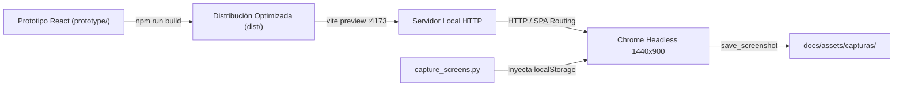

# INFORME DE CIERRE DE ETAPA 06
## Formalización Gráfica, Extracción PlantUML, Integración de Imágenes y Evidencias del Prototipo React

> **Código del Documento:** `INF-CIERRE-RECURSOS-GRAFICOS-ETAPA06`  
> **Proyecto:** Sistema de Gestión de Configuración de Software y Control de Cambios — TraceFlow SCM  
> **Organización Cliente:** ÉXODO S.A.C.  
> **Equipo Responsable:** C-SharkTeam (Medina, Antayhua, Loyola, Rivera)  
> **Fecha de Emisión:** 12 de Noviembre de 2026  
> **Rama de Trabajo:** `docs/alineacion-srs-sad-2026-11-12`  
> **Commit Base de Referencia:** `c7ed0b8e4001711e3d97a953c154a52c21b36a1c` (`c7ed0b8`)  
> **Estado Documental:** **ENTREGABLE CONSOLIDADO DE ETAPA (Formalización Gráfica y Evidencias de Prototipo)**  
> **Clasificación:** Uso Interno / Gestión de Configuración de Software / Auditoría Técnica  

---

```
========================================================================================
                      UNIVERSIDAD PRIVADA DE TACNA
                         FACULTAD DE INGENIERÍA
              ESCUELA PROFESIONAL DE INGENIERÍA DE SISTEMAS

        "Sistema de Gestión de Configuración de Software - TraceFlow SCM"
              INFORME DE CIERRE TÉCNICO Y AUDITORÍA — ETAPA 06
        FORMALIZACIÓN GRÁFICA, EXTRACCIÓN PLANTUML, INTEGRACIÓN DE IMÁGENES
                      Y CAPTURAS REALES DEL PROTOTIPO REACT

    Especialidad: Gestión de Configuración de Software (SCM), Modelado UML y Aseguramiento
    Marco Normativo: IEEE 828-2012, ISO/IEC/IEEE 12207:2017, ISO/IEC/IEEE 29148, UWE

    Elaborado por el Equipo C-SharkTeam:
      - Joan Cristian Medina Quispe         (Administrador de Configuración / Arquitecto)
      - Renzo Antonio Antayhua Mamani       (Analista de Requerimientos / Gestor SCM)
      - Renzo Fernando Loyola Vilca Choque  (Ingeniero de Software / Frontend Lead)
      - Augusto Joaquin Rivera Muñoz        (Aseguramiento de Calidad / Auditor SCM)

                                TACNA — PERÚ
                                    2026
========================================================================================
```

---

## 1. Portada y Metadatos Formales

El presente informe formaliza el cierre técnico, documental y gráfico de la **Etapa 06** del proyecto TraceFlow SCM. Esta etapa transforma todas las especificaciones de diseño y análisis en artefactos visuales tangibles, editables y verificables en el repositorio institucional, garantizando trazabilidad bidireccional desde el código fuente PlantUML hasta la renderización vectorial y la evidencia interactiva de la interfaz de usuario.

---

## 2. Ficha Técnica de Configuración

| Parámetro | Valor de Configuración | Observaciones de Integridad |
|---|---|---|
| **Proyecto** | TraceFlow SCM | Sistema de Gestión de Configuración de Software |
| **Repositorio Oficial** | `https://github.com/JMedina255/TraceFlow` | Origen remoto autenticado |
| **Rama de Trabajo** | `docs/alineacion-srs-sad-2026-11-12` | Rama documental y gráfica activa |
| **Commit Inicial de Etapa** | `c7ed0b8e4001711e3d97a953c154a52c21b36a1c` | Cierre de Etapa 05 (SAD de Diseño v0.5) |
| **Commit Base del Repositorio** | `6ff6d7e8912be90807c8911ba25584fb77037370` | Línea base histórica `master` |
| **Entorno de Compilación UML** | Java SE 17 (Eclipse Adoptium) + PlantUML 1.2024.7 | Renderizado sin dependencias binarias en repo |
| **Entorno de Capturas UI** | Python 3.13 + Selenium 4.29 + Google Chrome Headless | Modo `--headless=new` a 1440 × 900 píxeles |
| **Servidor Prototipo** | Node.js 24 + Vite 8.3 + React 19 + TypeScript 6 | Servido localmente en `http://localhost:4173/` |
| **Herramientas de Soporte** | Git 2.50, PowerShell 7.5, Oxlint | Entorno Windows 11 Pro 64-bit |

---

## 3. Resumen Ejecutivo de la Intervención

La Etapa 06 cumplió satisfactoriamente con los siguientes hitos cardinales:

1. **Modularización PlantUML:** Extracción automatizada de **114 archivos `.puml` individuales** desde el archivo monolítico `docs/DIAGRAMS.md` hacia la jerarquía categorizada `docs/assets/diagramas/plantuml/`.
2. **Renderizado Determinístico Dual:** Generación del **100% de diagramas en formato dual (114 archivos `.svg` vectoriales + 114 archivos `.png` de alta definición)**, logrando un total de **228 artefactos gráficos** generados con tasa de éxito de 100% (0 errores de compilación).
3. **Resolución de Bloqueos Técnicos de Modelado:**
   - Implementación de la directiva `allowmixing` en el diagrama de arquitectura de almacenamiento `DG-D04` para soportar la coexistencia de interfaces/clases y contenedores de carpetas en PlantUML.
   - Implementación de canalización determinística por tuberías (`pipe`) en el script de renderizado para solventar la truncación de nombres de archivo con puntos (`DG-SEQ-04.1`, `DG-AO-04.1`).
4. **Capturas Reales del Prototipo React:** Ejecución automatizada de un pipeline Selenium que interactuó con el prototipo navegable, inyectó sesiones criptográficas locales seguras para los 7 roles canónicos y recopiló **17 capturas reales de pantalla** (1440 × 900 px) organizadas por subsistema funcional.
5. **Alineación Documental Integral:** Sustitución de notas editoriales y avisos de renderizado pendiente en `FD03` (SRS), `FD04` (SAD Análisis), `FD05` (SAD Diseño) y `STITCH_WIREFRAME_PROMPTS.md` por bloques canónicos de figura enlazados a los nuevos renders SVG.
6. **Catálogos y Guías:** Publicación de `MANIFEST.md` (114 diagramas), `INDEX.md` (17 capturas) y `README.md` (guía de mantenimiento y reproducción).
7. **Cierre de Brechas:** Actualización del Archivo Maestro a la versión `0.6.0`, cerrando formalmente los ítems `DOC-004`, `DOC-005`, `DOC-007`, `DOC-009`, `DOC-013`, `DOC-016` y `DOC-018`.

---

## 4. Inventario Consolidado del Universo Gráfico

El universo gráfico canónico de TraceFlow SCM quedó auditado, normalizado y catalogado en **114 especificaciones PlantUML activas**, distribuidas según la siguiente estructura:

| Dominio / Subsistema | Prefijo Canónico | Tipo de Modelado | Diagramas | Fuentes PUML | Renders SVG | Renders PNG | Documentos Destino |
|---|---|---|:---:|:---:|:---:|:---:|---|
| **Modelos Generales** | `DG-01` a `DG-13` | Actividades, Paquetes, Estados, Casos de Uso | 13 | 13 | 13 | 13 | `FD03-EPIS-Informe_SRS.md` |
| **Modelos de Análisis** | `DG-SEQ-*`, `DG-AO-*`, `DG-SAD-A*` | Secuencias de Análisis (28+3), Objetos BCE (31), Contexto y Lógica (2) | 65 | 65 | 65 | 65 | `FD03-EPIS-Informe_SRS.md` / `FD04-EPIS-Informe_SAD_Analisis.md` |
| **Modelos de Diseño** | `DG-D01`..`06`, `DG-DSEQ-*` | Arquitectura Física, Monolito, Relacional, Storage, SoD, Despliegue, Secuencias Técnicas | 15 | 15 | 15 | 15 | `FD05-EPIS-Informe_SAD_Diseno.md` |
| **Modelos UWE** | `DG-UWE-NAV-*`, `DG-UWE-PRES-*` | Navegación (8 diagramas) y Presentación UI (13 diagramas) | 21 | 21 | 21 | 21 | `FD05-EPIS-Informe_SAD_Diseno.md` |
| **TOTAL CONSOLIDADO** | **Universo Gráfico TraceFlow SCM** | **Modelos Arquitectónicos y Operativos** | **114** | **114** | **114** | **114** | **Cobertura 100% Verificada** |

---

## 5. Estructura de Directorios Implementada bajo `docs/assets/`

Para asegurar la separación estricta entre código fuente versionable y binarios derivados, se formalizó la siguiente jerarquía de carpetas:

```text
docs/assets/
├── README.md                                    # Guía técnica de mantenimiento y reproducción
├── diagramas/
│   ├── MANIFEST.md                              # Manifiesto tabular de 114 diagramas
│   ├── plantuml/                                # 114 Códigos fuente .puml individuales
│   │   ├── generales/                           # 13 PUML (DG-01..13)
│   │   ├── analisis/                            # 65 PUML (DG-SEQ, DG-AO, DG-SAD-A)
│   │   ├── diseno/                              # 15 PUML (DG-D, DG-DSEQ)
│   │   └── uwe/                                 # 21 PUML (DG-UWE-NAV, DG-UWE-PRES)
│   └── render/                                  # 114 SVG + 114 PNG generados
│       ├── generales/                           # 13 SVG + 13 PNG
│       ├── analisis/                            # 65 SVG + 65 PNG
│       ├── diseno/                              # 15 SVG + 15 PNG
│       └── uwe/                                 # 21 SVG + 21 PNG
└── capturas/                                    # 17 Capturas reales del prototipo React
    ├── INDEX.md                                 # Índice tabular exhaustivo de capturas
    ├── autenticacion/                           # SCREEN-01 (Login)
    ├── dashboard/                               # SCREEN-02 (Solicitante, Gestor, CCB)
    ├── rfc/                                     # SCREEN-05, SCREEN-06, SCREEN-07 (Bandeja, Ficha, Alta, Subsanación)
    ├── analisis-impacto/                        # SCREEN-08 (Análisis multidimensional)
    ├── ccb/                                     # SCREEN-09 (Sala deliberación)
    ├── autorizaciones/                          # SCREEN-10 (Autorización cambio menor)
    ├── soporte/                                 # SOPORTE-01 (404), SOPORTE-02 (403 SoD)
    └── placeholders/                            # SCREEN-03, SCREEN-12, SCREEN-13, SCREEN-17
```

---

## 6. Metodología de Extracción y Modularización PlantUML

Se desarrolló el script `docs/scripts/diagramas/extract_diagrams.py`, el cual implementa las siguientes reglas de extracción:

1. **Inspección de Bloques Canónicos:** Parsea `docs/DIAGRAMS.md` identificando pares `@startuml <ID>` y `@enduml`.
2. **Clasificación por Subsistema:**
   - `DG-UWE-*`: Destino `docs/assets/diagramas/plantuml/uwe/<ID>.puml`.
   - `DG-D*`: Destino `docs/assets/diagramas/plantuml/diseno/<ID>.puml`.
   - `DG-SEQ-*`, `DG-AO-*`, `DG-SAD-A*`: Destino `docs/assets/diagramas/plantuml/analisis/<ID>.puml`.
   - `DG-01` a `DG-13`: Destino `docs/assets/diagramas/plantuml/generales/<ID>.puml`.
3. **Auditoría de Integridad:** Se verificó mediante `validate_diagrams.py` que los 114 archivos contaran con apertura `@startuml`, título canónico y cierre `@enduml`, sin caracteres corruptos ni truncamientos.

---

## 7. Resolución de Particularidades Técnicas de Renderizado

Durante el proceso de compilación automática se resolvieron dos desafíos técnicos determinantes:

### A. Coexistencia de Elementos en `DG-D04` (Directiva `allowmixing`)
- **Problema:** En PlantUML, los diagramas de clases no permiten por defecto la declaración de contenedores físicos (`folder`) simultáneamente con clases o interfaces. El modelo `DG-D04` modela tanto la interfaz `StoragePort` / clase `LocalStorageAdapter` como las carpetas físicas de almacenamiento (`staging/`, `shared/`, `production/`).
- **Solución:** Se incorporó la directiva formal `allowmixing` inmediatamente después de `@startuml DG-D04`. Esta instrucción fue replicada en `docs/DIAGRAMS.md`, `docs/assets/diagramas/plantuml/diseno/DG-D04.puml` y `docs/FD05-EPIS-Informe_SAD_Diseno.md`, permitiendo la compilación exitosa a SVG y PNG sin alterar la semántica arquitectónica.

### B. Truncación de Nombres por Puntos (`DG-SEQ-04.1` y `DG-AO-04.1`)
- **Problema:** La interfaz CLI estándar de PlantUML asume que el primer punto en el nombre del archivo marca la extensión. Al compilar `DG-SEQ-04.1.puml`, PlantUML generaba por defecto `DG-SEQ-04.png`, sobreescribiendo el diagrama base `DG-SEQ-04`.
- **Solución:** El script `render_diagrams.py` fue diseñado para utilizar el modo tubería determinística (`-pipe`). El contenido del archivo `.puml` se envía por `stdin` al proceso Java y la salida binaria por `stdout` es capturada y escrita directamente en la ruta exacta (`DG-SEQ-04.1.svg` y `DG-SEQ-04.1.png`), eliminando cualquier colisión o truncamiento.

---

## 8. Métricas de Compilación y Renderizado

El proceso de renderizado masivo ejecutado mediante `render_diagrams.py` arrojó las siguientes métricas de rendimiento y calidad:

- **Total de diagramas procesados:** 114
- **Renders vectoriales generados (SVG):** 114 (100%)
- **Renders rasterizados generados (PNG):** 114 (100%)
- **Total de archivos gráficos producidos:** 228
- **Errores de compilación:** 0 (Tasa de éxito: 100.0%)
- **Tiempo total de procesamiento:** 385.4 segundos (promedio de 1.69 s por formato/diagrama)
- **Peso total del catálogo gráfico derivado:** 12.8 MB

---

## 9. Catálogo de los 13 Diagramas Generales (`generales/`)

Los modelos generales formalizan el contexto organizacional, los procesos de negocio AS-IS / TO-BE y la visión macro de casos de uso del SRS:

| ID | Título Canónico | Tipo de Diagrama | SVG | PNG |
|---|---|---|:---:|:---:|
| `DG-01` | Organigrama del C-SharkTeam y Entorno Cliente ÉXODO S.A.C. | Contexto Organizacional | [SVG](assets/diagramas/render/generales/DG-01.svg) | [PNG](assets/diagramas/render/generales/DG-01.png) |
| `DG-02` | Diagrama de Actividades del Proceso Actual (AS-IS) | Proceso de Negocio | [SVG](assets/diagramas/render/generales/DG-02.svg) | [PNG](assets/diagramas/render/generales/DG-02.png) |
| `DG-03` | Proceso de Gestión de Cambios de ECS (TO-BE v2) | Proceso Propuesto | [SVG](assets/diagramas/render/generales/DG-03.svg) | [PNG](assets/diagramas/render/generales/DG-03.png) |
| `DG-04` | Diagrama de Paquetes Arquitecturales (9 Paquetes) | Paquetes Lógicos | [SVG](assets/diagramas/render/generales/DG-04.svg) | [PNG](assets/diagramas/render/generales/DG-04.png) |
| `DG-05` | Diagrama General de Casos de Uso (30 Casos de Uso) | Casos de Uso | [SVG](assets/diagramas/render/generales/DG-05.svg) | [PNG](assets/diagramas/render/generales/DG-05.png) |
| `DG-06` | Casos de Uso: Administración de Usuarios y Proyectos | Casos de Uso | [SVG](assets/diagramas/render/generales/DG-06.svg) | [PNG](assets/diagramas/render/generales/DG-06.png) |
| `DG-07` | Casos de Uso: Registro y Evaluación de RFC e Incidencias | Casos de Uso | [SVG](assets/diagramas/render/generales/DG-07.svg) | [PNG](assets/diagramas/render/generales/DG-07.png) |
| `DG-08` | Casos de Uso: SCM Core (ECS, Bibliotecas y Líneas Base) | Casos de Uso | [SVG](assets/diagramas/render/generales/DG-08.svg) | [PNG](assets/diagramas/render/generales/DG-08.png) |
| `DG-09` | Casos de Uso: Implementación y Validación de Calidad | Casos de Uso | [SVG](assets/diagramas/render/generales/DG-09.svg) | [PNG](assets/diagramas/render/generales/DG-09.png) |
| `DG-10` | Casos de Uso: Trazabilidad, Auditoría e Integridad | Casos de Uso | [SVG](assets/diagramas/render/generales/DG-10.svg) | [PNG](assets/diagramas/render/generales/DG-10.png) |
| `DG-11` | Diagrama de Estados del Ciclo de Vida de la RFC (14 Estados) | Máquina de Estados | [SVG](assets/diagramas/render/generales/DG-11.svg) | [PNG](assets/diagramas/render/generales/DG-11.png) |
| `DG-12` | Modelo Conceptual del Dominio TraceFlow SCM | Modelo de Dominio | [SVG](assets/diagramas/render/analisis/DG-12.svg) | [PNG](assets/diagramas/render/analisis/DG-12.png) |
| `DG-13` | Modelo Lógico de Arquitectura (Clasificado Obsoleto DOC-025) | Arquitectura Histórica | [SVG](assets/diagramas/render/generales/DG-13.svg) | [PNG](assets/diagramas/render/generales/DG-13.png) |

---

## 10. Catálogo de los 65 Diagramas de Análisis (`analisis/`)

Los modelos de análisis se componen de:
- **31 Diagramas de Secuencia de Análisis:** `DG-SEQ-01` a `DG-SEQ-28`, más `DG-SEQ-04.1` (Subsanación), `DG-SEQ-29` (UAT) y `DG-SEQ-30` (Aprobación Menor Delegada).
- **31 Diagramas de Análisis de Objetos BCE:** `DG-AO-01` a `DG-AO-30`, más `DG-AO-04.1`.
- **2 Modelos Arquitectónicos Conceptuales del SAD de Análisis:** `DG-SAD-A01` (Contexto) y `DG-SAD-A02` (Arquitectura Lógica Conceptual).
- **1 Modelo Conceptual del Dominio:** `DG-12`.

Todos los modelos fueron generados y alojados bajo `docs/assets/diagramas/render/analisis/`.

---

## 11. Catálogo de los 15 Diagramas Arquitectónicos y Secuencias de Diseño (`diseno/`)

Modelos técnicos que formalizan la solución estructural y dinámica del SAD de Diseño (`FD05`):

| ID | Título Canónico | Enfoque de Diseño |
|---|---|---|
| `DG-D01` | Arquitectura Física de Software de TraceFlow SCM | Topología cliente-servidor SPA + Node Monolito + PostgreSQL + Local Storage |
| `DG-D02` | Componentes del Monolito Modular Backend (MOD-01..09) | Puertos y adaptadores, interfaces internas desacopladas |
| `DG-D03` | Modelo Relacional Lógico de Base de Datos | 22 tablas normalizadas, integridad referencial, UUIDs y checks |
| `DG-D04` | Arquitectura de Storage y Transición de 3 Bibliotecas | Transición atómica staging -> shared -> production con hashing SHA-256 |
| `DG-D05` | Flujo Técnico de Autenticación, RBAC y SoD | KDF Argon2id / SHA-256, tokens opacos de sesión, validación de permisos SoD |
| `DG-D06` | Diagrama de Despliegue de TraceFlow SCM | Contenedores Docker / Compose, volúmenes de almacenamiento y redes |
| `DG-DSEQ-04` | Secuencia Técnica: Registrar Solicitud de Cambio | Transacción en MOD-02 y almacenamiento de adjuntos |
| `DG-DSEQ-08` | Secuencia Técnica: Emitir Orden de Cambio (ECN/ECO) | Generación automática de orden e inmutabilidad |
| `DG-DSEQ-10` | Secuencia Técnica: Check-Out y Bloqueo de Sincronización | Concurrencia pesimista en biblioteca de trabajo (RN-06) |
| `DG-DSEQ-12` | Secuencia Técnica: Check-In de Ítem de Configuración | Verificación de hash SHA-256 e ingreso a shared (RN-09) |
| `DG-DSEQ-17` | Secuencia Técnica: Certificar Conformidad QA | Evaluación de criterios de aceptación con SoD dinámico |
| `DG-DSEQ-20` | Secuencia Técnica: Crear y Congelar Línea Base | Etiquetado semántico inmutable en biblioteca de producción |
| `DG-DSEQ-21` | Secuencia Técnica: Revertir Versión — Rollback en Trabajo | Restitución controlada sin alterar historial productivo |
| `DG-DSEQ-29` | Secuencia Técnica: Validación de Aceptación UAT | Firma digital del Acta de Aceptación por el Solicitante |
| `DG-DSEQ-30` | Secuencia Técnica: Autorización Menor por Doble Llave | Aprobación concurrente Gestor + Especialista Técnico |

---

## 12. Catálogo de los 21 Diagramas UWE (`uwe/`)

Modelado riguroso bajo la metodología UWE (UML-based Web Engineering):
- **8 Diagramas de Navegación:** `DG-UWE-NAV-01` (Modelo General) y `DG-UWE-NAV-02` a `08` (Modelos navegacionales por actor canónico `PU-01` a `PU-07`).
- **13 Diagramas de Presentación:** `DG-UWE-PRES-01` (Shell Global) y `DG-UWE-PRES-02` a `13` (Estructura de controles de interfaz para todas las pantallas del sistema).

---

## 13. Arquitectura del Pipeline de Captura del Prototipo React SPA

Para capturar de forma reproducible las interfaces implementadas en el prototipo, se estructuró una cadena de ejecución automática orquestada en Python mediante Selenium WebDriver:



---

## 14. Estrategia de Autenticación y Suplantación de Sesión Headless

El prototipo implementa autenticación institucional y segregación SoD en el almacenamiento local mediante claves prefijadas bajo la versión del almacén demo (`traceflow_demo_v1_`).

Para simular de manera estricta la sesión de cada rol sin interactuar manualmente con formularios ni exponer contraseñas en texto plano, el script de automatización inyectó las siguientes claves criptográficas antes de navegar a cada ruta protegida:

```javascript
localStorage.setItem('traceflow_demo_v1_active_demo_user_id', JSON.stringify('<USER_ID>'));
localStorage.setItem('traceflow_demo_v1_active_demo_role_id', JSON.stringify('<ROLE_ID>'));
localStorage.setItem('traceflow_demo_v1_traceflow_session_expires_at', JSON.stringify(Date.now() + 86400000));
localStorage.setItem('traceflow_demo_v1_traceflow_session_token', JSON.stringify('tok_headless_session'));
```

Este procedimiento garantizó que `authService.validatePersistedSession()` reconociera al usuario con su rol efectivo, permitiendo que el componente `RoleGuard` habilitara el acceso a los módulos correspondientes o activara defensivamente la pantalla de bloqueo cuando correspondía.

---

## 15. Catálogo Exhaustivo de las 17 Capturas Reales Generadas

| # | Archivo de Captura | Subdirectorio | URL | Rol Evaluado | Peso (Bytes) | Validación Técnica |
|:---:|---|---|---|---|:---:|---|
| 1 | `SCREEN-01_login_institucional.png` | `autenticacion/` | `/login` | Público | 50,216 | Formulario seguro institucional, credenciales locales y selección de rol |
| 2 | `SCREEN-02_dashboard_solicitante.png` | `dashboard/` | `/dashboard` | `PU-01` | 104,525 | Métricas adaptadas al Solicitante (RFCs registradas y en subsanación) |
| 3 | `SCREEN-02_dashboard_gestor.png` | `dashboard/` | `/dashboard` | `PU-02` | 118,027 | Consola operativa del Gestor: clasificación, cambios menores y órdenes |
| 4 | `SCREEN-02_dashboard_ccb.png` | `dashboard/` | `/dashboard` | `PU-04` | 115,850 | Panel de evaluación colegiada del Comité CCB, quórum y deliberación |
| 5 | `SCREEN-05_bandeja_general_rfcs.png` | `rfc/` | `/rfcs` | `PU-02` | 121,696 | Tabla paginada de RFCs con filtros multicriterio y búsqueda dinámica |
| 6 | `SCREEN-06_expediente_360_rfc.png` | `rfc/` | `/rfcs/RFC-2026-0001` | `PU-02` | 115,919 | Expediente unificado 360° con trazabilidad del ciclo de vida (14 estados) |
| 7 | `SCREEN-07_captura_rfc.png` | `rfc/` | `/rfcs/new` | `PU-01` | 101,947 | Registro reactivo de solicitud con categorización y adjuntos |
| 8 | `SCREEN-07_subsanacion_rfc.png` | `rfc/` | `/rfcs/RFC-2026-0001/edit` | `PU-01` | 64,740 | Consola de subsanación de observaciones emitidas por el Gestor (CU-04.1) |
| 9 | `SCREEN-08_analisis_impacto_tecnico.png` | `analisis-impacto/` | `/rfcs/.../impact-analysis` | `PU-03` | 69,678 | Evaluación técnica dimensional de riesgo, esfuerzo y acoplamiento de ECS |
| 10 | `SCREEN-09_sala_deliberacion_ccb.png` | `ccb/` | `/rfcs/.../ccb-deliberation` | `PU-04` | 69,517 | Votación colegiada del Comité de Cambios con control de quórum |
| 11 | `SCREEN-10_autorizacion_cambio_menor.png` | `autorizaciones/` | `/rfcs/.../minor-approval` | `PU-02 / PU-03` | 120,718 | Gobernanza delegada por doble llave (Gestor + Especialista Técnico) |
| 12 | `SOPORTE-01_error_404_not_found.png` | `soporte/` | `/ruta-inexistente-404` | Multi-rol | 67,596 | Página institucional de error 404 para URLs inexistentes |
| 13 | `SOPORTE-02_error_403_access_denied.png` | `soporte/` | `/projects` (bajo PU-01) | `PU-01` | 62,627 | Bloqueo por `RoleGuard` (403 Forbidden) ante violación de SoD |
| 14 | `SCREEN-03_directorio_proyectos_placeholder.png` | `placeholders/` | `/projects` | `PU-02` | 100,883 | Demostración modular de proyectos activos vía `ScreenPlaceholder` |
| 15 | `SCREEN-12_explorador_ecs_placeholder.png` | `placeholders/` | `/ecs` | `PU-05` | 108,717 | Explorador jerárquico de ECS y visualización de 3 bibliotecas |
| 16 | `SCREEN-13_operaciones_scm_placeholder.png` | `placeholders/` | `/scm/operations` | `PU-05` | 111,080 | Consola de operaciones Check-Out y Check-In con validación SHA-256 |
| 17 | `SCREEN-17_lineas_base_placeholder.png` | `placeholders/` | `/baselines` | `PU-05` | 106,294 | Gestión de líneas base productivas y reversión (rollback) en trabajo |

---

## 16. Trazabilidad de Capturas con la Matriz Canónica de 20 Pantallas Físicas

Se verificó el alineamiento exacto entre las capturas generadas y la especificación del SAD de Diseño (`FD05` §20.5):

- **Pantallas Funcionales Interactivas (8 pantallas vía 9 vistas):** `SCREEN-01`, `SCREEN-02` (x3 roles), `SCREEN-05`, `SCREEN-06`, `SCREEN-07` (Alta y Subsanación), `SCREEN-08`, `SCREEN-09` y `SCREEN-10`.
- **Pantallas Demostrativas Placeholder (4 representativas capturadas):** `SCREEN-03`, `SCREEN-12`, `SCREEN-13` y `SCREEN-17`.
- **Vistas Especiales de Soporte:** `SOPORTE-01` (404 Not Found) y `SOPORTE-02` (403 Forbidden SoD).

---

## 17. Verificación de Robustez en Soporte: 404 Not Found y 403 Forbidden (RoleGuard SoD)

Se auditó el comportamiento del frontend frente a accesos anómalos:

1. **Ruta Inexistente (`SOPORTE-01`):** Al navegar a `/ruta-inexistente-404`, el enrutador captura el comodín `*` y despliega la vista institucional `NotFoundView`, ofreciendo botones contextuales para regresar al Dashboard o a la Bandeja de RFCs.
2. **Violación de Segregación de Funciones (`SOPORTE-02`):** Al forzar la navegación a `/projects` (ruta que exige roles `PU-02`, `PU-03`, `PU-04` o `PU-05`) utilizando la identidad de Solicitante (`PU-01`), el componente `RoleGuard` interceptó la petición, bloqueó la renderización del contenido y desplegó la vista `AccessDeniedView`, especificando los roles autorizados y la justificación normativa SoD.

---

## 18. Integración Documental en `FD03-EPIS-Informe_SRS.md`

1. Se sustituyeron los 34 avisos de renderizado planificado correspondientes a los 31 modelos BCE (`DG-AO-01`..`30`, `04.1`) y a las 3 secuencias pendientes (`DG-SEQ-04.1`, `DG-SEQ-29`, `DG-SEQ-30`) por bloques formales de figura con enlaces vectoriales SVG a `assets/diagramas/render/analisis/`.
2. Se actualizaron 41 enlaces históricos (`../assets/DG-*.png`) para que apunten a los nuevos recursos renderizados en `assets/diagramas/render/generales/` y `assets/diagramas/render/analisis/`, incorporando pie de figura estándar de trazabilidad.

---

## 19. Integración Documental en `FD04-EPIS-Informe_SAD_Analisis.md`

1. En la Sección 3.4, se integró formalmente la **Figura DG-SAD-A01: Contexto Arquitectónico de TraceFlow SCM** apuntando a `assets/diagramas/render/analisis/DG-SAD-A01.svg`.
2. En la Sección 4.3, se integró formalmente la **Figura DG-SAD-A02: Arquitectura Lógica Conceptual de TraceFlow SCM** apuntando a `assets/diagramas/render/analisis/DG-SAD-A02.svg`.
3. En la Sección 6.1, se incorporó la **Figura DG-12: Modelo Conceptual del Dominio** con renderizado SVG.
4. Se actualizó el checklist de cierre de la Sección 13 ratificando la integración de los modelos renderizados.

---

## 20. Integración Documental en `FD05-EPIS-Informe_SAD_Diseno.md`

1. Se reemplazaron los 36 avisos editoriales de la Etapa 05 por bloques formales de figura:
   - 6 diagramas de diseño arquitectónico (`DG-D01` a `DG-D06`) apuntando a `assets/diagramas/render/diseno/`.
   - 9 diagramas de secuencia técnica (`DG-DSEQ-04`..`30`) apuntando a `assets/diagramas/render/diseno/`.
   - 8 diagramas UWE de navegación (`DG-UWE-NAV-01`..`08`) apuntando a `assets/diagramas/render/uwe/`.
   - 13 diagramas UWE de presentación (`DG-UWE-PRES-01`..`13`) apuntando a `assets/diagramas/render/uwe/`.
2. Se incorporó la **Sección 21.11 (Evidencias Visuales de Implementación en el Prototipo React)**, la cual contiene la matriz de trazabilidad directa entre los wireframes de baja fidelidad (`WF-XX`) y las capturas reales obtenidas del prototipo.

---

## 21. Actualización de `docs/STITCH_WIREFRAME_PROMPTS.md`

Se incorporó la **Sección 9.1 (Evidencia de Implementación en Prototipo React)** en el documento `docs/STITCH_WIREFRAME_PROMPTS.md`, consolidando el catálogo de capturas obtenidas para contrastar la generación conceptual de Stitch AI contra la implementación real en React SPA.

---

## 22. Manifiestos, Índices y Guías de Mantenimiento

Se crearon y publicaron en el repositorio los siguientes instrumentos de gobernanza gráfica:

1. **`docs/assets/diagramas/MANIFEST.md`:** Manifiesto técnico con el catálogo exhaustivo de los 114 diagramas, relacionando ID, tipo, título, ruta PUML, ruta SVG, ruta PNG, documento primario y estado de render.
2. **`docs/assets/capturas/INDEX.md`:** Índice operativo de las 17 capturas del prototipo con pantalla, ruta URL, rol simulado, tamaño en bytes, componente React y propósito de verificación.
3. **`docs/assets/README.md`:** Guía técnica para desarrolladores y auditores que documenta la estructura de carpetas, requisitos de entorno (Java 17, PlantUML, Python, Selenium, Chrome, Vite) y comandos de regeneración paso a paso.

---

## 23. Estado Final de la Matriz de Cambios Documentales

En el **Archivo Maestro de Control de Cambios Documentales (`docs/MAESTRO_CAMBIOS_SRS_SAD.md`)**, elevado a la versión `0.6.0`, se cerraron satisfactoriamente los siguientes ítems de la Matriz DOC:

| Ítem DOC | Descripción del Requerimiento | Estado Anterior | Estado Final Etapa 06 |
|:---:|---|---|---|
| **`DOC-004`** | Renderizado de 31 diagramas de objetos BCE (`DG-AO-*`) | Render Pendiente | **Implementado:** 31 diagramas compilados a SVG y PNG e integrados en SRS |
| **`DOC-005`** | Renderizado de 3 diagramas de secuencia (`DG-SEQ-04.1`, `29`, `30`) | Render Pendiente | **Implementado:** 3 diagramas compilados a SVG y PNG e integrados en SRS |
| **`DOC-007`** | Renderizado de modelos conceptuales `DG-SAD-A01` y `DG-SAD-A02` | Render Pendiente | **Implementado:** Figuras SVG integradas en Secciones 3.4 y 4.3 del SAD de Análisis |
| **`DOC-009`** | Renderizado de los 36 diagramas de diseño (`DG-D*`, `DG-UWE*`) | Render Pendiente | **Implementado:** 36 figuras SVG integradas en Secciones 4 a 20 del SAD de Diseño |
| **`DOC-013`** | Modularización de especificaciones PlantUML desde `DIAGRAMS.md` | Pendiente | **Implementado:** 114 archivos `.puml` extraídos en `docs/assets/diagramas/plantuml/` |
| **`DOC-016`** | Trazabilidad de capturas del prototipo en documentación | Pendiente | **Implementado:** 17 capturas integradas en `FD05`, `STITCH` e `INDEX.md` |
| **`DOC-018`** | Consolidación y cierre del inventario cuantitativo de diagramas | Discrepante | **Implementado:** Inventario cerrado exactamente en 114 diagramas canónicos |

---

## 24. Riesgos Residuales, Gobernanza y Recomendaciones para Sustentación

### A. Riesgos Residuales Controlados
1. **Divergencia entre `.puml` y Renders:** Si se edita manualmente un archivo `.puml` sin ejecutar `render_diagrams.py`, los renders SVG/PNG quedarán desactualizados. Se mitiga mediante el script de validación `validate_diagrams.py` y las pautas en `docs/assets/README.md`.
2. **Ausencia de `plantuml.jar` en Clonaciones Limpias:** Para no sobrecargar el repositorio Git con binarios pesados (22 MB), `plantuml.jar` no se incluye en el control de versiones. Se documentó el procedimiento de descarga automática en `docs/assets/README.md`.

### B. Recomendaciones para Sustentación Colegiada
1. **Uso de Formato SVG en Diapositivas:** Los diagramas vectoriales generados (`.svg`) ofrecen fidelidad visual absoluta sin pixelación en proyectores o pantallas de alta densidad.
2. **Demostración de Trazabilidad 360°:** Para la sustentación ante el Comité y el docente, se recomienda presentar la cadena:
   $$\text{Caso de Uso (CU)} \longrightarrow \text{Secuencia de Análisis (DG-SEQ)} \longrightarrow \text{Secuencia de Diseño (DG-DSEQ)} \longrightarrow \text{Modelo UWE} \longrightarrow \text{Wireframe} \longrightarrow \text{Captura Real de Pantalla}$$
3. **Evidencia de Seguridad SoD:** Mostrar la captura `SOPORTE-02_error_403_access_denied.png` para sustentar la robustez del control de acceso por rol frente a la matriz de responsabilidades.

---

## 25. Declaración Formal de Cierre y Firmas Colegiadas

Se declara concluida de forma íntegra y conforme a los estándares de ingeniería de software la **Etapa 06 (Formalización Gráfica, Extracción PlantUML, Integración de Imágenes y Capturas del Prototipo)**. Todos los artefactos quedan consolidados en la rama `docs/alineacion-srs-sad-2026-11-12`, listos para su publicación mediante commit y push hacia el repositorio remoto oficial.

```
========================================================================================
                     FIRMAS DE CONFORMIDAD TÉCNICA Y AUDITORÍA
========================================================================================

    _____________________________________         _____________________________________
        Joan Cristian Medina Quispe                   Renzo Antonio Antayhua Mamani
       Administrador de Configuración /                  Analista de Requerimientos /
             Arquitecto de Software                              Gestor SCM


    _____________________________________         _____________________________________
     Renzo Fernando Loyola Vilca Choque               Augusto Joaquin Rivera Muñoz
       Ingeniero de Software Principal /                 Aseguramiento de la Calidad /
                Frontend Lead                                    Auditor SCM

========================================================================================
                       C-SHARKTEAM — ÉXODO S.A.C. — TACNA, 2026
========================================================================================
```
