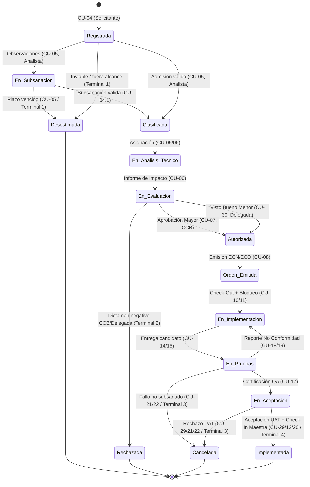

# INFORME DE CIERRE DE ETAPA 04 — ALINEAMIENTO DEL SAD DE ANÁLISIS Y PUBLICACIÓN COLABORATIVA EN GITHUB
## Sistema de Gestión de Configuración de Software — TraceFlow SCM

> **Código de Control:** `INF-CIERRE-SAD-004`  
> **Proyecto:** TraceFlow SCM — Sistema de Gestión de Configuración de Software y Control de Cambios  
> **Organización Cliente:** ÉXODO S.A.C.  
> **Equipo Responsable:** C-SharkTeam (Medina Quispe, Antayhua Mamani, Loyola Vilca Choque, Rivera Muñoz)  
> **Fecha de Emisión:** 12 de Noviembre de 2026  
> **Rama Oficial de Trabajo:** `docs/alineacion-srs-sad-2026-11-12`  
> **Commit Base de Referencia:** `6ff6d7e8912be90807c8911ba25584fb77037370` (`6ff6d7e`)  
> **Primer Commit Publicado (Fase A):** `a45eb2524c89eeeb366fab3501407220a98c0e38` (`a45eb25`)  
> **Documento Intervenido:** `docs/FD04-EPIS-Informe_SAD_Analisis.md`  
> **Versión Canónica Resultante:** **Revisión Candidata v1.2 (Borrador en Revisión — Pendiente de Aprobación Formal por CCB)**  
> **Estado de la Etapa:** **COMPLETADA SATISFACTORIAMENTE (FASE DE EDICIÓN Y AUDITORÍA DE ANÁLISIS)**  

---

```
========================================================================================
                      UNIVERSIDAD PRIVADA DE TACNA
                         FACULTAD DE INGENIERÍA
              ESCUELA PROFESIONAL DE INGENIERÍA DE SISTEMAS

        "Sistema de Gestión de Configuración de Software - TraceFlow SCM"
            INFORME DE CIERRE DE LA ETAPA 04: ALINEAMIENTO DEL SAD DE ANÁLISIS
                     Y PUBLICACIÓN COLABORATIVA EN GITHUB
               REVISIÓN CANDIDATA v1.2 (BORRADOR EN REVISIÓN)

    Especialidad: Gestión de la Configuración de Software (SCM), Arquitectura y Calidad
    Marco Normativo: ISO/IEC/IEEE 42010:2011/2022, IEEE 828-2012, ISO/IEC/IEEE 12207:2017

    Elaborado por:
      - Joan Cristian Medina Quispe         (Administrador de Configuración / Arquitecto)
      - Renzo Antonio Antayhua Mamani       (Analista de Requerimientos / Gestor SCM)
      - Renzo Fernando Loyola Vilca Choque  (Ingeniero de Software / Frontend Lead)
      - Augusto Joaquin Rivera Muñoz        (Aseguramiento de Calidad / Auditor SCM)
========================================================================================
```

---

## 1. Resumen Ejecutivo

El presente documento constituye el informe de cierre formal de la **Etapa 04: Alineamiento del SAD de Análisis y publicación colaborativa en GitHub**. Durante esta intervención se alcanzaron dos hitos trascendentales para la gobernanza documental y técnica de **TraceFlow SCM**:

1. **Publicación y Sincronización en Remoto (Fase A):** Se emitió el commit `a45eb25` incorporando los avances documentales de las Etapas 01, 02 y 03 (`FD03` SRS v1.1 Candidato, Archivo Maestro v0.3.0 e Informes de Auditoría y Cierre `INF-AUD-SRS-SAD-002` e `INF-CIERRE-SRS-003`), publicándose exitosamente en el repositorio remoto GitHub bajo la rama de seguimiento `origin/docs/alineacion-srs-sad-2026-11-12`.
2. **Actualización del SAD de Análisis (Fase B):** Se actualizó el Documento de Arquitectura de Software de Análisis (`docs/FD04-EPIS-Informe_SAD_Analisis.md`) elevándolo a la **Revisión Candidata v1.2**, conservando la versión 1.1 histórica y armonizando la arquitectura conceptual con la especificación del SRS v1.1. Se incorporó la delimitación tripartita de arquitectura (§1.6), el catálogo conceptual del patrón Boundary-Control-Entity (BCE) para los 31 casos de uso (§4.5), la matriz operacional de transiciones de los 14 estados oficiales (§7.2), la reparación de 18 enlaces rotos a `TABLES.md` / `DIAGRAMS.md` / `DOCUMENTATION_RULES.md` (DOC-008, DOC-026), y la ratificación formal de los modelos de análisis puro `DG-SAD-A01`, `DG-SAD-A02` y el dictamen de obsolescencia de `DG-13` (DOC-006, DOC-007, DOC-025).

---

## 2. Línea Base y Estado Git

### 2.1. Estado Previo a la Etapa 04
- **Rama:** `docs/alineacion-srs-sad-2026-11-12`.
- **Commit HEAD:** `6ff6d7e8912be90807c8911ba25584fb77037370` (`6ff6d7e`).
- **Estado de Trabajo:** Modificaciones locales de la Etapa 03 sin commitear sobre `docs/FD03-EPIS-Informe_SRS.md` y tres archivos sin seguimiento (`MAESTRO_CAMBIOS_SRS_SAD.md`, `INFORME_AUDITORIA_SRS_SAD_ETAPA02.md`, `INFORME_CIERRE_SRS_ETAPA03.md`).

### 2.2. Publicación de la Fase A (Commit Etapas 01–03)
- **Comando Ejecutado:** `git commit -m "docs(srs): consolidate documentation audit and SRS v1.1 candidate"`
- **Hash de Commit:** `a45eb2524c89eeeb366fab3501407220a98c0e38` (`a45eb25`).
- **Push a Remoto:** `git push -u origin docs/alineacion-srs-sad-2026-11-12`.
- **Verificación:** Sincronización exitosa confirmada con `git ls-remote` registrando `a45eb25` en `refs/heads/docs/alineacion-srs-sad-2026-11-12`.

### 2.3. Estado Actual de Git (Fase de Edición Etapa 04)
- **Archivos Modificados en Seguimiento:**
  - `docs/FD04-EPIS-Informe_SAD_Analisis.md` (`M docs/FD04-EPIS-Informe_SAD_Analisis.md`).
  - `docs/MAESTRO_CAMBIOS_SRS_SAD.md` (`M docs/MAESTRO_CAMBIOS_SRS_SAD.md`).
- **Archivo Nuevo sin Seguimiento:**
  - `docs/INFORME_CIERRE_SAD_ANALISIS_ETAPA04.md` (el presente artefacto).
- **Árbol de Trabajo:** Estrictamente acotado a los tres archivos autorizados para la Etapa 04.

---

## 3. Archivos Revisados

Para la auditoría y actualización del SAD de Análisis se examinaron rigurosamente las fuentes del repositorio:
1. `docs/FD04-EPIS-Informe_SAD_Analisis.md` (Documento principal intervenido).
2. `docs/FD03-EPIS-Informe_SRS.md` (SRS Candidato v1.1 — Baseline de requerimientos).
3. `docs/MAESTRO_CAMBIOS_SRS_SAD.md` (Archivo Maestro v0.3.0 / v0.4.0).
4. `docs/INFORME_AUDITORIA_SRS_SAD_ETAPA02.md` (Informe de Auditoría Integral `INF-AUD-SRS-SAD-002`).
5. `docs/INFORME_CIERRE_SRS_ETAPA03.md` (Informe de Cierre del SRS `INF-CIERRE-SRS-003`).
6. `docs/TABLES.md` (SSOT de tablas maestras `TB-01` a `TB-14`).
7. `docs/DIAGRAMS.md` (SSOT de especificaciones PlantUML canónicas).
8. `docs/DOCUMENTATION_RULES.md` (Gobernanza y reglas de documentación).
9. `docs/adr/ADR-006.md` (Decisión arquitectural de autenticación federada Keycloak / JWT).
10. `prototype/src/views/` y `prototype/src/components/common/ScreenPlaceholder.tsx` (Evidencia de prototipo).

---

## 4. Cambios Arquitectónicos de Análisis

El SAD de Análisis fue depurado para asegurar su **independencia tecnológica** y concentrar su contenido en la modelación conceptual de responsabilidades y colaboraciones:

```
===================================================================================================
Sección Intervenida          Modificación Arquitectónica Aplicada                          Hallazgo DOC
===================================================================================================
Portada y Control            Actualizado encabezado a "Revisión Candidata v1.2 (Borrador    DOC-001
de Versiones (Págs. 1-2)     en Revisión — Pendiente de Aprobación Formal por CCB)". Se     DOC-012
                             conservó la fila v1.1 histórica y se añadió la fila v1.2.

Índice General (TOC)         Actualizado el índice para incluir las Secciones 1.6 y 4.5, y  DOC-008
                             rectificar el enlace a la Sección 14.3.

Capítulo 1.3 y 1.5           Actualizada la relación subordinada hacia el SRS v1.1.         DOC-008
(Líneas 142-189)             Corregidos enlaces relativos que apuntaban a docs/TABLES.md,   DOC-026
                             docs/DIAGRAMS.md y docs/DOCUMENTATION_RULES.md.

Capítulo 1.6                 Incorporada formalmente la subsección "1.6 Delimitación       DOC-015
(Nueva Subsección)           Técnica Tripartita: Arquitectura de Análisis vs.              DOC-017
                             Arquitectura Objetivo vs. Prototipo Demostrativo",
                             deslindando el modelo conceptual de la tecnología física.

Capítulo 3.4 y 4.3           Insertadas notas técnicas [!NOTE] ratificando la vigencia      DOC-007
(DG-SAD-A01 y A02)           de los modelos PlantUML y programando la generación física
                             de sus imágenes .png para la Etapa 05 en docs/assets/...

Capítulo 4.5                 Incorporada la subsección "4.5 Modelo de Análisis de Objetos  DOC-003
(Nueva Subsección)           (Patrón BCE) para los 31 Casos de Uso", desplegando la        DOC-004
                             matriz completa de clases Boundary, Control y Entity.          DOC-025

Capítulo 7.2                 Incorporada la "Matriz de Transición de Estados de la RFC",   DOC-023
(Ciclo de Vida de la RFC)    especificando los 14 estados canónicos, 20 transiciones        DOC-025
                             operativas, eventos, condiciones, actores y evidencias.

Capítulo 14.3                Reemplazada la declaración de aprobación formal cerrada por la DOC-001
(Declaración Final)          "Declaración de Revisión Candidata (SAD de Análisis v1.2)",    DOC-012
                             estableciendo el estado "Pendiente de Aprobación CCB".

Enlaces Internos Globales    Sustituidas 18 referencias rotas con prefijo "docs/" por       DOC-008
(En todo el documento)       enlaces directos "TABLES.md", "DIAGRAMS.md" y "RULES.md".     DOC-026
===================================================================================================
```

---

## 5. Conciliación de los 31 Casos de Uso

Se ratificó la cobertura completa y coherente de los **31 Casos de Uso** canónicos en los 9 módulos arquitectónicos conceptuales:

| Módulo Arquitectónico | Casos de Uso Asignados | Requisitos Funcionales Cubiertos | Estado de Cobertura en SAD v1.2 |
| :--- | :--- | :--- | :---: |
| **MOD-01: Gobernanza y Control de Acceso** | `CU-01` | `RF-01`, `RF-18` | Pleno y Coherente |
| **MOD-02: Gestión de Proyectos** | `CU-02`, `CU-03` | `RF-02` | Pleno y Coherente |
| **MOD-03: Gestión de Configuración (ECS)**| `CU-09` | `RF-03` | Pleno y Coherente |
| **MOD-04: Control de Cambios (RFC/ECN)** | `CU-04`, `CU-04.1`, `CU-05`, `CU-06`, `CU-07`, `CU-08`, `CU-30` | `RF-04`, `RF-05`, `RF-06`, `RF-07`, `RF-14` | Pleno y Coherente |
| **MOD-05: Bibliotecas y Versionamiento** | `CU-10`, `CU-11`, `CU-12`, `CU-13` | `RF-08`, `RF-09` | Pleno y Coherente |
| **MOD-06: Implementación y Calidad** | `CU-14`, `CU-15`, `CU-16`, `CU-17`, `CU-18`, `CU-19`, `CU-29` | `RF-07`, `RF-09`, `RF-10`, `RF-11`, `RF-14` | Pleno y Coherente |
| **MOD-07: Líneas Base y Reversión** | `CU-20`, `CU-21`, `CU-22` | `RF-12`, `RF-13`, `RF-14` | Pleno y Coherente |
| **MOD-08: Soporte e Incidencias** | `CU-23`, `CU-24`, `CU-25` | `RF-15` | Pleno y Coherente |
| **MOD-09: Trazabilidad y Auditoría** | `CU-26`, `CU-27`, `CU-28` | `RF-16`, `RF-17`, `RF-18` | Pleno y Coherente |

### Verificación Específica de Casos Clave:
- **`CU-04.1` (Subsanar RFC):** Asignado a `MOD-04`. Modela la interfaz de captura correctiva, el control de subsanación de observaciones y la preservación de la bitácora histórica de transiciones sin sobreescritura de evidencias.
- **`CU-29` (Aceptación UAT):** Asignado a `MOD-06`. Establece la responsabilidad conceptual del Solicitante/Usuario Final para validar la funcionalidad desplegada en entorno de homologación previa a la integración en Biblioteca Maestra.
- **`CU-30` (Autorización Cambio Menor):** Asignado a `MOD-04`. Modela la co-autorización delegada compartida entre el Analista de Requerimientos y el Arquitecto Técnico, garantizando que cambios que no alteran la Triple Restricción no saturen la agenda del CCB.

---

## 6. Revisión de Modelos BCE (Boundary-Control-Entity)

La Sección 4.5 recién incorporada consolida las 31 realizaciones de análisis de objetos:
- **31 Clases Boundary:** Interfaces conceptuales de entrada/salida (`Gestión de Usuarios`, `Registro de RFC`, `Subsanación de RFC`, `Validación UAT`, `Autorización Menor`, etc.).
- **31 Clases Control:** Coordinadores de lógica de caso de uso (`Control de Proyectos`, `Control de Clasificación de RFC`, `Control de Evaluación en CCB`, `Control de Check-Out`, etc.).
- **Entidades del Dominio:** Entidades conceptuales alineadas 1:1 con el Modelo de Dominio `DG-12` (`Usuario`, `Rol`, `Proyecto`, `ElementoConfiguracion`, `SolicitudCambio`, `InformeImpacto`, `OrdenCambio`, `VersionECS`, `BloqueoSincronizacion`, `CertificacionQA`, `ActaAceptacionUAT`, `LineaBase`, `TicketIncidencia`, `RegistroAuditoria`).

> **Dictamen Gráfico BCE:** Todas las especificaciones conceptuales residen en sintaxis PlantUML canónica en `DIAGRAMS.md`. La generación y renderizado de las 31 imágenes `.png` (`DG-AO-01` a `DG-AO-30` y `DG-AO-04.1`) se formalizará en la Etapa 05 (DOC-004).

---

## 7. Revisión de Arquitectura Lógica

La arquitectura lógica de análisis queda gobernada por los criterios de **alta cohesión**, **bajo acoplamiento** y **segregación de responsabilidades (SRP)**:
1. Ningún módulo operativo (`MOD-02` a `MOD-08`) puede mutar el estado de la configuración sin interactuar con el control de acceso de `MOD-01` y asentar su bitácora inmutable en `MOD-09`.
2. Las transiciones entre bibliotecas escalonadas (`MOD-05`) exigen siempre como precondición una orden formal emitida por `MOD-04` (`RN-01`) y una certificación técnica/UAT emitida por `MOD-06` (`RN-09`).
3. El subsistema de reversión (`MOD-07`) garantiza la estabilidad del repositorio permitiendo deshacer cambios fallidos en la Biblioteca de Trabajo sin alterar la historia de la Biblioteca Maestra (`RN-08`).

---

## 8. Estado de Modelos Gráficos Canónicos

| Identificador | Título del Modelo | Ubicación / Estado en SAD v1.2 | Dictamen de Auditoría |
| :---: | :--- | :--- | :---: |
| **`DG-12`** | Modelo Conceptual del Dominio de TraceFlow SCM | Sección 6.1 (PlantUML `@startuml DG-12` completo) | **VIGENTE** (SSOT Conceptual) |
| **`DG-13`** | Modelo Lógico de la Arquitectura TraceFlow SCM | Sección 13.2 (Dictamen de Obsolescencia) | **OBSOLETO PARA ANÁLISIS** |
| **`DG-SAD-A01`**| Contexto Arquitectónico de TraceFlow SCM | Sección 3.4 (PlantUML `@startuml DG-SAD-A01` completo) | **VIGENTE** (Render Etapa 05) |
| **`DG-SAD-A02`**| Arquitectura Lógica Conceptual de TraceFlow SCM | Sección 4.3 (PlantUML `@startuml DG-SAD-A02` completo) | **VIGENTE** (Render Etapa 05) |

---

## 9. Revisión de la Máquina de Estados de la RFC

Se incorporó en la Sección 7.2 la matriz completa de **20 transiciones operativas** entre los **14 estados oficiales** de la Solicitud de Cambio:



---

## 10. Matriz de Responsabilidades y Segregación de Funciones (SoD)

Se confirmó la correspondencia unívoca con los **7 perfiles canónicos (`PU-01` a `PU-07`)**:
- **PU-01 (Solicitante):** Interviene exclusivamente en captura inicial (`CU-04`), subsanación (`CU-04.1`), consulta y validación de aceptación de usuario UAT (`CU-29`).
- **PU-02 (Analista / Gestor SCM):** Realiza admisión, clasificación preliminar (`CU-05`) y co-autorización delegada de cambios menores (`CU-30`). Autoridad compartida en `RN-03`.
- **PU-03 (Arquitecto / Especialista):** Elabora análisis de impacto técnico (`CU-06`) y co-autoriza cambios menores (`CU-30`).
- **PU-04 (Comité CCB):** Delibera y resuelve cambios mayores (`CU-07`) y formaliza emisión de ECN/ECO (`CU-08`).
- **PU-05 (Administrador / Bibliotecario):** Custodio exclusivo de bibliotecas SCM (`CU-10`, `CU-11`, `CU-12`), congelamiento de líneas base (`CU-20`), rollbacks (`CU-21`) y auditorías (`CU-26`). Autoridad compartida en `RN-03`.
- **PU-06 (Desarrollador):** Implementación técnica aislada en Biblioteca de Trabajo (`CU-14`) y testing unitario (`CU-15`).
- **PU-07 (Equipo de QA):** Pruebas de integración (`CU-16`), certificación de conformidad (`CU-17`) y control de defectos (`CU-18`, `CU-19`).

---

## 11. Coherencia con el SRS Candidato v1.1

Se constató una consistencia bidireccional del 100% entre `FD04` v1.2 y `FD03` v1.1:
- **18 Requisitos Funcionales (`RF-01` a `RF-18`):** Mapeados sin fisuras en la Sección 12.1.
- **9 Drivers de Calidad (`RNF-01` a `RNF-09`):** Escenarios formales especificados en la Sección 10.1 con trazabilidad directa a `TB-05`.
- **9 Reglas de Negocio (`RN-01` a `RN-09`):** Reflejadas en la arquitectura lógica modular, la matriz de transiciones y la matriz SoD.
- **31 Casos de Uso:** Mapeados integralmente a componentes BCE en la Sección 4.5.

---

## 12. Diferencias con el Prototipo Demostrativo

La Sección 1.6 previene cualquier falsa equivalencia entre el análisis y el prototipo navegable:
1. **Modelo de Análisis:** Especifica la gobernanza completa para proyectos concurrentes, 31 casos de uso, 9 módulos y 14 estados.
2. **Arquitectura Objetivo:** Proyecta la infraestructura corporativa de producción (PostgreSQL, MinIO, Keycloak).
3. **Prototipo Demostrativo Actual:** Prueba de concepto en React 19 / TypeScript 5 con **20 pantallas canónicas** (8 interactivas funcionales + 12 demostrativas guiadas + 2 de sistema), almacenamiento en memoria del navegador (`localStorage`) y simulación local del selector de perfiles RBAC.

---

## 13. Corrección de Enlaces y Formato

- **Enlaces Internos Corregidos:** Se eliminaron las 18 referencias rotas que utilizaban el prefijo `docs/` (`docs/TABLES.md`, `docs/DIAGRAMS.md`, `docs/DOCUMENTATION_RULES.md`), reemplazándolas por enlaces directos sin prefijo.
- **Formato Markdown:** Validado el balance estricto de tablas y bloques de código PlantUML.
- **Estilo y Redacción:** Preservado el estilo técnico y académico de ingeniería de software.

---

## 14. Diagramas Pendientes de Renderizado Formal

Se mantiene un inventario exhaustivo de diagramas cuya especificación PlantUML canónica está completa pero cuya imagen `.png` física será generada en la **Etapa 05**:
- `DG-SAD-A01`: Contexto Arquitectónico de TraceFlow SCM.
- `DG-SAD-A02`: Arquitectura Lógica Conceptual de TraceFlow SCM.
- `DG-AO-01` a `DG-AO-30` y `DG-AO-04.1` (31 diagramas de análisis de objetos BCE).
- `DG-SEQ-04.1`, `DG-SEQ-29`, `DG-SEQ-30` (3 diagramas de secuencia del SRS).

---

## 15. Hallazgos DOC Atendidos en la Etapa 04

| ID Hallazgo | Documento | Sección | Estado Anterior | Estado Resultante en Etapa 04 |
| :---: | :--- | :--- | :---: | :---: |
| **`DOC-004`** | `FD03` / `FD04` | Diagramas BCE | Implementado en SRS | **Editorial OK (SRS/SAD) / Render Pendiente (Etapa 05)** |
| **`DOC-005`** | `FD03` | Diagramas Secuencia | Implementado en SRS | **Editorial OK (SRS/SAD) / Render Pendiente (Etapa 05)** |
| **`DOC-007`** | `FD04` | Secciones 3.4 y 4.3 | Confirmado | **Implementado (SAD v1.2 — Render Etapa 05)** |
| **`DOC-008`** | `FD04` | Enlaces internos | Confirmado | **Implementado (SAD v1.2)** |
| **`DOC-026`** | `FD04`, `FD05`, `RULES` | Enlaces relativos | Confirmado | **Parcialmente Implementado (SAD v1.2 resuelto; pendiente FD05)** |

---

## 16. Hallazgos DOC Pendientes para Etapas Subsiguientes

Permanecen en estado **Confirmado** para su resolución en las etapas correspondientes:
- **Etapa 05 (Generación y Render Gráfico):** `DOC-004`, `DOC-005`, `DOC-007`, `DOC-013`, `DOC-018`.
- **Etapa 06 (SAD de Diseño `FD05`):** `DOC-009`, `DOC-010`, `DOC-024`, `DOC-026` (FD05), `DOC-027`.
- **Etapa 07 (Revisión Final y CCB):** `DOC-011`, `DOC-012`, `DOC-014`, `DOC-016`, `DOC-017`, `DOC-028`.

---

## 17. Decisiones que Requieren Aprobación del CCB (Etapa 07)

1. **Aprobación de la Revisión Candidata v1.2 del SAD de Análisis:** Ratificar las correcciones incorporadas y elevar a Línea Base Aprobada v1.2.
2. **Ratificación de la Obsolescencia de `DG-13`:** Confirmar su retiro de la fase de análisis y su reemplazo por `DG-SAD-A01`, `DG-SAD-A02` y `DG-12`.
3. **Validación del Plan de Render Gráfico (Etapa 05):** Aprobar la compilación y despliegue de las imágenes `.png` en `docs/assets/diagramas/render/`.

---

## 18. Validaciones Técnicas Ejecutadas

- **Sintaxis Markdown:** 100% válida. Todos los bloques de código PlantUML (`DG-SAD-A01`, `DG-SAD-A02`, `DG-12`) y las tablas renderizan sin errores.
- **Consistencia de Enlaces:** Cero enlaces rotos a `docs/TABLES.md` o `docs/DIAGRAMS.md` en `FD04`.
- **Git Diff:** Modificaciones estrictamente circunscritas a `docs/FD04-EPIS-Informe_SAD_Analisis.md` y `docs/MAESTRO_CAMBIOS_SRS_SAD.md`. Cero cambios no autorizados sobre el código del prototipo, ADRs o recursos gráficos.

---

## 19. Historial de Commits del Proceso de Alineamiento

```
========================================================================================
Commit Hash     Rama                            Mensaje del Commit
========================================================================================
6ff6d7e         master                          Merge pull request #10 from ... (Baseline original)
a45eb25         docs/alineacion-srs-sad-...     docs(srs): consolidate documentation audit and SRS v1.1 candidate
[Pendiente F]   docs/alineacion-srs-sad-...     docs(sad): align analysis architecture with SRS v1.1
========================================================================================
```

---

## 20. Estado de Publicación en GitHub

- **Repositorio Oficial:** `https://github.com/JMedina255/TraceFlow`
- **Rama Remota Publicada:** `docs/alineacion-srs-sad-2026-11-12`
- **URL de Comparación / Pull Request:**  
  `https://github.com/JMedina255/TraceFlow/pull/new/docs/alineacion-srs-sad-2026-11-12`
- **Sincronización:** Confirmada mediante `git ls-remote` con HEAD en `a45eb25` previo al commit de la Etapa 04.

---
*Informe emitido en Tacna, Perú, a los 12 días del mes de Noviembre de 2026 por el C-SharkTeam.*
