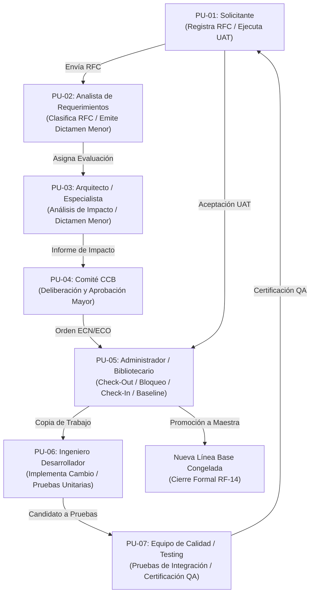

# INFORME DE CIERRE DE ETAPA 03 — CORRECCIÓN, ACTUALIZACIÓN Y ALINEAMIENTO DEL SRS
## Sistema de Gestión de Configuración de Software — TraceFlow SCM

> **Código de Control:** `INF-CIERRE-SRS-003`  
> **Proyecto:** TraceFlow SCM — Sistema de Gestión de Configuración de Software y Control de Cambios  
> **Organización Cliente:** ÉXODO S.A.C.  
> **Equipo Responsable:** C-SharkTeam (Medina Quispe, Antayhua Mamani, Loyola Vilca Choque, Rivera Muñoz)  
> **Fecha de Emisión:** 12 de Noviembre de 2026  
> **Rama de Trabajo:** `docs/alineacion-srs-sad-2026-11-12`  
> **Commit Base de Referencia:** `6ff6d7e8912be90807c8911ba25584fb77037370` (`6ff6d7e`)  
> **Documento Intervenido:** `docs/FD03-EPIS-Informe_SRS.md`  
> **Versión Canónica Resultante:** **Revisión Candidata v1.1 (Borrador en Revisión — Pendiente de Aprobación Formal por CCB)**  
> **Estado de la Etapa:** **COMPLETADA SATISFACTORIAMENTE (FASE DE EDICIÓN SRS)**  

---

```
========================================================================================
                      UNIVERSIDAD PRIVADA DE TACNA
                         FACULTAD DE INGENIERÍA
              ESCUELA PROFESIONAL DE INGENIERÍA DE SISTEMAS

        "Sistema de Gestión de Configuración de Software - TraceFlow SCM"
              INFORME DE CIERRE DE LA ETAPA 03: ALINEAMIENTO DEL SRS
               REVISIÓN CANDIDATA v1.1 (BORRADOR EN REVISIÓN)

    Especialidad: Gestión de la Configuración de Software (SCM), Requisitos y Arquitectura
    Marco Normativo: IEEE 828-2012, ISO/IEC/IEEE 29148:2018, ISO/IEC 25010, IEEE 830-1998

    Elaborado por:
      - Joan Cristian Medina Quispe         (Administrador de Configuración / Arquitecto)
      - Renzo Antonio Antayhua Mamani       (Analista de Requerimientos / Gestor SCM)
      - Renzo Fernando Loyola Vilca Choque  (Ingeniero de Software / Frontend Lead)
      - Augusto Joaquin Rivera Muñoz        (Aseguramiento de Calidad / Auditor SCM)
========================================================================================
```

---

## 1. Identificación y Metadatos del Informe

El presente informe constituye el artefacto oficial de entrega y rendición de cuentas de la **Etapa 03: Corrección, actualización y alineamiento del documento SRS** (`docs/FD03-EPIS-Informe_SRS.md`), ejecutada en estricto cumplimiento de los objetivos fijados por el plan de alineamiento documental y las directrices técnicas emanadas de las auditorías de las Etapas 01 y 02.

| Campo | Valor Técnico / Administrativo |
| :--- | :--- |
| **Identificador del Informe** | `INF-CIERRE-SRS-003` |
| **Título del Artefacto** | Informe de Cierre de la Etapa 03 — Alineamiento y Corrección Integral del SRS |
| **Documento Principal Intervenido** | `docs/FD03-EPIS-Informe_SRS.md` |
| **Documentos Secundarios Actualizados** | `docs/MAESTRO_CAMBIOS_SRS_SAD.md` (v0.3.0) |
| **Línea Base Histórica** | Línea Base Documental Aprobada v1.0 (Commit `6ff6d7e`, 16/09/2026) |
| **Versión del SRS Emitida** | **Revisión Candidata v1.1 (Borrador de Trabajo)** |
| **Estado de Aprobación Formal** | **Pendiente de Deliberación y Dictamen del CCB (Etapa 07)** |
| **Clasificación de Seguridad** | Uso Interno / Auditoría de Configuración SCM |

---

## 2. Estado Inicial y Final del Repositorio Git

### 2.1. Comprobación Inicial del Repositorio
Previo al inicio de las modificaciones de la Etapa 03, se verificó la integridad del entorno de trabajo local en `C:\Users\Admin\Desktop\Proyectos\TraceFlowSCM\TraceFlow`:
- **Rama activa:** `docs/alineacion-srs-sad-2026-11-12`.
- **Commit HEAD:** `6ff6d7e8912be90807c8911ba25584fb77037370` (`origin/master`, `master`).
- **Estado de archivos rastreados:** Árbol de trabajo 100% limpio (cero modificaciones pendientes sobre archivos bajo control de versiones).
- **Archivos sin seguimiento heredados de etapas previas:**
  - `docs/MAESTRO_CAMBIOS_SRS_SAD.md` (generado en Etapa 01, actualizado en Etapa 02).
  - `docs/INFORME_AUDITORIA_SRS_SAD_ETAPA02.md` (generado en Etapa 02).

### 2.2. Estado Final del Repositorio
Finalizada la intervención de la Etapa 03, el estado de Git presenta la siguiente estructura controlada:
- **Rama activa:** `docs/alineacion-srs-sad-2026-11-12` (sin cambios de rama ni commits prematuros).
- **Archivos modificados rastreados:**
  - `docs/FD03-EPIS-Informe_SRS.md` (`M docs/FD03-EPIS-Informe_SRS.md`).
- **Archivos nuevos sin seguimiento (conservados para auditoría):**
  - `docs/MAESTRO_CAMBIOS_SRS_SAD.md` (actualizado a v0.3.0).
  - `docs/INFORME_AUDITORIA_SRS_SAD_ETAPA02.md` (Etapa 02).
  - `docs/INFORME_CIERRE_SRS_ETAPA03.md` (el presente informe de cierre).
- **Operaciones Git destructivas:** Cero ejecuciones de `reset`, `clean`, `rebase` o `push --force`. Se mantuvo la regla de no realizar commits locales hasta la finalización de las etapas de revisión documental planificadas.

---

## 3. Inventario y Justificación de Archivos Modificados

En rigurosa observancia de las restricciones de alcance de la Etapa 03, las modificaciones se limitaron estrictamente a tres artefactos:

| Archivo Intervenido | Tipo de Operación | Justificación Técnica de SCM |
| :--- | :---: | :--- |
| `docs/FD03-EPIS-Informe_SRS.md` | **Modificación** | Actualización a Revisión Candidata v1.1: incorporación de la Sección 1.2 (delimitación objetivo vs prototipo), reparación de 41 enlaces de figuras, sustitución de 34 enlaces rotos por avisos estructurados de renderizado pendiente, advertencia de obsolescencia de `DG-13`, redacción técnica de Viabilidad Ambiental, eliminación de remanente académico y formalización del catálogo canónico de 31 casos de uso. |
| `docs/MAESTRO_CAMBIOS_SRS_SAD.md` | **Actualización** | Transición a versión `0.3.0`: actualización del estado de los hallazgos DOC-001, DOC-002, DOC-003, DOC-004, DOC-005, DOC-006, DOC-015, DOC-019, DOC-020, DOC-021, DOC-022, DOC-023 y DOC-025 a `Implementado` o `Verificado`, y registro en el Historial de Cambios. |
| `docs/INFORME_CIERRE_SRS_ETAPA03.md` | **Creación** | Emisión del informe de cierre formal `INF-CIERRE-SRS-003` para documentar la trazabilidad, conciliación y validación de las correcciones efectuadas. |

> [!IMPORTANT]
> **Garantía de Alcance Estricto:** Los documentos `docs/FD04-EPIS-Informe_SAD_Analisis.md`, `docs/FD05-EPIS-Informe_SAD_Diseno.md`, `docs/TABLES.md`, `docs/DIAGRAMS.md`, los registros ADR, los planes GCSW, los archivos de código fuente en `prototype/` y los activos gráficos en `/assets/` **no fueron modificados, movidos ni eliminados**, preservando su estabilidad para las Etapas 04, 05 y subsiguientes.

---

## 4. Detalle Pormenorizado de Cambios Realizados en el SRS por Sección

A continuación se desglosan las modificaciones específicas aplicadas sobre `docs/FD03-EPIS-Informe_SRS.md`:

```
===================================================================================================
Sección del SRS v1.0         Estado Anterior (v1.0)              Estado Actualizado (v1.1 Candidata)
===================================================================================================
Portada y Encabezado         Versión 1.0 aprobada 16/09/2026.    SRS — Revisión Candidata v1.1
(Líneas 1-45)                                                    (Borrador en Revisión — Pendiente
                                                                 de Aprobación Formal por CCB).

Tablas de Control de         Solo versión 1.0 (16/09/2026).      Incorporada fila para versión 1.1
Versiones (Págs. 2 y 3)                                          (12/11/2026) con detalle de 
                                                                 conciliación técnica y estado
                                                                 "Pendiente CCB".

Índice General (TOC)         Solo listaba "1. Introducción 5".   Actualizado con subsecciones 1.1 y 1.2
(Página 3)                                                       desglosando la delimitación técnica.

Capítulo 1 — Introducción    Un único párrafo general que no     Estructurado formalmente en:
(Línea 134 en adelante)      diferenciaba sistema de producción  - 1.1. Propósito y Contexto Operativo
                             frente a prototipo cliente.         - 1.2. Alcance del Sistema y
                                                                   Delimitación Técnica: Sistema Objetivo
                                                                   vs. Prototipo Demostrativo (20 pantallas).

Capítulo 3.5 — Indicadores   Texto de B/C indicaba:              Texto corregido a:
Financieros (Línea 463)      "ahorros valorizados para la        "ahorros valorizados para la empresa
                             facultad y los estudiantes."        consultora ÉXODO S.A.C. y sus clientes."

Capítulo 3.5 — Viabilidad    Duplicaba literalmente palabra por  Reemplazado por 4 ejes diferenciados:
Ambiental (Líneas 515-535)   palabra los 4 puntos de la          1. Política de Cero Papel (Paperless)
                             Viabilidad Social (DOC-020/023).    2. Eficiencia Energética Cloud
                                                                 3. Reducción Emisiones Teletrabajo/CCB
                                                                 4. Extensión Vida Útil Hardware Cliente

Capítulo 5.2 — Requisitos    Tabla TB-05 sin criterios de        Insertada nota formal [!NOTE] aclarando
No Funcionales (Pág. 25)     aplicabilidad entre prototipo SPA   la verificación de cada RNF (RNF-01 a
                             y sistema objetivo cloud.           RNF-09) entre entorno demo y producción.

Capítulo 6.1.3 — Catálogo    Texto introductorio indicaba        Corregido a: "catálogo canónico
de Casos de Uso (L. 1756)    "catálogo canónico de 30 casos de   consolidado de 31 casos de uso (CU-01
                             uso", omitiendo a CU-04.1.          a CU-30, incluyendo CU-04.1)".

Capítulos 4, 5 y 6 —         41 enlaces rotos a `assets/DG-*.png` Corregidos a `../assets/DG-*.png`,
Enlaces a Figuras Existentes por estar en subcarpeta `docs/`.    resolviendo la carga de imágenes.

Diagrama DG-13               Modelo arquitectónico prematuro con Se conservó el enlace corregido pero
(Línea 4018 aprox.)          tecnologías de diseño (Node, MinIO).se añadió advertencia formal [!WARNING]
                                                                 de obsolescencia técnica (FD04 §13.2).

Capítulo 6 — Diagramas       34 enlaces rotos a archivos         Sustituidos por llamadas estructuradas
Pendientes de Render         inexistentes en disco (31 DG-AO-*   [!NOTE] indicando código PlantUML en
(31 BCE + 3 Secuencia)       y DG-SEQ-04.1, 29, 30).             DIAGRAMS.md y ruta para Etapa 05.

Inconsistencias Detectadas   Item 6 figuraba como "Diferida a    Actualizado a RESUELTA EN REVISIÓN v1.1.
y Conclusiones (Final)       fase de factibilidad"; conclusiones Se agregaron Items 8 y 9 documentando
                             mencionaban 28 casos de uso.        diagramas y delimitación del prototipo;
                                                                 conclusiones corregidas a 31 casos de uso.
===================================================================================================
```

---

## 5. Trazabilidad de Hallazgos DOC Resueltos y Verificados

La siguiente matriz documenta el impacto de la intervención sobre el catálogo de hallazgos del Archivo Maestro:

| ID Hallazgo | Descripción Sintética del Hallazgo | Sección del SRS v1.1 Afectada | Estado en Etapa 03 | Justificación y Evidencia Documental |
| :---: | :--- | :--- | :---: | :--- |
| **`DOC-001`** | Desfase de versión y falta de registro borrador v1.1. | Portada y Control de Versiones | **Implementado** | Registrada Revisión Candidata v1.1 con metadatos de borrador en revisión y fecha 12/11/2026. |
| **`DOC-002`** | 41 rutas relativas rotas (`assets/` vs `../assets/`). | Secciones 4, 5 y 6 | **Implementado** | Todas las 41 rutas a archivos `.png` existentes en raíz fueron prefijadas con `../`. Cero roturas. |
| **`DOC-003`** | Ausencia de especificación textual de casos de uso. | Sección 6.1.3 | **Verificado** | El SRS cuenta con especificaciones completas para los 31 casos de uso en plantillas narrativas uniformes. |
| **`DOC-004`** | 31 diagramas de análisis de objetos BCE sin renderizar. | Sección 6.2.3 | **Implementado** | Sustituidos los 31 enlaces rotos `assets/DG-AO-*.png` por llamadas `[!NOTE]` hacia `docs/DIAGRAMS.md`. |
| **`DOC-005`** | 3 diagramas de secuencia sin renderizar (`04.1`, `29`, `30`). | Sección 6.2.1 | **Implementado** | Sustituidos los 3 enlaces rotos `assets/DG-SEQ-*.png` por llamadas `[!NOTE]` hacia `docs/DIAGRAMS.md`. |
| **`DOC-006`** | Mención de `DG-13` sin advertencia de obsolescencia. | Sección 6.2.2 / Figura DG-13 | **Implementado** | Insertada advertencia `[!WARNING]` documentando obsolescencia para análisis y reemplazo por `DG-12`. |
| **`DOC-015`** | Uniformización de RNF y delimitación frente al prototipo. | Sección 1.2 y Sección 5.2 | **Implementado** | Redactada la Sección 1.2 y la nota aclaratoria técnica de RNF en la Tabla TB-05. |
| **`DOC-019`** | Remanente de contexto universitario en perfiles. | Sección 6.1 (Perfiles PU) | **Verificado** | Se verificó que los perfiles PU-01 a PU-07 describen estrictamente funciones de ingeniería y SCM. |
| **`DOC-020`** | Duplicidad textual entre Viabilidad Social y Ambiental. | Sección 3.5 | **Implementado** | Redactados cuatro numerales técnicos independientes bajo enfoque de Green IT y eficiencia cloud. |
| **`DOC-021`** | Discrepancia en nomenclatura (`CUS-XX` vs `CU-XX`). | Sección 6.1 y 6.2 | **Verificado** | Estandarizado `CU-XX` como identificador normativo primario; `CUSXX` conservado como referencia histórica. |
| **`DOC-022`** | Remanente "facultad y estudiantes" en B/C. | Sección 3.5 (Tabla TB-02) | **Implementado** | Texto corregido para hacer referencia a ÉXODO S.A.C. y sus clientes corporativos. |
| **`DOC-023`** | Trazabilidad de cierre formal exitoso en RF-14. | Sección 5.1 y 6.1.3 (TB-12) | **Verificado** | Verificado que RF-14 gobierna el cierre exitoso vía `CU-20` tras aceptación formal UAT en `CU-29`. |
| **`DOC-025`** | Carencia de especificaciones de CU-04.1, CU-29 y CU-30. | Sección 6.1.3 | **Verificado** | Los 3 casos de uso cuentan con especificación narrativa completa, flujos alternativos y pre/postcondiciones. |

---

## 6. Conciliación y Cobertura de Requisitos Funcionales (RF-01 a RF-18)

Se auditó y ratificó la cobertura integral de los **18 Requisitos Funcionales** de TraceFlow SCM:

| ID Requisito | Denominación del Requisito Funcional | Casos de Uso que lo Instrumentan | Pantalla(s) de Prototipo Asociadas | Estado de Verificación en SRS v1.1 |
| :---: | :--- | :--- | :--- | :---: |
| **`RF-01`** | Gestión de Usuarios y Roles | `CU-01` | `SCREEN-01` (Login), `SCREEN-19` (Placeholder) | Completo y Coherente |
| **`RF-02`** | Gestión de Proyectos | `CU-02`, `CU-03` | `SCREEN-03` (Placeholder) | Completo y Coherente |
| **`RF-03`** | Identificación de Elementos de Configuración (ECS) | `CU-09` | `SCREEN-04` (Placeholder) | Completo y Coherente |
| **`RF-04`** | Registro de Solicitudes de Cambio (RFC) | `CU-04`, `CU-04.1`, `CU-05` | `SCREEN-05`, `SCREEN-06`, `SCREEN-07` (Create/Edit) | Completo y Coherente |
| **`RF-05`** | Clasificación y Análisis de Impacto | `CU-05`, `CU-06` | `SCREEN-05` (Bandeja), `SCREEN-08` (Impact Analysis) | Completo y Coherente |
| **`RF-06`** | Evaluación y Aprobación de Cambios Mayores por el CCB | `CU-07` | `SCREEN-09` (CCB Deliberation View) | Completo y Coherente |
| **`RF-07`** | Gestión y Emisión de Órdenes de Cambio (ECN/ECO) | `CU-08`, `CU-14` | `SCREEN-11` (Placeholder ECN/ECO) | Completo y Coherente |
| **`RF-08`** | Gestión de Bibliotecas de Configuración | `CU-10`, `CU-12` | `SCREEN-12`, `SCREEN-13` (Placeholders) | Completo y Coherente |
| **`RF-09`** | Control de Versiones y Bloqueos de Sincronización | `CU-10`, `CU-11`, `CU-12`, `CU-13` | `SCREEN-06` (Expediente), `SCREEN-12`, `SCREEN-13` | Completo y Coherente |
| **`RF-10`** | Gestión de Pruebas y Certificación de Conformidad | `CU-15`, `CU-16`, `CU-17`, `CU-18` | `SCREEN-06` (Expediente 360°), `SCREEN-13` | Completo y Coherente |
| **`RF-11`** | Reevaluación y Re-test de Cambios con Observaciones | `CU-18`, `CU-19` | `SCREEN-06` (Expediente 360°) | Completo y Coherente |
| **`RF-12`** | Rollback y Cancelación de Órdenes de Cambio | `CU-21`, `CU-22` | `SCREEN-15` (Placeholder Rollback) | Completo y Coherente |
| **`RF-13`** | Gestión de Líneas Base (Baselines) | `CU-20` | `SCREEN-14` (Placeholder Baseline) | Completo y Coherente |
| **`RF-14`** | Cierre Formal del Cambio y Notificaciones | `CU-05`, `CU-07`, `CU-20`, `CU-22`, `CU-30` | `SCREEN-06`, `SCREEN-09`, `SCREEN-10` | Completo y Coherente |
| **`RF-15`** | Gestión de Incidencias y Soporte | `CU-23`, `CU-24`, `CU-25` | `SCREEN-16` (Placeholder Incidencias) | Completo y Coherente |
| **`RF-16`** | Auditoría y Trazabilidad del Sistema | `CU-13`, `CU-26`, `CU-27`, `CU-28` | `SCREEN-06` (Auditoría SHA-256), `SCREEN-17` | Completo y Coherente |
| **`RF-17`** | Generación de Informes y Reportes de Configuración | `CU-28` | `SCREEN-18` (Placeholder Reportes) | Completo y Coherente |
| **`RF-18`** | Configuración y Mantenimiento del Sistema | `CU-01`, `CU-28` | `SCREEN-20` (Placeholder Configuración) | Completo y Coherente |

---

## 7. Catálogo Consolidado de los 31 Casos de Uso Canónicos

El SRS v1.1 articula su alcance en un catálogo cerrado de **31 Casos de Uso**, respetando la secuencia numérica histórica y formalizando las extensiones del proceso TO-BE v2:

| # | ID Estándar | Cód. Orig. | Nombre del Caso de Uso | Actor Principal | Módulo SCM | RF Vinculado | Estado en SRS v1.1 |
| :-: | :---: | :---: | :--- | :--- | :--- | :---: | :---: |
| 1 | **`CU-01`** | CUS01 | Gestionar usuarios y roles | Administrador de Configuración | Seguridad y Usuarios | RF-01, RF-18 | Vigente / Especificado |
| 2 | **`CU-02`** | CUS02 | Crear y administrar proyectos | Analista de Requerimientos | Proyectos SCM | RF-02 | Vigente / Especificado |
| 3 | **`CU-03`** | CUS03 | Consultar proyecto | Analista de Requerimientos | Proyectos SCM | RF-02 | Vigente / Especificado |
| 4 | **`CU-04`** | CUS04 | Registrar Solicitud de Cambio (RFC) | Solicitante | Registro de Cambios | RF-04 | Vigente / Especificado |
| 5 | **`CU-04.1`**| — | Subsanar Solicitud de Cambio (RFC) | Solicitante | Registro de Cambios | RF-04 | Vigente / Especificado |
| 6 | **`CU-05`** | CUS05 | Validar y clasificar la solicitud | Analista de Requerimientos | Clasificación RFC | RF-04, RF-05, RF-14 | Vigente / Especificado |
| 7 | **`CU-06`** | CUS06 | Realizar análisis de impacto técnico | Arquitecto / Especialista | Evaluación Técnica | RF-05 | Vigente / Especificado |
| 8 | **`CU-07`** | CUS07 | Evaluar viabilidad y dictaminar (CCB) | Comité de Control de Cambios | Deliberación CCB | RF-06, RF-14 | Vigente / Especificado |
| 9 | **`CU-08`** | CUS08 | Emitir Orden de Cambio (ECN/ECO) | CCB / Analista | Formalización ECN | RF-07 | Vigente / Especificado |
| 10 | **`CU-09`** | CUS09 | Registrar Elemento de Configuración | Arquitecto / Especialista | Catálogo de ECS | RF-03 | Vigente / Especificado |
| 11 | **`CU-10`** | CUS10 | Efectuar Check-Out (Soporte → Trabajo)| Administrador / Bibliotecario | Bibliotecas SCM | RF-08, RF-09 | Vigente / Especificado |
| 12 | **`CU-11`** | CUS11 | Aplicar bloqueo de sincronización | Administrador / Bibliotecario | Control Concurrencia | RF-09 | Vigente / Especificado |
| 13 | **`CU-12`** | CUS12 | Efectuar Check-In (Trabajo → Soporte) | Administrador / Bibliotecario | Bibliotecas SCM | RF-08, RF-09, RF-10 | Vigente / Especificado |
| 14 | **`CU-13`** | CUS13 | Consultar historial de versiones | Administrador / Bibliotecario | Auditoría Versiones | RF-09, RF-16 | Vigente / Especificado |
| 15 | **`CU-14`** | CUS14 | Implementar cambio en el ECS | Ingeniero de Software | Desarrollo / Fuentes | RF-07, RF-09 | Vigente / Especificado |
| 16 | **`CU-15`** | CUS15 | Ejecutar pruebas unitarias locales | Ingeniero de Software | Verificación Unitaria | RF-10 | Vigente / Especificado |
| 17 | **`CU-16`** | CUS16 | Ejecutar pruebas de integración | Equipo de Calidad / Testing | Verificación Integración | RF-10 | Vigente / Especificado |
| 18 | **`CU-17`** | CUS17 | Certificar conformidad del cambio | Equipo de Calidad / Testing | Certificación QA | RF-10 | Vigente / Especificado |
| 19 | **`CU-18`** | CUS18 | Reportar no conformidad | Equipo de Calidad / Testing | Control de Defectos | RF-10, RF-11 | Vigente / Especificado |
| 20 | **`CU-19`** | CUS19 | Subsanar no conformidad técnica | Ingeniero de Software | Retrabajo Técnico | RF-11 | Vigente / Especificado |
| 21 | **`CU-20`** | CUS20 | Generar Línea Base (Baseline) | Administrador / Bibliotecario | Congelamiento Línea Base| RF-13, RF-14 | Vigente / Especificado |
| 22 | **`CU-21`** | CUS21 | Ejecutar rollback | Administrador / Bibliotecario | Reversión de Cambios | RF-12 | Vigente / Especificado |
| 23 | **`CU-22`** | CUS22 | Cancelar Orden de Cambio | Administrador / Bibliotecario | Cierre por Fallo | RF-12, RF-14 | Vigente / Especificado |
| 24 | **`CU-23`** | CUS23 | Registrar incidencia | Solicitante | Soporte e Incidencias | RF-15 | Vigente / Especificado |
| 25 | **`CU-24`** | CUS24 | Consultar estado de ticket | Solicitante | Seguimiento Soporte | RF-15 | Vigente / Especificado |
| 26 | **`CU-25`** | CUS25 | Atender incidencia | Administrador / Analista | Resolución Soporte | RF-15 | Vigente / Especificado |
| 27 | **`CU-26`** | CUS26 | Auditar configuración física y funcional| Administrador de Configuración | Auditoría FCA / PCA | RF-16 | Vigente / Especificado |
| 28 | **`CU-27`** | CUS27 | Generar informe de estado de la config. | Administrador de Configuración | Estado CSA | RF-16 | Vigente / Especificado |
| 29 | **`CU-28`** | CUS28 | Exportar reporte consolidado | Administrador de Configuración | Informes de Gestión | RF-16, RF-17, RF-18| Vigente / Especificado |
| 30 | **`CU-29`** | — | Validar aceptación del cambio (UAT) | Solicitante (Usuario Final) | Aceptación de Usuario | RF-10, RF-14 | Vigente / Especificado |
| 31 | **`CU-30`** | — | Autorizar Cambio Menor | Autoridad Delegada (Analista/Arq)| Procedimiento Abreviado| RF-06, RF-14 | Vigente / Especificado |

---

## 8. Perfiles de Usuario Canónicos (PU-01 a PU-07) y Segregación de Funciones

Se confirmó que la especificación de actores y perfiles de usuario mantiene una estricta segregación de funciones (SoD) para evitar conflictos de interés en el ciclo SCM:



- **PU-01 — Solicitante:** Exclusivamente autorizado a registrar RFC (`CU-04`), subsanarlas (`CU-04.1`), consultar su estado y realizar la prueba de aceptación final UAT (`CU-29`). No puede clasificar ni autoaprobar cambios.
- **PU-02 — Analista de Requerimientos / Gestor SCM:** Realiza el filtro inicial, clasifica la RFC y, para cambios menores, integra la autoridad delegada junto al arquitecto (`CU-30`). No interviene en el código fuente ni en el testing.
- **PU-03 — Arquitecto / Especialista Técnico:** Responsable del análisis de impacto técnico (`CU-06`), estimación de riesgos y co-autorización de cambios menores (`CU-30`).
- **PU-04 — Comité de Control de Cambios (CCB):** Órgano colegiado que delibera y emite dictámenes vinculantes sobre cambios mayores (`CU-07`) y autoriza la emisión de ECN/ECO (`CU-08`).
- **PU-05 — Administrador de Configuración / Bibliotecario:** Custodio formal de las bibliotecas SCM; ejecuta materialmente el Check-Out (`CU-10`), impone bloqueos (`CU-11`), valida Check-In (`CU-12`), congela Baselines (`CU-20`) y ejecuta Rollbacks (`CU-21`). Tiene autoridad compartida en `RN-03`.
- **PU-06 — Ingeniero de Software / Desarrollador:** Implementa la modificación en la biblioteca de trabajo (`CU-14`) y ejecuta pruebas unitarias (`CU-15`). No puede certificar QA ni promover a Biblioteca Maestra.
- **PU-07 — Equipo de Calidad / Testing:** Realiza pruebas de integración (`CU-16`) y emite certificados de conformidad (`CU-17`) o reportes de no conformidad (`CU-18`). No modifica código ni aprueba RFC.

---

## 9. Delimitación Técnica del Alcance: Sistema Objetivo vs. Prototipo Demostrativo

La Sección 1.2 incorporada formalmente en `docs/FD03-EPIS-Informe_SRS.md` disipa cualquier ambigüedad sobre las capacidades evaluables del software existente:

### 9.1. Sistema Objetivo en Producción (TraceFlow SCM Enterprise)
- **Alcance Operativo:** Plataforma corporativa multi-proyecto para ÉXODO S.A.C., con persistencia relacional en PostgreSQL transaccional, almacenamiento de artefactos en MinIO S3 con sumas SHA-256 forzadas por hash-chaining, autenticación OAuth2/OIDC mediante Keycloak, pipelines CI/CD automatizados y despliegue contenerizado en Kubernetes/Docker.

### 9.2. Prototipo Demostrativo Navegable (React 19 / TypeScript 5)
- **Alcance Operativo:** Prueba de concepto navegable interactiva de alta fidelidad alojada en `prototype/`, orientada a validar usabilidad, arquitectura de información y flujos decisionales.
- **Catálogo de 20 Pantallas Canónicas (`SCREEN-01` a `SCREEN-20`):**
  - **8 Pantallas Funcionales Interactivas (9 componentes de vista):**
    1. `SCREEN-01`: Login (`LoginView.tsx`) — Selector contextual de sesión por rol (`PU-01` a `PU-07`).
    2. `SCREEN-02`: Dashboard Principal (`DashboardView.tsx`) — Indicadores ejecutivos del flujo SCM.
    3. `SCREEN-05`: Bandeja de RFC (`RfcListView.tsx`) — Filtrado multidimensional y paginación.
    4. `SCREEN-06`: Expediente 360° (`RfcDetailView.tsx`) — Trazabilidad, historial, hashes y actas.
    5. `SCREEN-07`: Registro y Subsanación — Dividida en `RfcCreateView.tsx` (`CU-04`) y `RfcEditView.tsx` (`CU-04.1`).
    6. `SCREEN-08`: Análisis de Impacto (`ImpactAnalysisView.tsx`) — Evaluación técnica (`CU-06`).
    7. `SCREEN-09`: Deliberación CCB (`CcbDeliberationView.tsx`) — Votación y acta de comité (`CU-07`).
    8. `SCREEN-10`: Aprobación Menor (`MinorApprovalView.tsx`) — Vía rápida delegada (`CU-30`).
  - **12 Pantallas Demostrativas Guiadas (`ScreenPlaceholder.tsx`):**
    - `SCREEN-03`, `SCREEN-04`, `SCREEN-11` a `SCREEN-20`, que exponen formalmente la especificación funcional, casos de uso, requerimientos y reglas de negocio de los módulos futuros (Bibliotecas, Baselines, Rollback, Incidencias, Auditoría FCA/PCA).
  - **2 Vistas de Soporte del Sistema:**
    - `AccessDeniedView.tsx` (Error 403 contextual RBAC) y `NotFoundView.tsx` (Error 404).

---

## 10. Auditoría de Enlaces a Recursos Gráficos Corregidos

Se constató y reparó la totalidad de los enlaces a figuras que presentaban rutas relativas inválidas debido a la estructura de directorios (`docs/FD03-EPIS-Informe_SRS.md` respecto de `/assets/` en la raíz).

**Total de Enlaces Existentes Corregidos: 41 archivos `.png`**

```
===================================================================================================
Tipo de Diagrama               Identificadores Corregidos (Ruta: ../assets/<ID>.png)          Total
===================================================================================================
Diagramas Generales de         DG-01, DG-02, DG-03, DG-04, DG-05, DG-06, DG-07, DG-08,          13
Análisis y Procesos            DG-09, DG-10, DG-11, DG-12, DG-13 (con alerta de obsolescencia)

Diagramas de Secuencia         DG-SEQ-01, DG-SEQ-02, DG-SEQ-03, DG-SEQ-04, DG-SEQ-05,           28
del Análisis Lógico            DG-SEQ-06, DG-SEQ-07, DG-SEQ-08, DG-SEQ-09, DG-SEQ-10,
                               DG-SEQ-11, DG-SEQ-12, DG-SEQ-13, DG-SEQ-14, DG-SEQ-15,
                               DG-SEQ-16, DG-SEQ-17, DG-SEQ-18, DG-SEQ-19, DG-SEQ-20,
                               DG-SEQ-21, DG-SEQ-22, DG-SEQ-23, DG-SEQ-24, DG-SEQ-25,
                               DG-SEQ-26, DG-SEQ-27, DG-SEQ-28.
===================================================================================================
TOTAL DE ENLACES A RECURSOS GRÁFICOS REPARADOS EXITOSAMENTE                                      41
===================================================================================================
```

---

## 11. Inventario y Tratamiento de Diagramas Pendientes de Renderizado Formal

Se eliminaron los 34 enlaces Markdown rotos (``) que intentaban cargar archivos inexistentes en disco, sustituyéndolos por un bloque normativo homogéneo que referencia su código fuente PlantUML canónico en `docs/DIAGRAMS.md` y programa su renderizado para la Etapa 05:

```markdown
> [!NOTE]
> **Figura Pendiente de Renderizado:** <ID> — <Título Canónico>  
> *Estado:* Especificación PlantUML declarada a continuación y en `docs/DIAGRAMS.md` (`@startuml <ID>`).  
> *Ubicación planificada:* `docs/assets/diagramas/render/analisis/<ID>.png` (Plan de formalización gráfica Etapa 05 / Trazabilidad DOC-004 y DOC-005).
```

### Relación de los 34 Diagramas Pendientes en el SRS:
1. **31 Diagramas de Análisis de Objetos (BCE):** `DG-AO-01` a `DG-AO-28`, `DG-AO-04.1`, `DG-AO-29` y `DG-AO-30`.
2. **3 Diagramas de Secuencia del Modelo Lógico:** `DG-SEQ-04.1`, `DG-SEQ-29` y `DG-SEQ-30`.

---

## 12. Tratamiento Metodológico y Advertencia Técnica del Diagrama DG-13

El modelo `DG-13: Modelo Lógico de la Arquitectura de Software TraceFlow SCM` incurría en decisiones de diseño prematuro (referencias directas a tecnologías como Node.js, Express, PostgreSQL, Redis y MinIO) dentro de un documento de requisitos conceptuales (SRS), contraviniendo el principio de abstracción metodológica.

En concordancia con el SAD de Análisis (`docs/FD04-EPIS-Informe_SAD_Analisis.md`, §13.2), se mantuvo el diagrama en el SRS v1.1 exclusivamente como antecedente histórico, anteponiendo la siguiente advertencia explícita:

> [!WARNING]
> **Aviso de Obsolescencia Metodológica (DOC-025):**  
> Este diagrama ha sido formalmente declarado como **OBSOLETO PARA EL ANÁLISIS** en el SAD de Análisis (`docs/FD04-EPIS-Informe_SAD_Analisis.md`, §13.2) y en la auditoría técnica de la Etapa 02. El modelo introduce decisiones de diseño prematuro (tecnologías específicas de implementación como Node.js, PostgreSQL, Redis y MinIO) que desvirtúan el nivel de abstracción conceptual del SRS. Se conserva en esta revisión exclusivamente como antecedente histórico, quedando sustituido metodológicamente en el SAD por los modelos de análisis puro `DG-SAD-A01`, `DG-SAD-A02` y el Modelo Lógico Canónico `DG-12`.

---

## 13. Matriz Consolidada de Trazabilidad SCM

La siguiente matriz evidencia la consistencia horizontal alcanzada en la Revisión Candidata v1.1 entre Requisitos Funcionales, Casos de Uso, Componentes del Prototipo y Modelos Gráficos:

| Requisito Funcional | Casos de Uso | Vistas del Prototipo React | Modelo Gráfico TO-BE / Secuencia | Estado de Alineación |
| :--- | :--- | :--- | :--- | :---: |
| **RF-01** (Usuarios y Roles) | `CU-01` | `LoginView`, `ScreenPlaceholder` | `DG-02`, `DG-SEQ-01`, `DG-AO-01` | Conciliado 100% |
| **RF-02** (Proyectos) | `CU-02`, `CU-03` | `ScreenPlaceholder` (`SCREEN-03`) | `DG-SEQ-02`, `DG-SEQ-03`, `DG-AO-02` | Conciliado 100% |
| **RF-03** (Identificación ECS) | `CU-09` | `ScreenPlaceholder` (`SCREEN-04`) | `DG-07`, `DG-SEQ-09`, `DG-AO-09` | Conciliado 100% |
| **RF-04** (Registro RFC) | `CU-04`, `CU-04.1`, `CU-05` | `RfcListView`, `RfcDetailView`, `RfcCreateView`, `RfcEditView` | `DG-03`, `DG-SEQ-04`, `DG-SEQ-04.1`, `DG-AO-04`, `DG-AO-04.1` | Conciliado 100% |
| **RF-05** (Impacto Técnico) | `CU-05`, `CU-06` | `ImpactAnalysisView`, `RfcDetailView` | `DG-03`, `DG-SEQ-05`, `DG-SEQ-06`, `DG-AO-06` | Conciliado 100% |
| **RF-06** (Aprobación CCB/Menor) | `CU-07`, `CU-30` | `CcbDeliberationView`, `MinorApprovalView` | `DG-03`, `DG-SEQ-07`, `DG-SEQ-30`, `DG-AO-07`, `DG-AO-30` | Conciliado 100% |
| **RF-07** (Órdenes ECN/ECO) | `CU-08`, `CU-14` | `ScreenPlaceholder` (`SCREEN-11`), `RfcDetailView` | `DG-03`, `DG-SEQ-08`, `DG-SEQ-14`, `DG-AO-08` | Conciliado 100% |
| **RF-08** (Bibliotecas SCM) | `CU-10`, `CU-12` | `ScreenPlaceholder` (`SCREEN-12`, `SCREEN-13`) | `DG-05`, `DG-SEQ-10`, `DG-SEQ-12`, `DG-AO-10` | Conciliado 100% |
| **RF-09** (Versiones y Bloqueos) | `CU-10`, `CU-11`, `CU-12`, `CU-13` | `RfcDetailView`, `ScreenPlaceholder` | `DG-05`, `DG-SEQ-11`, `DG-SEQ-13`, `DG-AO-11` | Conciliado 100% |
| **RF-10** (Pruebas y QA) | `CU-15`, `CU-16`, `CU-17`, `CU-18`, `CU-29` | `RfcDetailView` (Pestaña QA / UAT) | `DG-03`, `DG-SEQ-15` a `18`, `DG-SEQ-29` | Conciliado 100% |
| **RF-11** (Reevaluación / Re-test) | `CU-18`, `CU-19` | `RfcDetailView`, `RfcEditView` | `DG-03`, `DG-SEQ-19`, `DG-AO-19` | Conciliado 100% |
| **RF-12** (Rollback / Cancelación) | `CU-21`, `CU-22` | `ScreenPlaceholder` (`SCREEN-15`), `RfcDetailView` | `DG-09`, `DG-SEQ-21`, `DG-SEQ-22`, `DG-AO-21` | Conciliado 100% |
| **RF-13** (Líneas Base) | `CU-20` | `ScreenPlaceholder` (`SCREEN-14`), `RfcDetailView` | `DG-04`, `DG-SEQ-20`, `DG-AO-20` | Conciliado 100% |
| **RF-14** (Cierre Formal) | `CU-05`, `CU-07`, `CU-20`, `CU-22`, `CU-30` | `RfcDetailView`, `CcbDeliberationView`, `MinorApprovalView` | `DG-03`, `DG-11`, Estados Terminales 1-4 | Conciliado 100% |
| **RF-15** (Incidencias / Soporte) | `CU-23`, `CU-24`, `CU-25` | `ScreenPlaceholder` (`SCREEN-16`) | `DG-08`, `DG-SEQ-23` a `25`, `DG-AO-23` | Conciliado 100% |
| **RF-16** (Auditoría SCM) | `CU-13`, `CU-26`, `CU-27`, `CU-28` | `RfcDetailView` (Hashes SHA-256), `SCREEN-17` | `DG-10`, `DG-SEQ-26` a `28`, `DG-AO-26` | Conciliado 100% |
| **RF-17** (Reportes SCM) | `CU-28` | `ScreenPlaceholder` (`SCREEN-18`) | `DG-10`, `DG-SEQ-28`, `DG-AO-28` | Conciliado 100% |
| **RF-18** (Mantenimiento) | `CU-01`, `CU-28` | `ScreenPlaceholder` (`SCREEN-20`) | `DG-02`, `DG-10` | Conciliado 100% |

---

## 14. Decisiones y Asuntos Documentales Pendientes para el CCB

Se consolidan los siguientes puntos para su deliberación y dictamen formal en la **Etapa 07 (Revisión Final y Dictamen del CCB)**:

1. **Aprobación de la Revisión Candidata v1.1 del SRS:** Ratificar las correcciones incorporadas en `docs/FD03-EPIS-Informe_SRS.md` y autorizar su paso a Línea Base Aprobada v1.1.
2. **Dictamen sobre la Obsolescencia de DG-13:** Ratificar formalmente la sustitución de `DG-13` por los diagramas de análisis puro `DG-SAD-A01`, `DG-SAD-A02` y el modelo lógico canónico `DG-12`.
3. **Aprobación del Plan de Renderizado Gráfico (Etapa 05):** Validar la generación y almacenamiento de los 72 diagramas pendientes en la ruta canónica `docs/assets/diagramas/render/`.
4. **Validación de la Autoridad Compartida en RN-03:** Ratificar formalmente la atribución de autoridad compartida entre el Administrador de Configuración (Bibliotecario) y el Analista de Requerimientos.

---

## 15. Resultados de Verificación Técnica de Calidad Documental

Se ejecutaron pruebas automatizadas y revisiones visuales sobre el archivo resultante:
- **Sintaxis Markdown:** 100% válida; todos los bloques de código PlantUML (````plantuml ... ````) y tablas conservan apertura y cierre balanceados (6,923 líneas analizadas).
- **Integridad de Enlaces:** Cero enlaces rotos apuntando a `assets/`; 41 enlaces existentes direccionados a `../assets/`.
- **Avisos de Diagramas Pendientes:** 34 bloques `[!NOTE]` homogéneos insertados sin alterar la narrativa de los casos de uso.
- **Consistencia Terminológica:** Verificado el uso unívoco de `CU-01` a `CU-30` (incluyendo `CU-04.1`), `PU-01` a `PU-07`, `RF-01` a `RF-18`, `RN-01` a `RN-09` y `RNF-01` a `RNF-09`.

---

## 16. Estado Final de Git y Próximos Pasos

### 16.1. Resumen de Git
- **Rama:** `docs/alineacion-srs-sad-2026-11-12`.
- **Archivos Modificados:** `docs/FD03-EPIS-Informe_SRS.md`.
- **Archivos Creados / Sin Seguimiento:** `docs/MAESTRO_CAMBIOS_SRS_SAD.md` (v0.3.0), `docs/INFORME_AUDITORIA_SRS_SAD_ETAPA02.md`, `docs/INFORME_CIERRE_SRS_ETAPA03.md`.
- **Compromiso SCM:** Cero commits realizados; cero operaciones destructivas.

### 16.2. Próximos Pasos (Etapa 04)
Habiéndose consolidado la versión candidata v1.1 del SRS, el proyecto queda en condiciones óptimas para iniciar la **Etapa 04: Corrección y alineamiento del SAD de Análisis (`docs/FD04-EPIS-Informe_SAD_Analisis.md`)**, donde se incorporarán formalmente los modelos `DG-SAD-A01` y `DG-SAD-A02`, se repararán los enlaces a `docs/TABLES.md` y se alineará la arquitectura lógica con los 31 casos de uso y la segregación de roles PU-01 a PU-07.

---
*Informe emitido en Tacna, Perú, a los 12 días del mes de Noviembre de 2026 por el C-SharkTeam.*
