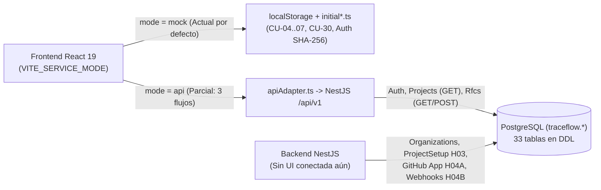

# Inventario Funcional y Auditoría Técnica Integral — TraceFlow SCM (MVP-H00)

> **Documento:** `docs/INVENTARIO_FUNCIONAL_MVP.md`  
> **Proyecto:** TraceFlow SCM — Sistema de Gestión de Configuración de Software y Control de Cambios  
> **Organización:** ÉXODO S.A.C. | **Equipo:** C-SharkTeam  
> **Rama de Trabajo:** `feat/mvp-integral-traceflow`  
> **Commit Base Certificado:** `1f5e5c8333e441691b0bdd375d7e39c9ee40f7f4` (`origin/feat/init-h04b-webhooks-git-sync` — INIT-H04B-C)  
> **Fecha de Emisión:** 26 de noviembre de 2026  
> **Estado:** EMITIDO (MVP-H00)

---

## 1. Propósito y Criterios de Clasificación

Este inventario audita de manera integral todas las capacidades funcionales y técnicas de **TraceFlow SCM**, contrastando la línea base documental vigente (`FD03`, `FD04`, `FD05`, `SAD_FINAL.md`, `TABLES.md`, `PLAN_INICIALIZACION_PROYECTOS.md`, `docs/refactor/*`) contra la implementación real verificada en:

- **Base de Datos (`supabase/migrations/`)**: 11 migraciones SQL (`202611250001`..`202611260008`), 33 tablas físicas en esquema `traceflow`, rol `traceflow_app` y triggers normativos.
- **Backend (`backend/src/`)**: Monolito modular NestJS 11 (`Health`, `Auth`, `Audit`, `Organizations`, `Projects`, `ProjectPlanning`, `GitHub`, `GitHubWebhook`, `Rfcs`).
- **Frontend (`prototype/src/`)**: SPA React 19 + TypeScript + Vite + Zustand (`AppRouter`, `navigation.ts`, `apiAdapter.ts`, tiendas Zustand, servicios locales `localStorage` y 20 pantallas canónicas `SCREEN-01`..`SCREEN-20`).
- **Pruebas automatizadas**: 13 archivos (`177` pruebas) en `backend/test/` y 9 suites en `prototype/src/services/`, más 4 suites de certificación física PostgreSQL (`77` pruebas documentadas en INIT-H04B-C, no re-ejecutadas en MVP-H00 por ausencia de PostgreSQL local).

### Categorías de Clasificación

| Estado | Significado en la Auditoría |
|---|---|
| **IMPLEMENTADA Y VERIFICADA** | Implementada en código fuente real y verificada mediante pruebas automatizadas ejecutadas en esta sesión (con persistencia real PostgreSQL o lógica verificada en suite). |
| **IMPLEMENTADA SIN VERIFICACIÓN** | Implementada en código/SQL, pero su suite física real (`real-postgres-*` o `supabase`) o prueba E2E integrada no pudo ejecutarse en el entorno actual (p. ej. sin PostgreSQL local o sin UI conectada). |
| **PARCIALMENTE IMPLEMENTADA** | Existe una parte funcional real (p. ej. tabla DDL o endpoints parciales de backend o vista parcial), pero falta backend, frontend, integración API o cierre de ciclo de vida. |
| **SOLO PROTOTIPO O MOCK** | Funciona únicamente en el frontend mediante `localStorage`, datos semilla estáticos (`initial*.ts`) o adaptadores en memoria sin persistencia real en backend/PostgreSQL. |
| **NO IMPLEMENTADA** | Especificada en SRS/SAD/Plan o requerida para el MVP, sin implementación operativa en backend ni interfaz funcional. |
| **FUERA DEL ALCANCE DEL MVP** | Capacidades explícitamente excluidas del MVP actual por restricción o por corresponder a fases posteriores (p. ej. servicio externo de correo, OAuth real GitHub, webhooks públicos en producción, Policy Gates `INIT-H04C`). |

---

## 2. Resumen Ejecutivo de Persistencia Real vs. Datos Simulados

| Capa / Subsistema | Persistencia Real (PostgreSQL + Backend) | Datos Simulados / Mock (`localStorage` / Memoria) | Brecha Principal |
|---|---|---|---|
| **Autenticación y Sesiones** | `AuthModule` + `user_session` + Argon2id + cookie `HttpOnly` (`POST /login`, `GET /me`, `POST /logout`). | `auth.service.ts` (SHA-256 + `localStorage`) activo cuando `VITE_SERVICE_MODE=mock`. | `AuthRepository` consulta roles globales (`user_role_assignment`), no roles por proyecto (`project_team_role`); `LoginView` depende de `authService.getAccountByEmail` local para selector de rol. |
| **Administración de Usuarios (`CU-01`, `PU-08`)** | Tablas `app_user`, `user_role_assignment` existen; solo script CLI `provision-users.ts`. | `initialUsers.ts` estático; ruta `/admin/users` es `ScreenPlaceholder`. | Sin `UsersModule`, sin endpoints CRUD/estado, sin `PU-08`, sin invitaciones persistidas. |
| **Organizaciones y Membresías (`INIT-H02`)** | `OrganizationsModule` completo en PostgreSQL (`organization`, `organization_member`, `DA-06`, auditoría SHA-256). | No existe en frontend ni en `apiAdapter.ts`. | Sin UI ni integración frontend. |
| **Proyectos, Equipos y Planificación (`INIT-H02`/`H03`)** | `ProjectsModule` + `ProjectPlanningService` (`POST /projects` en `BORRADOR`, `team-members`, `methodology`, `phases`, `milestones`, `deliverables`, `setup/step-2`, `step-3`, `progress`). | `project.service.ts` + `initialProjects.ts`; rutas `/projects` y `/projects/:projectId` son `ScreenPlaceholder`. | Falta `POST /projects/:id/activate` (Paso 5), gestión de `PU-09`, autorización para crear proyectos y toda la UI del wizard/panel. |
| **GitHub App y Webhooks (`INIT-H04A`/`H04B-C`)** | `GitHubModule` (`status`, `available-repos`, `link`, `validate`, `unlink`, `create-draft`, `webhook` HMAC + worker con `claim_token` y `config_item_path_history`). | `MockGitHubApiClient` solo en pruebas; no hay UI en `prototype/`. | Sin UI para vincular repositorios ni visualizar eventos/sync; `RfcsService.createRfc()` aún usa flag `ALLOW_MOCK_GITHUB_ACTIVATION` en lugar de validar `github_integration` real. |
| **Flujo SCM (`CU-04`..`CU-30`, `CU-10`..`CU-29`)** | **Solo `CU-04`** (`GET/POST /rfcs`, `GET /rfcs/:id`) y `AuditService.logEvent()` existen en backend; las 14+ tablas SCM (`change_request`, `impact_assessment`, `change_authorization`, `ccb_resolution`, `ccb_vote`, `change_order`, `sync_lock`, `ecs_version`, `qa_certification`, `uat_acceptance`, `baseline`, `incident_ticket`) existen en DDL. | `CU-05` (`admit`, `observe`, `dismiss`), `CU-04.1` (`subsanar`), `CU-06` (`impactAnalysisService`), `CU-30` (`minorApprovalService`), `CU-07` (`ccbService`), `auditService` y `initialEcns`/`initialBaselines`/`initialIncidents`/`initialEcs` funcionan 100% en `localStorage`. | Todo el flujo posterior a `CU-04` carece de endpoints backend y de conexión en `apiAdapter.ts`; 10 pantallas SCM operativas (`ECN`, `ECS`, `Check-Out/In`, `QA`, `UAT`, `Baselines`, `Incidents`, `Audit`, `Reports`) son `ScreenPlaceholder`. |

---

## 3. Inventario Detallado por Dominio Funcional

### 3.1 Autenticación, Sesiones y Seguridad Base

| ID | Funcionalidad / Artefacto | Referencia SRS/SAD | Persistencia | Evidencia Verificada en Repo | Clasificación |
|---|---|---|---|---|---|
| **F-AUTH-01** | Login con Argon2id, sesión opaca 256-bit, cookie `HttpOnly` (`tf_session`), TTL por inactividad 15 min y `/auth/me`, `/auth/logout` | `ADR-006`, `RNF-01` | Real (`user_session`, `app_user`) + Mock | `backend/src/modules/auth/auth.controller.ts`, `auth.service.ts`, `backend/test/auth.spec.ts` (5/5) | **IMPLEMENTADA Y VERIFICADA** (en modo mock/unit; pendiente prueba PG real local) |
| **F-AUTH-02** | Portal `/login` con validación y selector de rol efectivo | `SCREEN-01`, `IDENTITY_AND_ROLES.md` | Mixta (`apiAdapter` + `authService`) | `prototype/src/features/auth/LoginView.tsx`, `prototype/src/services/auth.spec.mjs` (9/9) | **PARCIALMENTE IMPLEMENTADA** *(el selector de rol en UI consulta `authService.getAccountByEmail` local y no soporta cuentas dinámicas creadas en BD)* |
| **F-AUTH-03** | Guardas backend (`AuthGuard`, `RolesGuard`) y frontend (`ProtectedRoute`, `RoleGuard`, Default-Deny) | `RBAC_ACCESS_MATRIX.md` | Real / SPA | `backend/src/common/guards/*.ts`, `prototype/src/components/auth/*.tsx`, `enterprise.rbac.spec.mjs` (12/12) | **IMPLEMENTADA Y VERIFICADA** |
| **F-AUTH-04** | Resolución de rol efectivo por proyecto (`project_team_role`) y cambio de contexto proyecto/rol | Requisito MVP (`PU-01..09`) | Parcial (tabla `project_team_role` existe) | `auth.repository.ts` lee solo `user_role_assignment`; `useProjectStore.ts` solo filtra `assignedProjectIds` | **PARCIALMENTE IMPLEMENTADA** |
| **F-AUTH-05** | Aprovisionamiento CLI seguro de usuarios semilla (`USR-001`..`USR-004`) | `H-02` | Real (`app_user`, `user_role_assignment`) | `backend/src/scripts/provision-users.ts` | **IMPLEMENTADA SIN VERIFICACIÓN** *(en esta sesión sin BD local)* |

### 3.2 Administración del Sistema (`PU-08`) y Usuarios (`CU-01`)

| ID | Funcionalidad / Artefacto | Referencia SRS/SAD | Persistencia | Evidencia Verificada en Repo | Clasificación |
|---|---|---|---|---|---|
| **F-ADM-01** | Perfil global `PU-08` (Administrador del Sistema) | Decisión MVP | No existe en DDL ni código | `202611250002_structural_seeds.sql` solo tiene `PU-01`..`PU-07` | **NO IMPLEMENTADA** |
| **F-ADM-02** | Gestión de usuarios y cuentas (`CU-01`: listar, crear, editar, activar/suspender/desactivar) | `RF-01`, `CU-01` | Solo tabla `app_user` | Sin `UsersModule` en `backend/src/app.module.ts`; `/admin/users` es `ScreenPlaceholder` en `AppRouter.tsx#L215-L221` | **NO IMPLEMENTADA** |
| **F-ADM-03** | Gestión de autorizaciones globales para crear proyectos | Decisión MVP | No existe | Sin columna/tabla ni endpoint ni UI | **NO IMPLEMENTADA** |
| **F-ADM-04** | Invitaciones por correo / GitHub (UI, validaciones y persistencia local sin envío externo) | Decisión MVP | No existe | `202611260001` excluyó explícitamente `INVITED` de `organization_member` (`DA-06`); requiere tabla dedicada de invitaciones | **NO IMPLEMENTADA** |
| **F-ADM-05** | Servicio externo de envío de correos (SMTP/SES/SendGrid) y OAuth GitHub de usuario | Restricción MVP | N/A | Excluido explícitamente por alcance MVP | **FUERA DEL ALCANCE DEL MVP** |

### 3.3 Organizaciones, Proyectos, Equipos y Planificación (`CU-02`, `CU-03`, `CU-31..35`)

| ID | Funcionalidad / Artefacto | Referencia SRS/SAD | Persistencia | Evidencia Verificada en Repo | Clasificación |
|---|---|---|---|---|---|
| **F-ORG-01** | CRUD básico y membresías organizacionales (`POST/GET /organizations`, `GET/POST /members`, `PATCH /status`, `DA-06`) | `RF-19`, `CU-31`, `INIT-H02` | Real (`organization`, `organization_member`) | `backend/src/modules/organizations/*`, `backend/test/organizations.spec.ts` (14/14) | **IMPLEMENTADA Y VERIFICADA** *(sin UI ni `PU-08`)* |
| **F-PRJ-01** | Creación de proyectos en `BORRADOR` y consulta multitenant (`POST/GET /projects`, `GET /projects/:id`) | `RF-02`, `CU-02`, `CU-03`, `INIT-H02` | Real (`project`, `user_project_assignment`) + Mock UI | `backend/src/modules/projects/projects.controller.ts`, `projects.service.ts`, `projects-h02.spec.ts` (14/14) | **IMPLEMENTADA Y VERIFICADA** *(autorización actual usa `OWNER`/`ADMIN`/`PU-02`; falta `PU-09`)* |
| **F-PRJ-02** | Perfil `PU-09` (Jefe de Proyecto) y separación frente a `PU-02` (Analista/Gestor de Cambios) | Decisión MVP | No existe | `PU-02` concentraba creación/planificación en `ProjectsService`, `ProjectPlanningService` y `GitHubService` | **NO IMPLEMENTADA** |
| **F-PRJ-03** | Conformación de equipo y asignación de perfiles por proyecto (`project_team_role`) | `RF-20`, `DA-06`, `INIT-H03` | Real (`project_team_role`, `project_setup`) | `ProjectsController` (`POST/GET/PATCH :id/team-members`, `PUT :id/setup/step-2`), `projects-h03-planning.spec.ts` (27/27) | **IMPLEMENTADA Y VERIFICADA** *(solo backend; falta UI y soporte `PU-09`)* |
| **F-PRJ-04** | Configuración de metodología, fases, hitos y entregables (`SCRUM`, `KANBAN`, `CASCADA`, `HIBRIDA`, `UPT_ACADEMICA`) | `RF-22`, `CU-34`, `INIT-H03` | Real (`project_methodology`, `project_phase`, `project_milestone`, `project_deliverable`) | `ProjectPlanningService` (`PUT/GET :id/methodology`, `POST/GET :id/phases`, `milestones`, `deliverables`, `PUT :id/setup/step-3`), `projects-h03-planning.spec.ts` | **IMPLEMENTADA Y VERIFICADA** *(solo backend; sin UI)* |
| **F-PRJ-05** | Activación, suspensión, cierre y archivo de proyectos (`POST /projects/:id/activate`, `CU-35`) | `RF-23`, `CU-35`, `DA-04` | No existe endpoint | `ProjectSetupEntity.validation_completed` existe en BD, pero sin endpoint ni transición en `ProjectsService` | **NO IMPLEMENTADA** |
| **F-PRJ-06** | Interfaz Web de Directorio de Proyectos, Asistente 5 pasos y Panel de Configuración (`/projects`, `/projects/:id`) | `SCREEN-03`, `SCREEN-04`, `DA-05` | Ninguna (Placeholder) | `AppRouter.tsx#L34-L57` renderiza `ScreenPlaceholder` | **NO IMPLEMENTADA** |

### 3.4 Integración GitHub, Webhooks y Sincronización Git (`INIT-H04A`, `INIT-H04B-C`)

| ID | Funcionalidad / Artefacto | Referencia SRS/SAD | Persistencia | Evidencia Verificada en Repo | Clasificación |
|---|---|---|---|---|---|
| **F-GH-01** | Gestión de instalaciones por organización (`organization_github_installation`), cliente API RS256 JWT + IAT en memoria, `status`, `available-repos`, `link`, `validate`, `unlink`, `create-draft` | `RF-21`, `CU-33`, `ADR-011`, `INIT-H04A-R` | Real (`github_integration`, `organization_github_installation`) | `backend/src/modules/github/github.controller.ts`, `github.service.ts`, `github-api.client.ts`, `github-integration.spec.ts` (42/42) | **IMPLEMENTADA Y VERIFICADA** *(backend completo; sin UI ni endpoints de registro/consulta de instalaciones desde UI)* |
| **F-GH-02** | Recepción HMAC-SHA256 de webhooks (`POST /github/webhook`, `POST /projects/:id/github/webhook`), idempotencia `delivery_id`, worker `FOR UPDATE SKIP LOCKED` + `claim_token`, detección out-of-band y `config_item_path_history` | `RF-24`, `RF-25`, `INIT-H04B-C` | Real (`github_event`, `config_item_path_history`) | `github-webhook.controller.ts`, `github-webhook.service.ts`, `github-event-processor.service.ts`, `github-webhooks.spec.ts` (32/32) | **IMPLEMENTADA Y VERIFICADA** *(suite unitaria verde; certificación PG16 real en `real-postgres-h04b-certification.spec.ts` no ejecutada aquí por falta de PG local)* |
| **F-GH-03** | Política `DA-04` real en operaciones SCM (`RfcsService` validando `project.status = 'ACTIVO'` y `github_integration = 'VALIDATED'`) | `DA-04`, `RN-12`, `RN-13` | Parcial (usa flag `ALLOW_MOCK_GITHUB_ACTIVATION`) | `backend/src/modules/rfcs/rfcs.service.ts#L205-L213` bloquea por variable de entorno en lugar de consultar `github_integration` | **PARCIALMENTE IMPLEMENTADA** |
| **F-GH-04** | Interfaz Web para vincular repositorio GitHub e inspeccionar historial de rutas/eventos | `RF-21`, `RF-24` | Ninguna | Sin vistas ni métodos en `apiClient.ts` | **NO IMPLEMENTADA** |
| **F-GH-05** | Exposición pública de webhooks en producción / Policy Gates GitHub Checks API (`INIT-H04C`) | `RF-25`, `INIT-H04C` | N/A | Excluido por restricciones MVP-H00 y posterior a `INIT-H04B-C` | **FUERA DEL ALCANCE DEL MVP** *(Policy Gates completos tras MVP o según prioridad de H03)* |

### 3.5 Flujo SCM y Control de Cambios (`CU-04`..`CU-30`, `CU-09`..`CU-29`)

| ID | Caso de Uso / Capacidad | Referencia | Persistencia Real (Backend + BD) | Estado Frontend (`prototype/`) | Clasificación |
|---|---|---|---|---|---|
| **F-SCM-01** | `CU-04`: Registrar RFC (`POST /rfcs`), listar (`GET /rfcs`) y consultar detalle (`GET /rfcs/:id`) | `RF-04`, `TB-07` | **Real**: `RfcsController`, `RfcsService`, `RfcsRepository`, tabla `change_request` + `audit_log` (`rfcs.spec.ts` 10/10) | `RfcListView`, `RfcCreateView`, `RfcDetailView` conectados vía `apiAdapter` | **PARCIALMENTE IMPLEMENTADA** *(backend ok en modo mock/unit, pero bloqueado en PG por `ALLOW_MOCK_GITHUB_ACTIVATION` y `apiAdapter.createRfc` tiene nombres fallback hardcodeados)* |
| **F-SCM-02** | `CU-05`: Validar, admitir, observar y desestimar RFC (`PU-02`) | `RF-04`, `RF-05` | **Tabla `change_request` existe**, pero **0 endpoints en backend** | `RfcDetailView.tsx` + `rfc.service.ts` (`admit`, `observe`, `dismiss`) | **SOLO PROTOTIPO O MOCK** |
| **F-SCM-03** | `CU-04.1`: Subsanar RFC observada (`PU-01`) | `RF-04` | **Tabla `change_request` existe**, **0 endpoints en backend** | `RfcEditView.tsx` + `rfc.service.ts` (`subsanar`) | **SOLO PROTOTIPO O MOCK** |
| **F-SCM-04** | `CU-06`: Análisis de impacto técnico (`PU-03`, `RN-05`) | `RF-05`, `RN-05` | **Tabla `impact_assessment` + trigger SoD existen en DDL**, **0 endpoints en backend** | `RfcImpactAnalysisView.tsx` + `impactAnalysis.service.ts` (`impactAnalysis.spec.mjs` 11/11) | **SOLO PROTOTIPO O MOCK** |
| **F-SCM-05** | `CU-30`: Autorización Cambio Menor / Doble Llave (`PU-02` + `PU-03`) | `RF-07`, `SoD-02` | **Tabla `change_authorization` + trigger `enforce_double_key_segregation` existen en DDL**, **0 endpoints en backend** | `RfcMinorApprovalView.tsx` + `minorApproval.service.ts` (`minorApproval.spec.mjs` 20/20) | **SOLO PROTOTIPO O MOCK** |
| **F-SCM-06** | `CU-07`: Deliberación y votación colegiada del CCB (`PU-04`) | `RF-06`, `RN-01` | **Tablas `ccb_resolution`, `ccb_vote` + trigger SoD existen en DDL**, **0 endpoints en backend** | `RfcCcbDeliberationView.tsx` + `ccb.service.ts` (`ccb.spec.mjs` 18/18) | **SOLO PROTOTIPO O MOCK** |
| **F-SCM-07** | `CU-08`, `CU-22`: Emisión y cancelación de Órdenes de Cambio (ECN/ECO) | `RF-07`, `RF-12` | **Tabla `change_order` existe en DDL**, `extensible/contracts.ts` tiene DTO; **0 endpoints en backend** | `initialEcns.ts` + rutas `/ecns`, `/ecns/:ecnId` en `ScreenPlaceholder` | **PARCIALMENTE IMPLEMENTADA** *(solo DDL + datos demo + placeholder)* |
| **F-SCM-08** | `CU-09`, `CU-13`, `CU-26`: Catálogo de ECS, historial de versiones, diff e integridad SHA-256 | `RF-03`, `RF-09`, `RF-16`, `RF-17` | **Tablas `config_item`, `ecs_version`, `config_item_path_history` existen en DDL**, `ProjectsRepository.findEcsByProjectId` en lectura; **0 endpoints CRUD/historial ECS** | `ecs.service.ts` + `initialEcs.ts`; rutas `/ecs`, `/ecs/:ecsId`, `/ecs/:ecsId/history` en `ScreenPlaceholder` | **PARCIALMENTE IMPLEMENTADA** |
| **F-SCM-09** | `CU-10`, `CU-11`, `CU-12`, `CU-14`, `CU-15`: Check-Out, `sync_lock` exclusivo (`RN-06`), implementación Dev y Check-In (`PU-05`, `PU-06`) | `RF-08`, `RF-09`, `RN-06` | **Tabla `sync_lock` + índice parcial `uq_active_sync_lock_per_ecs` existen en DDL**, **0 endpoints en backend** | `/scm/operations` en `ScreenPlaceholder` | **PARCIALMENTE IMPLEMENTADA** *(solo DDL + placeholder)* |
| **F-SCM-10** | `CU-16..19`: Pruebas QA, Certificación de Conformidad y No Conformidades (`PU-07`, `RN-09`) | `RF-10`, `RF-11`, `RN-09` | **Tabla `qa_certification` existe en DDL**, **0 endpoints en backend** | `/qa/validation/:rfcId` en `ScreenPlaceholder` | **PARCIALMENTE IMPLEMENTADA** *(solo DDL + placeholder)* |
| **F-SCM-11** | `CU-29`: Aceptación Formal de Usuario UAT (`PU-01`, `RN-09`) | `RF-10`, `RN-09` | **Tabla `uat_acceptance` existe en DDL**, **0 endpoints en backend** | `/rfcs/:rfcId/uat` en `ScreenPlaceholder` | **PARCIALMENTE IMPLEMENTADA** *(solo DDL + placeholder)* |
| **F-SCM-12** | `CU-20`, `CU-21`: Líneas Base congeladas (`vX.Y.Z`) y Rollback (`PU-05`, `RN-02`, `RN-08`) | `RF-12`, `RF-13`, `RN-02` | **Tablas `baseline`, `baseline_item` + triggers de inmutabilidad existen en DDL**, **0 endpoints en backend** | `initialBaselines.ts`; `/baselines` en `ScreenPlaceholder` | **PARCIALMENTE IMPLEMENTADA** *(solo DDL + datos demo + placeholder)* |
| **F-SCM-13** | `CU-23`, `CU-24`, `CU-25`: Mesa de Incidencias y derivación a RFC (`PU-01`, `PU-02`) | `RF-15` | **Tabla `incident_ticket` existe en DDL**, **0 endpoints en backend** | `initialIncidents.ts`; `/incidents`, `/incidents/:id` en `ScreenPlaceholder` | **PARCIALMENTE IMPLEMENTADA** *(solo DDL + datos demo + placeholder)* |
| **F-SCM-14** | `CU-27`, `CU-28`: Auditoría forense SHA-256 (`audit_log`) y Reportes SCM | `RF-17`, `RF-18`, `ADR-008` | **Escritura real** vía `AuditService.logEvent()` -> `traceflow.append_audit_log()`; **0 endpoints GET `/audit` o `/reports`** | `audit.service.ts` (hash mock en `localStorage`); `/audit`, `/reports` en `ScreenPlaceholder` | **PARCIALMENTE IMPLEMENTADA** *(escritura real en BD verificada; lectura/UI pendiente)* |
| **F-SCM-15** | Dashboard Adaptativo (`SCREEN-02`) y Navegación Contextual (`Sidebar`, `Topbar`) | `SCREEN-02`, `ROLE_NAVIGATION_MATRIX.md` | Consume `projects` y `rfcs` vía stores | `DashboardView.tsx`, `Sidebar.tsx`, `Topbar.tsx` operativos | **IMPLEMENTADA Y VERIFICADA** *(en modo mock/UI; requiere actualizar para `PU-08`/`PU-09` y rol por proyecto)* |

---

## 4. Inventario de Infraestructura de Base de Datos y Pruebas

### 4.1 Migraciones DDL (`supabase/migrations/`)

| Orden | Archivo | Contenido Principal | Estado en Código | Estado en Supabase Prod (`xmyfqxlvveiawnxgydtz`) |
|---|---|---|---|---|
| 1 | `202611250001_initial_traceflow.sql` | Esquema `traceflow` (21 tablas base), `append_audit_log()`, `uq_active_sync_lock_per_ecs` | Completo | Desplegado (`DB-01`, según `ESTADO_DEL_PROYECTO.md`) |
| 2 | `202611250002_structural_seeds.sql` | Semillas roles `PU-01`..`PU-07` | Completo (requiere extensión `PU-08`/`PU-09`) | Desplegado (`DB-01.1`) |
| 3 | `202611250003_secure_app_role_least_privilege.sql` | 10 triggers SoD/inmutabilidad y `traceflow_app` least privilege | Completo | Desplegado (`DB-02.1`) |
| 4–11 | `202611260001`..`202611260008` (+ rollbacks) | `organization`, `organization_member`, `project_setup`, `project_team_role`, `project_methodology`, `project_phase`, `project_milestone`, `project_deliverable`, `github_integration`, `organization_github_installation`, `github_event`, `config_item_path_history`, `claim_token` (33 tablas totales) | Completo y certificado previamente en PG16 local (`INIT-H04B-C`) | **En pausa bajo Governance Gate** (pendiente validación/despliegue en instancia objetivo) |

### 4.2 Suites de Pruebas Automatizadas Existentes

| Subsistema | Suite | Casos | Ejecutado en MVP-H00 | Resultado Observado | Naturaleza |
|---|---|---:|:---:|:---:|---|
| **Backend** | `test/auth.spec.ts` | 5 | Sí | **5/5 PASSED** | Mock / In-memory |
| **Backend** | `test/organizations.spec.ts` | 14 | Sí | **14/14 PASSED** | Mock / In-memory |
| **Backend** | `test/projects.spec.ts` | 3 | Sí | **3/3 PASSED** | Mock / In-memory |
| **Backend** | `test/projects-h02.spec.ts` | 14 | Sí | **14/14 PASSED** | Mock / In-memory |
| **Backend** | `test/projects-h03-planning.spec.ts` | 27 | Sí | **27/27 PASSED** | Mock / In-memory |
| **Backend** | `test/rfcs.spec.ts` | 10 | Sí | **10/10 PASSED** | Mock / In-memory |
| **Backend** | `test/github-integration.spec.ts` | 42 | Sí | **42/42 PASSED** | Mock / In-memory |
| **Backend** | `test/github-webhooks.spec.ts` | 32 | Sí | **32/32 PASSED** | Mock / In-memory |
| **Backend** | `test/isolated-pgmem-tests.spec.ts` | 8 | Sí | **8/8 PASSED** | `pg-mem` (SQL en memoria) |
| **Backend** | `test/governance-negative.spec.ts` | 7 | Sí | **7/7 PASSED** | Mock / In-memory |
| **Backend** | `test/destructive-safeguards.spec.ts` | 8 | Sí | **8/8 PASSED** | Unit (validación guardias) |
| **Backend** | `test/migration-compatibility.spec.ts` | 6 | Sí | **6/6 PASSED** | Unit (verificación SQL/contratos) |
| **Backend** | `test/vertical-flow.e2e-spec.ts` | 1 | Sí | **1/1 PASSED** | Supertest E2E sobre app mock |
| **Backend PG** | `test/real-postgres-*.spec.ts` (4 suites) | 77 | **No** | Excluidas (`vitest.config.ts`) | Requiere PostgreSQL local `127.0.0.1:5432` (ausente) |
| **Backend Supa** | `test/real-postgres-integration.spec.ts` & `vertical-flow` | — | **No** | Excluidas (`ALLOW_REMOTE_TEST_DML`) | Requiere autorización explícita remota |
| **Frontend** | 9 suites (`rfc.*`, `auth`, `navigation`, `impactAnalysis`, `minorApproval`, `ccb`, `enterprise.rbac`) | 9 suites | Sí | **9/9 PASSED** (`Auth 9/9`, `Nav 8/8`, `Impact 11/11`, `Minor 20/20`, `CCB 18/18`, `RBAC 12/12` + `CU-04`, `V.2`, `V.3`) | Node `--experimental-strip-types` sobre `localStorage` mock |

---

*Documento elaborado como entregable oficial de MVP-H00 — TraceFlow SCM / ÉXODO S.A.C.*
