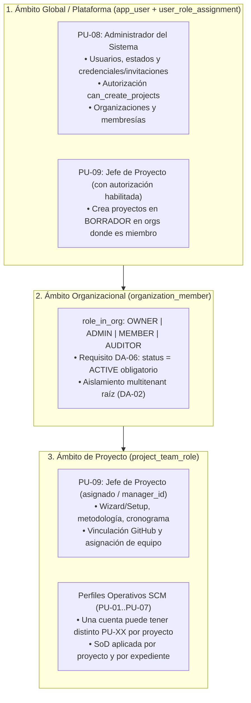

# Matriz de Perfiles, Permisos, Alcance y Segregación de Funciones — TraceFlow SCM (MVP-H00)

> **Documento:** `docs/MATRIZ_PERFILES_PERMISOS.md`  
> **Proyecto:** TraceFlow SCM — Sistema de Gestión de Configuración de Software y Control de Cambios  
> **Organización:** ÉXODO S.A.C. | **Equipo:** C-SharkTeam  
> **Basado en:** `FD03` (`TB-06`, `TB-09`, `TB-10`), `docs/refactor/IDENTITY_AND_ROLES.md`, `RBAC_ACCESS_MATRIX.md`, `ROLE_NAVIGATION_MATRIX.md`, `PLAN_INICIALIZACION_PROYECTOS.md`, `supabase/migrations/202611250001..202611260008`  
> **Fecha de Emisión:** 26 de noviembre de 2026  
> **Estado:** PROPUESTA ARQUITECTÓNICA PARA MVP (Pendiente de ejecución en MVP-H01/H02)

---

## 1. Auditoría del Modelo de Perfiles Actual (AS-IS)

La inspección del SRS (`TB-09`, `TB-10`), base de datos (`traceflow.app_role`), backend (`backend/src/`) y frontend (`prototype/src/`) identificó **cinco desalineamientos estructurales** respecto a las decisiones funcionales del MVP:

1. **Sobrecarga normativa en `PU-05` (`CU-01`)**: Tanto `TB-10` como `prototype/src/types/permissions.ts` (`GESTIONAR_USUARIOS`, `/admin/users`) atribuyen la administración global de usuarios al **Bibliotecario / Administrador SCM (`PU-05`)**, mezclando la custodia de bibliotecas SCM con la administración de cuentas y seguridad de plataforma.
2. **Sobrecarga operativa en `PU-02` (`CU-02`, `INIT-H02..H04A`)**: `TB-10` atribuyó la creación de proyectos al **Analista de Requerimientos / Gestor (`PU-02`)** y `INIT-H02..H04A` lo replicó en `OrganizationsService.createOrganization()`, `ProjectsService.createProject()`, `ProjectPlanningService` y `GitHubService`. Esto mezcla el análisis y co-aprobación de cambios (`CU-05`, `CU-30`) con la dirección de proyecto y vinculación GitHub.
3. **Desacoplamiento entre roles globales (`user_role_assignment`) y roles por proyecto (`project_team_role`)**:
   - `AuthRepository` (`auth.repository.ts`) lee los roles del usuario únicamente desde `traceflow.user_role_assignment` (catálogo global) y fija un único `activeRoleId` en `traceflow.user_session` para toda la sesión.
   - Aunque `INIT-H03` creó `traceflow.project_team_role` (`project_id, user_id, role_id, status`), dicho rol por proyecto **no se integra** con `AuthService`, `RolesGuard`, `RfcsService` ni el frontend (`Topbar` / `useAuthStore`). Por ello, una misma cuenta aún no puede operar con roles distintos según el proyecto activo sin colisionar con el rol global de sesión.
4. **Ausencia de control de autorización para crear proyectos**: Cualquier usuario con sesión activa en `PU-02` (si es miembro activo de la organización) puede crear proyectos en `ProjectsService.createProject()`, sin requerir autorización explícita otorgada por un Administrador del Sistema.
5. **Inconsistencia menor en validación técnica de webhooks (`H04B-C`)**: `backend/src/modules/github/github.repository.ts` (líneas 1278 y 1448) valida que el autor del commit tenga rol en `project_team_role` con `ar.code IN ('PU-06', 'PU-02', 'PU-03', 'PU-05')`, mientras el informe de aceptación citaba nombres conceptuales (`DEVELOPER`, `LEAD_DEVELOPER`, `SCM_ADMIN`). La tabla real usa códigos canónicos `PU-XX`.

---

## 2. Arquitectura Propuesta de Perfiles y Ámbitos de Autorización (TO-BE MVP)

Se conservan íntegros los **siete perfiles SCM existentes (`PU-01` a `PU-07`)** y se incorporan **dos perfiles diferenciados (`PU-08` y `PU-09`)**, organizando la autorización en **tres ámbitos ortogonales y complementarios**:

### 2.1 Catálogo Consolidado de Perfiles (`PU-01` a `PU-09`)

| Código | Nombre Oficial | Ámbito Principal | Responsabilidad en TraceFlow SCM (MVP) | Conservado / Nuevo |
| :---: | :--- | :---: | :--- | :---: |
| **PU-01** | **Solicitante** | Proyecto | Origina RFCs (`CU-04`), subsana observaciones (`CU-04.1`), reporta incidencias (`CU-23`) y suscribe aceptación UAT (`CU-29`). | **Conservado** |
| **PU-02** | **Analista de Requerimientos / Gestor de Cambios** | Proyecto | Valida completitud y clasifica RFCs (`CU-05`), deriva incidencias (`CU-25`) y co-autoriza Cambios Menores con `PU-03` (`CU-30`). *(Se desacopla de crear organizaciones/proyectos salvo rol `PU-09` o compatibilidad transitoria controlada).* | **Conservado** *(acotado a Gestión de Cambios)* |
| **PU-03** | **Arquitecto / Especialista Técnico** | Proyecto | Ejecuta análisis de impacto técnico (`CU-06`), registra/cataloga ECS (`CU-09`) y co-autoriza Cambios Menores (`CU-30`). | **Conservado** |
| **PU-04** | **Comité de Control de Cambios (CCB)** | Proyecto | Evalúa y vota Cambios Mayores (`CU-07`), emite ECN (`CU-08`) y audita expedientes del proyecto (`CU-27`). | **Conservado** |
| **PU-05** | **Administrador de Configuración / Bibliotecario** | Proyecto | Custodia de bibliotecas Trabajo/Soporte/Maestra, Check-Out/In y `sync_lock` (`CU-10..12`), Líneas Base (`CU-20`) y Rollback (`CU-21..22`). *(Se retira `CU-01` Administración de Usuarios hacia `PU-08`).* | **Conservado** *(acotado a Custodia SCM)* |
| **PU-06** | **Ingeniero de Software / Desarrollador** | Proyecto | Implementa cambios autorizados por ECN (`CU-14`, `CU-15`) y sincroniza commits correlacionados en GitHub. | **Conservado** |
| **PU-07** | **Equipo de Calidad / Testing (QA)** | Proyecto | Ejecuta pruebas de integración (`CU-16`), certifica conformidad (`CU-17`) y reporta no conformidades/re-test (`CU-18..19`). | **Conservado** |
| **PU-08** | **Administrador del Sistema** | Global / Plataforma | Administra cuentas `app_user` (alta, edición, suspensión/reactivación), invitaciones UI/BD, roles globales, organizaciones, membresías y **autorizaciones para crear proyectos**. No interviene en dictámenes ni operaciones SCM. | **Nuevo** |
| **PU-09** | **Jefe de Proyecto** | Global (creación autorizada) + Proyecto | Crea e inicializa proyectos (`CU-02`/`CU-32`), configura metodología y cronograma (`CU-34`), vincula repositorios GitHub (`CU-33`), conforma equipos y asigna perfiles `PU-01..PU-07` en sus proyectos, y activa/suspende sus proyectos (`CU-35`). | **Nuevo** |

---

## 3. Análisis de los 9 Ejes de Seguridad y Gobierno

| Eje Revisado | Estado Actual (AS-IS) | Diseño Objetivo para MVP (TO-BE) | Mecanismo Técnico Mínimo |
|---|---|---|---|
| **1. Permisos globales** | Solo `user_role_assignment` para `PU-01..07`. | `user_role_assignment` habilita capacidades globales (`PU-08`, `PU-09` y roles base elegibles); `PU-08` ejerce administración global sin depender de membresía a un proyecto específico. | `app_role` con filas `8` (`PU-08`) y `9` (`PU-09`); guardas dedicados (`GlobalRolesGuard` o extensión de `RolesGuard`). |
| **2. Roles de organización** | `organization_member.role_in_org` (`OWNER`, `ADMIN`, `MEMBER`, `AUDITOR`). | Se mantiene `organization_member` (`DA-02`, `DA-06`) como barrera institucional de pertenencia. `PU-08` puede crear organizaciones y administrar sus miembros; dentro de una org, `OWNER`/`ADMIN` conservan administración interna de miembros si aplica. | Conservar `organization_member` sin romper pruebas `organizations.spec.ts`; permitir a `PU-08` operar sobre organizaciones. |
| **3. Roles y membresías de proyecto** | `project_team_role` existe en BD, pero `AuthService` usa un rol global único para toda la sesión. | **Una cuenta puede tener distintos perfiles en distintos proyectos** mediante `project_team_role` (`status='ACTIVE'`). En operaciones sobre un proyecto `P`, el backend resuelve el perfil efectivo del usuario en `P` (y permite seleccionar el perfil activo si tiene >1 rol en `P`). | Endpoint `POST /auth/context` (o cabecera `X-Project-Id` / `active_project_id` en `user_session`) + helper `resolveEffectiveProjectRole(user, projectId)`. |
| **4. Administración de usuarios** | Inexistente (`UsersModule` ausente; `/admin/users` placeholder). | `PU-08` gestiona alta, consulta, edición, activación/suspensión/inactivación, asignación de roles globales y registro de invitaciones UI+BD (sin correo externo). | Nuevo `UsersModule` (`/api/v1/admin/users`, `/api/v1/admin/invitations`) y vista `/admin/users` para `PU-08`. |
| **5. Autorizaciones de creación de proyectos** | Cualquier `PU-02` miembro de org o `OWNER`/`ADMIN` crea proyectos. | Crear un proyecto requiere: (a) membresía `ACTIVE` en la organización destino (`DA-06`), (b) perfil `PU-09` (o `OWNER`/`ADMIN` organizacional según política, o estrictamente `PU-09` habilitado) **Y** (c) **autorización explícita vigente otorgada por `PU-08`** (`can_create_projects = true`, `project_creation_authorized_by`, `project_creation_authorized_at`). | Columnas en `app_user` (`can_create_projects`, `project_creation_authorized_by`, `project_creation_authorized_at`) + auditoría `USER_PROJECT_CREATION_AUTHORIZED/REVOKED`. |
| **6. Segregación de funciones (SoD)** | SoD-01..05 en servicios mock y 3 triggers físicos en PostgreSQL (`impact_assessment`, `change_authorization`, `ccb_vote`). | Se preservan SoD-01..05 **y se añade SoD-06**: `PU-08` no vota CCB, no aprueba RFCs ni realiza Check-In/QA; `PU-09` no puede auto-certificarse QA ni eludir doble llave ni CCB si también participa en desarrollo; el solicitante (`requester_id`) nunca aprueba ni evalúa su propia RFC sin importar en qué otros proyectos tenga otros roles. | Mantener triggers físicos existentes en PG + validación de identidad física (`user.id`) en todos los nuevos servicios backend (`CU-05`..`CU-30`). |
| **7. Restricciones entre proyectos** | `user_project_assignment` + `organization_member` en `ProjectsService`, `ProjectPlanningService`, `GitHubService`, `RfcsService`. | Aislamiento estricto: ninguna consulta o mutación de proyecto (`P1`) es accesible desde miembros o roles de `P2`, aunque pertenezcan a la misma organización (`H03-R04`). `PU-08` solo accede a administración de usuarios/orgs/autorizaciones, NO a artefactos internos SCM de proyectos ajenos sin asignación. | Verificación combinada: `organization_member.status = 'ACTIVE'` + registro activo en `project_team_role` (o `manager_id`) para `P1`. |
| **8. Trazabilidad de asignaciones** | `assigned_by`, `assigned_at`, `updated_at` en `project_team_role`, `user_project_assignment`, `organization_member` + `audit_log` SHA-256. | Toda creación/cambio de usuario, autorización `can_create_projects`, membresía de org y asignación/revocación de `project_team_role` registra `actor_user_id`, `actor_role`, `payload_diff` anterior/nuevo en `traceflow.append_audit_log()`. | Obligatorio dentro de `db.transaction()` en `UsersService`, `OrganizationsService` y `ProjectPlanningService`. |
| **9. Revocación de accesos** | `traceflow_app` tiene **revocado `DELETE`** en todas las tablas operativas; suspensión lógica en `organization_member` y `project_team_role`. | La revocación es **lógica, inmediata y sin borrado físico**: (a) suspender `app_user` revoca inmediatamente todas sus sesiones activas en `user_session` (`is_revoked = TRUE`); (b) desactivar `project_team_role` (`status = 'INACTIVE'`) bloquea de inmediato operaciones en ese proyecto; (c) revocar `can_create_projects` impide crear nuevos proyectos sin afectar los existentes. | Método `authRepo.revokeAllUserSessions(userId)` + actualización `status = 'INACTIVE'`/`'SUSPENDED'` + consulta en vivo en BD (sin depender de caché de sesión). |

---

## 4. Matriz Consolidada de Permisos por Acción y Ruta (MVP Target)

### 4.1 Matriz de Acciones Funcionales (`SystemAction`)

| Acción / Caso de Uso | PU-01 Solicit. | PU-02 Gestor RFC | PU-03 Arquit. | PU-04 CCB | PU-05 Biblio. | PU-06 Desarr. | PU-07 QA | PU-08 Admin Sist. | PU-09 Jefe Proy. |
|---|:---:|:---:|:---:|:---:|:---:|:---:|:---:|:---:|:---:|
| **Gestionar usuarios, estados, invitaciones y orgs (`CU-01`, `CU-31`)** | ❌ | ❌ | ❌ | ❌ | ❌ | ❌ | ❌ | ✅ | ❌ |
| **Autorizar / revocar permiso de crear proyectos** | ❌ | ❌ | ❌ | ❌ | ❌ | ❌ | ❌ | ✅ | ❌ |
| **Crear proyecto en borrador (`CU-02`)** | ❌ | ❌ | ❌ | ❌ | ❌ | ❌ | ❌ | ❌ | ✅ *(con `can_create_projects`)* |
| **Configurar equipo, metodología, cronograma, GitHub y activar proyecto (`CU-32..35`)** | ❌ | ❌ | ❌ | ❌ | ❌ | ❌ | ❌ | ❌ | ✅ *(en sus proyectos)* |
| **Consultar proyecto asignado (`CU-03`)** | ✅ | ✅ | ✅ | ✅ | ✅ | ✅ | ✅ | ❌ *(solo metadatos admin)* | ✅ |
| **Registrar / Subsanar RFC (`CU-04`, `CU-04.1`)** | ✅ | ❌ | ❌ | ❌ | ❌ | ❌ | ❌ | ❌ | ❌ |
| **Admitir / Observar / Desestimar RFC (`CU-05`)** | ❌ | ✅ | ❌ | ❌ | ❌ | ❌ | ❌ | ❌ | ❌ |
| **Análisis de Impacto Técnico y Registrar ECS (`CU-06`, `CU-09`)** | ❌ | ❌ | ✅ | ❌ | ❌ *(consulta/custodia)* | ❌ | ❌ | ❌ | ❌ |
| **Autorizar Cambio Menor — Doble Llave (`CU-30`)** | ❌ | ✅ *(Llave 1)* | ✅ *(Llave 2)* | ❌ | ❌ | ❌ | ❌ | ❌ | ❌ |
| **Deliberar / Votar CCB (`CU-07`)** | ❌ | ❌ | ❌ | ✅ | ❌ | ❌ | ❌ | ❌ | ❌ |
| **Emitir ECN (`CU-08`)** | ❌ | ✅ *(Menor)* | ❌ | ✅ *(Mayor)* | ❌ | ❌ | ❌ | ❌ | ❌ |
| **Check-Out / `sync_lock` / Check-In / Baseline / Rollback (`CU-10..12`, `CU-20..22`)** | ❌ | ❌ | ❌ | ❌ | ✅ | ❌ | ❌ | ❌ | ❌ |
| **Implementar cambio en Trabajo (`CU-14`, `CU-15`)** | ❌ | ❌ | ❌ | ❌ | ❌ | ✅ | ❌ | ❌ | ❌ |
| **Validación y Certificación QA (`CU-16..19`)** | ❌ | ❌ | ❌ | ❌ | ❌ | ❌ | ✅ | ❌ | ❌ |
| **Aceptación Formal UAT (`CU-29`)** | ✅ | ❌ | ❌ | ❌ | ❌ | ❌ | ❌ | ❌ | ❌ |
| **Registrar Incidencia (`CU-23`, `CU-24`)** | ✅ | ✅ *(consulta)* | ❌ | ❌ | ❌ | ❌ | ❌ | ❌ | ✅ *(consulta)* |
| **Derivar Incidencia a RFC (`CU-25`)** | ❌ | ✅ | ❌ | ❌ | ❌ | ❌ | ❌ | ❌ | ❌ |
| **Consultar Auditoría Forense y Reportes (`CU-27`, `CU-28`)** | ❌ | ✅ | ❌ | ✅ | ✅ | ❌ | ❌ | ✅ *(auditoría global/admin)* | ✅ *(de su proyecto)* |

### 4.2 Matriz de Rutas Frontend (`ROUTE_PERMISSIONS` Target)

| Ruta SPA | Módulo | Perfiles Autorizados | Regla Contextual / SoD |
|---|---|---|---|
| `/login` | Portal de Acceso | Público | Selecciona credenciales y perfil inicial (o contexto de proyecto). |
| `/dashboard` | Dashboard Adaptativo | `PU-01`..`PU-09` | Muestra KPIs y accesos directos acordes al perfil activo. |
| `/admin/users` | Administración del Sistema (`CU-01`) | **`PU-08`** | Exclusivo Admin del Sistema: usuarios, estados, invitaciones UI/BD, `can_create_projects`, organizaciones. |
| `/projects` | Directorio de Proyectos (`CU-02`, `CU-03`) | `PU-09`, `PU-02`, `PU-03`, `PU-04`, `PU-05`, `PU-01`, `PU-06`, `PU-07` | Botón "Nuevo Proyecto" visible/habilitado solo para `PU-09` con `canCreateProjects`. Lista filtrada estrictamente a proyectos asignados. |
| `/projects/new` | Asistente de Inicialización (`CU-32`) | **`PU-09`** | Requiere `can_create_projects = true` y membresía activa en la organización. |
| `/projects/:projectId` | Ficha / Configuración de Proyecto | Asignados al proyecto | Edición de equipo, metodología, cronograma, GitHub y activación restringida a `PU-09` (manager/asignado); lectura al resto del equipo. |
| `/rfcs`, `/rfcs/:rfcId` | Bandeja y Expediente 360° | `PU-01`..`PU-07`, `PU-09` *(lectura)* | `PU-01` solo ve sus propias RFCs (`Ownership`). Acciones internas bloqueadas por rol y SoD. |
| `/rfcs/new`, `/rfcs/:rfcId/edit`, `/rfcs/:rfcId/uat` | Solicitud, Subsanación y UAT | `PU-01` | Subsanación y UAT restringidas al solicitante propietario del expediente. |
| `/rfcs/:rfcId/impact-analysis` | Análisis Técnico (`CU-06`) | `PU-03` | Bloqueado si el usuario fue el solicitante (`SoD-01`). |
| `/rfcs/:rfcId/minor-approval` | Doble Llave (`CU-30`) | `PU-02`, `PU-03` | Dos identidades físicas distintas (`SoD-02`) y distintas al solicitante. |
| `/rfcs/:rfcId/ccb-deliberation` | Sala CCB (`CU-07`) | `PU-04` | Un voto por miembro (`SoD-05`), distinto al solicitante (`SoD-01`). |
| `/ecns`, `/ecns/:ecnId` | Órdenes de Cambio (`CU-08`) | `PU-02`, `PU-04`, `PU-05`, `PU-06`, `PU-07`, `PU-09` *(lectura)* | Emisión restringida a `PU-02`/`PU-04`; ejecución según flujo ECN. |
| `/ecs`, `/ecs/:ecsId`, `/ecs/:ecsId/history` | Catálogo ECS e Historial Git | `PU-03`, `PU-05`, `PU-06`, `PU-07`, `PU-09` *(lectura)* | Registro ECS: `PU-03`/`PU-05`; incluye `config_item_path_history` de GitHub. |
| `/scm/operations`, `/baselines` | Operaciones SCM y Baselines | `PU-05` | Check-Out/In, `sync_lock`, congelamiento y rollback exclusivos `PU-05`. |
| `/qa/validation/:rfcId` | Validación QA (`CU-16..19`) | `PU-07` | Bloqueado si el usuario implementó la ECN (`SoD-03`, `RN-09`). |
| `/incidents`, `/incidents/:incidentId` | Mesa de Incidencias (`CU-23..25`) | `PU-01`, `PU-02`, `PU-09` *(lectura)* | Registro: `PU-01`; Derivación a RFC: `PU-02`. |
| `/audit`, `/reports` | Auditoría Forense y Reportes | `PU-08` *(global)*, `PU-02`, `PU-04`, `PU-05`, `PU-09` *(proyecto)* | Consulta filtrada por ámbito (global para `PU-08`; proyecto asignado para `PU-02/04/05/09`). |

---

## 5. Modificaciones Mínimas Necesarias (Sin Ejecutar en MVP-H00)

### 5.1 Base de Datos (`supabase/migrations/`)

1. **Nueva migración incremental (`202611260009_mvp_roles_pu08_pu09_and_admin.sql` + rollback)**:
   - Insertar en `traceflow.app_role`:
     - `(8, 'PU-08', 'Administrador del Sistema', 'Gestiona usuarios, estados de cuentas, organizaciones y autorizaciones para crear proyectos.')`
     - `(9, 'PU-09', 'Jefe de Proyecto', 'Crea e inicializa proyectos, configura metodología/cronograma, vincula GitHub y conforma equipos.')`
   - Añadir a `traceflow.app_user` las columnas mínimas de gobierno:
     - `can_create_projects BOOLEAN NOT NULL DEFAULT FALSE`
     - `project_creation_authorized_by UUID REFERENCES traceflow.app_user(id) ON DELETE RESTRICT`
     - `project_creation_authorized_at TIMESTAMPTZ`
   - Crear tabla `traceflow.user_invitation` (UI + validaciones + persistencia, sin servicio de correo externo ni OAuth):
     - `id UUID PRIMARY KEY`, `email VARCHAR(100) NOT NULL`, `github_username VARCHAR(100)`, `invitation_channel VARCHAR(20) CHECK IN ('EMAIL', 'GITHUB')`, `organization_id UUID`, `project_id UUID`, `intended_role_id INT REFERENCES traceflow.app_role(id)`, `token_code VARCHAR(64) UNIQUE NOT NULL`, `status VARCHAR(20) CHECK IN ('PENDING', 'ACCEPTED', 'REVOKED', 'EXPIRED')`, `invited_by UUID NOT NULL`, `accepted_user_id UUID`, `expires_at TIMESTAMPTZ`, `created_at`, `updated_at`.
   - Opcional mínimo en `traceflow.user_session`: añadir `active_project_id UUID REFERENCES traceflow.project(id) ON DELETE SET NULL` para persistir en sesión el proyecto activo del usuario.
   - Conceder `SELECT, INSERT, UPDATE` (sin `DELETE`) a `traceflow_app` sobre `traceflow.user_invitation` y `SELECT, INSERT, UPDATE` (sin `DELETE`) sobre `traceflow.user_role_assignment` (actualmente es solo `SELECT` en `202611250003` — hallazgo clave para que `PU-08` pueda asignar/revocar roles globales!).
   - Añadir columna `status VARCHAR(20) DEFAULT 'ACTIVE'` o usar revocación controlada sin `DELETE` en `user_role_assignment` (p. ej. `is_active BOOLEAN NOT NULL DEFAULT TRUE` para mantener política cero `DELETE`).

### 5.2 Backend NestJS (`backend/src/`)

1. **`common/types/index.ts`**: Ampliar `CanonicalRoleId` con `'PU-08' | 'PU-09'`; añadir `canCreateProjects: boolean`, `activeProjectId?: string`, `projectRoles?: Record<string, CanonicalRoleId[]>` en `AuthenticatedUser`.
2. **`AuthModule` (`auth.service.ts`, `auth.repository.ts`, `auth.controller.ts`)**:
   - Reemplazar mapas estáticos `1..7` por consulta/catálogo dinámico incluyendo `PU-08` y `PU-09`.
   - Exponer `POST /api/v1/auth/context` (seleccionar proyecto activo y rol efectivo permitido para ese proyecto desde `project_team_role` + roles globales `PU-08`/`PU-09`) y método `revokeAllUserSessions(userId)` para revocación inmediata al suspender cuenta.
   - **Nota importante de mínimo privilegio**: en `202611250003`, `traceflow_app` solo tenía `SELECT` sobre `user_role_assignment`. La migración de MVP-H01 deberá otorgar `SELECT, INSERT, UPDATE` (sin `DELETE`) sobre `user_role_assignment` con columna `status` (`ACTIVE`/`INACTIVE`) para revocar sin borrar físicamente.
3. **Nuevo `UsersModule` (MVP-H01)**:
   - `GET/POST/PATCH /api/v1/admin/users`, `PATCH /api/v1/admin/users/:id/status`, `PATCH /api/v1/admin/users/:id/project-creation-auth`, `PUT /api/v1/admin/users/:id/roles`, `GET/POST/PATCH /api/v1/admin/invitations`. Protegido estrictamente por `@Roles('PU-08')`.
4. **Actualización de `OrganizationsModule`, `ProjectsModule`, `ProjectPlanningService`, `GitHubService` (MVP-H01 / MVP-H02)**:
   - Permitir a `PU-08` gestionar organizaciones y membresías.
   - Restringir `POST /api/v1/projects` a usuarios con `canCreateProjects === true` y rol `PU-09` (manteniendo compatibilidad controlada o actualizando tests H02/H03 donde `USR-001` opere como `PU-09` o `PU-02` según corresponda).
   - En `ProjectPlanningService` y `GitHubService`, reemplazar la comprobación de `PU-02` por `PU-09` (y `manager_id`/`created_by` del proyecto), permitiendo al Jefe de Proyecto asignar roles `PU-01..PU-07` en `project_team_role`.
   - Crear helper/guard transversal `ProjectContextGuard` que resuelva el rol efectivo del usuario dentro del proyecto objetivo (`project_team_role`) en lugar de depender solo de `user_role_assignment` global.

### 5.3 Frontend React 19 (`prototype/src/`)

1. **`types/auth.ts`, `types/permissions.ts`, `routes/navigation.ts`**: Incorporar `PU-08` y `PU-09`, reasignar `/admin/users` de `PU-05` a `PU-08`, asignar `/projects/new` y gestión de proyecto a `PU-09`.
2. **`LoginView.tsx` y `useAuthStore.ts`**: Eliminar dependencia obligatoria de `authService.getAccountByEmail()` en modo `api` para que cualquier usuario creado por `PU-08` en PostgreSQL pueda iniciar sesión y recibir sus roles reales desde `POST /auth/login`.
3. **`Topbar.tsx` y `useProjectStore.ts`**: Al cambiar de proyecto activo en el selector superior, invocar `POST /auth/context` (en modo `api`) y mostrar el **perfil efectivo que la cuenta ejerce en ese proyecto específico**, actualizando reactivamente `Sidebar` y permisos de pantalla.

---

*Documento elaborado como entregable oficial de MVP-H00 — TraceFlow SCM / ÉXODO S.A.C.*
