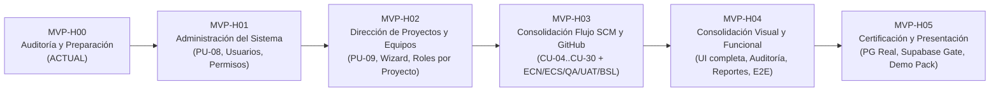

# Plan Integral de Desarrollo del MVP — TraceFlow SCM

> **Documento:** `docs/PLAN_DESARROLLO_MVP.md`  
> **Proyecto:** TraceFlow SCM — Sistema de Gestión de Configuración de Software y Control de Cambios  
> **Organización:** ÉXODO S.A.C. | **Equipo:** C-SharkTeam  
> **Rama de Trabajo:** `feat/mvp-integral-traceflow`  
> **Línea Base Técnica:** `origin/feat/init-h04b-webhooks-git-sync @ 1f5e5c8333e441691b0bdd375d7e39c9ee40f7f4` (INIT-H04B-C)  
> **Fecha de Emisión:** 26 de noviembre de 2026  
> **Estado:** PLAN MAESTRO PROPUESTO — Sujeto a aprobación antes de iniciar MVP-H01

---

## 1. Estrategia y Principios Rectores del MVP

El objetivo es entregar en el menor número de cambios seguros y verificables una versión **MVP funcional, conectada de extremo a extremo (React 19 → NestJS 11 → PostgreSQL/Supabase) y demostrable en vivo**, reutilizando al máximo la infraestructura ya certificada en `INIT-H02`..`INIT-H04B-C`.

### Principios de Alcance Mínimo Viable
1. **Reutilización máxima de lo certificado**: Aprovechar las 33 tablas DDL ya modeladas, el módulo de auditoría SHA-256 (`append_audit_log`), `OrganizationsModule`, `ProjectsModule` (H02/H03), `GitHubModule` (H04A/H04B-C) y los 7 componentes React ya construidos para RFCs (`RfcListView`, `RfcCreateView`, `RfcDetailView`, `RfcEditView`, `RfcImpactAnalysisView`, `RfcMinorApprovalView`, `RfcCcbDeliberationView`).
2. **Migración progresiva de `mock` a `api` real**: Eliminar el uso de `localStorage` en el flujo principal cuando `VITE_SERVICE_MODE=api`, manteniendo compatibilidad de pruebas unitarias.
3. **Límites explícitos del MVP**:
   - Invitaciones por correo o GitHub únicamente con **interfaz, validaciones y persistencia en PostgreSQL** (sin SMTP/SendGrid ni OAuth de GitHub).
   - Sin activación de webhooks públicos en producción (pruebas de sincronización GitHub mediante entorno controlado o endpoint/simulador autenticado de desarrollo/demo).
   - Preservación íntegra de los 7 perfiles SCM (`PU-01..PU-07`), reglas SoD, Doble Llave, auditoría SHA-256 y mínimo privilegio de `traceflow_app` (sin `DELETE`).

---

## 2. Mapa de Hitos y Dependencias

---

## 3. Detalle por Hito de Desarrollo

### MVP-H00: Auditoría y Preparación *(Hito Actual — En Cierre)*

- **Objetivo:** Verificar el estado técnico del repositorio, entorno, compilación y pruebas; auditar integralmente la arquitectura, código, base de datos y RBAC; definir la incorporación limpia de `PU-08` y `PU-09` y establecer el plan definitivo del MVP sin ejecutar cambios funcionales.
- **Funcionalidades reutilizables:** Todo el código base certificado hasta `INIT-H04B-C` (`1f5e5c8333e441691b0bdd375d7e39c9ee40f7f4`), 11 migraciones SQL y 274 pruebas automáticas no destructivas en verde.
- **Cambios estrictamente necesarios:** Creación de rama segura `feat/mvp-integral-traceflow` y redacción de los 4 entregables documentales (`INVENTARIO_FUNCIONAL_MVP.md`, `MATRIZ_PERFILES_PERMISOS.md`, `PLAN_DESARROLLO_MVP.md`, `MVP-H00-INFORME_AUDITORIA.md`).
- **Archivos y módulos afectados:** Exclusivamente `docs/INVENTARIO_FUNCIONAL_MVP.md`, `docs/MATRIZ_PERFILES_PERMISOS.md`, `docs/PLAN_DESARROLLO_MVP.md`, `docs/evidence/mvp-h00/MVP-H00-INFORME_AUDITORIA.md`.
- **Dependencias:** Ninguna externa (acceso de lectura al repositorio y Node/npm).
- **Riesgos:** Ausencia de PostgreSQL 16/17 local en el equipo actual impide re-ejecutar en esta sesión las 4 suites `real-postgres-*` (mitigado documentando el alcance exacto ejecutado vs. histórico certificado).
- **Pruebas:** `npm run lint`, `npm run build` y `npm test` en `backend/` (13 archivos, 177 tests) y `prototype/` (9 suites).
- **Criterios de aceptación:** Rama publicada desde commit certificado, cero modificaciones de código/BD productiva, 4 documentos emitidos y revisables antes de aprobar MVP-H01.

---

### MVP-H01: Administración del Sistema (`PU-08`)

- **Objetivo:** Incorporar los perfiles `PU-08` (Administrador del Sistema) y `PU-09` (Jefe de Proyecto) en el catálogo canónico, habilitar la administración real de cuentas de usuario, estados, invitaciones UI/BD, organizaciones y autorizaciones para crear proyectos, y preparar el soporte de sesiones con contexto por proyecto.
- **Funcionalidades reutilizables:**
  - `AuthModule` (Argon2id, sesiones opacas `user_session`, `AuthGuard`, `RolesGuard`).
  - `OrganizationsModule` (`organization`, `organization_member`, validación `DA-06`).
  - `AuditService.logEvent()` con encadenamiento SHA-256.
  - `provision-users.ts` (lógica de hashing Argon2id).
- **Cambios estrictamente necesarios:**
  1. **BD (migración `202611260009` + rollback):**
     - Insertar `PU-08` y `PU-09` en `traceflow.app_role`.
     - Agregar `can_create_projects`, `project_creation_authorized_by`, `project_creation_authorized_at` en `traceflow.app_user`.
     - Agregar `status` (`ACTIVE`/`INACTIVE`) en `user_role_assignment` y conceder `SELECT, INSERT, UPDATE` (sin `DELETE`) a `traceflow_app`.
     - Crear tabla `traceflow.user_invitation` (email, github_username, channel, organization_id, project_id, intended_role_id, token_code, status, expires_at) con `SELECT, INSERT, UPDATE` sin `DELETE`.
     - Agregar `active_project_id` opcional en `traceflow.user_session`.
  2. **Backend:**
     - Actualizar `CanonicalRoleId` (`PU-01`..`PU-09`), `AuthService` y `AuthRepository` (eliminando mapeos rígidos `1..7`, añadiendo `revokeAllUserSessions()` y `POST /auth/context`).
     - Crear `UsersModule` (`GET/POST/PATCH /admin/users`, `PATCH /admin/users/:id/status`, `PUT /admin/users/:id/roles`, `PATCH /admin/users/:id/project-creation-auth`, `GET/POST/PATCH /admin/invitations`) restringido a `@Roles('PU-08')`.
     - Permitir a `PU-08` operar en `OrganizationsController` para crear organizaciones y administrar membresías.
  3. **Frontend:**
     - Actualizar `types/auth.ts`, `types/permissions.ts`, `routes/navigation.ts` (`PU-08`, `PU-09`, mover `/admin/users` de `PU-05` a `PU-08`).
     - Desacoplar `LoginView.tsx` del catálogo local `initialUsers.ts` en modo `api`.
     - Implementar la vista funcional `AdminUsersView.tsx` (gestión de usuarios, estados, roles globales, check de autorización de proyectos, organizaciones e invitaciones UI+BD sin correo externo).
- **Archivos y módulos afectados:**
  - `supabase/migrations/202611260009_*.sql` (+ rollback).
  - `backend/src/common/types/index.ts`, `backend/src/modules/auth/*`, `backend/src/modules/users/*` (nuevo), `backend/src/modules/organizations/*`, `backend/src/app.module.ts`.
  - `prototype/src/types/auth.ts`, `permissions.ts`, `routes/navigation.ts`, `AppRouter.tsx`, `LoginView.tsx`, `useAuthStore.ts`, `services/api/*`, `features/admin/AdminUsersView.tsx` (nuevo).
- **Dependencias:** Aprobación de MVP-H00; disponibilidad de PostgreSQL local/entorno de pruebas para certificar migración `202611260009`.
- **Riesgos:** Romper pruebas existentes de `auth.spec.ts` u `organizations.spec.ts` que asumen rol `PU-02` para bootstrap o 7 roles fijos (mitigación: actualizar fixtures manteniendo reglas SoD y regresar 100% de suites).
- **Pruebas:** Pruebas unitarias `UsersModule`, pruebas de revocación de sesión al suspender usuario, pruebas `pg-mem`/PG real de `202611260009`, pruebas de frontend `navigation.spec.mjs` y `enterprise.rbac.spec.mjs` actualizadas.
- **Criterios de aceptación:** `PU-08` puede crear/suspender usuarios, autorizar creación de proyectos, registrar invitaciones (sin envío real) y gestionar organizaciones con persistencia real en PostgreSQL y auditoría SHA-256; usuario suspendido pierde acceso inmediato; `PU-05` ya no accede a `/admin/users`.

---

### MVP-H02: Dirección de Proyectos y Equipos (`PU-09`)

- **Objetivo:** Habilitar al Jefe de Proyecto (`PU-09`, autorizado por `PU-08`) para crear e inicializar proyectos, configurar metodología y cronograma, vincular repositorios GitHub (sin OAuth), conformar equipos asignando diferentes perfiles `PU-01..PU-07` por proyecto, y activar proyectos tras validar precondiciones; conectar todo ello con la UI real de `/projects`.
- **Funcionalidades reutilizables:**
  - `ProjectsModule` (`POST/GET /projects`) y `ProjectPlanningService` (`team-members`, `methodology`, `phases`, `milestones`, `deliverables`, `setup/step-2`, `step-3`, `progress`).
  - `GitHubService` y `GitHubController` (`status`, `available-repos`, `link`, `validate`, `unlink`, `create-draft`).
  - `Topbar.tsx` y `useProjectStore.ts` (selector de proyecto activo).
- **Cambios estrictamente necesarios:**
  1. **Backend:**
     - En `ProjectsService.createProject()`, exigir `canCreateProjects === true` y rol `PU-09` (manteniendo `DA-02` y `DA-06`). Al crear, asignar al creador en `project_team_role` como `PU-09` (`is_lead = true`) y en `user_project_assignment`.
     - En `ProjectPlanningService` y `GitHubService`, autorizar administración del proyecto a `PU-09` asignado (`manager_id`/`created_by` o `project_team_role = PU-09`) en reemplazo de `PU-02`.
     - Implementar `POST /api/v1/projects/:id/activate` (y `PATCH /api/v1/projects/:id/status` para `SUSPENDIDO`/`ARCHIVADO`) validando: equipo mínimo, metodología configurada y `github_integration.validation_status = 'VALIDATED'` (o modo `create-draft`/repositorio validado en entorno demo controlado), actualizando `project_setup.validation_completed = true` y `project.status = 'ACTIVO'`.
     - Exponer endpoints auxiliares de lectura/gestión de instalaciones GitHub de la organización (`GET /organizations/:id/github-installations`, `POST` controlado para entorno demo sin OAuth) y catálogo de miembros elegibles de la organización para asignar al equipo.
     - Implementar resolución real de **perfiles por proyecto** (`project_team_role`) en `AuthService` / `ProjectContextGuard`, de modo que una misma cuenta ejerza un perfil distinto según el proyecto activo seleccionado.
  2. **Frontend:**
     - Reemplazar los `ScreenPlaceholder` de `/projects` y `/projects/:projectId` por `ProjectsListView.tsx`, `ProjectWizardView.tsx` (`/projects/new`, 5 pasos `DA-05`: Identidad → Equipo/Invitaciones → Metodología/Fases/Hitos/Entregables → GitHub Link/Status → Resumen y Activación) y `ProjectDetailView.tsx` (Panel de configuración posterior).
     - Actualizar `Topbar.tsx` para conmutar proyecto + perfil efectivo del proyecto activo vía `POST /auth/context` y refrescar permisos/menú lateral.
- **Archivos y módulos afectados:**
  - `backend/src/modules/projects/*`, `backend/src/modules/github/*`, `backend/src/modules/auth/*`, `backend/src/common/guards/*`.
  - `prototype/src/features/projects/*` (nuevos), `prototype/src/routes/AppRouter.tsx`, `Topbar.tsx`, `useProjectStore.ts`, `useAuthStore.ts`, `apiClient.ts`, `apiAdapter.ts`.
- **Dependencias:** MVP-H01 completado (`PU-08`, `PU-09`, `can_create_projects`, `user_invitation`).
- **Riesgos:** Complejidad UX del asistente de 5 pasos y sincronización de roles por proyecto entre sesiones/pestañas (mitigación: mantener el estado canónico en backend y refrescar `getMe()`/`context` al cambiar proyecto).
- **Pruebas:** Pruebas unitarias e integración de activación de proyecto (`ACTIVO`), aislamiento inter-proyecto, asignación multi-rol de una cuenta en 2 proyectos distintos, y regresión de `projects-h02.spec.ts`, `projects-h03-planning.spec.ts`, `github-integration.spec.ts`.
- **Criterios de aceptación:** Un `PU-09` autorizado crea un proyecto desde la UI, configura equipo con roles distintos por proyecto, define metodología/fases/hitos, vincula repositorio GitHub (modo app/demo controlado sin OAuth), activa el proyecto a `ACTIVO`, y un mismo usuario cambia de proyecto viendo cambiar su perfil efectivo y menú lateral.

---

### MVP-H03: Consolidación del Flujo SCM y GitHub

- **Objetivo:** Llevar todo el flujo núcleo de Gestión de la Configuración (`CU-04`..`CU-30`, `CU-08`..`CU-25`, `CU-29`) desde simulación `localStorage` a **persistencia real en PostgreSQL vía NestJS API**, integrando la verificación real de `DA-04` (`github_integration`), control de ECS/bibliotecas (`sync_lock`), QA, UAT, Líneas Base y correlación con eventos GitHub (`INIT-H04B-C`).
- **Funcionalidades reutilizables:**
  - Tablas DDL ya creadas en `202611250001`: `config_item`, `ecs_version`, `change_request`, `impact_assessment`, `change_authorization`, `ccb_resolution`, `ccb_vote`, `change_order`, `sync_lock`, `qa_certification`, `uat_acceptance`, `baseline`, `baseline_item`, `incident_ticket`, `audit_log` + todos los triggers SoD e inmutabilidad (`202611250003`).
  - `RfcsModule` (`CU-04`) y `GitHubEventProcessorService` (`H04B-C`).
  - Vistas React ya funcionales en `prototype/src/features/rfcs/*` (`RfcListView`, `RfcCreateView`, `RfcDetailView`, `RfcEditView`, `RfcImpactAnalysisView`, `RfcMinorApprovalView`, `RfcCcbDeliberationView`).
- **Cambios estrictamente necesarios:**
  1. **Backend — Eliminación de deuda crítica en `RfcsService`:**
     - Reemplazar bloqueo temporal `ALLOW_MOCK_GITHUB_ACTIVATION` por verificación real contra `github_integration` (`validation_status === 'VALIDATED'`) y `project.status === 'ACTIVO'`.
     - Corregir `RfcsRepository.getNextCode()` usando secuencia o generación transaccional segura.
  2. **Backend — Endpoints reales para el flujo completo de cambios (usando las tablas DDL existentes):**
     - `RfcsModule`: `POST /rfcs/:id/admit`, `POST /rfcs/:id/observe`, `POST /rfcs/:id/dismiss` (`CU-05`, `PU-02`), `PUT /rfcs/:id/subsanar` (`CU-04.1`, `PU-01`), `POST /rfcs/:id/impact-analysis` (`CU-06`, `PU-03`), `POST /rfcs/:id/minor-approval` (`CU-30`, Doble Llave `PU-02`+`PU-03` con trigger físico SoD), `POST /rfcs/:id/ccb/votes` y `POST /rfcs/:id/ccb/resolve` (`CU-07`, `PU-04`).
     - `ChangesExecutionModule` (o módulos cohesivos `EcnModule`, `EcsModule`, `ValidationModule`, `BaselinesModule`, `IncidentsModule`):
       - `ECN` (`CU-08`): `GET/POST /ecns`, asignación de desarrollador (`PU-06`), transición `EMITIDA` → `EN_EJECUCION`.
       - `ECS y Bibliotecas` (`CU-09..15`): `GET/POST /projects/:id/ecs`, `GET /ecs/:id/history` (incluyendo `ecs_version` + `config_item_path_history` de H04B-C), `POST /ecs/:id/check-out` (crea `sync_lock` `ACTIVE`), `POST /ecs/:id/implement` (`PU-06`), `POST /ecs/:id/check-in` (`PU-05` con SHA-256 y liberación de `sync_lock`).
       - `QA y UAT` (`CU-16..19`, `CU-29`): `POST /ecns/:id/qa-certification` (`PU-07`, validando SoD vs `assigned_developer_id`), `POST /ecns/:id/uat-acceptance` (`PU-01` creador, validando `RN-09`).
       - `Baselines y Rollback` (`CU-20..22`): `GET/POST /projects/:id/baselines` (`PU-05`, exigiendo doble validación QA+UAT `RN-09`), `POST /ecns/:id/rollback` (`PU-05`, `RN-08`).
       - `Incidencias` (`CU-23..25`): `GET/POST /incidents`, `POST /incidents/:id/derive-rfc` (`PU-02`).
     - Asegurar que toda mutación verifique **rol efectivo del usuario en el proyecto de la entidad** (`project_team_role`), estado `ACTIVO` del proyecto (`DA-04`) y registre evento en `AuditService.logEvent()`.
  3. **Backend — Alinear detalle en `GitHubRepository` (`H04B-C`):**
     - Verificar que el rol técnico para sincronización de webhooks sea consistente con `PU-06` (y `PU-03`/`PU-05`/`PU-09` según política definida) y exponer consulta de eventos webhook/rutas (`GET /projects/:id/github/events`, `GET /projects/:id/github/path-history`) y disparador controlado de simulación de evento webhook en modo dev/demo (sin exposición pública).
  4. **Frontend — Conexión API:**
     - Conectar `apiClient.ts`, `apiAdapter.ts`, `useRfcStore.ts` y vistas `RfcDetailView`, `RfcEditView`, `RfcImpactAnalysisView`, `RfcMinorApprovalView`, `RfcCcbDeliberationView` al backend real cuando `VITE_SERVICE_MODE=api` (eliminando nombres/IDs hardcodeados en `apiAdapter.ts` y llamadas paralelas a `rfcService` local en `useRfcStore.createRfc`).
- **Archivos y módulos afectados:**
  - `backend/src/modules/rfcs/*`, nuevos módulos `ecs/`, `ecns/`, `baselines/`, `incidents/` (o consolidados en `scm/`), `github/github.controller.ts` y `github.repository.ts`.
  - `prototype/src/services/api/*`, `prototype/src/store/*`, `prototype/src/features/rfcs/*`.
- **Dependencias:** MVP-H02 completado (proyectos `ACTIVO` con GitHub validado y equipos asignados en `project_team_role`).
- **Riesgos:** Volumen de endpoints nuevos del flujo SCM; posible fricción entre IDs UUID de PostgreSQL y códigos `RFC-2026-XXXX` en rutas frontend (mitigación: aceptar `idOrCode` en todos los endpoints como ya hace `RfcsRepository` y `ProjectsRepository`).
- **Pruebas:** Pruebas unitarias y `pg-mem` para cada transición `TB-07`, pruebas negativas de SoD (`PU-06` vs `PU-07`, Doble Llave misma persona, solicitante votando CCB, `sync_lock` duplicado `RN-06`, Check-In sin QA+UAT `RN-09`), pruebas de webhook correlacionado con ECN + `sync_lock` reales.
- **Criterios de aceptación:** Ciclo completo de Cambio Menor (`CU-04` → `CU-05` → `CU-06` → `CU-30` → `CU-08` → `CU-10..12` → `QA` → `UAT` → `Baseline` → `IMPLEMENTADA`) y Cambio Mayor (`CU-07` CCB) ejecutándose con persistencia real en PostgreSQL sin depender de `localStorage`.

---

### MVP-H04: Consolidación Visual y Funcional

- **Objetivo:** Eliminar los 12 `ScreenPlaceholder` restantes del frontend reemplazándolos por vistas operativas reales conectadas al backend NestJS, unificando experiencia visual institucional (tema UPT/ÉXODO), manejo de errores API, trazabilidad GitHub y consola de auditoría/reportes.
- **Funcionalidades reutilizables:** `AppLayout`, `Sidebar`, `Topbar`, `Breadcrumb`, tokens de tema `prototype/src/theme/tokens.ts`, `DashboardView`, vistas RFC ya consolidadas.
- **Cambios estrictamente necesarios:**
  1. **Backend:**
     - `AuditController`: `GET /api/v1/audit` (filtros por proyecto/operación/actor y verificación de integridad de cadena SHA-256, respetando aislamiento por proyecto para `PU-02/04/05/09` y vista global para `PU-08`).
     - `ReportsController`: `GET /api/v1/reports/summary` (métricas reales agregadas de RFCs, ECNs, ECS, líneas base, eventos GitHub) + exportación JSON/CSV.
  2. **Frontend — Reemplazo de los `ScreenPlaceholder` pendientes:**
     - `EcnsView.tsx` y `EcnDetailView.tsx` (`/ecns`, `/ecns/:ecnId`).
     - `EcsCatalogView.tsx`, `EcsDetailView.tsx` y `EcsHistoryView.tsx` (`/ecs`, `/ecs/:ecsId`, `/ecs/:ecsId/history` con `config_item_path_history` y `ecs_version`).
     - `ScmOperationsView.tsx` (`/scm/operations`: Check-Out, `sync_lock`, Implementación, Check-In).
     - `QaValidationView.tsx` (`/qa/validation/:rfcId`).
     - `UatAcceptanceView.tsx` (`/rfcs/:rfcId/uat`).
     - `BaselinesView.tsx` (`/baselines`: congelar líneas base y rollback).
     - `IncidentsView.tsx` y `IncidentDetailView.tsx` (`/incidents`, `/incidents/:incidentId` + derivar a RFC).
     - `AuditLogView.tsx` y `ReportsView.tsx` (`/audit`, `/reports`).
  3. **Limpieza UX y configuración por defecto para demostración:**
     - Actualizar `DashboardView.tsx` para reflejar métricas reales de la API y accesos rápidos de `PU-08` y `PU-09`.
     - Asegurar estados de carga, banners de error SoD/API claros (`403`/`409`/`412`) y eliminación de `ScreenPlaceholder` en rutas productivas del MVP.
- **Archivos y módulos afectados:** `backend/src/modules/audit/*`, `backend/src/modules/reports/*` (nuevo), `prototype/src/features/*`, `prototype/src/routes/AppRouter.tsx`, `prototype/src/services/api/*`.
- **Dependencias:** MVP-H03 completado.
- **Riesgos:** Consistencia de datos entre vistas cuando el usuario cambia de proyecto o perfil; tamaño del bundle JS (advertencia actual de Vite `> 500 kB` — mitigación: lazy-loading por ruta si aplica).
- **Pruebas:** `oxlint`, `tsc -b`, `vite build`, pruebas de navegación RBAC para los 9 perfiles (`PU-01..PU-09`), verificación de cero rutas MVP apuntando a `ScreenPlaceholder`.
- **Criterios de aceptación:** Las 20 pantallas canónicas + vistas de `PU-08`/`PU-09` funcionan sin placeholders en modo `VITE_SERVICE_MODE=api`, mostrando datos persistidos y mensajes SoD precisos ante operaciones denegadas.

---

### MVP-H05: Certificación y Preparación de la Presentación

- **Objetivo:** Certificar íntegramente el MVP sobre PostgreSQL real (migraciones históricas + nuevas migraciones MVP + rollbacks), ejecutar pruebas E2E integradas (Playwright / API) del flujo completo con los 9 perfiles, validar despliegue controlado en Supabase (previa autorización explícita del responsable/CCB) y preparar el paquete de demostración.
- **Funcionalidades reutilizables:** Suites `backend/test/real-postgres-*.spec.ts`, `test-isolation.guard.ts`, `docs/evidence/int-01/`, `docs/presentacion/TraceFlow_SCM_5min.html`.
- **Cambios estrictamente necesarios:**
  1. Certificación física de todas las migraciones (`202611250001`..`202611260009`+) en PostgreSQL real aislado, incluyendo verificación de rollbacks y mínimo privilegio de `traceflow_app`.
  2. Suite E2E completa cubriendo el guion demostrable de extremo a extremo:
     - `PU-08` crea/habilita usuarios, autoriza a `PU-09`, registra invitación UI+BD.
     - `PU-09` crea proyecto, arma equipo (mismo usuario con roles distintos en 2 proyectos), configura metodología/fases, vincula repo GitHub y activa proyecto.
     - Flujo completo Cambio Menor (`Doble Llave`) y Cambio Mayor (`CCB`), `Check-Out` (`sync_lock`), simulación webhook GitHub controlada, `QA`, `UAT`, `Check-In`, `Baseline` y consulta de auditoría SHA-256.
  3. Despliegue autorizado de migraciones pendientes en Supabase `TraceFlow-UPT` (únicamente bajo aprobación explícita del Governance Gate) y aprovisionamiento de datos de demostración limpios.
  4. Actualización documental final (`ESTADO_DEL_PROYECTO.md`, `MATRIZ_TRAZABILIDAD.md`, `DICCIONARIO_DATOS.md`, guía de demo).
- **Archivos y módulos afectados:** `backend/test/*`, `prototype/` (E2E Playwright), `docs/evidence/mvp-h05/*`, `docs/ESTADO_DEL_PROYECTO.md`, `docs/MATRIZ_TRAZABILIDAD.md`, `docs/DICCIONARIO_DATOS.md`.
- **Dependencias:** MVP-H04 completado; disponibilidad de instancia PostgreSQL de certificación y aprobación de Governance Gate para Supabase.
- **Riesgos:** Desfase de esquema en Supabase productivo (hoy con 3 migraciones vs 11+ en repo); manejo de secretos de sesión/GitHub en demo (mitigación: checklist pre-demo sin secretos en Git, `verify_migration.sql` actualizado).
- **Pruebas:** 100% de suites unitarias backend, `pg-mem`, certificación física PostgreSQL real, pruebas frontend y E2E Playwright ejecutadas y documentadas sin omisiones.
- **Criterios de aceptación:** Cero errores de compilación/lint, 100% de pruebas aprobadas con evidencia verificable, guion de demostración end-to-end validado en vivo y dictamen listo para entrega/presentación.

---

*Plan Maestro del MVP elaborado en MVP-H00 — TraceFlow SCM / ÉXODO S.A.C.*
