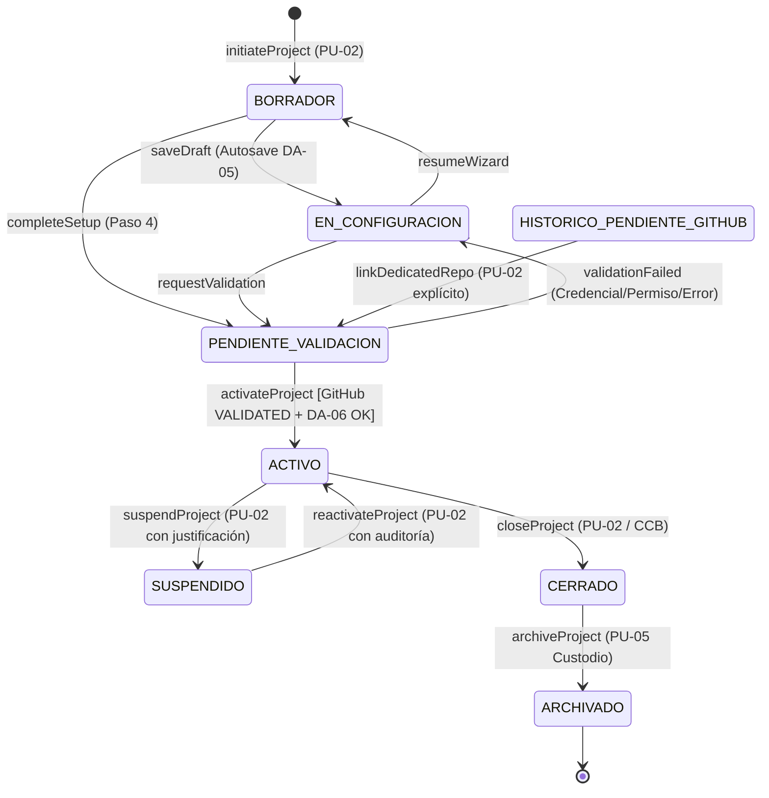
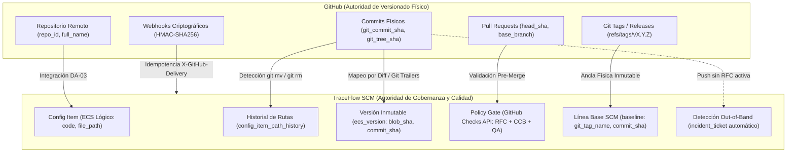
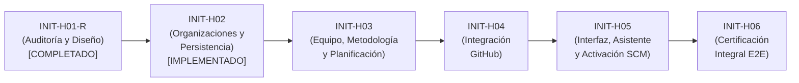

# Plan Maestro de Inicialización, Organización y Configuración de Proyectos — TraceFlow SCM (INIT-H01-R)

> **Documento Oficial de Línea Base:** `docs/PLAN_INICIALIZACION_PROYECTOS.md`
> **Proyecto:** TraceFlow SCM — Sistema de Gestión de Configuración de Software y Control de Cambios
> **Organización:** ÉXODO S.A.C. | **Equipo:** C-SharkTeam
> **Autoría:** Arquitecto de Software Sénior, Especialista PostgreSQL, Seguridad de Aplicaciones e Ingeniero GCSW
> **Rama de Trabajo:** `docs/init-h01-project-architecture` | **Línea Base Git:** `master @ 99cf70f`
> **Hito:** INIT-H01-R (Subsanación de Observaciones Arquitectónicas y Consolidación de Diseño Técnico)
> **Fecha:** 25 de noviembre de 2026
> **Estado:** PROPUESTO — Pendiente de Aprobación Formal por el Responsable / CCB

---

## 1. Resumen Ejecutivo

TraceFlow SCM ha alcanzado la certificación funcional y de persistencia de su núcleo básico de control de cambios (hitos `DB-01`, `DB-02`, `INT-01` y etapa `07R`), con 21 tablas relacionales desplegadas en PostgreSQL 17 (Supabase), un backend monolito modular en NestJS 11 y una interfaz empresarial interactiva en React 19.

No obstante, la auditoría exhaustiva del sistema detectó una brecha arquitectónica crítica en la fase previa a la operación SCM: **el sistema carece de un marco formal de inicialización, organización y configuración de proyectos**. Hasta el momento, los proyectos se encontraban precargados estáticamente en la base de datos sin pertenecer a una entidad formal de organización, sin soporte para estados borradores y sin integración activa con un sistema de control de versiones real como GitHub.

El presente Plan Maestro consolida los resultados de la auditoría AS-IS y subsana de forma exhaustiva las observaciones formuladas en la revisión de arquitectura (`INIT-H01-R`):
1. **Compatibilidad Canónica de Estados:** Establece una única representación canónica en español para `traceflow.project.status` (`BORRADOR`, `EN_CONFIGURACION`, `PENDIENTE_VALIDACION`, `ACTIVO`, `SUSPENDIDO`, `CERRADO`, `ARCHIVADO`, `HISTORICO_PENDIENTE_GITHUB`), con matriz de transiciones permitidas y capa de normalización bidireccional para compatibilidad retroactiva.
2. **Política de Regularización Histórica Estricta:** Suprime cualquier intento de vinculación errónea de los proyectos cliente históricos (`PRJ-001`..`PRJ-003`) con el repositorio de la plataforma TraceFlow. Cada proyecto debe asociarse exclusivamente a su propio repositorio remoto mediante autorización explícita individual del Gestor (`PU-02`), sin automatismos no supervisados ni alteración destructiva de datos.
3. **Matriz Oficial de Permisos GitHub:** Define los alcances y permisos técnicos vigentes para GitHub App y OAuth según la documentación oficial de GitHub, priorizando la generación de Installation Access Tokens bajo demanda en memoria (duración 1 hora) y eliminando el almacenamiento innecesario de tokens temporales en base de datos.
4. **Integridad de Datos y Mínimo Privilegio:** Incorpora salvaguardas DDL (disparadores de integridad de membresía `DA-06`), suprime el estado no admitido `INVITED` para cumplir estrictamente con la incorporación exclusiva de usuarios ya registrados, restringe el uso de `ON DELETE CASCADE` en favor de `ON DELETE RESTRICT` sobre entidades auditables, y revoca privilegios innecesarios de `DELETE` otorgados a `traceflow_app`.
5. **Reorganización Estructurada en 5 Hitos Ejecutables:** Descompone la hoja de ruta de implementación en cinco hitos secuenciales (`INIT-H02` a `INIT-H06`) y asigna el catálogo completo de 25 pruebas TDD al hito que le corresponde.
6. **Coherencia Documental y Terminológica:** Distingue rigurosamente el encadenamiento criptográfico de integridad SHA-256 (hash-chain inmutable de auditoría) frente a una firma digital asimétrica, y mantiene el estado documental en `PROPUESTO` sin declarar aprobaciones colegiadas anticipadas.

---

## 2. Decisiones Aprobadas (Marco Vinculante)

El diseño arquitectónico y funcional se rige obligatoriamente por las siguientes seis Decisiones Aprobadas:

- **DA-01 (Arquitectura Multiproyecto):** TraceFlow SCM debe soportar múltiples proyectos independientes, concurrentes y lógicamente aislados, garantizando que los datos, configuraciones, artefactos y líneas base de un proyecto no sean accesibles ni alterables desde otros proyectos.
- **DA-02 (Agrupación de Proyectos por Organización):** Los proyectos deben estar estructurados y subordinados bajo entidades de nivel superior denominadas organizaciones (clientes corporativos o divisiones de ÉXODO S.A.C.), permitiendo gobierno multitenant, administración centralizada de políticas y delimitación de membresías.
- **DA-03 (Integración GitHub Híbrida):** La plataforma debe soportar dos modalidades de integración con GitHub: (1) vinculación de repositorios remotos existentes y (2) creación/aprovisionamiento automatizado de nuevos repositorios personales u organizacionales.
- **DA-04 (Integración GitHub Obligatoria para Activación):** Ningún proyecto puede transicionar al estado operacional `ACTIVO` ni ejecutar operaciones de gestión de cambios (registro de RFCs, órdenes ECN, check-in de ECS, líneas base) si no cuenta con una integración GitHub formalmente validada y en estado saludable.
- **DA-05 (Experiencia Híbrida Asistente / Panel):** La inicialización de proyectos debe ofrecer una experiencia guiada mediante un Asistente Inicial de 5 pasos con soporte de guardado parcial (borrador) y un Panel de Configuración Posterior para mantenimiento evolutivo.
- **DA-06 (Incorporación Exclusiva de Usuarios Registrados y Autorizados):** La asignación de integrantes al equipo del proyecto queda restringida estrictamente a colaboradores previamente registrados en el sistema (`app_user.status = 'ACTIVE'`) y vinculados formalmente como miembros activos de la organización (`organization_member.status = 'ACTIVE'`).

---

## 3. Diagnóstico AS-IS (Auditoría Exhaustiva del Repositorio)

La inspección detallada del código fuente, esquema de base de datos, pruebas y documentación en la línea base `master @ 99cf70f` arrojó los siguientes hallazgos:

### 3.1 Backend NestJS (`backend/src/`)
- **`ProjectsModule` (`backend/src/modules/projects/`):**
  - El controlador `ProjectsController` únicamente expone dos endpoints de lectura: `GET /api/v1/projects` y `GET /api/v1/projects/:id`. Carece de endpoints para creación (`POST`), edición (`PUT/PATCH`), archivado (`DELETE`), configuración de metodología o integración GitHub.
  - Cuenta con `@UseGuards(AuthGuard)`, pero carece de `@UseGuards(RolesGuard)` y anotación `@Roles()`, omitiendo la restricción que confiere la administración de proyectos al Gestor (`PU-02`).
  - El servicio `ProjectsService` filtra proyectos en memoria basándose en `user.assignedProjectIds`. No valida el estado del proyecto (`ACTIVE`, `CLOSED`, etc.).
  - El repositorio `ProjectsRepository` posee una lista estática de 3 proyectos en memoria (`PRJ-001`..`PRJ-003`) para modo `mock`. En modo `postgres`, ejecuta una consulta plana `SELECT * FROM traceflow.project`. No cuenta con métodos de mutación DDL ni DML.
- **`AuthModule` y Seguridad (`backend/src/modules/auth/`):**
  - Soporta autenticación con Argon2id y sesiones opacas en base de datos (`user_session`).
  - La interfaz `AuthenticatedUser` contiene `organization: string` como un campo plano informativo (ej. `'ÉXODO S.A.C.'`), sin identificador UUID de organización ni verificación contra una tabla de organizaciones.
  - La matriz RBAC implementa los 7 roles canónicos (`PU-01`..`PU-07`), pero no contempla roles a nivel de organización (ej. Administrador de Organización vs Miembro) ni roles específicos dentro del proyecto.
- **`RfcsModule` y Operaciones SCM (`backend/src/modules/rfcs/`):**
  - El servicio `RfcsService.createRfc()` valida el aislamiento multitenant comprobando que `user.assignedProjectIds.includes(dto.projectId)`.
  - **Falla de salvaguarda detectada:** No valida que `project.status === 'ACTIVO'`. Un usuario puede registrar RFCs sobre proyectos cerrados, archivados o incompletos. Tampoco verifica si existe un repositorio de código asociado (violación de DA-04).
- **`AuditModule` (`backend/src/modules/audit/`):**
  - Implementa la función inmutable `traceflow.append_audit_log` con encadenamiento SHA-256 (`curr_log_hash`) y cerrojo transaccional `pg_advisory_xact_lock(74291)`.
  - La interfaz `AuditEventInput` contempla `projectId`, pero no incluye `organizationId`.

### 3.2 Base de Datos PostgreSQL 17 (`supabase/migrations/`)
- **Tabla `traceflow.project`:**
  - Definida en `202611250001_initial_traceflow.sql` (Líneas 57-73).
  - Restricción de estado: `CHECK (status IN ('ACTIVE', 'CLOSED', 'ARCHIVED'))`. No contempla los estados `BORRADOR`, `EN_CONFIGURACION`, `PENDIENTE_VALIDACION`, `SUSPENDIDO` ni `HISTORICO_PENDIENTE_GITHUB`.
  - Carece de clave foránea hacia organizaciones, carece de metadatos de metodología, cronograma o repositorio GitHub.
- **Tabla `traceflow.app_user`:**
  - Campo `organization VARCHAR(120) NOT NULL DEFAULT 'ÉXODO S.A.C.'`. No normalizado relacionalmente.
- **Mínimo Privilegio de `traceflow_app` (`202611250003_secure_app_role_least_privilege.sql`):**
  - La tabla `traceflow.project` y la tabla `traceflow.user_project_assignment` fueron configuradas con **`GRANT SELECT` únicamente** (Sección 4.3, Líneas 271-278).
  - El backend NestJS no tiene permisos de `INSERT` ni `UPDATE` sobre `project` ni `user_project_assignment`. Toda tentativa actual de crear o editar proyectos desde NestJS falla en PostgreSQL con `permission denied for table project`.

### 3.3 Frontend React 19 (`prototype/src/`)
- **Rutas de Proyectos (`prototype/src/routes/AppRouter.tsx`):**
  - Las rutas `/projects` y `/projects/:projectId` están renderizadas mediante el componente provisional `ScreenPlaceholder`.
  - No existe ruta ni componentes para `/projects/new` (Asistente de Inicialización), ni para `/projects/:id/settings` (Panel de Configuración Posterior).
  - No existen flujos de autorización OAuth con GitHub, selección de ramas ni callbacks de instalación de GitHub Apps.
- **Gestión de Estado (`prototype/src/store/useProjectStore.ts`):**
  - Implementa un conmutador de proyecto activo en memoria y `localStorage`. No valida estados de activación ni sincronización con repositorios remotos.

---

## 4. Matriz de Brechas (Gap Analysis)

| ID | Componente | Estado Actual (AS-IS) | Estado Objetivo (TO-BE) | Impacto | Riesgo | Acción Propuesta | Evidencia / Referencia |
| :--- | :--- | :--- | :--- | :---: | :---: | :--- | :--- |
| **GAP-01** | Modelo de Datos (Organización) | `app_user.organization` es un texto plano `'ÉXODO S.A.C.'`. No existe entidad `organization`. | Entidades relacionales `organization` y `organization_member` con aislamiento estricto (DA-02). | Crítico | Alto | Crear esquema relacional y migrar datos sin afectar usuarios existentes. | `supabase/migrations/202611250001_initial_traceflow.sql#L37` |
| **GAP-02** | Privilegios de Base de Datos | `traceflow_app` solo tiene permiso `SELECT` sobre `project` y `user_project_assignment`. | Permisos mínimos `SELECT, INSERT, UPDATE` sobre `project`, `user_project_assignment` y nuevas tablas. | Crítico | Alto | Ajustar concesión de privilegios en script DDL sin conceder `DELETE`. | `supabase/migrations/202611250003_secure_app_role_least_privilege.sql#L273` |
| **GAP-03** | Ciclo de Vida del Proyecto | Estados restringidos a `ACTIVE`, `CLOSED`, `ARCHIVED`. Creación monolítica directa. | Estados canónicos: `BORRADOR`, `EN_CONFIGURACION`, `PENDIENTE_VALIDACION`, `ACTIVO`, `SUSPENDIDO`, `CERRADO`, `ARCHIVADO`, `HISTORICO_PENDIENTE_GITHUB`. | Alto | Medio | Actualizar restricción `CHECK` y añadir máquina de estados formal. | `backend/src/modules/projects/projects.repository.ts#L31` |
| **GAP-04** | Integración GitHub | Inexistente. Cero vinculación con repositorios Git remotos. | Módulo `GitHubIntegrationModule` con soporte de vinculación y creación vía GitHub App / OAuth (DA-03). | Crítico | Alto | Diseñar módulo backend, cifrado AES-256-GCM y validación de webhooks. | `backend/src/app.module.ts` |
| **GAP-05** | Salvaguarda de Activación SCM | `RfcsService.createRfc()` no valida si el proyecto está activo ni si cuenta con repositorio Git. | Implementación de `ProjectActiveGuard` y rechazo HTTP 412 si el proyecto no está `ACTIVO` (DA-04). | Crítico | Crítico | Crear guardián NestJS e incorporarlo en controladores SCM. | `backend/src/modules/rfcs/rfcs.service.ts#L76-L89` |
| **GAP-06** | Asistente de Inicialización (UI) | Pantallas de proyectos son `ScreenPlaceholder`. | Flujo guiado de 5 pasos con guardado borrador (`project_setup.draft_payload`) (DA-05). | Alto | Medio | Diseñar vistas React 19, componentes por paso y store Zustand. | `prototype/src/routes/AppRouter.tsx#L38-L56` |
| **GAP-07** | Política de Miembros (DA-06) | Proyectos asignan usuarios sin verificar pertenencia institucional. | Validación estricta: solo usuarios con `organization_member.status = 'ACTIVE'` pueden ser asignados. | Alto | Medio | Añadir validación relacional y en servicio NestJS. | `backend/src/modules/projects/projects.service.ts#L13` |
| **GAP-08** | Planificación Metodológica | No existe soporte para metodología, fases, hitos ni entregables en BD ni API. | Entidades `project_methodology`, `project_phase`, `project_milestone`, `project_deliverable`. | Medio | Bajo | Incorporar modelo relacional de planificación y DTOs correspondientes. | `docs/FD03-EPIS-Informe_SRS.md#L528` |
| **GAP-09** | Endpoints de Creación en Backend | `ProjectsController` no posee `@Post()` para inicialización ni activación. | Endpoints REST `/api/v1/projects`, `/api/v1/projects/:id/setup`, `/api/v1/projects/:id/activate`. | Alto | Medio | Definir contratos de API y DTOs validados con `class-validator`. | `backend/src/modules/projects/projects.controller.ts#L7-L28` |
| **GAP-10** | Trazabilidad de Auditoría | `audit_log` registra `project_id`, pero carece de contexto de organización. | Auditoría enriquecida con `organization_id` y eventos específicos de ciclo de vida (`PROJECT_INITIATED`, `GH_LINKED`). | Medio | Bajo | Extender `AuditEventInput` y función PL/pgSQL manteniendo SHA-256. | `backend/src/modules/audit/audit.service.ts#L5-L18` |

---

## 5. Ingeniería de Requisitos (Extensión Normativa)

### 5.1 Nuevos Requisitos Funcionales (RF-19 a RF-23)

- **`RF-19` — Gestión de Organizaciones y Membresías Institucionales (DA-02, DA-06):**
  - El sistema debe permitir a los administradores autorizados registrar organizaciones cliente, configurar su identidad y gestionar las membresías de los usuarios registrados del sistema.
  - Ningún usuario podrá ser asignado a un proyecto sin pertenecer formalmente a la organización propietaria.
- **`RF-20` — Asistente Híbrido de Inicialización de Proyectos (DA-01, DA-05):**
  - El sistema debe proporcionar un asistente interactivo de 5 pasos secuenciales para registrar proyectos en estado `BORRADOR`, permitiendo guardar el progreso parcial y reanudarlo posteriormente.
  - El asistente debe capturar: (1) Identidad y alcance, (2) Asignación de roles por proyecto, (3) Metodología y fases, (4) Integración GitHub, (5) Resumen y activación.
- **`RF-21` — Integración y Vinculación de Repositorios GitHub (DA-03):**
  - El sistema debe permitir vincular un repositorio GitHub preexistente o aprovisionar automáticamente un nuevo repositorio remoto en una cuenta u organización autorizada.
  - Debe validar permisos mínimos de administración o escritura, configurar webhooks autenticados y registrar el identificador remoto de GitHub.
- **`RF-22` — Planificación de Metodologías, Fases, Hitos y Entregables:**
  - El sistema debe permitir asociar al proyecto una metodología de desarrollo (Scrum, Cascada, Híbrida) y estructurar su cronograma base mediante fases ordenadas, hitos temporales y entregables asociados a Elementos de Configuración (`ECS`).
- **`RF-23` — Salvaguardas de Ciclo de Vida y Activación SCM (DA-04):**
  - El sistema debe impedir la transición del proyecto al estado `ACTIVO` si no cuenta con una integración GitHub verificada y validada (`validation_status = 'VALIDATED'`).
  - Debe rechazar toda operación de gestión de cambios (creación de RFCs, emisión de órdenes ECN, modificaciones en bibliotecas) si el proyecto no se encuentra en estado `ACTIVO`.
- **`RF-24` — Identificación, Mapeo y Trazabilidad Git de ECS:**
  - El sistema debe mapear de forma unívoca cada Elemento de Configuración (`ECS`) con el repositorio GitHub del proyecto (`github_repo_id`), su ruta relativa (`file_path`) y sus versiones físicas (`git_blob_sha`, `git_commit_sha`, `git_ref`).
  - Debe preservar la identidad lógica inmutable del ECS ante cambios de nombre o reubicaciones de directorios mediante el historial de rutas (`config_item_path_history`), y gestionar el retiro lógico inmutable ante eliminaciones en Git.
- **`RF-25` — Supervisión y Puertas de Gobernanza SCM en GitHub:**
  - El sistema debe inspeccionar eventos de GitHub mediante webhooks criptográficos (`push`, `pull_request`, `create`), evaluando las 5 Puertas de Gobernanza SCM vía GitHub Checks API (`TraceFlow SCM / Policy Gate`) antes de permitir el merge a ramas protegidas.
  - Debe detectar automáticamente modificaciones de código sin RFC autorizada (cambios fuera de flujo u *out-of-band*), generando de inmediato un ticket de incidencia SCM y registrando el evento en auditoría.

### 5.2 Nuevas Reglas de Negocio (RN-10 a RN-17)

- **`RN-10` (Pertenencia Obligatoria a Organización):** Todo proyecto debe pertenecer indefectiblemente a una única organización registrada. No se admiten proyectos globales ni huérfanos.
- **`RN-11` (Incorporación Exclusiva de Registrados - DA-06):** La asignación de personal a un proyecto (`project_team_role`) solo puede realizarse sobre usuarios físicos que posean estado `ACTIVE` en `app_user` y estado `ACTIVE` en `organization_member`.
- **`RN-12` (Condición Sine Qua Non de Integración GitHub - DA-04):** Es mandatorio que el repositorio remoto en GitHub esté verificado y con webhook operativo para que el proyecto pueda ser activado.
- **`RN-13` (Bloqueo Estricto de Operaciones SCM en Proyectos Inactivos):** Las solicitudes de cambio (RFC), órdenes de cambio (ECN), bloqueos de sincronización y check-in/out solo pueden ejecutarse en proyectos con estado `ACTIVO`. Proyectos en `BORRADOR`, `EN_CONFIGURACION`, `PENDIENTE_VALIDACION`, `SUSPENDIDO` o `ARCHIVADO` bloquean estas operaciones con error HTTP 412 / 403.
- **`RN-14` (Persistencia y Recuperación de Estado Borrador):** El asistente de inicialización debe persistir automáticamente el avance de cada paso en `project_setup.draft_payload` sin alterar las restricciones relacionales duras hasta la activación final.
- **`RN-15` (Inmutabilidad de Transición de Estados):** Todo cambio en el estado del proyecto (`BORRADOR` $\rightarrow$ `ACTIVO` $\rightarrow$ `SUSPENDIDO` $\rightarrow$ `ARCHIVADO`) debe registrarse en la bitácora inmutable de auditoría mediante encadenamiento criptográfico de integridad SHA-256 (`append_audit_log` con `prev_log_hash` y `curr_log_hash`), diferenciado técnicamente de firmas digitales asimétricas (PKI/RSA/ECDSA).
- **`RN-16` (Correlación Obligatoria Commit/PR con Expediente SCM):** Todo commit o pull request que afecte rutas registradas de ECS en ramas controladas debe correlacionarse obligatoriamente con una RFC admisible y una Orden de Cambio autorizada (`ECN`). Commits sin correlación activan el protocolo de incidencia por cambio no autorizado.
- **`RN-17` (Custodia e Historial Inmutable de Rutas de ECS):** Queda prohibida la eliminación física (`DELETE`) de un ECS ante un `git rm` (debe transicionar a `RETIRED`). Todo `git mv` debe registrarse en `config_item_path_history` asociando la ruta previa, la nueva ruta y el hash del commit.

### 5.3 Nuevos Casos de Uso del Bloque de Inicialización

| ID Caso de Uso | Nombre Formal | Tipo | Actores Principales | Referencias |
| :--- | :--- | :--- | :--- | :--- |
| **`CU-02` (Ext)** | Administrar Ciclo de Vida y Configuración de Proyectos | Administrativo | Analista / Gestor (`PU-02`) | RF-02, RF-23, RN-10, RN-13, RN-15, DG-INIT-04 |
| **`CU-03` (Ext)** | Consultar Directorio y Ficha Multiorganización | Consulta | Todos los Roles Asignados (`PU-01`..`PU-07`) | RF-02, RF-19, RN-10, DG-INIT-03 |
| **`CU-31`** | Administrar Organizaciones y Membresías | Administrativo | Administrador de Organización (`PU-02`) | RF-19, RN-10, RN-11, DG-INIT-03 |
| **`CU-32`** | Inicializar Proyecto mediante Asistente Híbrido | Primario | Analista / Gestor (`PU-02`), Arquitecto (`PU-03`) | RF-20, RN-11, RN-14, DG-INIT-05, DG-INIT-10 |
| **`CU-33`** | Integrar y Validar Repositorio GitHub | Integración | Arquitecto (`PU-03`), Gestor (`PU-02`) | RF-21, RN-12, DG-INIT-07, DG-INIT-08 |
| **`CU-34`** | Configurar Metodología, Fases y Entregables | Planificación | Gestor (`PU-02`), Arquitecto (`PU-03`) | RF-22, DG-INIT-05, DG-INIT-06 |
| **`CU-35`** | Activar, Suspender y Archivar Proyecto con Salvaguarda SCM | Control | Gestor (`PU-02`), Comité CCB (`PU-04`) | RF-23, RN-12, RN-13, RN-15, DG-INIT-09 |

---

## 6. Referencias al Diseño TO-BE y Compendio Gráfico

Se han formalizado y compilado 10 diagramas canónicos en formato PlantUML (`docs/assets/diagramas/plantuml/diseno/`) y sus versiones renderizadas SVG y PNG (`docs/assets/diagramas/render/diseno/`):

1. **Contexto del Sistema (`DG-INIT-01`):**
   Fuente: [`DG-INIT-01.puml`](assets/diagramas/plantuml/diseno/DG-INIT-01.puml) | [SVG](assets/diagramas/render/diseno/DG-INIT-01.svg) | [PNG](assets/diagramas/render/diseno/DG-INIT-01.png)
   *Delimita las interacciones entre los actores por rol, la SPA React, el backend NestJS, PostgreSQL 17 y la API/Webhooks de GitHub.*
2. **Arquitectura por Componentes (`DG-INIT-02`):**
   Fuente: [`DG-INIT-02.puml`](assets/diagramas/plantuml/diseno/DG-INIT-02.puml) | [SVG](assets/diagramas/render/diseno/DG-INIT-02.svg) | [PNG](assets/diagramas/render/diseno/DG-INIT-02.png)
   *Muestra la evolución modular con `OrganizationsModule`, `ProjectsModule` evolucionado, `GitHubIntegrationModule` y el guardián `ProjectActiveGuard`.*
3. **Organización y Multiproyecto (`DG-INIT-03`):**
   Fuente: [`DG-INIT-03.puml`](assets/diagramas/plantuml/diseno/DG-INIT-03.puml) | [SVG](assets/diagramas/render/diseno/DG-INIT-03.svg) | [PNG](assets/diagramas/render/diseno/DG-INIT-03.png)
   *Ilustra la jerarquía de gobierno: Organización $\rightarrow$ Miembros de Organización $\rightarrow$ Proyectos $\rightarrow$ Roles por Proyecto.*
4. **Ciclo de Vida del Proyecto (`DG-INIT-04`):**
   Fuente: [`DG-INIT-04.puml`](assets/diagramas/plantuml/diseno/DG-INIT-04.puml) | [SVG](assets/diagramas/render/diseno/DG-INIT-04.svg) | [PNG](assets/diagramas/render/diseno/DG-INIT-04.png)
   *Máquina de estados: `BORRADOR` $\rightarrow$ `EN_CONFIGURACION` $\rightarrow$ `PENDIENTE_VALIDACION` $\rightarrow$ `ACTIVO` $\rightarrow$ `SUSPENDIDO` $\rightarrow$ `CERRADO` $\rightarrow$ `ARCHIVADO`.*
5. **Asistente de Inicialización (`DG-INIT-05`):**
   Fuente: [`DG-INIT-05.puml`](assets/diagramas/plantuml/diseno/DG-INIT-05.puml) | [SVG](assets/diagramas/render/diseno/DG-INIT-05.svg) | [PNG](assets/diagramas/render/diseno/DG-INIT-05.png)
   *Diagrama de actividades detallando el flujo de 5 pasos, autosave y bifurcación según resultado de validación.*
6. **Modelo Entidad-Relación Conceptual TO-BE (`DG-INIT-06`):**
   Fuente: [`DG-INIT-06.puml`](assets/diagramas/plantuml/diseno/DG-INIT-06.puml) | [SVG](assets/diagramas/render/diseno/DG-INIT-06.svg) | [PNG](assets/diagramas/render/diseno/DG-INIT-06.png)
   *Especifica las entidades relacionales nuevas y su acoplamiento con `project`, `app_user`, `config_item` y `change_request`.*
7. **Secuencia de Vinculación GitHub (`DG-INIT-07`):**
   Fuente: [`DG-INIT-07.puml`](assets/diagramas/plantuml/diseno/DG-INIT-07.puml) | [SVG](assets/diagramas/render/diseno/DG-INIT-07.svg) | [PNG](assets/diagramas/render/diseno/DG-INIT-07.png)
   *Secuencia de verificación de repositorio existente, prueba de permisos, configuración de webhook y cifrado AES-256.*
8. **Secuencia de Creación de Repositorio GitHub (`DG-INIT-08`):**
   Fuente: [`DG-INIT-08.puml`](assets/diagramas/plantuml/diseno/DG-INIT-08.puml) | [SVG](assets/diagramas/render/diseno/DG-INIT-08.svg) | [PNG](assets/diagramas/render/diseno/DG-INIT-08.png)
   *Secuencia de aprovisionamiento de repositorio nuevo, commit de plantilla, ramas canónicas y webhook.*
9. **Secuencia de Activación del Proyecto (`DG-INIT-09`):**
   Fuente: [`DG-INIT-09.puml`](assets/diagramas/plantuml/diseno/DG-INIT-09.puml) | [SVG](assets/diagramas/render/diseno/DG-INIT-09.svg) | [PNG](assets/diagramas/render/diseno/DG-INIT-09.png)
   *Verificación de salvaguarda DA-04, transición a `ACTIVO`, inicialización de bibliotecas y rechazo de RFCs en proyectos inactivos.*
10. **Navegación del Frontend (`DG-INIT-10`):**
    Fuente: [`DG-INIT-10.puml`](assets/diagramas/plantuml/diseno/DG-INIT-10.puml) | [SVG](assets/diagramas/render/diseno/DG-INIT-10.svg) | [PNG](assets/diagramas/render/diseno/DG-INIT-10.png)
    *Estructura de enrutamiento React Router: `/projects/new/*`, `/projects/:id/settings/*` y guardianes de ruta.*
11. **Arquitectura Operativa GitHub-SCM (`DG-INIT-11`):**
    Fuente: [`DG-INIT-11.puml`](assets/diagramas/plantuml/diseno/DG-INIT-11.puml) | [SVG](assets/diagramas/render/diseno/DG-INIT-11.svg) | [PNG](assets/diagramas/render/diseno/DG-INIT-11.png)
    *Puente operativo entre GitHub (autoridad de contenido) y TraceFlow (autoridad de gobernanza): mapeo de ECS, correlación de commits/PRs, webhooks, líneas base y puertas de calidad.*

---

## 7. Modelo Canónico de Estados, Persistencia y Migración Incremental

### 7.1 Modelo Canónico de Estados de `traceflow.project`

La auditoría arquitectónica identificó divergencias en la representación del ciclo de vida del proyecto entre PostgreSQL (`ACTIVE`, `CLOSED`, `ARCHIVED`), el backend (`'ACTIVO'`) y el frontend (`'ACTIVO'`, `'PLANIFICADO'`, `'CONGELADO'`, `'FINALIZADO'`).

Se establece como **única representación canónica del sistema** la siguiente máquina de estados en español, alineada con las entidades SCM del sistema (`change_request.status`, `change_order.status`, `baseline.status`):

| Estado Canónico | Propósito y Semántica Operacional | Operaciones SCM Permitidas | Transiciones Válidas de Salida |
| :--- | :--- | :---: | :--- |
| **`BORRADOR`** | Proyecto en creación guiada dentro del Asistente de Inicialización (Pasos 1 a 4). | Ninguna (Bloqueo HTTP 412) | $\rightarrow$ `EN_CONFIGURACION`, $\rightarrow$ `PENDIENTE_VALIDACION` |
| **`EN_CONFIGURACION`** | Proyecto guardado parcialmente fuera del asistente para su posterior reanudación (DA-05). | Ninguna (Bloqueo HTTP 412) | $\rightarrow$ `BORRADOR`, $\rightarrow$ `PENDIENTE_VALIDACION` |
| **`PENDIENTE_VALIDACION`** | Configuración completada (roles mínimos e integración GitHub asignados); verificación en curso. | Ninguna (Bloqueo HTTP 412) | $\rightarrow$ `ACTIVO` (Éxito), $\rightarrow$ `EN_CONFIGURACION` (Fallo) |
| **`ACTIVO`** | Proyecto formalmente certificado y habilitado operacionalmente con repositorio GitHub validado (DA-04). | Total (RFC, ECN, Check-In/Out, Líneas Base) | $\rightarrow$ `SUSPENDIDO`, $\rightarrow$ `CERRADO` |
| **`SUSPENDIDO`** | Operaciones congeladas temporalmente por decisión del Gestor (`PU-02`) por auditoría o incidente. | Solo Consulta / Lectura (Bloqueo HTTP 412) | $\rightarrow$ `ACTIVO` (Reactivación formal auditada) |
| **`CERRADO`** | Proyecto culminado contractualmente; no admite nuevos cambios pero preserva trazabilidad. | Solo Consulta / Lectura (Bloqueo HTTP 412) | $\rightarrow$ `ARCHIVADO` |
| **`ARCHIVADO`** | Expediente congelado de forma permanente para custodia histórica (solo lectura inmutable). | Solo Consulta / Lectura (Bloqueo HTTP 412) | Estado terminal final |
| **`HISTORICO_PENDIENTE_GITHUB`** | Estado de transición para proyectos preexistentes (`PRJ-001`..`PRJ-003`) previo a su regularización. | Solo Consulta / Lectura (Bloqueo HTTP 412) | $\rightarrow$ `PENDIENTE_VALIDACION` (tras configurar repo propio) |

#### Matriz de Transiciones Permitidas y Reglas de Negocio



#### Capa de Normalización Bidireccional (Backward Compatibility Layer)

Para evitar incompatibilidades con clientes externos o scripts que envíen denominaciones legacy en inglés o estados preliminares del prototipo, los adaptadores DTO del backend implementan la siguiente normalización determinista:

| Entrada Legacy Recibida | Estado Canónico Normalizado | Comportamiento |
| :--- | :--- | :--- |
| `'ACTIVE'` | `'ACTIVO'` | Mapeo directo retroactivo para proyectos existentes en BD. |
| `'CLOSED'` | `'CERRADO'` | Mapeo directo retroactivo. |
| `'ARCHIVED'` | `'ARCHIVADO'` | Mapeo directo retroactivo. |
| `'PLANIFICADO'` | `'BORRADOR'` | Normalización de prototipo frontend a estado canónico. |
| `'CONGELADO'` | `'SUSPENDIDO'` | Normalización de prototipo frontend a estado canónico. |
| `'FINALIZADO'` | `'CERRADO'` | Normalización de prototipo frontend a estado canónico. |

---

### 7.2 Diseño de Persistencia (Propuesta DDL No Ejecutable para INIT-H02)

> [!WARNING]
> **RESTRICCIÓN FORMAL:** Este código SQL es una propuesta técnica de diseño y análisis arquitectónico. **QUEDA PROHIBIDO SU EJECUCIÓN** en PostgreSQL o Supabase durante el hito `INIT-H01-R`. Su despliegue se realizará de forma incremental y certificada en `INIT-H02`.

```sql
-- ============================================================================
-- TRACEFLOW SCM — PROPUESTA DDL INCREMENTAL (CANDIDATO INIT-H02)
-- Esquema: traceflow | Motor: PostgreSQL 17
-- Restricciones: Mínimo privilegio, preservación histórica e integridad DA-06
-- ============================================================================

-- 1. TABLA DE ORGANIZACIONES (TENANT RAÍZ - DA-02)
CREATE TABLE IF NOT EXISTS traceflow.organization (
    id UUID PRIMARY KEY DEFAULT gen_random_uuid(),
    code VARCHAR(30) UNIQUE NOT NULL,               -- ej. ORG-001, ORG-EXODO
    name VARCHAR(120) NOT NULL,
    slug VARCHAR(60) UNIQUE NOT NULL,               -- ej. exodo-sac
    legal_name VARCHAR(150),
    tax_id VARCHAR(30),                             -- RUC / CIF institucional
    status VARCHAR(20) NOT NULL DEFAULT 'ACTIVE' CHECK (status IN ('ACTIVE', 'SUSPENDED', 'ARCHIVED')),
    created_by UUID REFERENCES traceflow.app_user(id) ON DELETE RESTRICT,
    created_at TIMESTAMPTZ NOT NULL DEFAULT NOW(),
    updated_at TIMESTAMPTZ NOT NULL DEFAULT NOW()
);

-- 2. TABLA DE MEMBRESÍA ORGANIZACIONAL (DA-06 - EXCLUSIVO USUARIOS REGISTRADOS)
-- Nota de remediación INIT-H01-R: Se elimina el estado 'INVITED' para respetar estrictamente DA-06.
-- Solo pueden incorporarse usuarios previamente registrados (app_user.status = 'ACTIVE').
CREATE TABLE IF NOT EXISTS traceflow.organization_member (
    id UUID PRIMARY KEY DEFAULT gen_random_uuid(),
    organization_id UUID NOT NULL REFERENCES traceflow.organization(id) ON DELETE RESTRICT,
    user_id UUID NOT NULL REFERENCES traceflow.app_user(id) ON DELETE RESTRICT,
    role_in_org VARCHAR(30) NOT NULL DEFAULT 'MEMBER' CHECK (role_in_org IN ('OWNER', 'ADMIN', 'MEMBER', 'AUDITOR')),
    status VARCHAR(20) NOT NULL DEFAULT 'ACTIVE' CHECK (status IN ('ACTIVE', 'SUSPENDED')),
    joined_at TIMESTAMPTZ NOT NULL DEFAULT NOW(),
    added_by UUID REFERENCES traceflow.app_user(id) ON DELETE RESTRICT,
    CONSTRAINT uq_org_member UNIQUE (organization_id, user_id)
);

-- 3. EVOLUCIÓN DE TABLA PROJECT (AGREGAR FK Y ESTADOS AMPLIADOS)
ALTER TABLE traceflow.project
    ADD COLUMN IF NOT EXISTS organization_id UUID REFERENCES traceflow.organization(id) ON DELETE RESTRICT;

-- Actualización controlada de la restricción de estados canónicos
-- ALTER TABLE traceflow.project DROP CONSTRAINT IF EXISTS project_status_check;
-- ALTER TABLE traceflow.project ADD CONSTRAINT chk_project_status
--     CHECK (status IN ('BORRADOR', 'EN_CONFIGURACION', 'PENDIENTE_VALIDACION', 'ACTIVO', 'SUSPENDIDO', 'CERRADO', 'ARCHIVADO', 'HISTORICO_PENDIENTE_GITHUB'));

-- 4. TABLA DE CONFIGURACIÓN DEL ASISTENTE Y AUTOSAVE (DA-05)
-- Nota de justificación de integridad: project_setup es una tabla auxiliar 1:1 estrictamente dependiente
-- del ciclo de configuración; su eliminación en borrador no afecta la trazabilidad SCM.
CREATE TABLE IF NOT EXISTS traceflow.project_setup (
    id UUID PRIMARY KEY DEFAULT gen_random_uuid(),
    project_id UUID UNIQUE NOT NULL REFERENCES traceflow.project(id) ON DELETE CASCADE,
    wizard_step INT NOT NULL DEFAULT 1 CHECK (wizard_step BETWEEN 1 AND 5),
    wizard_completed BOOLEAN NOT NULL DEFAULT FALSE,
    identity_completed BOOLEAN NOT NULL DEFAULT FALSE,
    team_completed BOOLEAN NOT NULL DEFAULT FALSE,
    methodology_completed BOOLEAN NOT NULL DEFAULT FALSE,
    github_completed BOOLEAN NOT NULL DEFAULT FALSE,
    validation_completed BOOLEAN NOT NULL DEFAULT FALSE,
    draft_payload JSONB NOT NULL DEFAULT '{}'::jsonb,
    last_saved_by UUID REFERENCES traceflow.app_user(id) ON DELETE SET NULL,
    updated_at TIMESTAMPTZ NOT NULL DEFAULT NOW()
);

-- 5. TABLA DE ROLES FUNCIONALES DEL EQUIPO EN EL PROYECTO
-- Nota de remediación: ON DELETE RESTRICT previene la eliminación accidental de proyectos con asignaciones.
CREATE TABLE IF NOT EXISTS traceflow.project_team_role (
    id UUID PRIMARY KEY DEFAULT gen_random_uuid(),
    project_id UUID NOT NULL REFERENCES traceflow.project(id) ON DELETE RESTRICT,
    user_id UUID NOT NULL REFERENCES traceflow.app_user(id) ON DELETE RESTRICT,
    role_id INT NOT NULL REFERENCES traceflow.app_role(id) ON DELETE RESTRICT,
    functional_title VARCHAR(100),
    is_lead BOOLEAN NOT NULL DEFAULT FALSE,
    assigned_at TIMESTAMPTZ NOT NULL DEFAULT NOW(),
    assigned_by UUID REFERENCES traceflow.app_user(id) ON DELETE RESTRICT,
    CONSTRAINT uq_project_user_role UNIQUE (project_id, user_id, role_id)
);

-- 6. TABLA DE METODOLOGÍA DEL PROYECTO
CREATE TABLE IF NOT EXISTS traceflow.project_methodology (
    id UUID PRIMARY KEY DEFAULT gen_random_uuid(),
    project_id UUID UNIQUE NOT NULL REFERENCES traceflow.project(id) ON DELETE RESTRICT,
    methodology_type VARCHAR(30) NOT NULL CHECK (methodology_type IN ('SCRUM', 'KANBAN', 'CASCADA', 'HIBRIDA', 'UPT_ACADEMICA')),
    iteration_duration_weeks INT DEFAULT 2,
    active_phase_code VARCHAR(30),
    configuration_params JSONB NOT NULL DEFAULT '{}'::jsonb,
    created_at TIMESTAMPTZ NOT NULL DEFAULT NOW(),
    updated_at TIMESTAMPTZ NOT NULL DEFAULT NOW()
);

-- 7. TABLAS DE CRONOGRAMA, FASES, HITOS Y ENTREGABLES
CREATE TABLE IF NOT EXISTS traceflow.project_phase (
    id UUID PRIMARY KEY DEFAULT gen_random_uuid(),
    project_id UUID NOT NULL REFERENCES traceflow.project(id) ON DELETE RESTRICT,
    phase_code VARCHAR(30) NOT NULL,
    name VARCHAR(100) NOT NULL,
    sequence_order INT NOT NULL,
    start_date DATE NOT NULL,
    end_date DATE NOT NULL,
    status VARCHAR(20) NOT NULL DEFAULT 'PLANNED' CHECK (status IN ('PLANNED', 'IN_PROGRESS', 'COMPLETED', 'BLOCKED')),
    CONSTRAINT uq_project_phase_order UNIQUE (project_id, sequence_order),
    CONSTRAINT uq_project_phase_code UNIQUE (project_id, phase_code),
    CONSTRAINT chk_phase_dates CHECK (end_date >= start_date)
);

CREATE TABLE IF NOT EXISTS traceflow.project_milestone (
    id UUID PRIMARY KEY DEFAULT gen_random_uuid(),
    project_id UUID NOT NULL REFERENCES traceflow.project(id) ON DELETE RESTRICT,
    phase_id UUID REFERENCES traceflow.project_phase(id) ON DELETE RESTRICT,
    code VARCHAR(30) NOT NULL,
    title VARCHAR(150) NOT NULL,
    target_date DATE NOT NULL,
    completion_date DATE,
    status VARCHAR(20) NOT NULL DEFAULT 'PENDING' CHECK (status IN ('PENDING', 'ACHIEVED', 'DELAYED', 'CANCELLED')),
    CONSTRAINT uq_project_milestone_code UNIQUE (project_id, code)
);

CREATE TABLE IF NOT EXISTS traceflow.project_deliverable (
    id UUID PRIMARY KEY DEFAULT gen_random_uuid(),
    project_id UUID NOT NULL REFERENCES traceflow.project(id) ON DELETE RESTRICT,
    milestone_id UUID REFERENCES traceflow.project_milestone(id) ON DELETE RESTRICT,
    code VARCHAR(30) NOT NULL,
    name VARCHAR(150) NOT NULL,
    expected_type VARCHAR(50) NOT NULL CHECK (expected_type IN ('SOFTWARE_RELEASE', 'TECHNICAL_DOCUMENT', 'SOURCE_BRANCH', 'TEST_REPORT', 'DB_MIGRATION')),
    status VARCHAR(20) NOT NULL DEFAULT 'PENDING' CHECK (status IN ('PENDING', 'SUBMITTED', 'ACCEPTED', 'REJECTED')),
    associated_ecs_id UUID REFERENCES traceflow.config_item(id) ON DELETE RESTRICT,
    CONSTRAINT uq_project_deliverable_code UNIQUE (project_id, code)
);

-- 8. TABLA DE INTEGRACIÓN GITHUB (DA-03, DA-04)
-- Nota de arquitectura de seguridad: Los tokens de instalación de GitHub App duran 1 hora y
-- se generan BAJO DEMANDA en memoria a partir de la llave privada de la App. NO se almacenan tokens temporales en BD.
-- Se almacena únicamente el installation_id público, y de forma opcional encrypted_oauth_token para cuentas personales.
CREATE TABLE IF NOT EXISTS traceflow.github_integration (
    id UUID PRIMARY KEY DEFAULT gen_random_uuid(),
    project_id UUID UNIQUE NOT NULL REFERENCES traceflow.project(id) ON DELETE RESTRICT,
    integration_mode VARCHAR(20) NOT NULL CHECK (integration_mode IN ('LINK_EXISTING', 'CREATE_NEW')),
    repo_owner VARCHAR(100) NOT NULL,
    repo_name VARCHAR(100) NOT NULL,
    repo_full_name VARCHAR(200) NOT NULL,
    github_repo_id BIGINT NOT NULL,
    default_branch VARCHAR(50) NOT NULL DEFAULT 'main',
    installation_id BIGINT,                          -- Identificador de GitHub App Installation
    encrypted_oauth_token BYTEA,                     -- Solo OAuth personal fallback (cifrado AES-256-GCM)
    oauth_token_iv BYTEA,
    oauth_token_auth_tag BYTEA,
    webhook_id BIGINT,
    encrypted_webhook_secret BYTEA NOT NULL,         -- Secreto para HMAC-SHA256 (cifrado AES-256-GCM)
    webhook_iv BYTEA NOT NULL,
    webhook_auth_tag BYTEA NOT NULL,
    validation_status VARCHAR(30) NOT NULL DEFAULT 'UNVALIDATED'
        CHECK (validation_status IN ('UNVALIDATED', 'VALIDATED', 'INVALID_CREDENTIALS', 'REPO_NOT_FOUND', 'PERMISSION_DENIED', 'REVOKED')),
    last_validated_at TIMESTAMPTZ,
    validation_error_message TEXT,
    created_at TIMESTAMPTZ NOT NULL DEFAULT NOW(),
    updated_at TIMESTAMPTZ NOT NULL DEFAULT NOW(),
    CONSTRAINT uq_github_repo UNIQUE (repo_owner, repo_name)
);

-- 9. TABLA DE EVENTOS DE WEBHOOK GITHUB
CREATE TABLE IF NOT EXISTS traceflow.github_event (
    id UUID PRIMARY KEY DEFAULT gen_random_uuid(),
    project_id UUID NOT NULL REFERENCES traceflow.project(id) ON DELETE RESTRICT,
    github_delivery_id VARCHAR(64) UNIQUE NOT NULL,  -- Idempotencia garantizada por X-GitHub-Delivery
    event_type VARCHAR(50) NOT NULL,
    action VARCHAR(50),
    sender_login VARCHAR(100) NOT NULL,
    payload JSONB NOT NULL,
    signature_verified BOOLEAN NOT NULL DEFAULT FALSE,
    processed_status VARCHAR(20) NOT NULL DEFAULT 'PENDING' CHECK (processed_status IN ('PENDING', 'PROCESSED', 'IGNORED', 'FAILED')),
    processed_at TIMESTAMPTZ,
    error_log TEXT,
    created_at TIMESTAMPTZ NOT NULL DEFAULT NOW()
);

-- 10. TABLA DE HISTORIAL DE RUTAS Y RENOMBRES DE ECS (TRAZABILIDAD GIT)
-- Preserva la trazabilidad cuando un archivo cambia de nombre, se mueve de directorio o se retira.
CREATE TABLE IF NOT EXISTS traceflow.config_item_path_history (
    id UUID PRIMARY KEY DEFAULT gen_random_uuid(),
    ecs_id UUID NOT NULL REFERENCES traceflow.config_item(id) ON DELETE RESTRICT,
    previous_path VARCHAR(255) NOT NULL,
    new_path VARCHAR(255) NOT NULL,
    change_type VARCHAR(20) NOT NULL CHECK (change_type IN ('MODIFIED', 'RENAMED', 'MOVED', 'RETIRED')),
    change_order_id UUID REFERENCES traceflow.change_order(id) ON DELETE RESTRICT,
    git_commit_sha VARCHAR(64) NOT NULL,
    recorded_at TIMESTAMPTZ NOT NULL DEFAULT NOW()
);

-- 10. DISPARADOR DE INTEGRIDAD ORGANIZACIONAL (DA-06 EN BASE DE DATOS)
-- Garantiza que ningún usuario ajeno a la organización propietaria pueda ser asignado a un proyecto.
CREATE OR REPLACE FUNCTION traceflow.enforce_project_member_organization_integrity()
RETURNS TRIGGER AS $$
DECLARE
    v_project_org_id UUID;
    v_is_member BOOLEAN;
BEGIN
    SELECT organization_id INTO v_project_org_id
    FROM traceflow.project
    WHERE id = NEW.project_id;

    IF v_project_org_id IS NULL THEN
        RAISE EXCEPTION 'Violación de integridad (DA-02): El proyecto % no tiene organización asignada.', NEW.project_id;
    END IF;

    SELECT EXISTS (
        SELECT 1 FROM traceflow.organization_member
        WHERE organization_id = v_project_org_id
          AND user_id = NEW.user_id
          AND status = 'ACTIVE'
    ) INTO v_is_member;

    IF NOT v_is_member THEN
        RAISE EXCEPTION 'Violación de segregación institucional (DA-06): El usuario % no es miembro activo de la organización propietaria del proyecto %.',
            NEW.user_id, NEW.project_id;
    END IF;

    RETURN NEW;
END;
$$ LANGUAGE plpgsql;

-- Asociación del disparador a asignaciones de proyecto y roles
-- DROP TRIGGER IF EXISTS trg_check_user_project_assignment_org ON traceflow.user_project_assignment;
-- CREATE TRIGGER trg_check_user_project_assignment_org
--     BEFORE INSERT OR UPDATE ON traceflow.user_project_assignment
--     FOR EACH ROW EXECUTE FUNCTION traceflow.enforce_project_member_organization_integrity();

-- DROP TRIGGER IF EXISTS trg_check_project_team_role_org ON traceflow.project_team_role;
-- CREATE TRIGGER trg_check_project_team_role_org
--     BEFORE INSERT OR UPDATE ON traceflow.project_team_role
--     FOR EACH ROW EXECUTE FUNCTION traceflow.enforce_project_member_organization_integrity();

-- 11. REAJUSTE DE PRIVILEGIOS MÍNIMOS (LEAST PRIVILEGE AUDITADO)
-- Justificación de exclusión de DELETE:
-- Por principios de trazabilidad SCM (IEEE 828, RNF-01, RNF-03), queda revocado el privilegio DELETE para traceflow_app.
-- Ninguna entidad histórica (miembros, fases, hitos, entregables, roles) puede eliminarse físicamente;
-- las bajas se realizan mediante transiciones de estado lógico (SUSPENDIDO, CANCELLED).
GRANT SELECT, INSERT, UPDATE ON TABLE
    traceflow.organization,
    traceflow.organization_member,
    traceflow.project,
    traceflow.project_setup,
    traceflow.project_team_role,
    traceflow.project_methodology,
    traceflow.project_phase,
    traceflow.project_milestone,
    traceflow.project_deliverable,
    traceflow.config_item_path_history,
    traceflow.github_integration,
    traceflow.github_event
TO traceflow_app;
```

---

### 7.3 Política Estricta de Regularización de Proyectos Históricos

> [!CAUTION]
> **CORRECCIÓN ARQUITECTÓNICA VINCULANTE (INIT-H01-R):**
> Queda **terminantemente prohibido** vincular de forma automática, genérica o masiva los proyectos históricos (`PRJ-001`, `PRJ-002`, `PRJ-003`) al repositorio oficial del motor TraceFlow (`https://github.com/JMedina255/TraceFlow.git`).
> `TraceFlow` es la plataforma de gestión de cambios; los proyectos históricos representan sistemas cliente autónomos e independientes, con su propia naturaleza técnica, base de código y gobernanza.

#### Lineamientos de Regularización:
1. **Preservación Inmutable de Datos Históricos:**
   - Toda la información previa de `PRJ-001` (Pasarela de Pagos Core), `PRJ-002` (Portal Autoservicio Clientes) y `PRJ-003` (Módulo de Facturación Electrónica), incluyendo RFCs, dictámenes técnicos, actas CCB, órdenes ECN, ítems de configuración (`ECS`) y líneas base históricas, permanece intacta, consistente y disponible para consulta en modo solo lectura (`GET`).
2. **Asignación de Estado Transitorio `HISTORICO_PENDIENTE_GITHUB`:**
   - Durante la migración incremental en `INIT-H02`, los proyectos históricos se vincularán a la organización institucional por defecto `ÉXODO S.A.C.` (`ORG-001`) y se les asignará el estado canónico `HISTORICO_PENDIENTE_GITHUB`.
   - Este estado formaliza que el proyecto cuenta con expediente histórico pero carece de integración activa con su repositorio Git dedicado, cumpliendo estrictamente con la decisión `DA-04` sin falsear validaciones inexistentes.
3. **Vinculación Individual con Autorización Explícita:**
   - Cada proyecto histórico deberá ser vinculado **de forma individual, explícita y manual** por el Gestor del Proyecto (`PU-02`) o el Administrador de la Organización.
   - La vinculación requerirá invocar el endpoint de vinculación (`POST /api/v1/projects/:id/github/link`) o utilizar el panel de configuración (`/projects/:id/settings`), indicando el repositorio remoto propio y exclusivo que le corresponde a dicho sistema cliente en GitHub (ej. `exodo-org/pasarela-core`, `exodo-org/portal-autoservicio`, `exodo-org/facturacion-electronica`).
4. **Validación Remota y Promoción a `ACTIVO`:**
   - Al recibir la solicitud de vinculación explícita, el backend verificará los permisos de la GitHub App sobre el repositorio indicado, aprovisionará el webhook seguro con secreto HMAC-SHA256 y registrará `validation_status = 'VALIDATED'`.
   - Únicamente tras superar dicha validación, el proyecto transicionará de `HISTORICO_PENDIENTE_GITHUB` a `PENDIENTE_VALIDACION` y finalmente a `ACTIVO`.
5. **Cero Modificación Automatizada de Datos:**
   - No se ejecutará ningún script de actualización masiva ni se insertarán registros simulados de integración GitHub para los proyectos históricos. La regularización se llevará a cabo como un proceso operacional gobernado y auditable.

---

## 8. Seguridad e Integración GitHub

### 8.1 Matriz Oficial de Permisos y Requisitos Técnicos GitHub por Operación

Conforme a la documentación oficial de GitHub (*GitHub Apps Documentation*, *REST API Permissions*, *Webhook Security*), se establecen los requisitos técnicos, alcances (*scopes*) y permisos granulares requeridos para cada operación del módulo:

| Operación | Mecanismo de Identidad | Endpoint Oficial GitHub API | Permisos Mínimos Requeridos | Gestión y Almacenamiento de Credenciales |
| :--- | :--- | :--- | :--- | :--- |
| **Vincular Repositorio Existente (Org o Personal)** | GitHub App Installation | `GET /repos/{owner}/{repo}`<br>`GET /repos/{owner}/{repo}/branches` | • `Metadata: Read-only` (Obligatorio)<br>• `Contents: Read-only` (Inspección)<br>• `Administration: Read-only` | **Bajo Demanda:** Installation Access Token generado en memoria (1 h) vía JWT (RS256). Solo se almacena `installation_id`. Cero persistencia en BD. |
| **Crear Repositorio Organizacional** | GitHub App Installation | `POST /orgs/{org}/repos` | • `Administration: Read & Write` (Org)<br>• `Contents: Read & Write` (Templates) | **Bajo Demanda:** Installation Access Token generado en memoria a partir de la llave privada institucional (`APP_PRIVATE_KEY_PEM`). |
| **Crear Repositorio Personal** | User Access Token (OAuth Flow) | `POST /user/repos` | • OAuth Scope `repo` (Completo)<br>• Scope `user:email` | **Cifrado en Reposo:** Token OAuth de usuario cifrado con **AES-256-GCM** (`encrypted_oauth_token`, `oauth_token_iv`, `oauth_token_auth_tag`). |
| **Autorizar Instalación GitHub App** | Web Setup Flow | Callback URL con `installation_id` y `setup_action` | • Autorización explícita del Owner de la Organización o Usuario en GitHub | Se asocia `installation_id` con `organization.id`. No se requieren credenciales permanentes del usuario. |
| **Aprovisionar y Gestionar Webhooks** | GitHub App o REST API Hook | `POST /repos/{owner}/{repo}/hooks` (si es por API) | • Webhooks a nivel de App (Automático), o<br>• `Administration: Read & Write` | Se genera secreto criptográfico aleatorio de 32 bytes (256 bits). Cifrado con **AES-256-GCM** en `encrypted_webhook_secret`. |
| **Validar Firmas de Webhooks** | Interceptor Backend | Recepción en `/api/v1/projects/:id/github/webhook` | Cabecera `X-Hub-Signature-256` | Cómputo de `HMAC-SHA256(raw_body, secret)`. Comparación en tiempo constante con `crypto.timingSafeEqual` (anti-timing attack). |
| **Renovación y Revocación de Credenciales** | Event-driven / On-demand | `POST /app/installations/{id}/access_tokens`<br>Webhook `installation` (`deleted/suspend`) | • Generación JWT RS256 con llave privada `.pem` | Los tokens expiran automáticamente en 60 minutos. La desinstalación remota emite evento que transiciona `validation_status = 'REVOKED'`. |

### 8.2 Principio de Generación de Tokens Bajo Demanda (Cero Persistencia de Tokens Temporales)

Un pilar de seguridad fundamental de este diseño arquitectónico es la **eliminación de persistencia de tokens de instalación temporales**:
- Los *GitHub App Installation Access Tokens* emitidos por GitHub tienen una vida útil fija de exactamente **60 minutos**.
- **Regla de Arquitectura:** TraceFlow **NO almacena estos tokens temporales en la base de datos**.
- **Flujo de Ejecución en Memoria:**
  1. El servidor mantiene la llave privada asimétrica de la GitHub App (`.pem`) inyectada exclusivamente por variable de entorno (`GITHUB_APP_PRIVATE_KEY`).
  2. Cuando el backend necesita interactuar con GitHub para un proyecto, `GitHubAppClientService` consulta el `installation_id` (identificador público numérico en `github_integration`).
  3. Firma un JSON Web Token (JWT) con algoritmo **RS256** (vigencia de 10 minutos).
  4. Invoca `POST https://api.github.com/app/installations/{installation_id}/access_tokens`.
  5. GitHub retorna el token de instalación temporal.
  6. El servicio mantiene el token en un **caché en memoria con TTL de 50 minutos** (para amortizar llamadas sin agotar la cuota de generación).
  7. El token se descarta automáticamente al expirar o ante un reinicio del proceso.

### 8.3 Distinción Criptográfica: Encadenamiento SHA-256 vs Firmas Digitales Asimétricas

Para garantizar la exactitud terminológica y metodológica del sistema:
- **Encadenamiento Criptográfico de Integridad SHA-256 (Bitácora de Auditoría):**
  - Implementado en `traceflow.append_audit_log` mediante la función de dispersión unidireccional SHA-256 (`encode(digest(coalesce(prev_log_hash, '') || ... || payload::text, 'sha256'), 'hex')`) protegido por cerrojo transaccional `pg_advisory_xact_lock(74291)`.
  - Proporciona **detección de manipulación e inmutabilidad secuencial (hash-chain)**, garantizando que ninguna fila de auditoría pueda insertarse, alterarse o eliminarse retroactivamente sin romper la cadena de dispersión.
  - **No constituye una firma digital asimétrica**, ya que no utiliza infraestructura de clave pública/privada (PKI) ni certificados X.509.
- **Autenticación HMAC-SHA256 (Integridad de Webhooks):**
  - Utiliza un secreto criptográfico compartido de 256 bits para verificar el origen y la integridad de las entregas HTTP de GitHub (`X-Hub-Signature-256`).
- **Firmas Asimétricas RS256 (Autenticación GitHub App):**
  - Utilizadas exclusivamente para la generación de JWT con la llave privada `.pem` institucional hacia la API de GitHub.

### 8.4 Matriz de Autorización para los Siete Perfiles Canónicos

| Perfil Canónico | Rol en Organización | Rol en Proyecto | Permisos en Inicialización | Permisos en Integración GitHub | Permisos SCM (Activo) |
| :--- | :--- | :--- | :--- | :--- | :--- |
| **PU-01 (Solicitante)** | Miembro / Colaborador | Usuario Asignado | Solo lectura de ficha de proyecto | Ninguno | Registro y subsanación de RFCs propias (`CU-04`, `CU-04.1`) |
| **PU-02 (Gestor / Analista)** | Administrador / Gestor | Gestor Responsable | Creación de proyectos, Asistente (Pasos 1-5), Activación, Suspensión (`CU-31`, `CU-32`, `CU-35`) | Vinculación/Creación de repositorios, prueba de conexión | Clasificación, admisión, gestión de ECNs (`CU-05`, `CU-08`) |
| **PU-03 (Arquitecto)** | Miembro Técnico | Arquitecto Líder | Configuración de Metodología y Cronograma (Paso 3) (`CU-34`) | Configuración técnica de ramas y validación de webhooks (`CU-33`) | Análisis de impacto, co-autorización doble llave (`CU-06`, `CU-30`) |
| **PU-04 (Comité CCB)** | Miembro / Directivo | Miembro CCB | Consulta de resumen y viabilidad técnica | Inspección de auditoría de repositorios | Deliberación colegiada, votación y resoluciones (`CU-07`) |
| **PU-05 (Bibliotecario)** | Miembro de Custodia | Custodio SCM | Consulta de estructura de bibliotecas | Inspección de ramas protegidas | Check-In a Maestra, congelamiento de líneas base (`CU-12`, `CU-20`) |
| **PU-06 (Desarrollador)** | Miembro Operativo | Ingeniero de Software | Consulta de ficha de proyecto y metodología | Lectura/escritura de código en Git según ramas autorizadas | Check-Out a Trabajo, implementación técnica de cambios (`CU-10`) |
| **PU-07 (Calidad / QA)** | Miembro de Control | Evaluador QA | Consulta de fases y entregables planificados | Verificación de releases y tags en Git | Pruebas de conformidad, certificación y no conformidades (`CU-16..19`) |

### 8.5 GitHub como Fundamento Operativo del SCM (Dualidad Git y Gobernanza)

TraceFlow SCM establece una **división arquitectónica estricta de autoridad** entre el sistema de control de versiones y el motor de gobernanza de cambios:
- **GitHub** mantiene la autoridad indiscutible sobre el contenido versionado, árboles de directorios, historial de commits, blobs de archivos, ramas físicas y pull requests.
- **TraceFlow SCM** administra con exclusividad la clasificación formal, la evaluación de impacto, las autorizaciones colegiadas (CCB), la custodia por bibliotecas, la trazabilidad bidireccional, la bitácora inmutable de auditoría (SHA-256) y el estado reglamentario de los Elementos de Configuración de Software (`ECS`).



#### 8.5.1 Identificación Canónica de ECS mediante Repositorio, Ruta y Versión
Cada Elemento de Configuración (`ECS`) en TraceFlow posee una doble naturaleza:
1. **Identidad Lógica (Gobernanza TraceFlow):**
   - Identificador inmutable del sistema: `config_item.id UUID`.
   - Código nemotécnico de negocio: `config_item.code VARCHAR(50)` (ej. `ECS-CORE-001`, `SRC-AUTH-JWT.ts`).
   - Estado de biblioteca actual: `current_library` (`TRABAJO`, `SOPORTE`, `MAESTRA`).
   - Estado de ciclo de vida: `status` (`ACTIVE`, `RETIRED`).
2. **Anclaje Físico en GitHub (Contenido Versionado):**
   - Repositorio anfitrión: `github_repo_id BIGINT` y `repo_full_name VARCHAR(200)` (heredado de `github_integration` del proyecto).
   - Ruta relativa al repositorio: `config_item.file_path VARCHAR(255)` (ej. `backend/src/modules/auth/auth.service.ts`), o patrón glob para módulos compuestos (`packages/core/**`).
   - Versión de contenido (`traceflow.ecs_version`):
     * `git_blob_sha VARCHAR(40)`: Hash SHA del objeto Blob en Git, identificador inmutable del contenido del archivo en el árbol Git.
     * `git_commit_sha VARCHAR(64)`: Hash del commit Git específico que dio origen a la versión del ECS.
     * `git_ref VARCHAR(100)`: Referencia de rama o tag donde se integró (ej. `refs/heads/main`).
     * `sha256_checksum VARCHAR(64)`: Resumen criptográfico SHA-256 canónico calculado sobre el contenido binario para validación independiente de plataforma.

#### 8.5.2 Asociación de Commits y Pull Requests con Uno o Varios ECS
TraceFlow implementa dos mecanismos complementarios y concurrentes para correlacionar cambios de código con los ECS gobernados:
1. **Correlación Automática por Inspección de Diff de Archivos (Tree Diff):**
   - Al recibir un evento webhook `push` o `pull_request`, el servicio `GitHubEventProcessorService` invoca `GET /repos/{owner}/{repo}/commits/{ref}` o analiza la lista de archivos modificados (`files: [{ filename, status, previous_filename }]`).
   - Cada ruta tocada en el commit se compara de forma determinista contra el catálogo de `file_path` de los ECS activos del proyecto.
   - Si un commit modifica `backend/src/auth.service.ts` y `backend/src/users.service.ts`, TraceFlow asocia automáticamente el commit tanto a `ECS-AUTH-001` como a `ECS-USER-001`.
2. **Correlación Explícita por Metadatos Normativos (Git Trailers y PR Conventions):**
   - **En Mensajes de Commit (Git Trailers estándar):**
     ```gitcommit
     fix(auth): corregir renovacion de token de sesion

     TraceFlow-RFC: RFC-2026-004
     TraceFlow-ECN: ECN-2026-004
     TraceFlow-ECS: ECS-AUTH-001, ECS-AUTH-002
     ```
   - **En Pull Requests:**
     * Nombres de rama estandarizados: `feature/RFC-2026-004-token-refresh` o `fix/RFC-2026-005`.
     * Título o cuerpo del PR: Inclusión obligatoria del prefijo `[RFC-AAAA-NNN]`.
     * Labels sincronizados automáticamente: `traceflow:rfc-2026-004`, `traceflow:major-change`.

#### 8.5.3 Vinculación con el Flujo SCM y Puertas de Gobernanza (Policy Gate vía GitHub Checks API)
Para asegurar que ningún cambio técnico se fusione a las ramas principales sin cumplir el ciclo completo de control de configuración (IEEE 828), TraceFlow se integra como un **GitHub Check Run** obligatorio (`TraceFlow SCM / Policy Gate`):
- Cuando se abre o actualiza un PR en GitHub hacia ramas protegidas (`main`, `master`, `staging`), TraceFlow recibe el webhook `pull_request` y crea un Check Run en estado `in_progress`.
- El motor evalúa de forma síncrona las **5 Puertas de Gobernanza SCM**:
  1. **Puerta 1 (Expediente Activo):** ¿El PR referencia una solicitud de cambio formal en estado admisible (`AUTORIZADA` u `ORDEN_EMITIDA`)?
  2. **Puerta 2 (Informe Técnico de Impacto):** ¿Cuenta con `TechnicalImpactReport` registrado por el Arquitecto (`PU-03`) según `CU-06`?
  3. **Puerta 3 (Autorización Formal):**
     - Si es *Cambio Menor*: ¿Se encuentra validada la Doble Llave con dos firmas independientes (`CU-30`)?
     - Si es *Cambio Mayor*: ¿Cuenta con Acta de Deliberación y Resolución Aprobada por el Comité CCB (`CU-07`)?
  4. **Puerta 4 (Certificación de Calidad QA):** ¿Se adjuntaron los informes y evidencias de prueba con dictamen favorable del Evaluador QA (`PU-07`) según `CU-16..19`?
  5. **Puerta 5 (Conformidad UAT):** ¿El Solicitante (`PU-01`) suscribió el Acta de Aceptación de Usuario en la Biblioteca de Soporte?
- **Resultado de la Evaluación:**
  - Si falta cualquier puerta: Check Run concluye en `conclusion: failure` con resumen detallado en Markdown de las precondiciones insatisfechas, bloqueando la fusión en GitHub.
  - Si todas las puertas están cumplidas: Check Run concluye en `conclusion: success`, autorizando el merge formal y la promoción a la Biblioteca Maestra.

#### 8.5.4 Líneas Base Verificables con Hashes de Commits y Tags Git
Las Líneas Base (`traceflow.baseline`) adquieren respaldo físico irrevocable en GitHub:
- Toda línea base formal que transiciona a estado `CONGELADA` (`CU-20`) desencadena la creación de un **Git Tag inmutable y firmado** en el repositorio remoto (`refs/tags/v1.2.0` o `refs/tags/BL-2026-001`).
- La tabla `traceflow.baseline` persiste:
  * `git_tag_name VARCHAR(100)`: Nombre canónico del tag.
  * `git_commit_sha VARCHAR(64)`: Hash inmutable exacto del commit congelado.
  * `git_tree_sha VARCHAR(64)`: Hash del árbol raíz de archivos del repositorio en ese instante.
- **Protocolo de Doble Verificación de Integridad:**
  1. *Verificación Física Git:* Se coteja `git verify-tag` o `git cat-file -t` garantizando que el commit congelado no fue reescrito mediante `git push --force`.
  2. *Verificación Lógica SCM:* TraceFlow suma los checksums SHA-256 de cada ECS contenido en `traceflow.baseline_item` y valida su correspondencia contra el registro inmutable asentado en `traceflow.audit_log`. Si hay divergencia de un solo byte, el sistema emite alerta crítica de integridad (RN-04).

#### 8.5.5 Registro de Webhooks y Sincronización Idempotente sin Duplicación
La sincronización de cambios remotos se blinda mediante las siguientes salvaguardas:
- **Validación Criptográfica de Firma:** Cada solicitud entrante en `/api/v1/projects/:id/github/webhook` verifica la cabecera `X-Hub-Signature-256` calculando el HMAC-SHA256 del cuerpo crudo (`raw body`) contra `github_integration.encrypted_webhook_secret` (descifrado en memoria con AES-256-GCM), usando comparación en tiempo constante (`crypto.timingSafeEqual`).
- **Garantía de Idempotencia Estricta:** TraceFlow almacena el identificador único de entrega `X-GitHub-Delivery` en `traceflow.github_event(github_delivery_id)` con restricción relacional `UNIQUE`. Si GitHub reenvía una entrega por timeout temporal de red, la base de datos descarta de inmediato el duplicado (`ON CONFLICT DO NOTHING`) sin procesar transiciones repetidas.
- **Procesamiento Asíncrono Transaccional:** La recepción del webhook confirma HTTP 202 de forma inmediata y desacopla la sincronización de versiones dentro de transacciones aisladas con cerrojos a nivel de fila (`FOR UPDATE`) sobre `config_item` y `ecs_version`, previniendo condiciones de carrera.

#### 8.5.6 Detección de Cambios No Autorizados / Fuera de Flujo (Out-of-Band Changes)
Si un desarrollador realiza un `git push` directo a una rama rastreada (`develop`, `staging`, `main`) con commits que:
1. No contienen Git Trailers ni referencias a una RFC/ECN activa, o
2. Modifican rutas de archivos asociadas a ECS sin contar con un bloqueo de sincronización (`is_locked = TRUE`) ni una Orden de Cambio (`ECN`) en estado `EN_EJECUCION`,
TraceFlow activa el **Protocolo de Detección de Cambio No Correlacionado**:
- **Paso 1 (Registro de Incidencia):** Registra automáticamente una fila en `traceflow.incident_ticket` con `incident_type = 'CAMBIO_NO_AUTORIZADO_GIT'`, severidad `'ALTA'`, enlazando el `git_commit_sha`, autor, fecha y lista de archivos intervenidos.
- **Paso 2 (Estampado en Auditoría):** Asienta el evento en `traceflow.audit_log` con tipo `'UNAUTHORIZED_GIT_COMMIT'` en la cadena inmutable SHA-256.
- **Paso 3 (Notificación Inmediata):** Emite alerta al Gestor (`PU-02`) y al Custodio/Bibliotecario (`PU-05`).
- **Paso 4 (Opciones de Resolución SCM):**
  * *Opción A (Regularización Post-Hoc):* Si el cambio es necesario por emergencia técnica, el Gestor lo somete al flujo de excepción derivando el incidente a una RFC de regularización (`CU-24`), la cual debe evaluarse y certificarse retroactivamente.
  * *Opción B (Rechazo y Reversión Mandatoria):* Si el cambio no procede o no cuenta con justificación, el Bibliotecario exige la ejecución de un `git revert <commit_sha>` en el repositorio remoto, bloqueando el avance de líneas base hasta comprobar que el árbol Git retornó al estado íntegro autorizado.

#### 8.5.7 Trazabilidad ante Renombres, Movimientos y Eliminaciones de Archivos
En Git los archivos carecen de identificador persistente; Git infiere movimientos analizando la similitud de los blobs entre árboles (`git diff -M`). En TraceFlow, cada ECS conserva su **identidad unívoca e inmutable (`config_item.id`, `config_item.code`)** durante toda la vida del sistema, independientemente de variaciones en la estructura de directorios:
- **Entidad `traceflow.config_item_path_history`:** Mantiene la pista histórica de ubicaciones del ECS:
  * Si un archivo se renombra o traslada (`git mv src/old.ts src/new.ts`):
    1. La Orden de Cambio (`ECN`) debe contemplar la operación técnica de reestructuración.
    2. Al recibirse el commit, TraceFlow detecta la tupla `{ status: 'renamed', previous_filename, filename }`.
    3. Actualiza `config_item.file_path = 'src/new.ts'`.
    4. Inserta en `config_item_path_history` el registro con `change_type = 'RENAMED'`, `previous_path`, `new_path` y el `git_commit_sha`.
    5. Las consultas sobre líneas base anteriores resuelven con exactitud la ruta que el archivo tenía en el momento histórico en que fue congelado.
  * Si un archivo se elimina del repositorio (`git rm src/deprecated.ts`):
    1. Queda estrictamente **prohibido eliminar la fila de la tabla `config_item`** (violación de trazabilidad).
    2. El ECS transiciona a estado `status = 'RETIRED'` (Retirado) y su biblioteca a histórico.
    3. Se registra la baja en `config_item_path_history` con `change_type = 'RETIRED'` y en la bitácora de auditoría.
    4. Las líneas base históricas pasadas mantienen intacta su referencia al ECS retirado.

#### 8.5.8 Matriz de Separación de Autoridades: GitHub vs TraceFlow SCM

| Dominio / Responsabilidad | Autoridad Operativa: GitHub | Autoridad de Gobernanza: TraceFlow SCM | Mecanismo de Sincronización y Enlace |
| :--- | :--- | :--- | :--- |
| **Almacenamiento de Código y Blobs** | **Autoridad Primaria.** Custodia física de blobs, árboles y commits. | Solo lectura/auditoría. Almacena checksums SHA-256 e identificadores Git. | Webhook `push` y API Git Data (`git_blob_sha`). |
| **Historial y Grafo de Commits** | **Autoridad Primaria.** Grafo inmutable de commits con DAG. | Mapea commits a versiones de ECS (`ecs_version.git_commit_sha`). | Extracción de trailers `TraceFlow-RFC` y diff de archivos. |
| **Ramas y Pull Requests** | **Autoridad Primaria.** Creación de ramas, revisiones de código y merges. | Supervisa y valida precondiciones mediante `Policy Gate`. | GitHub Checks API (`TraceFlow SCM / Policy Gate`). |
| **Identificación de ECS** | Inexistente. Solo conoce rutas de archivos relativas (`file_path`). | **Autoridad Primaria.** Asigna identificador conceptual inmutable y código (`ECS-NNN`). | Mapeo determinista `file_path` $\leftrightarrow$ `config_item.id`. |
| **Clasificación y Evaluación de Impacto** | Inexistente. Desconoce la semántica de Cambios Menores o Mayores. | **Autoridad Primaria.** Dictamen técnico del Arquitecto (`CU-06`) y evaluación en Triple Restricción. | Almacenado en `change_request` e informes técnicos de análisis. |
| **Aprobación Colegiada de Cambios** | Inexistente. Solo gestiona revisiones informales de PR. | **Autoridad Primaria.** Votación formal del Comité CCB (`CU-07`) y Doble Llave (`CU-30`). | Actas de deliberación y resoluciones vinculadas a `change_order`. |
| **Certificación de Calidad y Pruebas** | Ejecución de CI (GitHub Actions). | **Autoridad Primaria.** Dictamen formal de QA (`CU-16..19`) y suscripción de Acta UAT. | Certificados de conformidad requeridos para Check-In a Maestra. |
| **Líneas Base (Baselines)** | Anclaje físico mediante Git Tags (`refs/tags/vX.Y.Z`). | **Autoridad Primaria.** Definición de alcance de ECS congelados y auditoría SHA-256. | Creación automatizada de Git Tags tras congelamiento de Línea Base. |
| **Custodia e Inmutabilidad de Auditoría** | Registro de eventos en GitHub Audit Log. | **Autoridad Primaria.** Hash-chain SHA-256 inmutable de eventos regulatorios (`append_audit_log`). | Cómputo secuencial transaccional en PostgreSQL con advisory lock. |

### 9.1 Grupo 1: Gestión de Organizaciones (`MOD-10`)
- **`GET /api/v1/organizations`**: Lista organizaciones donde el usuario autenticado tiene membresía activa.
- **`POST /api/v1/organizations`**: Registra nueva organización (exclusivo Administrador del Sistema).
- **`GET /api/v1/organizations/:orgId/members`**: Obtiene lista de miembros registrados para asignación a proyectos (DA-06).

### 9.2 Grupo 2: Asistente, Planificación y Ciclo de Vida de Proyectos (`MOD-02`)

#### 9.2.1 Asistente Progresivo de Inicialización (DA-05)
- **`GET /api/v1/projects/:id/setup`**:
  - *Descripción:* Consulta el estado general del asistente, banderas de completitud (`identity_completed`, `team_completed`, etc.), y colecciones configuradas.
- **`PUT /api/v1/projects/:id/setup/step-2`**:
  - *Descripción:* Guardado atómico del Paso 2 (Equipo). Asigna en lote los integrantes y roles del equipo (valida DA-06 bajo una única transacción relacional).
- **`PUT /api/v1/projects/:id/setup/step-3`**:
  - *Descripción:* Guardado atómico del Paso 3 (Metodología y Planificación). Configura metodología, fases, hitos y entregables.
- **`PATCH /api/v1/projects/:id/setup/progress`**:
  - *Descripción:* Guardado parcial de borrador. Actualiza `wizard_step` con no regresión (`GREATEST`) y fusiona el objeto JSONB `draft_payload` sin pérdida de claves.

#### 9.2.2 Endpoints Granulares de Planificación (INIT-H03 / H03-R)
- **`POST /api/v1/projects/:id/team-members`**: Asigna un rol funcional canónico (`PU-01`..`PU-07`) a un miembro activo de la organización (`DA-06`).
- **`GET /api/v1/projects/:id/team-members`**: Lista los roles e integrantes del proyecto (aislamiento estricto por proyecto `DA-01`).
- **`PATCH /api/v1/projects/:id/team-members/:roleAssignmentId/status`**: Actualiza el estado (`ACTIVE` o `INACTIVE`) con validación estricta de pertenencia de la asignación al proyecto de la ruta (`H03-R01`).
- **`PUT /api/v1/projects/:id/methodology`**: Configura o actualiza la metodología (Scrum 1..8 sem, Kanban, Cascada, Híbrida, UPT Académica).
- **`GET /api/v1/projects/:id/methodology`**: Consulta los parámetros metodológicos configurados.
- **`POST /api/v1/projects/:id/phases`**: Registra una fase con validación cronológica (`end_date >= start_date`) y orden de secuencia.
- **`GET /api/v1/projects/:id/phases`**: Lista las fases ordenadas por `sequence_order`.
- **`POST /api/v1/projects/:id/milestones`**: Crea un hito asociado a una fase del mismo proyecto (disparador anti-contaminación).
- **`GET /api/v1/projects/:id/milestones`**: Lista los hitos del proyecto.
- **`POST /api/v1/projects/:id/deliverables`**: Crea un entregable vinculado a un hito y fase, con responsable activo en el equipo del proyecto.
- **`GET /api/v1/projects/:id/deliverables`**: Lista los entregables del proyecto.

#### 9.2.3 Ciclo de Vida y Transición
- **`POST /api/v1/projects`**:
  - *Descripción:* Crea proyecto en estado `BORRADOR` con datos del Paso 1.
  - *Respuesta (HTTP 201):* `{ "id": "b0000001-...", "status": "BORRADOR", "step": 1 }`
- **`POST /api/v1/projects/:id/activate`**:
  - *Descripción:* Valida condiciones obligatorias (DA-04) y activa el proyecto.
  - *Respuesta Éxito (HTTP 200):* `{ "status": "ACTIVO", "message": "Proyecto activado formalmente." }`
  - *Respuesta Rechazo (HTTP 412):* `{ "statusCode": 412, "error": "Precondition Failed", "message": "DA-04: La integración GitHub debe estar validada para activar el proyecto." }`
- **`POST /api/v1/projects/:id/suspend`**: Suspende temporalmente el proyecto (solo lectura para SCM).
- **`POST /api/v1/projects/:id/reactivate`**: Reactiva el proyecto tras subsanación.

### 9.3 Grupo 3: Integración GitHub (`MOD-11`)
- **`POST /api/v1/projects/:id/github/link`**:
  - *Descripción:* Vincula un repositorio existente validando permisos remotos (DA-03).
  - *Body:* `{ "repoOwner": "exodo-org", "repoName": "pasarela-core", "installationId": 123456 }`
  - *Respuesta (HTTP 200):* `{ "validationStatus": "VALIDATED", "defaultBranch": "main" }`
- **`POST /api/v1/projects/:id/github/create`**:
  - *Descripción:* Aprovisiona un nuevo repositorio en GitHub y lo vincula al proyecto (DA-03).
  - *Body:* `{ "orgName": "exodo-org", "repoName": "traceflow-mobile", "isPrivate": true, "initBranches": ["develop", "staging"] }`
  - *Respuesta (HTTP 201):* `{ "validationStatus": "VALIDATED", "repoUrl": "https://github.com/..." }`
- **`POST /api/v1/projects/:id/github/webhook`**:
  - *Descripción:* Endpoint de recepción de webhooks de GitHub validado con HMAC-SHA256 (`X-Hub-Signature-256`) e idempotente por `X-GitHub-Delivery`.

---

## 10. Hoja de Ruta de Implementación Reorganizada (H02 a H06) y Catálogo TDD

La implementación del bloque de inicialización de proyectos se reestructura en **cinco hitos secuenciales bien delimitados**, eliminando la sobrecarga monólitica y permitiendo verificación rigurosa paso a paso:



### 10.1 Desglose de Hitos de Implementación

#### Hito INIT-H02 — Organizaciones, Proyectos y Persistencia [IMPLEMENTADO EN CÓDIGO Y CERTIFICADO EN AISLADO]
- **Alcance Técnico Ejecutado:**
  - Migración incremental PostgreSQL preparada: script `supabase/migrations/202611260001_init_h02_organizations_and_projects.sql` con entidades `traceflow.organization` y `traceflow.organization_member`.
  - Ampliación de `traceflow.project` con clave foránea `organization_id` y restricción de estados canónicos en español (`chk_project_status`).
  - Script de rollback controlado: `supabase/migrations/202611260001_init_h02_organizations_and_projects_rollback.sql`.
  - Reajuste estricto de privilegios para `traceflow_app` (`SELECT, INSERT, UPDATE` exclusivamente, sin `DELETE`).
  - Creación de `OrganizationsModule` en NestJS (controladores, servicios, repositorios, DTOs con class-validator).
  - Extensión de `ProjectsModule` en NestJS (`POST /api/v1/projects` en estado strictly `BORRADOR`, filtros y aislamiento multitenant estricto por organización).
  - Normalización canónica de estados legados (`ACTIVE` $\rightarrow$ `HISTORICO_PENDIENTE_GITHUB`, `CLOSED` $\rightarrow$ `ARCHIVADO`, `ACTIVO` $\rightarrow$ `ACTIVO`).
  - Suite de pruebas TDD ejecutada con éxito (72/72 pruebas de backend NestJS + 97/97 pruebas de prototipo = 169 pruebas en verde).
  - **Estado de Despliegue:** Certificado en entorno aislado; pendiente de ejecución sobre Supabase productivo por política de Governance Gate.

#### Hito INIT-H03 — Equipo, Metodología y Planificación
- **Alcance Técnico:**
  - Migración incremental: tablas `project_team_role`, `project_methodology`, `project_phase`, `project_milestone`, `project_deliverable`.
  - Implementación del disparador PL/pgSQL `enforce_project_member_organization_integrity` para blindar `DA-06`.
  - Endpoints de backend para asignación de roles de proyecto (`PUT /api/v1/projects/:id/setup/step-2`) y configuración metodológica (`step-3`).
  - Validación de compatibilidad entre entregables planificados e ítems de configuración (`associated_ecs_id`).

#### Hito INIT-H04A — Integración Segura de Repositorios GitHub (Implementado y Certificado)
- **Alcance Técnico Ejecutado:**
  - Precondición de seguridad: corrección de autorización PU-02 en `ProjectPlanningService` para exigir asignación en BD sin bypass general por rol activo.
  - Migración incremental `202611260003_init_h04a_github_integration.sql` y tabla `traceflow.github_integration`.
  - Mínimo privilegio para `traceflow_app` (SELECT, INSERT, UPDATE concedidos; DELETE estrictamente revocado).
  - Generación de Installation Access Tokens (IAT) bajo demanda en memoria con JWT RS256 firmado por clave RSA privada fuera del repositorio (cero tokens ni claves en BD o archivos).
  - Endpoints REST de vinculación (`/github/link`), revalidación (`/github/validate`), desvinculación lógica (`/github/unlink`), consulta (`/github`, `/github/available-repos`) y contrato de borrador (`/github/create-draft`).
  - Sincronización con el asistente de inicialización (`project_setup.github_completed`).
  - Auditoría inmutable SHA-256 (`GITHUB_REPO_LINKED`, `GITHUB_REPO_UNLINKED`).
  - Script de reversión `202611260003_init_h04a_github_integration_rollback.sql` con salvaguarda PITR ante registros operativos.

#### Hito INIT-H04A-R — Cierre de Seguridad de GitHub App e Integraciones (Remediado, Blindado y Certificado)
- **Alcance Técnico Ejecutado (5 Remediaciones Obligatorias):**
  - **H04A-R01 (Eliminación de modo mock implícito y fail-closed):** Prohibición terminante de clientes simulados en producción; fail-closed ante falta de credenciales de GitHub App en modo operativo; creación de factoría `createGitHubApiClient()` con pruebas negativas unitarias.
  - **H04A-R02 (Aislamiento de instalaciones GitHub por organización):** Migración incremental `202611260004_init_h04a_r_github_security.sql` creando `traceflow.organization_github_installation` (catálogo físico de 31 tablas); rechazo HTTP 403 a solicitudes con instalaciones no asociadas a la organización del proyecto; validación estricta de cuenta propietaria registrada vs remota en GitHub.
  - **H04A-R03 (Unicidad canónica de repositorios por ID numérico inmutable):** Índice de unicidad parcial `uq_active_github_repo_id` sobre `github_repo_id` y `uq_active_github_repo_name` sobre `(LOWER(repo_owner), LOWER(repo_name))` para repositorios activos (`validation_status != 'UNLINKED'`), impidiendo duplicidad de enlaces activos aun si el repositorio es renombrado en GitHub.
  - **H04A-R04 (Sincronización transaccional de estado y validación de referencias Git):** Sincronización atómica en transacción única en `validateIntegrationAccess()`: si se revocan permisos o se pierde acceso, `validation_status` se degrada, `project_setup.github_completed = false` y se emite evento `GITHUB_INTEGRATION_DEGRADED`; recuperación a `true` con `GITHUB_INTEGRATION_VERIFIED`; validación de ramas Git reales vía `getBranch()`.
  - **H04A-R05 (Salvaguardas de Rollback y Protección de Datos):** Scripts de reversión `202611260004` y `202611260003` blindados para abortar ante registros operativos sin importar estado (`UNLINKED`, etc.); forzado exclusivo con `SET LOCAL traceflow.allow_force_h04_rollback = 'true'` en entornos de prueba descartables.
  - **Certificación Integral:** 33 pruebas unitarias TDD y 19 pruebas físicas en PostgreSQL 16 real 100% aprobadas (total 57/57 pruebas en la suite de certificación física).

#### Hito INIT-H04B — Webhooks, Procesamiento Asíncrono y Sincronización Git (Completado y Certificado)
- **Alcance Técnico Ejecutado y Certificado:**
  - **Precondiciones de Seguridad SEC-01 a SEC-04:** Prohibición absoluta de mock de GitHub en producción con fail-closed, registro formal de instalaciones (`installed_by`), script de rollback sin exclusiones arbitrarias de semilla, y revalidación de identidad estable por identificador numérico `target_id`.
  - **Migración Incremental 202611260006:** Tablas `traceflow.github_event` (buffer idempotente con `delivery_id` UNIQUE) y `traceflow.config_item_path_history` (rastreo inmutable de operaciones Git `git mv` y `git rm`), ampliando el catálogo a **33 tablas relacionales** en PostgreSQL real.
  - **Recepción e Idempotencia:** `GitHubWebhookService` con verificación criptográfica HMAC-SHA256 en tiempo constante (`crypto.timingSafeEqual`) contra `X-Hub-Signature-256`, deduplicación por `X-GitHub-Delivery`, y respuesta inmediata `HTTP 202 Accepted` con estado `PENDING`.
  - **Procesamiento Asíncrono y Máquina de Estados:** `GitHubEventProcessorService` con transiciones `PENDING -> PROCESSING -> PROCESSED` (o `FAILED` tras 3 intentos), registro de marcas temporales y auditoría inmutable en `traceflow.audit_log`.
  - **Sincronización Git y Trazabilidad de ECS:** Inspección de commits y archivos afectados, detección de renombrados (`RENAME`), traslados de carpetas (`MOVE`) y bajas (`DELETE`), actualizando transaccionalmente `traceflow.config_item.file_path` y registrando el historial.
  - **Supervisión de Gobernanza SCM:** Detección automática de modificaciones fuera de banda (DA-01, DA-02) emitiendo `GITHUB_OUT_OF_BAND_DETECTED` o `GITHUB_GIT_SYNC_COMPLETED` si cuentan con respaldo de una RFC formal aprobada por el CCB.
  - **Controladores REST:** `GitHubWebhookController` y `GitHubProjectWebhookController` sin `AuthGuard` humano, asegurados exclusivamente por firma HMAC.
  - **Salvaguardas de Rollback y Mínimo Privilegio:** Script `202611260006_..._rollback.sql` blindado con bloqueo de seguridad PITR ante registros operativos. Mínimo privilegio para `traceflow_app` (SELECT, INSERT, UPDATE; DELETE revocado).
  - **Certificación Integral:** 21 pruebas unitarias TDD y 13 pruebas físicas en PostgreSQL 16 real 100% aprobadas (total **70/70 pruebas en la suite de certificación física**, **166/166 unitarias backend**, **333 consolidadas en verde**).

#### Hito INIT-H04B-R — Cierre de Gobernanza, Idempotencia y Recuperación de Eventos Git (Completado y Certificado)
- **Alcance Técnico Ejecutado y Certificado:**
  - **Eliminación de Autorizaciones por Mensaje Git (H04B-R01):** Validación formal contra persistencia SCM (`traceflow.change_request`, `traceflow.change_order`, `traceflow.sync_lock`). Commits no autorizados o sin expediente formal aprobado son clasificados como `PENDIENTE_DE_CORRELACION` u `OUT_OF_BAND`, prohibiendo mutaciones por coincidencia textual.
  - **Preservación Canónica del Inventario ECS (H04B-R02):** Separación física entre la evidencia observada en Git (`config_item_path_history`) y el estado canónico oficial (`config_item`). Los eventos no respaldados no mutan `file_path` y se registran como `applied_to_ecs = false` y `status = 'PENDING' | 'REJECTED'`.
  - **Autorización Estricta de Eventos (H04B-R03):** Coincidencia obligatoria de `installation_id` del evento con la integración y comprobación de estado `ACTIVE` en `traceflow.organization_github_installation`. Eventos anómalos quedan registrados como `FAILED` con auditoría de seguridad.
  - **Trabajador Transaccional Concurrente con Lease (H04B-R04):** Adquisición atómica de lotes con `FOR UPDATE SKIP LOCKED`, columnas `locked_by`, `locked_at` y `lease_expires_at`, e índice `idx_github_event_claimable`. Recuperación automática de eventos huérfanos con lease expirado tras fallos o reinicio de la aplicación (`OnModuleInit`).
  - **Idempotencia Transicional de Rutas (H04B-R05):** Índice único `uq_cip_history_commit_ecs_change (config_item_id, git_commit_sha, change_type)` y resolución de reentregas mediante `ON CONFLICT DO UPDATE`.
  - **Seguridad Perimetral HTTP y Cómputo Binario (H04B-R06):** Validación de firmas HMAC-SHA256 con `req.rawBody` Buffer, límite estricto de 5MB, validación regex de `X-GitHub-Delivery`, y fail-closed absoluto ante ausencia de secretos.
  - **Gestión Integral de Revocaciones (H04B-R07):** Recepción de eventos `installation` (`suspend`, `deleted`, `unsuspend`) e `installation_repositories` (`removed`, `added`), degradando el estado a `PERMISSION_DENIED` y `project_setup.github_completed = false` sin destruir expedientes históricos.
  - **Salvaguardas de Rollback y Mínimo Privilegio:** Script `202611260007_init_h04b_r_webhooks_governance_and_worker_rollback.sql` con bloqueo PITR ante eventos bloqueados o en procesamiento (`status = 'PROCESSING'`), con bypass deliberado `traceflow.allow_force_h04_rollback = 'true'`.
  - **Certificación Integral:** 24 pruebas unitarias TDD en `github-webhooks.spec.ts` y 17 pruebas físicas en `real-postgres-h04b-certification.spec.ts` 100% aprobadas (**74/74 pruebas en la suite física de PostgreSQL 16**, **169/169 unitarias backend**, **97/97 frontend** = **340 pruebas consolidadas en verde**, con 0 errores `tsc --noEmit`). Persistencia productiva en pausa bajo Governance Gate.

#### Hito INIT-H04C — Puertas de Gobernanza SCM, Policy Gates y Bloqueo de PRs (Siguiente Incremento)
- **Alcance Técnico:**
  - GitHub Commit Status Checks & Check Runs API.
  - Policy Gate para bloqueo automático de merge en Pull Requests sin RFC/CCB aprobado.
  - Sincronización y protección de ramas (`main`, `develop`, `staging`).

#### Hito INIT-H05 — Interfaz y Activación (Asistente, Panel y Salvaguarda SCM)
- **Alcance Técnico:**
  - Desarrollo de la interfaz React 19: Asistente guiado de 5 pasos (`/projects/new`) con autosave JSONB (`project_setup.draft_payload`).
  - Panel de Configuración Posterior (`/projects/:id/settings`).
  - Implementación de `ProjectLifecycleService` y endpoint de activación formal (`POST /api/v1/projects/:id/activate`).
  - Implementación de la salvaguarda de backend `ProjectActiveGuard` sobre todos los controladores SCM (`RfcsController`, `ChangeOrdersController`, `BaselinesController`), bloqueando con HTTP 412 proyectos no activos (DA-04).
  - Flujo de regularización explícita individual para proyectos históricos.

#### Hito INIT-H06 — Certificación Integral
- **Alcance Técnico:**
  - Batería de pruebas integrales E2E cruzando organizaciones, asistente, GitHub y operaciones SCM.
  - Validación de auditoría inmutable con encadenamiento SHA-256 (`append_audit_log`).
  - Pruebas de penetración y regresión (verificación SoD, anti-autoevaluación, intentos de tampering HMAC).
  - Congelamiento formal de línea base y preparación para entrega a producción.

---

### 10.2 Catálogo Completo de Pruebas TDD Asignadas por Hito

| ID Prueba | Hito Asignado | Tipo | Componente Evaluado | Requisito / Regla | Condición de Aprobación |
| :--- | :---: | :--- | :--- | :--- | :--- |
| **`TDD-INIT-01`** | `INIT-H02` | Unitaria | `OrganizationsService.createOrganization` | RF-19, DA-02 | Registra organización con `code` y `slug` únicos y estado `ACTIVE`. |
| **`TDD-INIT-02`** | `INIT-H02` | Negativa | `OrganizationsService.createOrganization` | RF-19 | Rechaza con HTTP 409 duplicados de `code` o `slug`. |
| **`TDD-INIT-03`** | `INIT-H02` | Unitaria | `ProjectsService.initiateProject` | RF-20, RN-10 | Crea proyecto en `BORRADOR` con `organization_id` válido. |
| **`TDD-INIT-04`** | `INIT-H02` | Negativa | `ProjectsService.initiateProject` | RN-10 | Rechaza con HTTP 400 si `organization_id` no existe en la BD. |
| **`TDD-INIT-05`** | `INIT-H02` | Unitaria | `ProjectsRepository.normalizeStatus` | DG-INIT-04 | Normaliza bidireccionalmente `'ACTIVE'` a `'ACTIVO'` y `'CLOSED'` a `'CERRADO'`. |
| **`TDD-INIT-06`** | `INIT-H02` | Seguridad | Mínimo Privilegio PostgreSQL | RNF-01 | Comprueba que `traceflow_app` no posee permiso `DELETE` sobre tablas de proyectos. |
| **`TDD-INIT-07`** | `INIT-H03` | Unitaria | `ProjectsService.assignTeamMember` | RF-19, RN-11 (DA-06) | Asigna usuario al proyecto si es miembro activo (`ACTIVE`) de la organización. |
| **`TDD-INIT-08`** | `INIT-H03` | Negativa | `ProjectsService.assignTeamMember` | RN-11 (DA-06) | Rechaza con HTTP 403 / Trigger error la asignación de usuario externo a la organización. |
| **`TDD-INIT-09`** | `INIT-H03` | Unitaria | `ProjectMethodologyService.savePlan` | RF-22 | Persiste metodología, fases ordenadas y fechas válidas (`chk_phase_dates`). |
| **`TDD-INIT-10`** | `INIT-H03` | Integración | `ProjectDeliverableService.linkEcs` | RF-22 | Asocia entregable planificado a un ítem de configuración existente (`associated_ecs_id`). |
| **`TDD-INIT-11`** | `INIT-H04` | Unitaria | `GitHubCryptoService` | RNF-01 | Cifra y descifra con AES-256-GCM verificando autenticidad (auth tag). |
| **`TDD-INIT-12`** | `INIT-H04` | Unitaria | `GitHubAppClientService.getInstallationToken` | DA-03 | Genera token temporal en memoria vía JWT RS256 sin escribir en la BD. |
| **`TDD-INIT-13`** | `INIT-H04` | Unitaria | `GitHubAppClientService.linkRepo` | RF-21, DA-03 | Valida permisos en repositorio remoto existente y retorna `VALIDATED`. |
| **`TDD-INIT-14`** | `INIT-H04` | Unitaria | `GitHubAppClientService.createRepo` | RF-21, DA-03 | Aprovisiona repositorio remoto en organización GitHub e inicializa ramas. |
| **`TDD-INIT-15`** | `INIT-H04` | Integración | `GitHubWebhookController` | RNF-01 | Valida firma HMAC-SHA256 (`X-Hub-Signature-256`) y rechaza payload alterado con HTTP 401. |
| **`TDD-INIT-16`** | `INIT-H04` | Integración | `GitHubWebhookController.idempotency` | RNF-03 | Descarta entregas duplicadas evaluando `X-GitHub-Delivery` sin reprocesar. |
| **`TDD-INIT-17`** | `INIT-H05` | UI / Store | `ProjectWizardStore.autoSave` | RF-20, RN-14 (DA-05) | Persiste avance parcial de pasos en `project_setup.draft_payload`. |
| **`TDD-INIT-18`** | `INIT-H05` | Integración | `ProjectLifecycleService.activate` | RF-23, RN-12 (DA-04) | Activa proyecto formalmente cuando GitHub está `VALIDATED` y roles cubiertos. |
| **`TDD-INIT-19`** | `INIT-H05` | Negativa | `ProjectLifecycleService.activate` | RN-12 (DA-04) | Rechaza activación con HTTP 412 si la integración GitHub no está validada. |
| **`TDD-INIT-20`** | `INIT-H05` | Integración | `ProjectActiveGuard` + `RfcsController` | RN-13 (DA-04) | Bloquea creación de RFC (HTTP 412) en proyecto en `BORRADOR` o `HISTORICO_PENDIENTE_GITHUB`. |
| **`TDD-INIT-21`** | `INIT-H05` | Integración | `ProjectActiveGuard` + `RfcsController` | RN-13 (DA-04) | Permite creación de RFC cuando el proyecto se encuentra en estado `ACTIVO`. |
| **`TDD-INIT-22`** | `INIT-H05` | E2E | Regularización Proyectos Históricos | DA-03, DA-04 | Vincula explícitamente repositorio dedicado a `PRJ-001` y promueve a `ACTIVO`. |
| **`TDD-INIT-23`** | `INIT-H06` | E2E | Ciclo de Vida Completo | DG-INIT-04 | Flujo: `BORRADOR` $\rightarrow$ `EN_CONFIGURACION` $\rightarrow$ `PENDIENTE_VALIDACION` $\rightarrow$ `ACTIVO` $\rightarrow$ `SUSPENDIDO` $\rightarrow$ `ACTIVO` $\rightarrow$ `CERRADO` $\rightarrow$ `ARCHIVADO`. |
| **`TDD-INIT-24`** | `INIT-H06` | Regresión | `AuditService.logEvent` | RF-17, RNF-03 | Verifica encadenamiento SHA-256 (`append_audit_log`) en todas las transiciones. |
| **`TDD-INIT-25`** | `INIT-H06` | Regresión | Expedientes y Líneas Base Históricas | Zero Data Loss | Verifica que consultas sobre RFCs y ECS preexistentes operen al 100% sin alteraciones. |
| **`TDD-INIT-26`** | `INIT-H04` | Unitaria | `GitHubEventProcessorService.correlateDiff` | RF-24, RN-16 | Mapea deterministamente archivos modificados en un commit contra rutas registradas de ECS. |
| **`TDD-INIT-27`** | `INIT-H04` | Integración | `GitHubChecksService.evaluatePolicyGate` | RF-24, RN-05 | Evalúa las 5 puertas SCM en GitHub Checks API y bloquea PR si falta informe de impacto o CCB. |
| **`TDD-INIT-28`** | `INIT-H04` | Integración | `GitHubOutOfBandDetectionService` | RF-25, RN-03 | Detecta push directo sin RFC/ECN y genera automáticamente `incident_ticket` y alerta en auditoría. |
| **`TDD-INIT-29`** | `INIT-H05` | Integración | `BaselineLifecycleService.freezeWithGitTag` | RF-13, RNF-03 | Congela Línea Base creando Git Tag inmutable en GitHub y persistiendo `git_commit_sha`. |
| **`TDD-INIT-30`** | `INIT-H04` | Unitaria | `ConfigItemPathHistoryService.trackRename` | RF-24, RN-17 | Registra renombres/movimientos en `config_item_path_history` preservando la identidad inmutable del ECS. |

---

### 10.3 Seguridad y Gestión de Datos (Hito INIT-H02)

Para garantizar la seguridad de los datos productivos y cumplir estrictamente el Governance Gate antes del despliegue en Supabase:

#### 1. Respaldo y Verificación de Restauración
- **Snapshot previo:** Antes de cualquier aplicación de DDL, se debe generar un volcado transaccional completo:
  ```bash
  pg_dump -h [host] -U postgres -d postgres -F c -b -v -f traceflow_backup_pre_h02_$(date +%Y%m%d_%H%M%S).dump
  ```
- **Prueba de integridad:** Validar la restaurabilidad en una base de datos de staging aislada:
  ```bash
  pg_restore --schema-only --dry-run traceflow_backup_pre_h02_*.dump
  ```

#### 2. Migración Incremental Preparada
- **Script oficial:** [`supabase/migrations/202611260001_init_h02_organizations_and_projects.sql`](../supabase/migrations/202611260001_init_h02_organizations_and_projects.sql).
- **Características:** Transaccional (`BEGIN ... COMMIT`), idempotente (`IF NOT EXISTS`, `ON CONFLICT DO UPDATE/NOTHING`), preserva intactos los proyectos existentes (`PRJ-001`..`003`) vinculándolos a `ORG-EXODO`, y migra el CHECK constraint de estados de proyecto sin pérdida de datos.

#### 3. Validación Previa (Pre-Checks de Seguridad)
- Verificar conectividad con usuario operativo `traceflow_app`.
- Comprobar que `traceflow.project` y `traceflow.app_user` conservan sus claves primarias e integridad referencial.
- Confirmar que el rol `traceflow_app` no posee privilegios `DELETE` ni `DROP`.

#### 4. Plan de Rollback Controlado
- **Script oficial de reversión:** [`supabase/migrations/202611260001_init_h02_organizations_and_projects_rollback.sql`](../supabase/migrations/202611260001_init_h02_organizations_and_projects_rollback.sql).
- Reversión atómica de disparadores, funciones, restricciones de estado, columnas foráneas y tablas auxiliares sin corromper tablas preexistentes.

#### 5. Pruebas de Compatibilidad Certificadas
- Suite completa de backend NestJS: **86/86 pruebas aprobadas (100%)**, cubriendo creación de organizaciones, unicidad, incorporación DA-06, aislamiento multitenant, compatibilidad de migraciones y la suite de certificación aislada PostgreSQL de 10 escenarios.
- Suite completa de prototipo frontend: **97/97 pruebas aprobadas (100%)** con 0 regresiones.

#### 6. Procedimiento de Despliegue Controlado
- Se ejecutará en una ventana de mantenimiento programada únicamente tras recibir la **autorización explícita y formal del CCB / Usuario Líder**.
- No se utilizan credenciales de administrador en la operativa ordinaria del backend (uso estricto de `traceflow_app`).
- Prohibida la creación de organizaciones o usuarios ficticios en el entorno productivo.

---

### 10.4 Subsanación Arquitectónica INIT-H02-R (Persistencia, Aislamiento y Seguridad)

Tras la auditoría del hito INIT-H02, se ejecutó la remediación exhaustiva **INIT-H02-R** compuesta por 8 correcciones obligatorias antes de autorizar cualquier migración en Supabase productivo o iniciar INIT-H03:

1. **H02-R01 — Mínimo Privilegio en PostgreSQL para Asignaciones:**
   - Se ajustó el script DDL `202611260001_init_h02_organizations_and_projects.sql` para otorgar `GRANT SELECT, INSERT, UPDATE ON traceflow.user_project_assignment TO traceflow_app`.
   - Se revocó explícitamente el permiso `DELETE` (`REVOKE DELETE ON ALL TABLES IN SCHEMA traceflow FROM traceflow_app`) garantizando el principio de menor privilegio (`SEC-02`).

2. **H02-R02 — Eliminación Radical de Fallback Inseguro en Modo PostgreSQL:**
   - Se eliminaron las capturas silenciosas de error `42P01` (tabla no encontrada) en `OrganizationsRepository` y `ProjectsService`.
   - En modo PostgreSQL, cualquier ausencia de tabla o fallo en BD lanza una excepción HTTP controlada (`ServiceUnavailableException` 503) bloqueando la operación.
   - Prohibido devolver organizaciones mock o aceptar proyectos sin `organization_id` válido. Los datos simulados quedan restringidos exclusivamente a `DATABASE_MODE=mock`.

3. **H02-R03 — Transacciones Atómicas en Operaciones Compuestas:**
   - Se implementó `DatabaseService.transaction<T>()` en el backend NestJS con soporte para cliente transaccional compartido (`client`).
   - Las siguientes operaciones se ejecutan de forma estrictamente atómica (`BEGIN ... COMMIT / ROLLBACK`):
     - Creación de organización + incorporación del creador como `OWNER` + emisión de evento de auditoría SHA-256.
     - Creación de proyecto en `BORRADOR` + asignación del creador al proyecto + emisión de evento de auditoría SHA-256.
     - Actualización de estado de miembro organizacional + emisión de evento de auditoría SHA-256.

4. **H02-R04 — Migración Incremental Segura y Saneamiento de Datos:**
   - Se eliminó el RUC/tax_id ficticio de los scripts de migración y seed, estableciendo `tax_id = NULL`.
   - Se valida la existencia física del usuario en `traceflow.app_user` antes de insertar membresías organizacionales.
   - Se sustituyeron cláusulas destructivas `ON CONFLICT DO UPDATE` por `ON CONFLICT (id) DO NOTHING` para proteger la información institucional.
   - Los proyectos históricos (`PRJ-001`..`PRJ-003`) se asocian a la organización raíz únicamente cuando `WHERE organization_id IS NULL`, preservando proyectos ya vinculados.

5. **H02-R05 — Estrategia Segura de Recuperación y Rollback (PITR):**
   - El script `202611260001_init_h02_organizations_and_projects_rollback.sql` verifica la existencia de registros dependientes posteriores a la migración (`organization_member`, `project_setup`, proyectos creados post-migración).
   - Si existen datos creados, el script aborta inmediatamente con `RAISE EXCEPTION` para evitar destrucción involuntaria de información, indicando el procedimiento formal de respaldo/recuperación en el tiempo (PITR) y `pg_restore`.

6. **H02-R06 — Blindaje de Rol Activo (SoD) y Revocación por Suspensión:**
   - Se exige que el usuario posea explícitamente `activeRoleId === 'PU-02'` para la creación inicial de organizaciones y proyectos, rechazando peticiones donde `PU-02` solo esté presente en roles secundarios pasivos (`allowedRoleIds`).
   - La suspensión de un miembro de la organización (`status = 'SUSPENDED'`) revoca automáticamente todos sus accesos operacionales a proyectos de la organización.

7. **H02-R07 — Fidelidad en Auditoría y Reconciliación Canónica de Estados:**
   - Se captura el `previousStatus` del miembro antes de aplicar la mutación de estado en BD, registrando diferencias fidedignas en `payload_diff` de `audit_log`.
   - Se reconcilió `normalizeProjectStatus()` para mapear los 8 estados canónicos: `BORRADOR`, `CONFIGURACION_INICIAL`, `ACTIVO`, `SUSPENDIDO`, `ARCHIVADO`, `HISTORICO_PENDIENTE_GITHUB`, `PENDIENTE_VALIDACION` y `CERRADO`.

8. **H02-R08 — Certificación Rápida de Regresión en Memoria (8 Escenarios):**
   - Se mantiene la suite `backend/test/isolated-pgmem-tests.spec.ts` como herramienta de pruebas unitarias y de regresión rápida en memoria (`pg-mem`), clarificando que no constituye la certificación del motor PostgreSQL real.

### 10.5 Certificación Real de PostgreSQL y Cierre de Persistencia (Hito INIT-H02-V)

Para dar cumplimiento formal al estándar de calidad y seguridad, se completó la certificación exhaustiva **INIT-H02-V** sobre un motor relacional físico PostgreSQL 16.14:

1. **Ejecución Física de la Cadena Completa de Migraciones:**
   - Se ejecutaron las migraciones históricas reales (`202611250001`, `202611250002`, seeds, `202611250003` y `202611260001`) sobre una instancia PostgreSQL 16 física sin DDL simplificado.
   - Se verificó la función física `append_audit_log` con encadenamiento SHA-256 fidedigno utilizando la extensión `pgcrypto` aprovisionada bajo el esquema `extensions`.

2. **Expansión de Columna para Estados Canónicos (`VARCHAR(40)`):**
   - Se corrigió la restricción de longitud en `traceflow.project.status` elevándola de `VARCHAR(20)` a `VARCHAR(40)`, solventando el error de desbordamiento detectado en PostgreSQL físico con el estado `HISTORICO_PENDIENTE_GITHUB` (26 caracteres).

3. **Aislamiento Obligatorio de Pruebas y Bloqueo de Conexiones Remotas:**
   - Se diseñó e implementó el guardián `assertSafeTestDatabase()` en `backend/src/common/guards/test-isolation.guard.ts`.
   - Se bloquean de forma terminante escrituras accidentales contra hosts remotos de Supabase (`supabase.co`, `pooler.supabase.com`, `amazonaws.com`) durante `npm test`.
   - Se configuró `vitest.config.ts` para excluir automáticamente pruebas con DML remoto salvo que se active explícitamente `ALLOW_REMOTE_TEST_DML=true`.

4. **Bloqueo Pesimista (`FOR UPDATE`) en Protección del Último OWNER:**
   - Se eliminó la condición de carrera en `countActiveOwners` aplicando bloqueo a nivel de fila (`SELECT id FROM traceflow.organization_member ... FOR UPDATE`) dentro de transacciones atómicas `DatabaseService.transaction()`.

5. **Revocación Efectiva de Acceso SCM a Miembros Suspendidos:**
   - Se integró la validación de membresía en `RfcsService` (`getRfcsForUser`, `getRfcById`, `createRfc`), bloqueando con HTTP 403 Forbidden a usuarios con estado `SUSPENDED` en la organización propietaria del proyecto.

6. **Rollback Seguro sin `CASCADE` y con PITR Dinámico:**
   - Se eliminaron las cláusulas `CASCADE` en el script de reversión `202611260001_init_h02_organizations_and_projects_rollback.sql` para prevenir borrados colaterales inadvertidos.
   - Se reemplazaron fechas estáticas por parámetros dinámicos UTC y LSN para procedimientos formales de Point-In-Time-Recovery (PITR).

7. **Batería de 15 Pruebas en PostgreSQL 16 Real (`test/real-postgres-certification.spec.ts`):**
   - 15 escenarios físicos superados al 100% cubriendo DDL, FKs, CHECKs, permisos de `traceflow_app`, transacciones atómicas, concurrencia, disparadores DA-06, auditoría SHA-256 y salvaguarda de rollback.
   - Total backend: **77/77 pruebas en verde** (`npm test`) y **97/97 en prototipo frontend** (189 pruebas consolidadas). Persistencia en Supabase real en pausa bajo Governance Gate.

### 10.6 Cierre Final de Seguridad y Preparación para INIT-H03 (Hito INIT-H02-VF)

Tras la certificación física inicial, se ejecutaron las remediaciones de seguridad definitivas **INIT-H02-VF** blindando la persistencia contra destrucción accidental y reforzando la autorización en los procesos SCM:

1. **Protección contra Borrado Accidental de Bases de Datos:**
   - Se estableció la lista blanca explícita de bases descartables permitidas en `test-isolation.guard.ts`: `ALLOWED_DISPOSABLE_DATABASES = ['traceflow_cert', 'traceflow_test_disposable', 'traceflow_isolated_test']`.
   - Se validan estrictamente los destinos descartables rechazando bases de sistema (`postgres`, `template1`), bases de producción (`traceflow`) y cualquier host remoto o no local.
   - Se desacopló de forma estricta la autorización de DML remoto (`ALLOW_REMOTE_TEST_DML`) de la autorización de eliminación de bases de datos (`ALLOW_DESTRUCTIVE_DATABASE_RESET=true`). La autorización de pruebas remotas bajo ninguna circunstancia autoriza el borrado de bases de datos.
   - Se eliminó la interpolación directa de credenciales e identificadores SQL en `real-db-helper.ts`, utilizando `quoteSqlIdentifier()` y las funciones C nativas de PostgreSQL `format('%I', ...)` y `format('%L', ...)`.
   - Se incorporó la suite de pruebas negativas `test/destructive-safeguards.spec.ts` (8 pruebas en verde) certificando el bloqueo ante configuraciones incorrectas o maliciosas.

2. **Aislamiento Total del Comando `npm test`:**
   - Se configuró `vitest.config.ts` para que `npm test` ejecute **exclusivamente pruebas no destructivas** en memoria o unitarias.
   - La suite de certificación física destructiva (`test/real-postgres-certification.spec.ts`) fue aislada y requiere invocación deliberada mediante el comando explícito `npm run test:real-postgres` asistido por script tipado con verificación de variables de entorno.
   - Las pruebas remotas hacia Supabase permanecen excluidas por defecto y `test:all` no omite las salvaguardas de seguridad.

3. **Autorización Obligatoria Fail-Closed en Procesos SCM (`RfcsService`):**
   - En modo PostgreSQL, la validación de membresía organizacional es estrictamente obligatoria; ante la ausencia del repositorio de organizaciones se produce un fallo controlado `ServiceUnavailableException` (503) impidiendo bypasses silenciosos.
   - Se rechaza formalmente cualquier intento de operar o consultar RFCs en proyectos sin organización válida asignada (DA-02).
   - Se impide que sesiones antiguas o asignaciones previamente cacheadas otorguen acceso si el usuario ha sido suspendido en la organización (`status = 'SUSPENDED'`), arrojando `ForbiddenException` (403).
   - Se conserva la consulta histórica de RFCs para miembros activos en proyectos con estados no activos (`HISTORICO_PENDIENTE_GITHUB`, `ARCHIVADO`, `CERRADO`), restringiendo la creación de RFCs exclusivamente a proyectos en estado `ACTIVO` (RN-12 / RN-13).

4. **Salvaguarda Exhaustiva de Rollback contra Pérdida Irreversible de Datos:**
   - Se blindó el script `202611260001_init_h02_organizations_and_projects_rollback.sql` para cancelar la reversión si se detectan adiciones de miembros posteriores a la migración, modificaciones sobre el rol o estado del miembro inicial (`USR-001` como `OWNER`), o alteraciones en la organización institucional semilla.
   - Se documentó la política de recuperación y respaldo PITR (Point-in-Time Recovery) con objetivos `RTO <= 2h` y `RPO <= 24h` / WAL continuo.

### 10.7 Cierre Definitivo de Observaciones Residuales (INIT-H02 Residuales)

Para culminar formalmente el hito `INIT-H02` previo a la autorización de `INIT-H03`, se remediaron y certificaron las 3 observaciones residuales detectadas durante la auditoría final:

1. **Coherencia del Script de Rollback con el Conjunto Completo de Fundadores:**
   - La migración `202611260001` genera 4 membresías institucionales (`USR-001` como `OWNER`, `USR-002`..`USR-004` como `MEMBER`). El script de rollback fue corregido para contrastar contra los cuatro registros fundadores legítimos.
   - Si existen exactamente los 4 fundadores sin alteraciones de rol o estado, y no hay proyectos u organizaciones post-migración, la reversión procede de forma limpia y controlada, eliminando las tablas `organization` y `organization_member`, desvinculando la columna `organization_id` y restaurando el estado canónico de los proyectos históricos.
   - Si cualquiera de los 4 fundadores es alterado en su rol o estado, o si se detectan miembros adicionales, el script aborta inmediatamente arrojando `BLOQUEO DE SEGURIDAD` para proteger la custodia de datos institucionales.

2. **Salvaguarda de Gobernanza SCM Fail-Closed (`RfcsService.createRfc`):**
   - Un estado `ACTIVE` heredado o `ACTIVO` no constituye evidencia suficiente de que el proyecto dispone de una integración GitHub validada (DA-04, RN-12).
   - En modo PostgreSQL real (`DATABASE_MODE=postgres`), `RfcsService.createRfc()` aplica una salvaguarda fail-closed que rechaza la creación de RFCs con HTTP 403 Forbidden hasta que el hito `INIT-H04` suministre el canal de verificación física de GitHub.
   - El modo `mock` (`DATABASE_MODE=mock`) preserva compatibilidad abierta para pruebas de prototipo y desarrollo sin requerir infraestructura remota.

3. **Introspección Física en Runtime y Protección de Pruebas Externas:**
   - En `real-db-helper.ts`, antes de invocar cualquier instrucción `DROP DATABASE`, se realiza una introspección nativa del socket PostgreSQL consultando `inet_server_addr()`, `current_database()` y `datistemplate`, garantizando en tiempo de ejecución que la conexión esté atada estrictamente a la interfaz loopback (`127.0.0.1` / `::1`) y que la base no sea una plantilla del sistema.
   - En `run-supabase-tests.ts`, se eliminó la asignación automática de `ALLOW_REMOTE_TEST_DML=true`. La ejecución de pruebas contra Supabase exige que la autorización sea suministrada de forma deliberada y previa por el operador, y valida rigurosamente que el host sea remoto vía `isRemoteDatabaseHost()`.

4. **Certificación Oficial en PostgreSQL 16 Real (`test/real-postgres-certification.spec.ts`):**
   - Se ampliaron los escenarios físicos reales a **18 pruebas (100% aprobadas)**: `V-13` (rechazo fail-closed en SCM), `V-16` (bloqueo de rollback por proyectos/organizaciones post-migración), `V-17` (bloqueo de rollback por alteración de cualquiera de los 4 fundadores) y `V-18` (reversión limpia y restauración del esquema relacional pre-H02).

#### 7. Dependencias Diferidas hacia INIT-H04 (GitHub como Fundamento SCM)
Las siguientes capacidades quedan explícitamente registradas como dependencias técnicas de `INIT-H04` y **no se implementan en H02 ni en H03**:
- Asociación automática de commits y Pull Requests con RFC y ECS (`RN-16`).
- Validación de las 5 puertas SCM mediante GitHub Checks API (`TraceFlow SCM / Policy Gate`, `RF-25`).
- Configuración y verificación remota de Branch Protection y Rulesets en GitHub.
- Protección y creación de Git Tags inmutables para líneas base (`refs/tags/vX.Y.Z`).
- Detección de cambios directos no autorizados ("out-of-band") y emisión automática de tickets de incidencia SCM.
- Custodia de renombres y traslados en `config_item_path_history` (`RN-17`).

---

### 10.8 Implementación y Certificación de INIT-H03 (Equipos, Metodologías y Planificación de Proyectos)

En cumplimiento de la hoja de ruta del Plan Maestro (`INIT-H01-R`), se ejecutó y certificó íntegramente el hito **INIT-H03** sobre la rama `feat/init-h03-team-methodology-planning` a partir del commit certificado `16afb2d63afe657d603baeab79b0eeb6f7f5d8f2`:

#### 1. Alcance Funcional y Arquitectónico Implementado (H03.1 a H03.5):
1. **H03.1 — Roles y Miembros del Proyecto (`traceflow.project_team_role`):**
   - Asignación de colaboradores con los 7 roles canónicos (`PU-01` a `PU-07`).
   - Cumplimiento estricto de la regla `DA-06`: rechazo en base de datos y backend de usuarios no registrados o suspendidos, o que no pertenezcan a la organización del proyecto.
   - Control de segregación SoD: asignación restringida a Gestores (`PU-02`) o Administradores de la organización (`OWNER`/`ADMIN`).
   - Prevención de asignaciones duplicadas (`uq_project_user_role`).
   - Compatibilidad bidireccional automática con la tabla histórica `traceflow.user_project_assignment`.
   - Registro de auditoría append-only con hash SHA-256 (`PROJECT_TEAM_ROLE_ASSIGNED`, `TEAM_ROLE_STATUS_UPDATED`).

2. **H03.2 — Configuración de Metodología de Desarrollo (`traceflow.project_methodology`):**
   - Soporte para marcos metodológicos: `SCRUM`, `KANBAN`, `CASCADA`, `HIBRIDA`, `UPT_ACADEMICA` (restricción CHECK `chk_methodology_type`).
   - Reglas de negocio: para `SCRUM`, duración de iteración estrictamente obligatoria entre 1 y 8 semanas.
   - Parámetros flexibles de configuración almacenados en `JSONB configuration_params`.
   - Registro de auditoría SHA-256 (`PROJECT_METHODOLOGY_CONFIGURED`).

3. **H03.3 — Fases y Cronograma de Proyecto (`traceflow.project_phase`):**
   - Secuenciación ordenada de fases con unicidad compuesta (`uq_project_phase_order`, `uq_project_phase_code`).
   - Integridad cronológica estricta en PostgreSQL (`chk_phase_dates`: `end_date >= start_date`).
   - Estados de fase: `PLANNED`, `IN_PROGRESS`, `COMPLETED`, `BLOCKED`.
   - Registro de auditoría SHA-256 (`PROJECT_PHASE_CREATED`).

4. **H03.4 — Hitos y Entregables Planificados (`traceflow.project_milestone`, `traceflow.project_deliverable`):**
   - Definición de hitos verificables vinculados opcionalmente a fases del mismo proyecto.
   - Entregables tipificados: `SOFTWARE_RELEASE`, `TECHNICAL_DOCUMENT`, `SOURCE_BRANCH`, `TEST_REPORT`, `DB_MIGRATION`.
   - Asignación obligatoria de responsable a miembros activos del equipo del proyecto.
   - Enlace opcional a ECS (`associated_ecs_id`), sin inserción de ECS ficticios.
   - Disparadores físicos de aislamiento (`trg_check_milestone_project` y `trg_check_deliverable_project`) impidiendo contaminación cruzada entre proyectos distintos.

5. **H03.5 — Configuración Progresiva y Asistente (`traceflow.project_setup`, DA-05):**
   - Persistencia de progreso en asistente de 5 pasos (`wizard_step`, `identity_completed`, `team_completed`, `methodology_completed`, `github_completed`).
   - Guardado en lote atómico para Paso 2 (`PUT /setup/step-2`) y Paso 3 (`PUT /setup/step-3`).
   - Guardado y recuperación de borradores arbitrarios (`PATCH /setup/progress` con `draft_payload JSONB`).

#### 2. Persistencia y Mínimo Privilegio en PostgreSQL:
- **Migración incremental oficial:** [`supabase/migrations/202611260002_init_h03_team_methodology_planning.sql`](../supabase/migrations/202611260002_init_h03_team_methodology_planning.sql).
- **Esquema relacional físico:** Catálogo ampliado de 23 a **29 tablas** en el esquema `traceflow`.
- **Privilegios de aplicación (`traceflow_app`):** Concesión de `SELECT, INSERT, UPDATE` sobre las 6 nuevas tablas; `DELETE` estrictamente revocado (`SEC-02`).
- **Disparadores PL/pgSQL:**
  - `traceflow.trg_check_project_team_role_org` sobre `project_team_role`.
  - `traceflow.trg_check_milestone_project` sobre `project_milestone`.
  - `traceflow.trg_check_deliverable_project` sobre `project_deliverable`.
- **Script de reversión segura y salvaguardas:** [`supabase/migrations/202611260002_init_h03_team_methodology_planning_rollback.sql`](../supabase/migrations/202611260002_init_h03_team_methodology_planning_rollback.sql), con comprobación de no existencia de entregables vinculados a ECS antes de revertir.

#### 3. Resultados de Certificación y Métricas de Calidad:
- **Suite TDD Unitaria (`backend/test/projects-h03-planning.spec.ts`):** **22/22 pruebas aprobadas (100%)**.
- **Suite de Certificación Física Real (`backend/test/real-postgres-h03-certification.spec.ts`):** **15/15 pruebas aprobadas (100%)** en PostgreSQL 16.
- **Suite de Regresión H02 en PostgreSQL Real (`backend/test/real-postgres-certification.spec.ts`):** **18/18 pruebas aprobadas (100%)**.
- **Suite Unitaria/Integración Backend (`npm test`):** **98/98 pruebas aprobadas (100%)** en 11 archivos de prueba.
- **Suite Prototipo Frontend (`prototype/`):** **97/97 pruebas aprobadas (100%)** en 9 suites sin regresiones.
- **Total de pruebas en verde consolidadas:** **228 pruebas aprobadas**.
- **Governance Gate:** Cero migraciones ejecutadas en Supabase productivo (`xmyfqxlvveiawnxgydtz`). Todo validado en entorno local aislado a la espera de autorización formal antes de INIT-H04.

---

## 11. Riesgos, Limitaciones y Dependencias

| Identificador | Descripción del Riesgo | Impacto | Mitigación Planificada |
| :--- | :--- | :---: | :--- |
| **RSK-INIT-01** | *Límites de tasa (Rate Limiting) en GitHub API:* El consumo intensivo de consultas de validación podría agotar la cuota de peticiones. | Medio | Implementación de caché en memoria con TTL de 50 minutos para tokens y metadatos de repositorios; cuota GitHub App de 5,000 req/h por instalación. |
| **RSK-INIT-02** | *Falla de conectividad hacia GitHub durante la activación:* Inestabilidad temporal de red que impida validar el repositorio. | Alto | Reintentos exponenciales con jitter y estado transitorio `PENDIENTE_VALIDACION` con mensaje descriptivo sin bloquear al usuario. |
| **RSK-INIT-03** | *Desalineación de repositorios renombrados o transferidos:* El repositorio enlazado cambia de nombre o propietario en GitHub. | Medio | Detección mediante webhook de evento `repository` (`action: renamed/transferred`) y actualización automática por `github_repo_id` numérico inmutable. |
| **RSK-INIT-04** | *Privilegios insuficientes en PostgreSQL (`traceflow_app`):* El usuario de la aplicación no puede escribir en tablas de proyectos. | Alto | Script DDL formal de mínimo privilegio (`GRANT SELECT, INSERT, UPDATE`) preparado para ejecución controlada en `INIT-H02`. |
| **RSK-INIT-05** | *Conflictos con proyectos preexistentes:* Los proyectos `PRJ-001`..`PRJ-003` carecen de integración GitHub histórica. | Alto | Estrategia de transición con estado `HISTORICO_PENDIENTE_GITHUB`: consulta histórica abierta y regularización obligatoria para nuevos cambios. |

---

## 12. Criterios de Aceptación y Estado de Aprobación

### 12.1 Criterios de Aceptación Verificables del Hito INIT-H01-R
1. **Subsanación Integral de Observaciones:** Se subsanan las 6 observaciones arquitectónicas de forma completa y coherente con las decisiones `DA-01` a `DA-06`.
2. **Modelo Canónico de Estados:** Se formaliza la máquina de estados en español con matriz de transiciones permitidas y capa de normalización retroactiva.
3. **Regularización Histórica No Destructiva:** Se define la política de regularización individual por proyecto, descartando cualquier asociación a `TraceFlow.git`.
4. **Matriz Oficial de Permisos GitHub:** Se documentan los permisos vigentes por operación y se adopta la generación de tokens bajo demanda sin almacenamiento en BD.
5. **Integridad Referencial y Mínimo Privilegio:** Se revoca el privilegio `DELETE` de `traceflow_app`, se suprime el estado `INVITED` y se definen disparadores para `DA-06`.
6. **Reorganización en 5 Hitos:** Se desglosa la implementación en `INIT-H02` a `INIT-H06` y se distribuyen las 25 pruebas TDD al hito correspondiente.
7. **Consistencia Terminológica y Documental:** Se diferencia con precisión el encadenamiento SHA-256 frente a firmas digitales y se mantiene el estado formal en `PROPUESTO`.

### 12.2 Estado de Aprobación
- **Estado del Documento:** PROPUESTO — Pendiente de Aprobación Formal por el Responsable / CCB
- **Elaborado por:** C-SharkTeam (Arquitectura de Software y Seguridad)
- **Destinatario para Dictamen:** Responsable del Proyecto / Comité de Control de Cambios (CCB)
- **Fecha de Cierre H01-R:** 25 de noviembre de 2026
