# Documento de Arquitectura de Software Consolidado (SAD Final Candidato) — TraceFlow SCM

> **Proyecto:** TraceFlow SCM — Sistema de Gestión de Configuración de Software y Control de Cambios  
> **Organización Cliente:** ÉXODO S.A.C. | **Equipo:** C-SharkTeam (Medina Quispe, Antayhua Mamani, Loyola Vilca Choque, Rivera Muñoz)  
> **Documento:** `docs/SAD_FINAL.md`  
> **Fuentes Consolidadas:** `FD04-EPIS-Informe_SAD_Analisis.md` (v1.2), `FD05-EPIS-Informe_SAD_Diseno.md` (v0.5), `ADR-001`..`ADR-010`, `DICCIONARIO_DATOS.md`, `ESTANDAR_PROGRAMACION.md`  
> **Rama:** `docs/alineacion-srs-sad-2026-11-12` | **Línea Base Código:** `master @ 84c832f`  
> **Estado:** Candidato a Aprobación del Responsable / CCB (DOC-02.6)  
> **Fecha:** 25 de noviembre de 2026  

---

## 1. Introducción
Este documento consolida en una única fuente arquitectónica coherente las vistas de **Análisis** (`FD04`) y **Diseño** (`FD05`) de **TraceFlow SCM**, reconciliadas con la implementación real vigente en NestJS 11, React 19 y PostgreSQL 17 (Supabase) y con el modelo objetivo normalizado al español (`REF-01`). Los entregables institucionales [`FD04-EPIS-Informe_SAD_Analisis.md`](FD04-EPIS-Informe_SAD_Analisis.md) y [`FD05-EPIS-Informe_SAD_Diseno.md`](FD05-EPIS-Informe_SAD_Diseno.md) se conservan intactos como baselines académicas/institucionales.

## 2. Objetivos Arquitectónicos
1. Garantizar trazabilidad integral de artefactos (`RF-16`, `RN-03`) desde la RFC hasta la Línea Base congelada.
2. Aplicar Segregación de Funciones (`SoD`) y Control de Acceso Basado en Roles (`RBAC`) en todas las capas (UI, API NestJS y motor PostgreSQL).
3. Evitar modificaciones concurrentes destructivas mediante bloqueo exclusivo de sincronización (`RN-06`).
4. Preservar evidencias inmutables de auditoría mediante encadenamiento criptográfico SHA-256 (`ADR-008`).
5. Mantener acoplamiento mínimo y modularidad estricta (`ADR-001`) permitiendo evolución incremental sin microservicios prematuros.

## 3. Alcance
Cubre los 9 módulos lógicos/físicos (`MOD-01` a `MOD-09`), los 31 casos de uso (`CU-01`..`CU-30` + `CU-04.1`), las 21 tablas del esquema `traceflow`, la SPA React (20 pantallas `SCREEN-01`..`SCREEN-20`) y el despliegue en contenedores / nube Supabase.

## 4. Restricciones
- **Seguridad obligatoria:** TLS estricto hacia PostgreSQL (`rejectUnauthorized: true`), Argon2id para credenciales, sesiones opacas `HttpOnly` (`ADR-006`) y mínimo privilegio para `traceflow_app` (`SEC-02`).
- **Sin fallback silencioso (`H-03`):** En modo `postgres`, ante falla de conectividad el backend detiene el arranque o rechaza peticiones explícitamente.
- **Preservación de contratos y datos:** La normalización terminológica al español (`REF-01`) debe preservar registros e integridad SHA-256 existentes.

## 5. Drivers Arquitectónicos
- **Funcionales:** 18 RF y 31 casos de uso del ciclo de vida completo de control de cambios (`FD03`).
- **Calidad (`RNF-01`..`RNF-09`):** Seguridad (`RNF-01`), disponibilidad/recuperación (`RNF-02`), integridad SHA-256 (`RNF-03`), usabilidad (`RNF-04`), mantenibilidad modular (`RNF-08`).
- **Reglas de Negocio (`RN-01`..`RN-09`):** Aprobación obligatoria, versionado único, trazabilidad, bibliotecas congeladas, Triple Restricción, bloqueo exclusivo, cierre diferenciado, rollback y doble validación QA+UAT.

## 6. Arquitectura Lógica
El sistema organiza el flujo propuesto (`TO-BE v2`) en paquetes cohesivos con separación estricta entre fronteras (UI/Controladores), control (Servicios/Guards) y entidades (Dominio/Repositorios).

### Flujo General de Gestión de Cambios (`DG-03`)
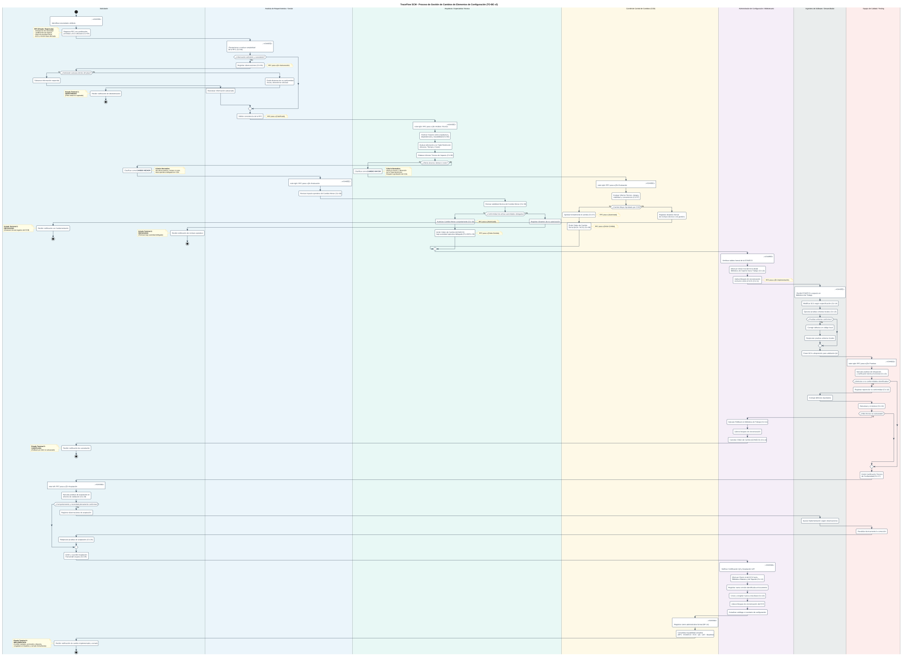

### Paquetes Arquitecturales (`DG-04`) y Contexto de Análisis (`DG-SAD-A01`, `DG-SAD-A02`)
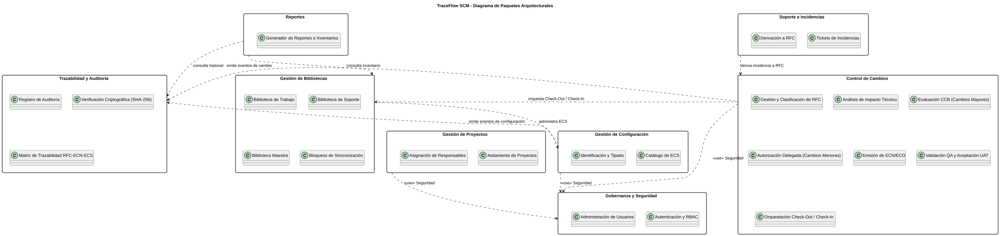

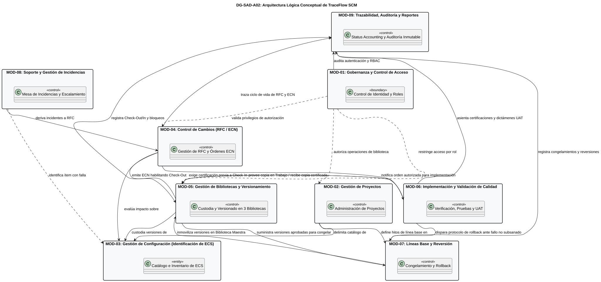

## 7. Arquitectura Física (`DG-D01`)
Topología cliente-servidor de tres planos: navegador web ejecutando el bundle React SPA → Proxy inverso Nginx / API REST NestJS sobre Node.js 24 LTS → PostgreSQL 17 (Supabase) + adaptador `StoragePort`.

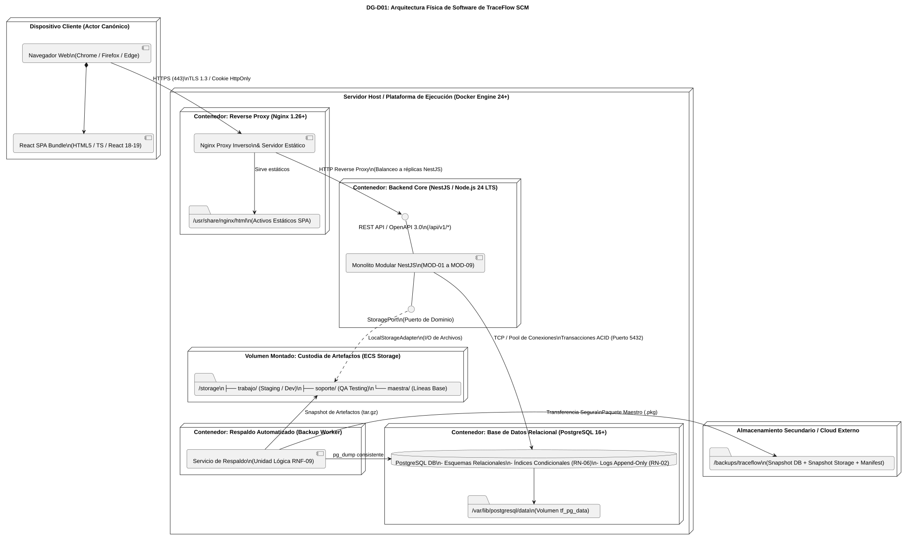

## 8. Arquitectura de Despliegue (`DG-D06`)
- **Diseño objetivo contenerizado (`ADR-010`):** Contenedores separados para Nginx (SPA estática), réplicas NestJS, PostgreSQL y almacenamiento compatible S3/local.
- **Despliegue vigente en desarrollo/nube:** Frontend Vite (`http://localhost:5173`), Backend NestJS (`http://localhost:3001/api/v1`) y Base de Datos administrada Supabase PostgreSQL 17.12 (`xmyfqxlvveiawnxgydtz`, AWS `us-west-2`, accesible por conexión directa IPv6 o Session Pooler IPv4 `aws-1-us-west-2.pooler.supabase.com:5432`).

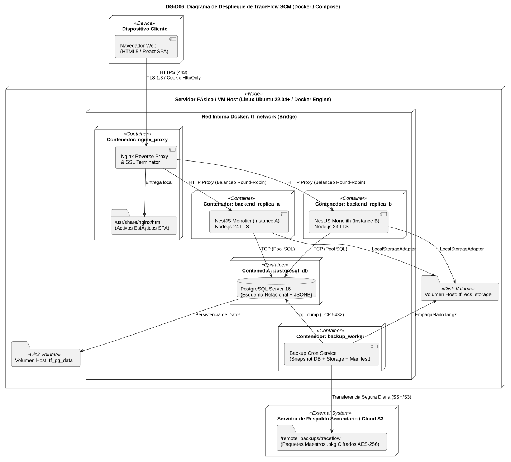

## 9. Arquitectura de Componentes (`DG-D02`)
Monolito Modular (`ADR-001`, `ADR-003`) donde cada módulo encapsula Controlador, Servicio, Repositorio/Puerto y DTOs validados.

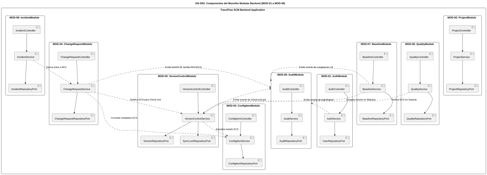

## 10. Módulos y Responsabilidades (`MOD-01` a `MOD-09`)

| Módulo | Responsabilidad principal | Casos de uso | Estado actual en código |
|---|---|---|---|
| **MOD-01** Autenticación, Usuarios y RBAC | Login Argon2id, sesiones opacas, roles `PU-01..07` | `CU-01` | **Operativo** (`AuthModule`, falta CRUD UI de usuarios) |
| **MOD-02** Gestión de Proyectos | Catálogo de proyectos y aislamiento multitenant | `CU-02`, `CU-03` | **Operativo lectura** (`ProjectsModule`, falta CRUD UI) |
| **MOD-03** Catálogo de ECS | Registro y clasificación de Elementos de Configuración | `CU-09` | Lectura parcial vía `Projects`/`Rfcs` + `ecsService` mock |
| **MOD-04** Control de Cambios (RFC/CCB/ECN) | Registro, admisión, subsanación, impacto, Doble Llave, CCB, ECN | `CU-04`, `04.1`, `05..08`, `30` | `CU-04` real (`RfcsModule`); `CU-05/04.1/06/30/07` simulados en UI |
| **MOD-05** Administración SCM Core | Check-Out, Check-In, `sync_lock`, `StoragePort`, Líneas Base, Rollback | `CU-10..14`, `20..22`, `26` | Tablas y triggers desplegados; lógica backend/UI pendiente |
| **MOD-06** Calidad, Pruebas y UAT | Pruebas integración, Certificación QA (`PU-07`), Aceptación UAT (`PU-01`) | `CU-15..19`, `29` | Tablas desplegadas; endpoints y vistas en placeholder |
| **MOD-07** Auditoría e Integridad | Bitácora SHA-256 append-only e inspección de cadena | `CU-27` | **Operativo base** (`AuditModule` + `append_audit_log()`); falta visor UI |
| **MOD-08** Incidencias y Soporte | Tickets de falla y derivación a RFC | `CU-23..25` | Tabla `incident_ticket` desplegada; endpoints/UI pendientes |
| **MOD-09** Reportería y Tableros | Dashboards adaptativos por rol e informes de estado | `CU-28` | `DashboardView.tsx` operativo; generador de reportes en placeholder |
| **MOD-10 (Nuevo)** Organizaciones y Membresías | Tenant raíz institucional, políticas corporativas y membresía (DA-02, DA-06) | `CU-31` | Diseñado en `INIT-H01` (`ADR-011`) |
| **MOD-11 (Nuevo)** Integración GitHub | Vinculación/Creación de repositorios, webhooks HMAC-SHA256, tokens AES-256 (DA-03, DA-04) | `CU-33` | Diseñado en `INIT-H01` (`ADR-011`) |

## 11. Modelo de Dominio (`DG-12`)
*(Resolución `DOC-030` en DOC-03.1: `analisis/DG-12.svg` queda establecido como el único `DG-12` canónico; el diagrama histórico de clases se preserva reclasificado como [`DG-12-HIST`](assets/diagramas/render/generales/DG-12-HIST.svg)).*

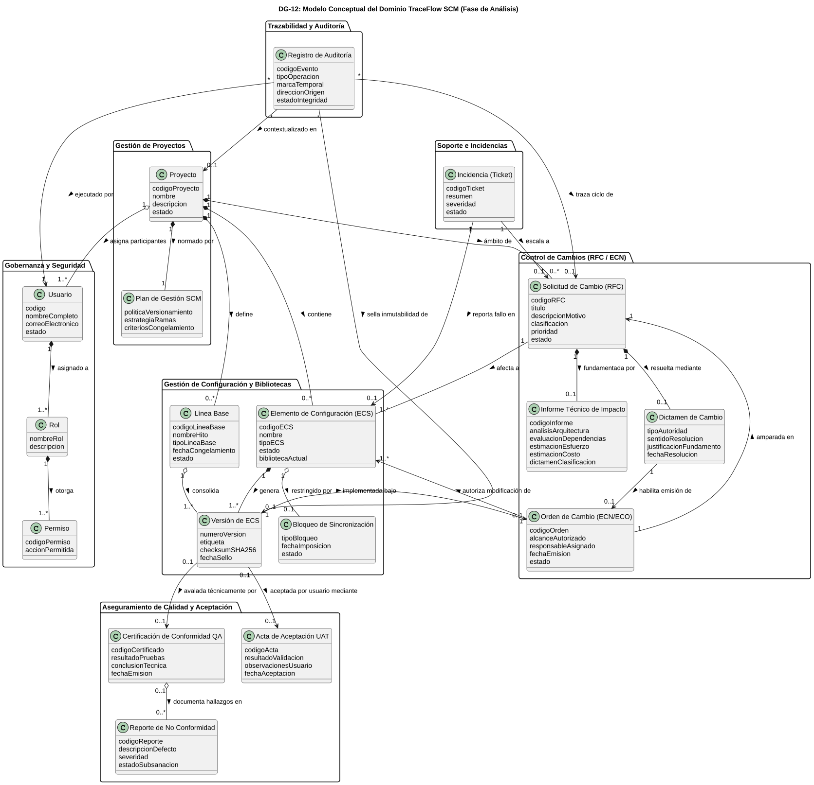

## 12. Modelo de Datos (`DICCIONARIO_DATOS.md`)
Consta de **21 tablas** en el esquema privado `traceflow`, verificadas en PostgreSQL 17.12.
- **Modelo Físico Vigente (`DG-ER-ACTUAL`):**
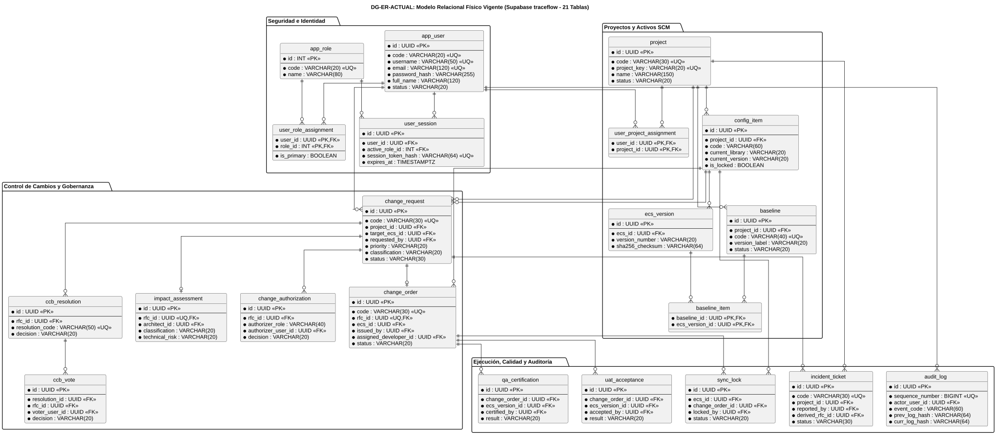
- **Modelo Objetivo en Español (`DG-ER-OBJETIVO`):** *(Propuesta para `REF-01.5`, aún NO desplegada en Supabase)*
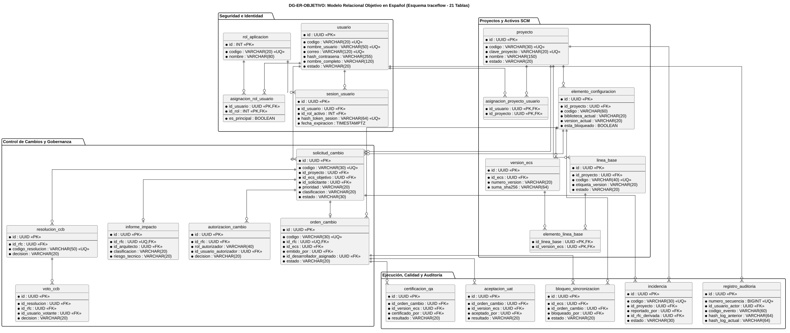

## 13. Contratos de Comunicación (`/api/v1`) y Navegación UI
- **Protocolo (`ADR-009`):** RESTful JSON bajo prefijo global `/api/v1` con `ValidationPipe` estricto (`whitelist`, `forbidNonWhitelisted`).
- **Rutas operativas actuales:** `/api/v1/health`, `/api/v1/auth/{login,me,logout}`, `/api/v1/projects{,/:id}`, `/api/v1/rfcs{,/:id}`.
- **Contratos diseñados para próximos hitos:** `/api/v1/rfcs/:id/{classify,rectification,impact-assessment,minor-approval,ccb-votes}`, `/api/v1/change-orders/*`, `/api/v1/scm/*` (ver `contracts.ts` y `ESTANDAR_PROGRAMACION.md` §6).
- **Navegación SPA (`DG-UWE-NAV-01`):**
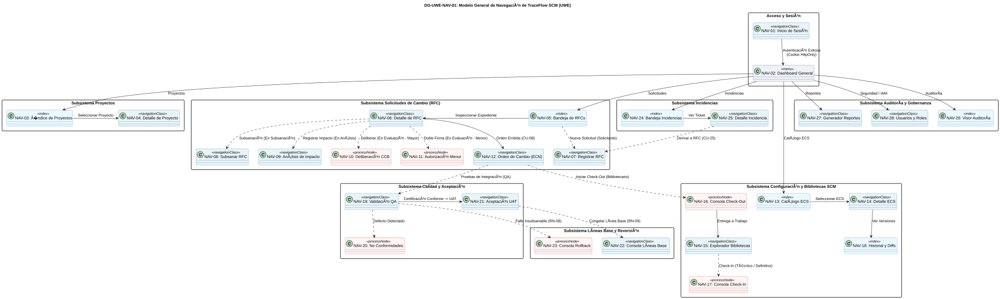

## 14. Seguridad (`DG-D05`)
- **Transporte:** TLS 1.3 obligatorio hacia Supabase con CA `prod-ca-2021.crt` (`rejectUnauthorized: true`).
- **Credenciales:** Derivación Argon2id (`memoryCost: 65536`, `timeCost: 3`, `parallelism: 4`).
- **Defensa perimetral:** CORS restringido a `CORS_ORIGIN`, cookie `HttpOnly` + cabecera `X-Requested-With`, consultas SQL 100% parametrizadas y `HttpExceptionFilter` sin fugas de stack o SQL.

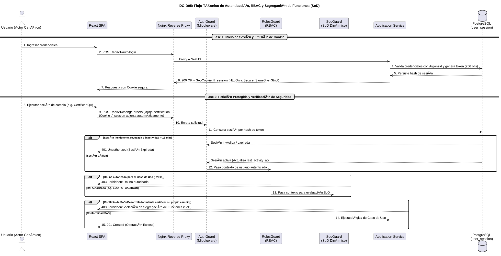

## 15. Identidades y Sesiones (`ADR-006`)
- Token aleatorio opaco de 256 bits entregado vía cookie `tf_session` (`HttpOnly`, `SameSite=Lax/Strict`), almacenado únicamente como hash SHA-256 en `traceflow.user_session`.
- Ventana de expiración por inactividad de **15 minutos** (`SESSION_TTL_MINUTES=15`) y revocación inmediata en `/auth/logout`.
- **Rol efectivo único por sesión:** Un usuario multi-rol (ej. `USR-001` con `PU-02` y `PU-01`) selecciona exactamente un rol efectivo al iniciar sesión.

## 16. RBAC y Segregación de Funciones (SoD)
- **Política Default-Deny:** Todo endpoint y ruta privada exige `AuthGuard` + `RolesGuard` / `RoleGuard`.
- **Invariantes SoD reforzadas en PostgreSQL (`SEC-04`, `SEC-05`):**
  1. `SoD-01`: El solicitante (`requested_by`) tiene prohibido evaluar impacto (`trg_enforce_impact_assessment_sod`), emitir doble llave (`trg_enforce_double_key_segregation`) o votar en CCB (`trg_enforce_ccb_vote_sod`) sobre su propia RFC.
  2. `CU-30 Doble Llave`: Dos autorizaciones únicas (`PU-02` Gestor + `PU-03` Arquitecto) ejecutadas por dos `authorizer_user_id` físicamente distintos.
  3. `SoD-05`: Voto CCB único e irrevocable por votante (`uq_ccb_vote_per_member` + `trg_ccb_vote_immutable`).
  4. Incompatibilidad Dev (`PU-06`) vs QA (`PU-07`) en certificación de calidad.

## 17. Aislamiento de Proyectos (Multitenancy)
- Toda consulta de proyectos o RFC filtra por `user_project_assignment` (`USR-004` aislado de `PRJ-003`).
- A nivel físico en PostgreSQL, la clave foránea compuesta `fk_rfc_target_ecs_same_project (target_ecs_id, project_id)` impide asociar un ECS de otro proyecto a una solicitud.

## 18. Máquinas de Estados (`DG-11` / `TB-07`)
La RFC transita por **14 estados oficiales**: `REGISTRADA`, `EN_SUBSANACION`, `CLASIFICADA`, `EN_ANALISIS_TECNICO`, `EN_EVALUACION`, `AUTORIZADA`, `ORDEN_EMITIDA`, `EN_IMPLEMENTACION`, `EN_PRUEBAS`, `EN_ACEPTACION` y 4 estados terminales (`DESESTIMADA`, `RECHAZADA`, `CANCELADA`, `IMPLEMENTADA`).

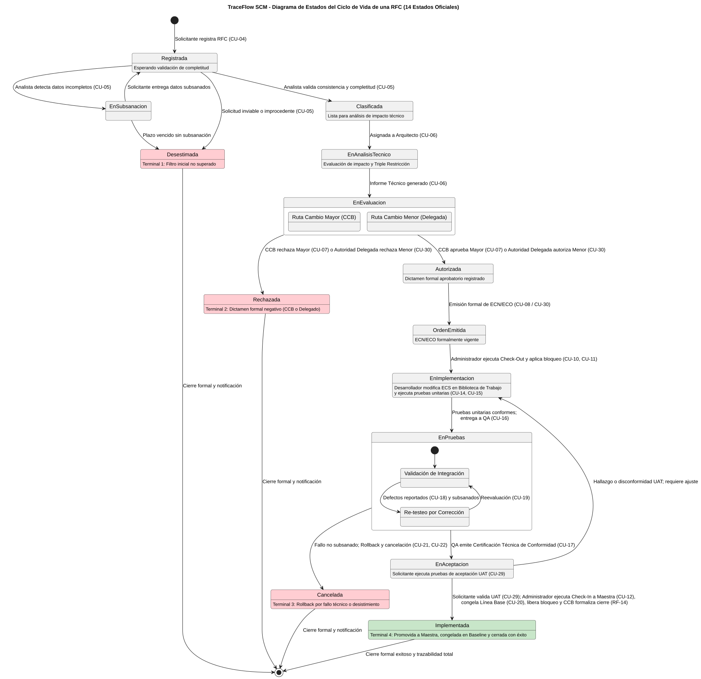

## 19. Gestión de Configuración y Bibliotecas (`DG-D04`)
El puerto `StoragePort` (`ADR-005`) desacopla los metadatos relacionales del almacenamiento de artefactos en tres bibliotecas: **Trabajo (`TRABAJO`)**, **Soporte (`SOPORTE`)** y **Maestra (`MAESTRA`)**.

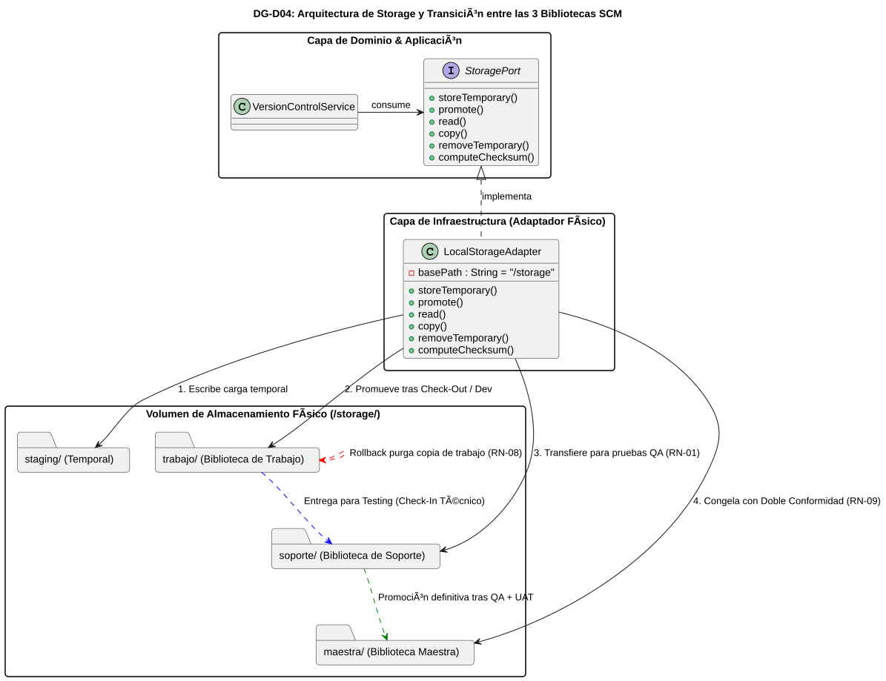

## 20. Versionamiento, Bloqueos y Líneas Base (`DG-DSEQ-10`, `DG-DSEQ-20`)
- **Bloqueo exclusivo (`RN-06`):** Índice parcial `uq_active_sync_lock_per_ecs ON sync_lock(ecs_id) WHERE status = 'ACTIVE'` y trigger `trg_sync_lock_no_delete`.
- **Inmutabilidad (`RN-02`):** Triggers `trg_ecs_version_immutable`, `trg_baseline_frozen_guard` y `trg_baseline_item_frozen_guard`.

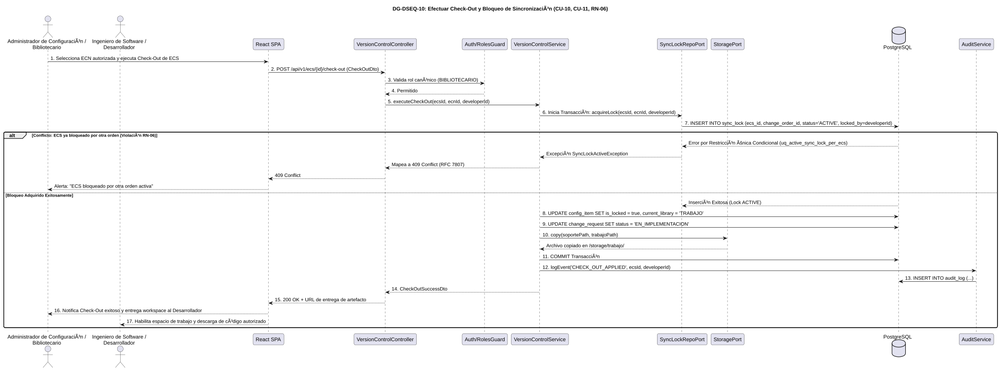
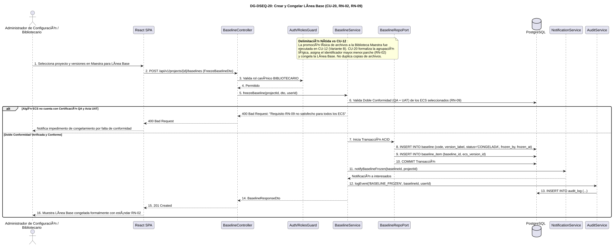

## 21. Auditoría e Integridad (`ADR-008`)
- Función `SECURITY DEFINER` `append_audit_log()` serializada mediante `pg_advisory_xact_lock(74291)` calculando `curr_log_hash = SHA256(prev_log_hash + payload)`.
- Protegida por `REVOKE UPDATE, DELETE, TRUNCATE` y trigger `trg_audit_log_immutable`.

## 22. Manejo de Errores
- Backend: `HttpExceptionFilter` centralizado + excepciones explícitas NestJS (`400`, `401`, `403`, `404`, `409`).
- Frontend: `TraceFlowApiError` tipado y manejo de estados de error por vista sin degradar a datos mock.

## 23. Estrategia de Pruebas
1. **Unitarias / Memoria:** Backend Vitest con `DatabaseService('mock')` (`20/20`) y Frontend (`9` suites, `97/97` casos).
2. **Integración Física PostgreSQL (`DB-T01`..`DB-T14`):** Validación real de TLS, concurrencia de `sync_lock`, cadena SHA-256, SoD y mínimo privilegio.
3. **Flujo Vertical HTTP y E2E Playwright (`INT-T01`..`INT-T18`):** Certificación de navegación, cookies `HttpOnly`, creación y persistencia real sin mocks.

## 24. Disponibilidad y Recuperación (`ADR-010`)
Metas de diseño: respaldos diarios automatizados de PostgreSQL/storage (`RPO <= 24h`, `RTO <= 2h`) y protocolo de rollback controlado de ECS ante fallos en QA/UAT (`CU-21`, `DG-DSEQ-21`).

## 25. Decisiones Arquitectónicas (`ADR-001` a `ADR-011`)
Todas aprobadas el `2026-10-01` en [`docs/adr/`](adr/README.md) y `ADR-011` propuesto en `2026-11-25`:
`ADR-001` (Monolito Modular), `ADR-002` (React SPA), `ADR-003` (NestJS/Node 24), `ADR-004` (PostgreSQL), `ADR-005` (`StoragePort` + 3 Bibliotecas), `ADR-006` (Sesiones Opacas `HttpOnly`; Keycloak diferido), `ADR-007` (Bloqueo Exclusivo en BD), `ADR-008` (Auditoría Append-Only SHA-256), `ADR-009` (API REST JSON/OpenAPI), `ADR-010` (Docker & Continuidad), `ADR-011` (Inicialización, Gobernanza GitHub y Salvaguardas SCM).

## 26. Trazabilidad con Requerimientos
La trazabilidad bidireccional completa entre `RF-01`..`RF-18`, `RNF-01`..`RNF-09`, `RN-01`..`RN-09`, `CU-01`..`CU-30`/`CU-04.1`, módulos, tablas actuales/objetivo, endpoints y pruebas se mantiene en [`MATRIZ_TRAZABILIDAD.md`](MATRIZ_TRAZABILIDAD.md).

## 27. Preservación de Modelos Técnicos de Análisis y Diseño (Traslado desde SRS)
Para mantener [`FD03-EPIS-Informe_SRS.md`](FD03-EPIS-Informe_SRS.md) estrictamente enfocado en requisitos funcionales comprensibles para el cliente, todo el detalle de modelado técnico de análisis y diseño se preserva centralizado aquí y en sus entregables técnicos fuente:
- **31 Diagramas de Secuencia de Análisis (`DG-SEQ-01`..`DG-SEQ-30` y `DG-SEQ-04.1`):** Fuentes PlantUML en [`DIAGRAMS.md`](DIAGRAMS.md) y renders vectoriales/rasterizados en [`docs/assets/diagramas/render/analisis/`](assets/diagramas/MANIFEST.md#3-catálogo-detallado-modelos-de-análisis-y-casos-de-uso-72-diagramas).
- **31 Diagramas de Análisis de Objetos BCE (`DG-AO-01`..`DG-AO-30` y `DG-AO-04.1`):** Matriz BCE consolidada en [`FD04-EPIS-Informe_SAD_Analisis.md`](FD04-EPIS-Informe_SAD_Analisis.md#45-modelo-de-análisis-de-objetos-patrón-bce-para-los-31-casos-de-uso) y compendio gráfico en [`DIAGRAMS.md`](DIAGRAMS.md).
- **Secuencias Técnicas de Diseño (`DG-DSEQ-04, 08, 10, 12, 17, 20, 21, 29, 30`) y Vistas UWE:** Preservadas en [`FD05-EPIS-Informe_SAD_Diseno.md`](FD05-EPIS-Informe_SAD_Diseno.md) y [`MANIFEST.md`](assets/diagramas/MANIFEST.md).
- **Antecedente Histórico `DG-13` (DOC-025):** Declarado obsoleto para el análisis en [`FD04-EPIS-Informe_SAD_Analisis.md`](FD04-EPIS-Informe_SAD_Analisis.md#132-dictamen-formal-de-obsolescencia-de-dg-13-para-la-fase-de-análisis) por contener tecnologías prematuras; sustituido por `DG-SAD-A01`, `DG-SAD-A02` y `DG-12`.
- **Consolidación RBAC e Identidad (`docs/refactor/`):** Las matrices técnicas [`IDENTITY_AND_ROLES.md`](refactor/IDENTITY_AND_ROLES.md), [`RBAC_ACCESS_MATRIX.md`](refactor/RBAC_ACCESS_MATRIX.md) y [`ROLE_NAVIGATION_MATRIX.md`](refactor/ROLE_NAVIGATION_MATRIX.md) complementan las secciones §15–§17 del presente SAD mientras concluye su integración definitiva en el SAD.

## 28. Estado Vigente vs Arquitectura Objetivo y Normalización
- **Ya implementado en producción/desarrollo:** Infraestructura de 21 tablas y triggers en PostgreSQL 17.12, autenticación/sesiones opacas, `ProjectsModule` (lectura), `RfcsModule` (`CU-04`), `AuditModule` base, SPA React conectada en modo `api` para flujo `CU-01`/`CU-03`/`CU-04`.
- **Diseñado y simulado en prototipo (próximo hito `SCM-01`):** `CU-05`, `CU-04.1` y `CU-06` (seguidos por `CU-30` y `CU-07`).
- **Diseñado pendiente de implementación (`SCM-02+`):** `CU-08`..`CU-26`, `CU-28`, `CU-29`, adaptador `StoragePort` físico y UI de las 12 pantallas en placeholder.
- **Propuesta de normalización (`REF-01`):** La traducción al español de código, rutas y tablas (`DG-ER-OBJETIVO`) es una **arquitectura objetivo documental pendiente de aprobación** conforme a [`PLAN_REFACTORIZACION.md`](PLAN_REFACTORIZACION.md); **no ha sido desplegada aún en Supabase ni en código fuente**.

## 29. Inicialización de Proyectos, Gobernanza GitHub y Salvaguardas SCM (INIT-H01-R)
Diseño técnico formal consolidado en [`docs/PLAN_INICIALIZACION_PROYECTOS.md`](PLAN_INICIALIZACION_PROYECTOS.md) y [`docs/adr/ADR-011.md`](adr/ADR-011.md) (subsanación arquitectónica `INIT-H01-R`):
- **Gobernanza Multitenant e Integridad (`DA-01`, `DA-02`, `DA-06`):** Entidades `organization` y `organization_member`, membresía activa obligatoria para incorporación a proyectos (`RN-10`, `RN-11`) blindada mediante disparador PL/pgSQL `enforce_project_member_organization_integrity`. Se suprime el estado no admitido `INVITED`.
- **Modelo Canónico de Estados:** Máquina de 8 estados en español (`BORRADOR`, `EN_CONFIGURACION`, `PENDIENTE_VALIDACION`, `ACTIVO`, `SUSPENDIDO`, `CERRADO`, `ARCHIVADO`, `HISTORICO_PENDIENTE_GITHUB`) con matriz de transiciones permitidas y capa de normalización retroactiva para compatibilidad DTO.
- **Asistente Híbrido 5 Pasos (`DA-05`, `RN-14`):** Entidad `project_setup` con `draft_payload JSONB` para autosave sin alterar restricciones relacionales (`DG-INIT-05`) y Panel de Configuración Posterior.
- **Integración GitHub Segura (`DA-03`, `DA-04`):** Soporte de vinculación y creación de repositorios (`DG-INIT-07`, `DG-INIT-08`), tokens de instalación generados bajo demanda en memoria vía JWT RS256 (sin almacenamiento en BD), webhooks HMAC-SHA256 con tiempo constante (`crypto.timingSafeEqual`) y tabla idempotente `github_event` (`X-GitHub-Delivery`).
- **Salvaguarda Operacional SCM (`DA-04`, `RN-12`, `RN-13`):** El guardián `ProjectActiveGuard` bloquea formalmente (HTTP 412) todo registro de RFC u operación en bibliotecas en proyectos que no cuenten con GitHub validado y estado `ACTIVO` (`DG-INIT-09`).
- **Regularización Estricta de Proyectos Históricos:** Vinculación individual y explícita por el Gestor (`PU-02`) de cada proyecto cliente (`PRJ-001`..`003`) a su propio repositorio dedicado en GitHub, prohibiendo cualquier asociación a `TraceFlow.git` y sin alteración masiva de datos.
- **Mínimo Privilegio e Integridad Referencial:** Revocación del privilegio `DELETE` a `traceflow_app` (solo `SELECT, INSERT, UPDATE`), y uso de `ON DELETE RESTRICT` sobre entidades hijas para garantizar custodia e inmutabilidad probatoria.
- **Hoja de Ruta en 5 Hitos (`INIT-H02` a `INIT-H06`):** Desglose secuencial con 25 pruebas TDD mapeadas exhaustivamente.
- **Compendio Gráfico Canónico:** 10 modelos canónicos compilados `DG-INIT-01` a `DG-INIT-10` en [`docs/assets/diagramas/render/diseno/`](assets/diagramas/MANIFEST.md).

---

*SAD Final Consolidado de TraceFlow SCM — Etapa DOC-02.6 / INIT-H01-R — C-SharkTeam / ÉXODO S.A.C.*
