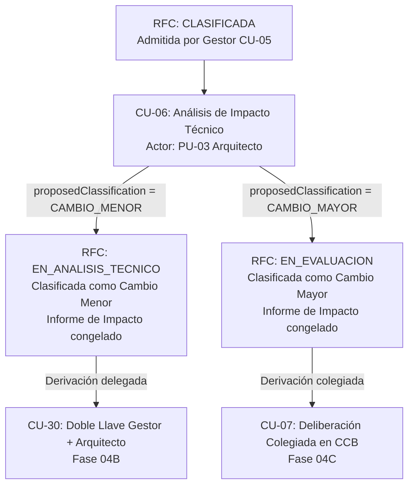

# TraceFlow SCM — Especificación Normativa del Análisis de Impacto Técnico (CU-06)

## 1. Identificación y Trazabilidad Normativa

El caso de uso **CU-06: Realizar Análisis de Impacto Técnico** constituye el eslabón técnico fundamental dentro del ciclo de vida de control de cambios de TraceFlow SCM. Garantiza que ninguna solicitud de cambio sea sometida a deliberación de aprobación (sea delegada o colegiada) sin una fundamentación técnica objetiva de viabilidad, riesgo y afectación arquitectónica.

* **Caso de Uso:** `CU-06` (Catálogo SRS `TB-10`).
* **Requisito Funcional:** `RF-05` — *Clasificación y Análisis de Impacto de la Solicitud*.
* **Regla de Negocio Normativa:** `RN-05` — *Evaluación Técnica Obligatoria y Clasificación*.
* **Actor Principal:** `PU-03` — *Arquitecto / Especialista Técnico* (SRS `TB-09`, SAD Sección 3.4.3).
* **Artefacto Producido:** `Informe Técnico de Impacto` (Entidad de Dominio / BCE `DG-AO-06`).
* **Diagrama de Secuencia:** `DG-SEQ-06` (Análisis Conceptual UWE).
* **Estados Involucrados (TB-07 / DG-11):** `CLASIFICADA`, `EN_ANALISIS_TECNICO`, `EN_EVALUACION`.

---

## 2. Precondiciones Normativas

Para que un expediente RFC sea admitido para la ejecución del análisis de impacto técnico, deben cumplirse rigurosamente las siguientes precondiciones:

1. **Estado Canónico Requerido:** La solicitud debe encontrarse en estado `CLASIFICADA` (tras superar la admisión formal del Gestor mediante `CU-05`) o en `EN_ANALISIS_TECNICO` (expediente formalmente asignado para evaluación técnica). No es admisible evaluar solicitudes en estado `REGISTRADA` (sin admisión) ni en `EN_SUBSANACION`.
2. **Actor Autorizado:** El operador debe estar autenticado con el rol canónico efectivo **`PU-03` (Arquitecto / Especialista Técnico)**.
3. **Pertenencia al Proyecto (Multitenancy):** El usuario debe poseer el identificador del proyecto de la RFC dentro de su lista de proyectos autorizados (`user.assignedProjectIds.includes(rfc.projectId)`).
4. **Segregación de Propiedad (SoD Antiautoevaluación):** Aunque el arquitecto posea asignado el rol de Solicitante (`PU-01`) en su cuenta corporativa, **no puede evaluar técnicamente una solicitud de cambio registrada por él mismo** (`rfc.requesterId !== user.id`).

---

## 3. Entradas Requeridas

El Arquitecto toma como base el expediente formal consolidado en las fases previas:
* **Entradas del Solicitante (`CU-04`):**
  * Título y descripción detallada del problema/necesidad.
  * Justificación operativa y de negocio.
  * Solución técnica propuesta preliminar.
  * Prioridad sugerida (`BAJA`, `MEDIA`, `ALTA`, `CRITICA`).
  * Categoría de cambio (`CORRECTIVO`, `ADAPTATIVO`, `PERFECTIVO`).
  * Elemento de Configuración de Software (ECS) primario afectado sugerido.
  * Archivos o especificaciones adjuntas.
* **Entradas del Gestor (`CU-05`):**
  * Dictamen de admisión formal.
  * Notas y observaciones preliminares del Analista de Requerimientos.
  * Fecha y firma de admisión.

---

## 4. Estructura del Informe Técnico de Impacto (Entregables Obligatorios)

Conforme a `RN-05` y `RF-05`, el análisis técnico debe modelar de forma exhaustiva los siguientes componentes:

### 4.1. Estimaciones de Triple Restricción
* **Esfuerzo Técnico Estimado:** Horas-hombre requeridas para el desarrollo, pruebas e integración (`effortHours > 0`).
* **Costo Financiero Estimado:** Presupuesto proyectado en moneda institucional (S/.) (`estimatedCost >= 0`).
* **Impacto en Cronograma:** Días hábiles o calendario adicionales que el cambio añade a la ruta crítica del proyecto (`scheduleImpactDays >= 0`).

### 4.2. Análisis Arquitectónico y Dependencias de ECS
* **ECS Directamente Afectados:** Selección de los Elementos de Configuración que sufrirán modificaciones en código, documentación o base de datos.
* **ECS Dependientes / Dependencias Cruzadas:** Identificación de módulos, librerías, interfaces API o bases de datos aguas arriba y aguas abajo que podrían verse impactados por efectos colaterales (análisis de regresión).
* **Resumen y Fundamentación Técnica:** Justificación técnica de ingeniería de software que valida la viabilidad de la arquitectura propuesta (mínimo 15 caracteres).

### 4.3. Gestión de Riesgos y Rollback
* **Riesgos Técnicos Identificados:** Inventario estructurado de riesgos potenciales (ej. degradación de rendimiento, incompatibilidad de versiones, brechas de seguridad, concurrencia, bloqueo de esquemas de datos).
* **Plan Preliminar de Rollback / Contingencia:** Estrategia técnica de retroceso en caso de fallo durante el despliegue o la validación en QA.

---

## 5. Dictamen Técnico y Bifurcación del Ciclo de Vida

El informe técnico culmina con un dictamen profesional emitido por el Arquitecto que determina el destino del cambio:

### 5.1. Recomendación Técnica
1. **`PROCEDE_MENOR`:** El cambio es técnicamente viable, su alcance es acotado, no impacta la línea base arquitectónica global ni compromete la seguridad estructural. Cumple los umbrales para ser tramitado de forma delegada.
2. **`PROCEDE_MAYOR`:** El cambio es viable pero introduce modificaciones sustanciales en contratos de API, esquema de base de datos, seguridad, costos elevados o retraso en cronograma crítico. Requiere deliberación colegiada del CCB.
3. **`RECHAZO_TECNICO`:** El cambio no es factible técnicamente, viola restricciones arquitectónicas institucionales o introduce riesgos inaceptables.

### 5.2. Clasificación Técnica y Transición en Máquina de Estados (DG-11)

* **Ruta de Cambio Menor:**
  * Clasificación asignada: `CAMBIO_MENOR`.
  * Estado: La solicitud queda en `EN_ANALISIS_TECNICO` con el informe de impacto adjunto y la clasificación asignada.
  * Destino posterior: Queda habilitada para el flujo de autorización por **Doble Llave Delegada (CU-30)** entre Gestor (`PU-02`) y Arquitecto (`PU-03`).
  * **Regla estricta:** El análisis NO aprueba automáticamente el cambio ni emite la ECN en esta fase.

* **Ruta de Cambio Mayor:**
  * Clasificación asignada: `CAMBIO_MAYOR`.
  * Estado: Transiciona canónicamente a **`EN_EVALUACION`**.
  * Destino posterior: Queda en la bandeja del **Comité de Control de Cambios (`PU-04` / CCB)** para deliberación formal mediante `CU-07`.

---

## 6. Reglas de Segregación de Funciones (SoD) e Integridad

1. **No Auto-Aprobación Unilateral (RN-01, RN-05):** El Arquitecto tiene potestad para emitir el dictamen técnico y clasificar la solicitud, pero carece de facultad para autorizar unilateralmente el inicio de la implementación. Todo cambio requiere autorización formal (CU-30 para menores, CU-07 para mayores).
2. **Inmutabilidad del Dictamen:** Una vez registrado y firmado por el Arquitecto, el `TechnicalImpactReport` queda congelado. No puede ser sobreescrito ni manipulado; cualquier variación posterior requiere una re-evaluación formal.
3. **Trazabilidad en Bitácora:** La emisión del informe genera un evento en la bitácora de auditoría demostrativa con la acción `RFC_ANALISIS_TECNICO_REGISTRADO`, identificador del arquitecto, fecha y métricas de impacto calculadas.
