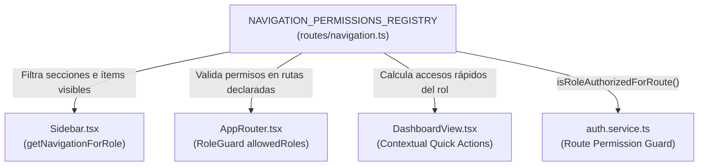

# Matriz de Navegación Contextual por Perfil Canónico — TraceFlow SCM

> **Documento:** `docs/refactor/ROLE_NAVIGATION_MATRIX.md`  
> **Fase:** 03 — Navegación Contextual por Perfil  
> **Basado en:** `FD03-EPIS-Informe_SRS.md` (TB-06, TB-09, TB-10, TB-14), `FD04-EPIS-Informe_SAD.md` (Secciones 3.4, 4.2), `FD05-EPIS-Informe_Manual.md`  
> **Estado:** APROBADO COMO BASELINE DE REFACTORIZACIÓN  

---

## 1. Introducción y Marco Normativo

El presente documento formaliza la **fuente única de verdad (SSOT)** para la navegación y visibilidad del sistema TraceFlow SCM. 

El modelo anterior desplegaba la totalidad de los módulos del sistema en un único menú monolítico organizado por paquetes arquitecturales (`DG-04`), obligando al usuario a ver pantallas y herramientas que no correspondían a su rol o a recibir errores de acceso denegado tras hacer clic.

En esta fase se establece que **la interfaz de navegación se construye dinámicamente** en función de:
1. La **Identidad del Usuario** (`UserAccount`): determina los proyectos autorizados (`assignedProjectIds`).
2. El **Rol Efectivo en Sesión** (`CanonicalRoleId`): determina los módulos, opciones de menú, accesos directos y operaciones autorizadas según la matriz de Segregación de Funciones (SoD).

---

## 2. Matriz Integral de Navegación y Permisos por Perfil Canónico

| Rol Canónico | Módulos Permitidos | Rutas Disponibles | Acciones Autorizadas | Proyectos Visibles | Estado Implementación | Justificación Documental |
| :--- | :--- | :--- | :--- | :--- | :--- | :--- |
| **PU-01** `SOLICITANTE` *(Solicitante / Usuario Final)* | • General • Control de Cambios • Soporte e Incidencias | • `/dashboard` • `/rfcs` • `/rfcs/new` • `/rfcs/:id` • `/rfcs/:id/edit` • `/rfcs/:id/uat` • `/incidents` • `/incidents/:id` | • `REGISTRAR_RFC` • `SUBSANAR_RFC` • `SUSCRIBIR_UAT` • `REGISTRAR_INCIDENCIA` • Consultar expediente propio | Proyectos asignados a su cuenta (`assignedProjectIds`) | • `/dashboard`: **Implementado** • `/rfcs`: **Implementado** • `/rfcs/new`: **Implementado** • `/rfcs/:id`: **Implementado** • `/rfcs/:id/edit`: **Implementado** • `/rfcs/:id/uat`: *Provisional* • `/incidents`: *Provisional* | SRS TB-09 (PU-01), TB-10 (CU-04, CU-04.1, CU-23, CU-29), TB-06 (RN-09 UAT), SAD 3.4.1. |
| **PU-02** `GESTOR` *(Analista de Requerimientos / Gestor)* | • General • Gestión de Proyectos • Control de Cambios • Soporte e Incidencias • Trazabilidad y Reportes | • `/dashboard` • `/projects` • `/projects/:id` • `/rfcs` • `/rfcs/:id` • `/rfcs/:id/minor-approval` • `/ecns` • `/ecns/:id` • `/incidents` • `/incidents/:id` • `/audit` • `/reports` | • `VALIDAR_CLASIFICAR_RFC` • `AUTORIZAR_CAMBIO_MENOR` (con PU-03) • `GESTIONAR_PROYECTOS` • `DERIVAR_INCIDENCIA` • Consultar auditoría y reportes | Proyectos asignados a su cuenta (`assignedProjectIds`) | • `/dashboard`: **Implementado** • `/rfcs`: **Implementado** • `/rfcs/:id`: **Implementado** (Consola Gestor) • `/projects`: *Provisional* • `/rfcs/:id/minor-approval`: *Provisional* • `/ecns`: *Provisional* • `/audit`: *Provisional* • `/reports`: *Provisional* | SRS TB-09 (PU-02), TB-10 (CU-02, CU-03, CU-05, CU-24, CU-25, CU-30), TB-06 (RN-05, RN-07), SAD 3.4.2. |
| **PU-03** `ARQUITECTO` *(Arquitecto / Especialista Técnico)* | • General • Gestión de Proyectos • Control de Cambios • Gestión de Configuración (ECS) | • `/dashboard` • `/projects` • `/projects/:id` • `/rfcs` • `/rfcs/:id` • `/rfcs/:id/impact-analysis` • `/rfcs/:id/minor-approval` • `/ecs` • `/ecs/:id` • `/ecs/:id/history` | • `ANALIZAR_IMPACTO` • `AUTORIZAR_CAMBIO_MENOR` (con PU-02) • Registrar / clasificar ECS • Inspeccionar historial y diff | Proyectos asignados a su cuenta (`assignedProjectIds`) | • `/dashboard`: **Implementado** • `/rfcs`: **Implementado** • `/rfcs/:id`: **Implementado** • `/rfcs/:id/impact-analysis`: *Provisional* • `/rfcs/:id/minor-approval`: *Provisional* • `/ecs`: *Provisional* • `/ecs/:id/history`: *Provisional* | SRS TB-09 (PU-03), TB-10 (CU-06, CU-09, CU-13, CU-30), TB-06 (RN-05), SAD 3.4.3. |
| **PU-04** `CCB` *(Comité de Control de Cambios)* | • General • Gestión de Proyectos • Control de Cambios • Trazabilidad y Reportes | • `/dashboard` • `/projects` • `/projects/:id` • `/rfcs` • `/rfcs/:id` • `/rfcs/:id/ccb-deliberation` • `/ecns` • `/ecns/:id` • `/audit` • `/reports` | • `EVALUAR_CCB` • `EMITIR_ECN` • `AUDITAR_SISTEMA` • Cierre formal de cambios mayores | Proyectos asignados a su cuenta (`assignedProjectIds`) | • `/dashboard`: **Implementado** • `/rfcs`: **Implementado** • `/rfcs/:id`: **Implementado** • `/rfcs/:id/ccb-deliberation`: *Provisional* • `/ecns`: *Provisional* • `/audit`: *Provisional* • `/reports`: *Provisional* | SRS TB-09 (PU-04), TB-10 (CU-07, CU-08, CU-27, CU-28), TB-06 (RN-01, RN-07), SAD 3.4.4. |
| **PU-05** `BIBLIOTECARIO` *(Administrador SCM / Bibliotecario)* | • General • Gestión de Proyectos • Control de Cambios (ECN) • Gestión de Configuración (ECS) • Gestión de Bibliotecas • Trazabilidad y Reportes • Administración y Seguridad | • `/dashboard` • `/projects` • `/projects/:id` • `/rfcs` • `/rfcs/:id` • `/ecns` • `/ecns/:id` • `/ecs` • `/ecs/:id` • `/ecs/:id/history` • `/scm/operations` • `/baselines` • `/audit` • `/reports` • `/admin/users` | • `CHECK_OUT` • `CHECK_IN` • `CONGELAR_BASELINE` • `EJECUTAR_ROLLBACK` • `GESTIONAR_USUARIOS` • `AUDITAR_SISTEMA` • Custodia criptográfica SHA-256 | Proyectos asignados a su cuenta (`assignedProjectIds`) | • `/dashboard`: **Implementado** • `/rfcs`: **Implementado** • `/rfcs/:id`: **Implementado** • `/scm/operations`: *Provisional* • `/baselines`: *Provisional* • `/admin/users`: *Provisional* • `/audit`: *Provisional* • `/reports`: *Provisional* | SRS TB-09 (PU-05), TB-10 (CU-01, CU-10..13, CU-20..22, CU-26..28), TB-06 (RN-02, RN-04, RN-06, RN-08), SAD 3.4.5. |
| **PU-06** `DESARROLLADOR` *(Ingeniero de Software / Desarrollador)* | • General • Control de Cambios (Órdenes ECN) • Gestión de Configuración (ECS) | • `/dashboard` • `/rfcs` • `/rfcs/:id` • `/ecns` • `/ecns/:id` • `/ecs` • `/ecs/:id` • `/ecs/:id/history` | • `IMPLEMENTAR_CAMBIO` • Consultar instrucciones técnicas en ECN • Trabajar en Biblioteca de Trabajo local • Prohibido Check-In directo a Maestra (`RN-04`) | Proyectos asignados a su cuenta (`assignedProjectIds`) | • `/dashboard`: **Implementado** • `/rfcs`: **Implementado** • `/rfcs/:id`: **Implementado** • `/ecns`: *Provisional* • `/ecs`: *Provisional* • `/ecs/:id/history`: *Provisional* | SRS TB-09 (PU-06), TB-10 (CU-14, CU-15), TB-06 (RN-04, RN-09), SAD 3.4.6. |
| **PU-07** `CALIDAD` *(Equipo de Calidad / Testing)* | • General • Control de Cambios (Validación QA) • Gestión de Configuración (ECS) | • `/dashboard` • `/rfcs` • `/rfcs/:id` • `/ecns` • `/ecns/:id` • `/qa/validation/:rfcId` • `/ecs` • `/ecs/:id` • `/ecs/:id/history` | • `VALIDACION_QA` • Pruebas en Biblioteca de Soporte • Emisión de Certificado de Conformidad • Registro de No Conformidades • Prohibido ser Desarrollador del cambio (`RN-09`) | Proyectos asignados a su cuenta (`assignedProjectIds`) | • `/dashboard`: **Implementado** • `/rfcs`: **Implementado** • `/rfcs/:id`: **Implementado** • `/qa/validation/:rfcId`: *Provisional* • `/ecns`: *Provisional* • `/ecs`: *Provisional* | SRS TB-09 (PU-07), TB-10 (CU-16..19, CU-22), TB-06 (RN-09), SAD 3.4.7. |

---

## 3. Análisis de Gobernanza: Asignación de Administración de Usuarios (`CU-01`)

### 3.1. Estado Normativo en la Documentación Oficial
En los sistemas de información empresariales genéricos, la administración de usuarios suele recaer en un perfil técnico denominado "Administrador de Sistemas" o "SuperAdmin". No obstante, en la especificación formal de TraceFlow SCM:
* **SRS Requerimiento Funcional RF-01:** "Gestión de Usuarios y Roles: El sistema debe permitir registrar usuarios y asignar los roles del flujo de cambios... restringiendo las acciones disponibles según el rol."
* **SRS Catálogo de Casos de Uso TB-10:** El caso de uso **`CU-01: Gestionar usuarios y roles`** (código analítico `CUS01`, diagrama `DG-SEQ-01` y `DG-AO-01`) está atribuido de manera unívoca al actor **`PU-05: Administrador de Configuración / Bibliotecario`**.
* **SRS Matriz de Perfiles TB-09:** El catálogo define exactamente siete perfiles canónicos (`PU-01` a `PU-07`). No existe un perfil de "SuperAdmin" ni "Administrador de TI" separado.

### 3.2. Discrepancia Documental Identificada
En la sección de observaciones de `docs/TABLES.md` (Incidencia 1), se identificó un párrafo residual proveniente de una plantilla académica externa que mencionaba roles ajenos a SCM ("mentores y tutorías universitarias"). La matriz normativa aprobada (`TB-10`, `TB-14`) prevalece sobre dicho texto explicativo y confirma que la gobernanza de usuarios y control de accesos pertenece a la competencia del Administrador SCM (`PU-05`).

### 3.3. Decisión Técnica de Implementación
* La ruta `/admin/users` y la sección de navegación "Administración y seguridad" se reservan **exclusivamente al perfil canónico `PU-05` (Bibliotecario)**.
* Los demás perfiles (`PU-01`, `PU-02`, `PU-03`, `PU-04`, `PU-06`, `PU-07`) **no visualizan** dicha opción en su menú lateral ni en sus accesos rápidos. Si intentan ingresar por URL directa, el guarda `RoleGuard` interceptará la petición presentando la vista amigable `AccessDeniedView`.

---

## 4. Arquitectura de Fuente Única de Verdad (SSOT)

Para erradicar la desincronización entre el menú lateral (`Sidebar.tsx`), el enrutador (`AppRouter.tsx`), las guardas (`RoleGuard.tsx`) y los servicios de negocio (`auth.service.ts`), se define la estructura unificada en `prototype/src/routes/navigation.ts`:

### Principios de la Implementación:
1. **Definición Centralizada:** Cada ítem y sección de navegación cuenta con su lista formal de roles autorizados (`allowedRoleIds: CanonicalRoleId[]`).
2. **Filtrado Reactivo:** El hook `useAuthStore` suministra `activeRoleId`. `Sidebar.tsx` calcula el subconjunto de secciones visibles con ítems autorizados para ese rol.
3. **Consistencia de Rutas Internas:** Se mantienen intactos los identificadores de rutas (`/rfcs`, `/projects`, `/scm/operations`, etc.) evitando roturas de navegación o marcadores guardados.
4. **Cero Polución Visual:** Se suprimen de las etiquetas visibles códigos de artefactos (`PKG_LIB`, `SCREEN-13`, `WF-13`), mostrando únicamente terminología corporativa clara.

---

## 5. Reglas SoD Aplicadas a la Navegación y Acciones

1. **Aislamiento Multitenant de Proyectos:**
   * La lista de proyectos disponibles en el selector global y en las consultas se restringe a `currentUser.assignedProjectIds`.
   * Un usuario con acceso restringido (ej. Renzo Loyola `USR-004`, asignado solo a `PRJ-001` y `PRJ-002`) no visualiza proyectos ajenos ni solicitudes vinculadas a `PRJ-003`.
2. **Propiedad y Autoría de Solicitudes (Ownership):**
   * La acción de subsanar (`/rfcs/:id/edit`) requiere rol `PU-01` y además valida que el usuario sea el solicitante original (`requesterId === currentUser.id`).
3. **Incompatibilidad de Auto-Aprobación / Auto-Certificación:**
   * `PU-06` (Desarrollador) tiene prohibido acceder a `/scm/operations` para hacer Check-In a Maestra (`RN-04`).
   * `PU-06` tiene prohibido acceder a `/qa/validation/:id` para certificar sus propios cambios (`RN-09`).
   * `PU-01` (Solicitante) tiene prohibido acceder a `/rfcs/:id/ccb-deliberation` o `/rfcs/:id/minor-approval` para aprobar su propia solicitud (`RN-01`, `RN-05`).
